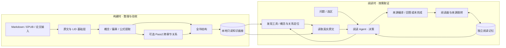

# Understand Book

**让复杂知识更容易学懂，让好的教学更容易被创造。**

Understand Book 从书籍、课程和学习者自己的问题出发，探索一种有讲解、有动手尝试、有针对性反馈，也能持续复盘的学习方式。

我们相信，好的教学能够降低学习门槛：帮助学习者找到适合的路径，把陌生概念讲到可以跟随，并根据真实的理解与困惑调整下一步。学习的进展，体现在一个人逐渐能够自己解释、判断和应用所学。

我们希望借助 Agent 降低教学内容与工具的制作成本，让更多具体的学习问题，都能得到合适的例子、实验、可视化和练习。我们欢迎任何领域的学习者、教师、研究者与开发者一起参与，把自己的知识和经验变成他人能够学懂、动手尝试的内容。

[教学原则](#教学原则) · [教学示例](#教学示例) · [Quick Start](#quick-start) · [参与贡献](#参与贡献) · [技术实现](#30-秒技术摘要) · [实测结果](#实测而不是预设胜出) · [当前限制](#当前限制)

## 教学原则

- **从真实问题开始，降低起步门槛。** 围绕学习者想弄明白的问题安排路径，从具体对象和可跟随的例子开始，提供必要的背景与支撑。学习计划随目标、理解和可用时间调整。
- **先猜后验，让判断有机会改变。** 给出足够的条件，邀请学习者先作预测，再通过实验、计算、原文或推导检验，并说清哪些观察改变了原来的想法。
- **通过交互与可视化理解过程。** 让学习者改变条件、观察结果、表达自己的解释；用图形、模型或可运行代码呈现对象与变化，让每一步怎样产生结果变得可见。
- **用反馈决定下一步。** 回应学习者实际说出或做出的内容，指出已经成立的理解、尚未接通的关系，再提供有针对性的讲解、示范或下一次尝试。
- **复盘理解的变化，逐步独立运用。** 回看“原来怎么想、什么证据改变了判断、现在能够解释什么”，并在新的问题中尝试运用。后续教学承接这些真实表现。

教学方法服务于当前需要。需要示范时先示范，提出明确问题时先把问题讲清楚；学习者可以直接求助、插问、暂停和改变方向。预测、探索和练习的安排，以当下是否有助于理解为依据。

## 为具体问题制作教学工具

Agent 让我们可以尝试为一个具体的理解困难，制作一件专门的教学工具。一个可操作的小实验、一段可以修改并运行的代码，都能成为讲解的一部分。

一个值得共建的例子是**简易 CPU 教学代码与演示**：用少量指令构成一台可以单步运行的教学 CPU，让学习者先预测一小段程序运行后的结果，再观察指令、寄存器和内存的变化，最后改一条指令，解释结果为什么不同。如果学习者混淆了“地址”和“地址里存的数”，就围绕这个困难安排一次对照实验。

同样的思路可以用于概率实验、机械运动、音乐聆听，以及更多领域。教学工具围绕明确的理解目标设计，讲解和反馈依据学习者的实际尝试继续展开。

## 教学示例

以下示例展示项目已有的交互讲解、作答反馈和阅读入口。各自的运行条件与使用方法见链接。

| 示例 | 可以怎样学习 | 体验方式 |
| --- | --- | --- |
| [齿轮的约定](examples/gear-transmission/README.md) | 改变齿数、拖动齿轮，从三维模型与二维图解观察转速、扭矩和啮合关系 | 独立网页，按示例说明在本地启动 |
| [最优化期末练习](examples/optimization-practice/README.md) | 写出思路、就某一步求助、提交答案，再根据具体反馈改答 | 使用阅读器，需要对应的已构建教材与模型配置 |
| [原创阅读演示](examples/quickstart/book.md) | 阅读原文、添加笔记与高亮，配置模型后围绕选区提问 | 按下方 Quick Start 启动；基础阅读无需模型 |

## Quick Start

Windows 本地完整运行时 debug 包见[本地 Debug 使用与构建说明](apps/local-debug/README.md)：本机运行 Reader 和 AI 引擎，在设置中配置自己的模型接口，无需连接线上业务服务器。

源码启动需要 **Node.js 22+、pnpm、Rust 工具链**。从仓库根目录执行：

```powershell
pnpm install
pnpm demo:prepare
pnpm build
cargo run -p server --bin server -- .understand-book/quickstart-demo
```

打开终端给出的本地地址，默认 [localhost:8787](http://127.0.0.1:8787)。这条路径不调用模型，可以直接阅读、添加笔记与高亮；首次 Rust 编译需要时间。若端口被占用，先设置 `$env:UNDERSTAND_BOOK_ADDR = "127.0.0.1:8788"`。

要启用 AI 回答，将 [.env.example](.env.example) 复制为 `.env`，填入所选服务的密钥、Base URL 与模型 ID，重启服务。模型调用会将问题与选取的原文发送给该服务，并产生相应费用。

已有完整书库可直接替换最后一项路径，例如：

```powershell
cargo run -p server --bin server -- .understand-book/quantification-essence
```

原书不随仓库分发。新书构建与 Windows 打包见[预构建说明](docs/预购建流程.md)和[桌面发行说明](apps/desktop/README.md)。生成原创演示使用真实分段器，但不调用模型，不代替正式预构建。

网站、云端与本地阅读器、桌面本机书库支持中文和 English，可在页面的语言菜单切换；管理后台保持中文。默认中文，选择保存在当前浏览器，分享链接也可使用 `?lang=en` 或 `?lang=zh-CN`。切换会重新载入当前页面。


*真实服务与生产前端截图。演示文本、笔记为原创，图谱为预设样例；语义评测使用独立的真实书库。*

## 参与贡献

我们欢迎任何领域的知识教学，也欢迎学习者带着自己的问题参与。贡献可以从一个具体的理解困难开始：

- **提出问题与困惑。** 告诉我们你想学会什么、卡在哪一步、当时怎样理解；附上相关材料位置或可以重现的例子，帮助我们改进讲解。
- **分享教学内容。** 贡献一个讲清概念的例子、一段推导、一组有启发的问题或一份课程。说明面向谁、需要什么基础，以及希望学习者能够解释或完成什么。
- **制作交互工具。** 让学习者可以改变条件、观察结果、验证预测。可以从现有齿轮示例出发，也可以带来自己领域的新实验。
- **改进反馈与学习体验。** 分享实际试学中的发现，改进练习、复盘、文档、翻译、界面或代码。

可以先在 [Issues](https://github.com/adaelon/undertand-book/issues) 描述问题或教学想法；已有内容和实现可以通过 [Pull Request](https://github.com/adaelon/undertand-book/pulls) 提交。教学内容请注明来源与使用许可，并写清运行或使用方法。学习者的困惑、一个有效的例子、一处讲解修正，都可以帮助后来的人更容易迈出下一步。

## 30 秒技术摘要

Rust · TypeScript · Vue 3 · Tauri 2 · MCP

将长文整理为可定位、可关联的知识底座，为讲解、查证与持续学习提供支撑。

- **构建时整理知识，阅读时按需取证。** 原文切分为稳定的 LID 层级，构建概念/断言图、篇章关系、公式语义与全书结构；读时先定位，再取原文，最后回答。
- **图谱用于找证据，原文用于支持回答。** MCP 与 Reader 共用 Rust 读取工具；来源定位、模型补充与证据不足有明确边界。
- **把阅读当作持续过程。** Reader 与 Agent 共享视口和选区，笔记、高亮、位置与会话独立持久化。TypeScript 负责预构建，Rust 负责读取/运行时，Vue 提供阅读界面，Tauri 封装本地桌面应用。

## 双时序架构



构建是有成本的离线准备；阅读不把整本书塞进每一轮上下文。源码入口：[构建编排](packages/core/src/build-orchestrator.ts)、[读时工具](crates/read-tools/src/lib.rs)、[Agent 运行时](crates/runtime/src/orchestrator.rs)、[Reader 服务](crates/server/src/lib.rs)、[前端](packages/web/src/App.vue)。

## 实测，而不是预设胜出

使用完整的 `quantification-essence` 书库，32 题覆盖原文定位、概念解释、跨章节、对比、公式、来源跳转、拒绝与重启。其中 **24 道共同问答**比较普通 Chunk RAG 与完整生产 Agent；4 道实际跳转、4 道 Agent 重启恢复单列。

下表为 **2026-09-08 修复前基线**，模型 `deepseek-v4-flash`，每系统每题一次。Agent 走真实 `/agent/chat`，自主搜索、发现工具、回读、修复和交付；评测器不提供检索种子或参考答案。逐题数据见[完整报告](https://github.com/adaelon/understand-book/blob/625b4405af3b011e87d4eb256f819c8075f88613/evals/semantic/results/2026-09-08-agent-v1/report.md)，方法见[评测协议](evals/semantic/AGENT_EVAL.md)。

| 系统 | 证据召回 | 引用支持率¹ | 任务成功率¹ | P95 延迟 | 单任务 Token（均值） |
| --- | ---: | ---: | ---: | ---: | ---: |
| Chunk RAG（BM25，单轮） | 84.6% | 88.5% | 91.7%（22/24） | 12.18 s | 4,260 |
| LID + Graph（完整 Resident Agent） | 88.5% | 53.8% | 54.2%（13/24） | 118.60 s | 88,425 |

Agent 在本轮多覆盖了一组参考证据，但没有转化为更好的交付：内容正确率为 **79.2%**，其中 6 题内容正确却没有有效引用，另有 4 题未完成和 1 次最终交付协议错误。共同问答实际发生 **199 次 Agent 模型请求**，所有循环和修复均计入用量。

Agent 专属动作测试中，来源跳转为 **0/4**；四道重启任务的保存/定位准备均未完成，完整恢复为 **0/4**，不能据此断定持久化层丢失数据。正式运行共 325 次被测模型请求，另有 51 次独立判分；重启测试的一条后台画像请求缺失用量，单列为 N/A。

已根据评测修复“普通编号列表被误认成根 LID”的交付误报，25 项来源相关回归通过，修复后的[真实单题验证](https://github.com/adaelon/understand-book/blob/625b4405af3b011e87d4eb256f819c8075f88613/evals/semantic/results/2026-09-08-list-marker-fix-probe/report.md)也通过。动作权限传播和无进展恢复仍需改进；单题结果不反写基线。详见[失败链路与改进](evals/semantic/agent-findings.md)，原来的两轮[固定检索消融](evals/semantic/README.md)作为独立实验保留。

后续 [LA7 完整回归](https://github.com/adaelon/understand-book/blob/625b4405af3b011e87d4eb256f819c8075f88613/evals/semantic/results/2026-09-08-la7/report.md)为 Agent 15/24、Chunk 20/24，实际跳转与重启恢复均 4/4；同时满足回答、引用和动作的来源题为 1/4。后续独立来源修复及真实前端连续阅读七阶段结果见 [LA7–LA10 实施与验收](docs/LA7-LA10实施与验收.md)，不替换上面的旧基线或固定全量样本。

[LA9 同环消融](https://github.com/adaelon/understand-book/blob/625b4405af3b011e87d4eb256f819c8075f88613/evals/semantic/results/2026-09-08-la9-v2/report.md)使用相同循环与预算，每组24题：Text 10/24、Tree 11/24、Graph 9/24。Graph 相对 Tree 新增2道成功、失去4道，本次单书结果没有支持扩大图谱默认使用；具体定位路径、成本、标注偏差与预构建成本限制见[裁决](docs/LA7-LA10实施与验收.md#la9-完整结果与裁决)。

¹ 引用支持率是必要事实中“结论正确且有有效原文引用支持”的比例；无引用计不支持。成功要求全部必要事实与引用通过，拒绝题要求明确不臆造。自然答案由独立模型标注，再核对金标准值、真实答句与引用；来源引用必须能被生产服务解析。参考证据召回、引用支持及完整成功的分母不同，详见协议。

## 当前限制

- **教学效果仍在验证。** 课程、练习、反馈与接续已有实现，真实模型的教学质量和首次使用者体验仍有待验收；具体进展见[学习主线实施记录](docs/实施记录-学习主线与课程入口.md)。
- **评测仍是开发集。** 单书 32 题、每系统一次/题，没有独立盲测或置信区间。语义标注器与被测系统使用同一模型家族；核心事实正确不等于整篇答案无幻觉或教学效果好。延迟来自仍有开发负载的本地设备，不是线上 SLA。
- **基线是产品级对照。** Chunk 是 6000 字符证据预算的单轮 BM25 RAG；Agent 使用生产提示、默认多轮策略与动态工具，预算不同。差异不能单独归因于图谱。另有 LA9 受限工具面的同环消融，但仅是单书单次开发集；尚未比较向量/混合检索或 reranker。
- **自主动作尚有缺口。** 普通跳转/笔记请求的写入权限传播、来源交付、失败后的恢复仍有实测问题。重启评测区分准备失败与持久化失败，不把直接接口 4/4 的旧结果当作自主 Agent 记忆成功率。
- **输入质量决定上限。** PDF/OCR、公式和表格的来源对齐可能存在未解析片段；原文定位能力与语义提取质量需要分别验收。预构建中断后的结果不能只凭文件存在就视为完整。
- **本地优先不等于全离线。** 原书和阅读记录保存在本地，模型推理需要配置外部服务；请根据资料敏感程度选择服务。桌面设置当前将 API key 保存在本机配置文件中。
- **工程仍在迭代。** Windows 桌面、安装程序和插件需保持匹配；旧控制协议的接续由构建引擎判断，公开发布状态以发行说明为准。

## 开发与配置

### 界面语言

界面文案使用 `packages/i18n/src/en.json` 中的英文目录，通过 `packages/web/src/i18n.ts` 的 `t` 读取。英文模式下，每次 Agent 请求固定携带 `response_language: "en"`，排队、重试、普通回答、教学和生成演示均使用这次选择；PDF 划词翻译以当前界面语言为目标。原始资料、直接引文、代码和已有历史内容保留原文。新增界面文案需同时补齐英文目录及插值参数。

### 代码与文档只读 MCP

开发者可通过[代码与文档只读 MCP](docs/代码只读MCP.md)让 ChatGPT 查看当前获准源码、设计文档与未提交差异，辅助架构分析。

<details>
<summary>可选 LangSmith 元数据观测：配置与运行边界</summary>

### 可选 LangSmith 元数据观测

Resident Agent 的开发者观测默认关闭。只有本项目自己的 `UB_OBSERVABILITY_MODE=metadata` 会开启发送；仅存在 `LANGSMITH_API_KEY` 或 `LANGSMITH_TRACING=true` 不会自动外发。开启时配置：

```powershell
$env:UB_OBSERVABILITY_MODE = "metadata"
$env:LANGSMITH_API_KEY = "..."
$env:LANGSMITH_PROJECT = "understand-book-dev"
# 区域或自管部署时覆盖；默认 https://api.smith.langchain.com
$env:LANGSMITH_ENDPOINT = "https://api.smith.langchain.com"
# 一个 key 关联多个 workspace 时设置
$env:LANGSMITH_WORKSPACE_ID = "..."
```

Resident metadata 发送执行树、三轴终态、基本耗时、Provider 报告的用量细分、首字/首个安全答案补丁时间、证据接纳坐标、最终来源引用和交付/请求诊断计数；inputs/outputs 为空，不发送问题、回答、工具参数/结果、来源预览、选区、画像、Provider 错误体或呈现 HTML。可用 `GET /observability/status` 查看启用、排队、发送、丢弃及规范错误状态，其中不含密钥或端点。

可选设置 `UB_OBSERVABILITY_SPOOL_DIR` 启用已过滤记录的持久 spool；默认上限为 64 MiB、4096 个文件、保留 24 小时，可分别用 `UB_OBSERVABILITY_SPOOL_MAX_BYTES`、`UB_OBSERVABILITY_SPOOL_MAX_FILES`、`UB_OBSERVABILITY_SPOOL_RETENTION_HOURS` 调整。spool 必须位于书库、构建 lease 和 Memory 真相源之外。崩溃重启只重放观测，未闭合根按最后已观察时间标记 `interrupted`，不会重跑模型或工具。项目、区域或 workspace 改变时默认把旧队列隔离；只有一次性显式设置 `UB_OBSERVABILITY_SPOOL_TARGET_CHANGE=replay` 或 `drop` 才会重投或删除。关闭模式清理本项目拥有的未发送 spool 文件，不撤回已上传数据。

未配置 spool 时 Resident 队列只驻留内存，进程崩溃可能丢失；两种模式的退出都只在两秒预算内冲刷，也都不是 exactly-once。预构建回执可由显式开发/诊断调用只读导出；评测导入另需显式 `eval_content` 授权和每个产品样本的真实绝对时间，旧的 elapsed-only 报告不会发送。Harness 未落账调用仍不在统计内，不能把当前 token 字段当作全应用账单。真实 LangSmith 租户联调尚未执行。

</details>

## 深入项目

- [书籍与成套课程的学习层级](docs/adr/0185-book-and-course-collection-learning-hierarchy.md) · [实施记录](docs/实施记录-书籍与成套课程入口.md)（以书籍／整套课程组织入口、单元目录与原任务归属）
- [学习主线与课程入口 ADR](docs/adr/0184-task-led-learning-entry-and-continuity.md) · [切片方案](docs/切片方案-学习主线与课程入口.md) · [实施与验收记录](docs/实施记录-学习主线与课程入口.md)（入口、任务、反馈回课与验收状态）
- [云端学习与考试冲刺产品方案](docs/产品方案-云端学习与考试冲刺.md) · [实施计划](docs/实施计划-云端学习与考试冲刺.md) · [运行说明](docs/运行说明-云端学习与考试冲刺.md)（云端账号、套餐、空间与课程实施及验收状态）
- [完整 Agent 评测方法与复现](evals/semantic/AGENT_EVAL.md)
- [架构与设计决策](docs/架构.md)
- [工具接口](docs/book工具.md)
- [原创演示文本](examples/quickstart/book.md)
- [构建控制面实测](https://github.com/adaelon/understand-book/blob/625b4405af3b011e87d4eb256f819c8075f88613/docs/performance/understand-book-v1-release.md)
