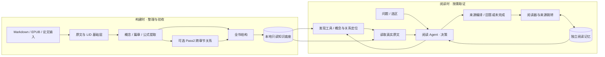

# Understand Book

**让复杂知识更容易学懂，让好的教学更容易被创造。**

Understand Book 从书籍、课程和学习者自己的问题出发，探索一种有讲解、有动手尝试、有针对性反馈，也能持续复盘的学习方式。

我们相信，好的教学能够降低学习门槛：帮助学习者找到适合的路径，把陌生概念讲到可以跟随，并根据真实的理解与困惑调整下一步。学习的进展，体现在一个人逐渐能够自己解释、判断和应用所学。

我们希望借助 Agent 降低教学内容与工具的制作成本，让更多具体的学习问题，都能得到合适的例子、实验、可视化和练习。我们欢迎任何领域的学习者、教师、研究者与开发者一起参与，把自己的知识和经验变成他人能够学懂、动手尝试的内容。

[教学原则](#教学原则) · [教学示例](#教学示例) · [学习材料](#下载学习材料) · [Quick Start](#quick-start) · [参与贡献](#参与贡献) · [技术实现](#30-秒技术摘要) · [当前限制](#当前限制)

## 教学原则

- **从真实问题开始，降低起步门槛。** 围绕学习者想弄明白的问题安排路径，从具体对象和可跟随的例子开始，提供必要的背景与支撑。学习计划随目标、理解和可用时间调整。
- **先猜后验，让判断有机会改变。** 给出足够的条件，邀请学习者先作预测，再通过实验、计算、原文或推导检验，并说清哪些观察改变了原来的想法。
- **通过交互与可视化理解过程。** 让学习者改变条件、观察结果、表达自己的解释；用图形、模型或可运行代码呈现对象与变化，让每一步怎样产生结果变得可见。
- **用反馈决定下一步。** 回应学习者实际说出或做出的内容，指出已经成立的理解、尚未接通的关系，再提供有针对性的讲解、示范或下一次尝试。
- **复盘理解的变化，逐步独立运用。** 回看“原来怎么想、什么证据改变了判断、现在能够解释什么”，并在新的问题中尝试运用。后续教学承接这些真实表现。

教学方法服务于当前需要。需要示范时先示范，提出明确问题时先把问题讲清楚；学习者可以直接求助、插问、暂停和改变方向。预测、探索和练习的安排，以当下是否有助于理解为依据。

## 为具体问题制作教学工具

Agent 让我们可以尝试为一个具体的理解困难，制作一件专门的教学工具。一个可操作的小实验、一段可以修改并运行的代码，都能成为讲解的一部分。

一个值得共建的例子是**简易 CPU 教学代码与演示**：用少量指令构成一台可以单步运行的教学 CPU，让学习者先预测一小段程序运行后的结果，再观察指令、寄存器和内存的变化，最后改一条指令，解释结果为什么不同。如果学习者混淆了“地址”和“地址里存的数”，就围绕这个困难安排一次对照实验。

同样的思路可以用于概率实验、机械运动、音乐聆听，以及更多领域。教学工具围绕明确的理解目标设计，讲解和反馈依据学习者的实际尝试继续展开。

## 教学示例

以下示例展示项目已有的交互讲解、作答反馈和阅读入口。各自的运行条件与使用方法见链接。

| 示例 | 可以怎样学习 | 体验方式 |
| --- | --- | --- |
| [齿轮的约定](examples/gear-transmission/README.md) | 改变齿数、拖动齿轮，从三维模型与二维图解观察转速、扭矩和啮合关系 | 独立网页，按示例说明在本地启动 |
| [最优化期末练习](examples/optimization-practice/README.md) | 写出思路、就某一步求助、提交答案，再根据具体反馈改答 | 使用阅读器，需要对应的已构建教材与模型配置 |
| [原创阅读演示](examples/quickstart/book.md) | 阅读原文、添加笔记与高亮，配置模型后围绕选区提问 | 按下方 Quick Start 启动；基础阅读无需模型 |

## 下载学习材料

原书、音频、乐谱与对应的阅读预构建数据已整理为可下载的资料包。解压后可以直接用本地阅读器打开，目录选择、材料来源与预构建范围见[学习材料说明](materials/README.md)。

| 材料 | 下载 |
| --- | --- |
| 最优化方法 I：复习讲义与历年考试题，含 Markdown、PDF 与预构建 | [下载 ZIP · 1.4 MiB](https://github.com/adaelon/understand-book/releases/download/learning-materials-2026-11-16/optimization-review.zip) |
| 贝多芬第九交响曲全部四个乐章，含音频、乐谱与音乐预构建 | [下载 ZIP · 311.1 MiB](https://github.com/adaelon/understand-book/releases/download/learning-materials-2026-11-16/beethoven-symphony-9.zip) |
| 深入理解 AI Infra：量化分析与系统设计，含原书、插图与预构建 | [下载 ZIP · 15.7 MiB](https://github.com/adaelon/understand-book/releases/download/learning-materials-2026-11-16/ai-infra-book.zip) |
| A Survey of Agent Memory in the Second Half，含原 PDF 与阅读预构建 | [下载 ZIP · 22.5 MiB](https://github.com/adaelon/understand-book/releases/download/learning-materials-2026-11-16/agent-memory-paper.zip) |

## Quick Start

Windows 本地完整运行时 debug 包见[本地 Debug 使用与构建说明](apps/local-debug/README.md)：本机运行 Reader 和 AI 引擎，在设置中配置自己的模型接口，无需连接线上业务服务器。

源码启动需要 **Node.js 22+、pnpm、Rust 工具链**。从仓库根目录执行：

```powershell
pnpm install
pnpm demo:prepare
pnpm build
cargo run -p server --bin server -- .understand-book/quickstart-demo
```

打开终端给出的本地地址，默认 [localhost:8787](http://127.0.0.1:8787)。这条路径不调用模型，可以直接阅读、添加笔记与高亮；首次 Rust 编译需要时间。若端口被占用，先设置 `$env:UNDERSTAND_BOOK_ADDR = "127.0.0.1:8788"`。

要启用 AI 回答，将 [.env.example](.env.example) 复制为 `.env`，填入所选服务的密钥、Base URL 与模型 ID，重启服务。模型调用会将问题与选取的原文发送给该服务，并产生相应费用。

已有预构建书库可将启动命令末尾的路径替换为实际书库目录。

现成原书与预构建可从上方资料包下载。准备自己的资料与 Windows 打包见[预构建说明](docs/预购建流程.md)和[桌面发行说明](apps/desktop/README.md)。生成原创演示使用真实分段器，但不调用模型，不代替正式预构建。

网站、云端与本地阅读器、桌面本机书库支持中文和 English，可在页面的语言菜单切换；管理后台保持中文。默认中文，选择保存在当前浏览器，分享链接也可使用 `?lang=en` 或 `?lang=zh-CN`。切换会重新载入当前页面。

## 参与贡献

我们欢迎任何领域的知识教学，也欢迎学习者带着自己的问题参与。贡献可以从一个具体的理解困难开始：

- **提出问题与困惑。** 告诉我们你想学会什么、卡在哪一步、当时怎样理解；附上相关材料位置或可以重现的例子，帮助我们改进讲解。
- **分享教学内容。** 贡献一个讲清概念的例子、一段推导、一组有启发的问题或一份课程。说明面向谁、需要什么基础，以及希望学习者能够解释或完成什么。
- **制作交互工具。** 让学习者可以改变条件、观察结果、验证预测。可以从现有齿轮示例出发，也可以带来自己领域的新实验。
- **改进反馈与学习体验。** 分享实际试学中的发现，改进练习、复盘、文档、翻译、界面或代码。

可以先在 [Issues](https://github.com/adaelon/understand-book/issues) 描述问题或教学想法；已有内容和实现可以通过 [Pull Request](https://github.com/adaelon/understand-book/pulls) 提交。教学内容请注明来源与使用许可，并写清运行或使用方法。学习者的困惑、一个有效的例子、一处讲解修正，都可以帮助后来的人更容易迈出下一步。

## 30 秒技术摘要

Rust · TypeScript · Vue 3 · Tauri 2 · MCP

将长文整理为可定位、可关联的知识底座，为讲解、查证与持续学习提供支撑。

- **构建时整理知识，阅读时按需取证。** 原文切分为稳定的 LID 层级，构建概念/断言图、篇章关系、公式语义与全书结构；读时先定位，再取原文，最后回答。
- **图谱用于找证据，原文用于支持回答。** MCP 与 Reader 共用 Rust 读取工具；来源定位、模型补充与证据不足有明确边界。
- **把阅读当作持续过程。** Reader 与 Agent 共享视口和选区，笔记、高亮、位置与会话独立持久化。TypeScript 负责预构建，Rust 负责读取/运行时，Vue 提供阅读界面，Tauri 封装本地桌面应用。

## 双时序架构



构建是有成本的离线准备；阅读不把整本书塞进每一轮上下文。源码入口：[构建编排](packages/core/src/build-orchestrator.ts)、[读时工具](crates/read-tools/src/lib.rs)、[Agent 运行时](crates/runtime/src/orchestrator.rs)、[Reader 服务](crates/server/src/lib.rs)、[前端](packages/web/src/App.vue)。

## 当前限制

- **课程覆盖以已提供内容为准。** 书籍和成套课程的目录展示已有单元与课时；完整学习对象与已完成课程的范围见[学习层级说明](docs/adr/0185-book-and-course-collection-learning-hierarchy.md)。
- **教学效果仍在验证。** 课程、练习、反馈与接续已有实现，真实模型的教学质量和首次使用者体验仍有待验收；具体进展见[学习主线实施记录](docs/实施记录-学习主线与课程入口.md)。
- **本地功能与云端功能各有运行条件。** 本地阅读器使用本机书库和配置的模型接口；线上账号、订阅和共享课程由云端服务提供。完整资料准备还需要相应执行器与格式工具，见[本地运行说明](apps/local-debug/README.md)。

## 开发与配置

### 界面语言

界面文案使用 `packages/i18n/src/en.json` 中的英文目录，通过 `packages/web/src/i18n.ts` 的 `t` 读取。英文模式下，每次 Agent 请求固定携带 `response_language: "en"`，排队、重试、普通回答、教学和生成演示均使用这次选择；PDF 划词翻译以当前界面语言为目标。原始资料、直接引文、代码和已有历史内容保留原文。新增界面文案需同时补齐英文目录及插值参数。

### 代码与文档只读 MCP

开发者可通过[代码与文档只读 MCP](docs/代码只读MCP.md)让 ChatGPT 查看当前获准源码、设计文档与未提交差异，辅助架构分析。

### 开发观测

可选运行观测的配置见 [.env.example](.env.example)，运行追踪与用量查询的维护说明见 [LangSmith 接入维护](docs/langsmith-smithdb-migration.md)。

## 深入项目

- [书籍与成套课程的学习层级](docs/adr/0185-book-and-course-collection-learning-hierarchy.md) · [实施记录](docs/实施记录-书籍与成套课程入口.md)（以书籍／整套课程组织入口、单元目录与原任务归属）
- [学习主线与课程入口 ADR](docs/adr/0184-task-led-learning-entry-and-continuity.md) · [切片方案](docs/切片方案-学习主线与课程入口.md) · [实施与验收记录](docs/实施记录-学习主线与课程入口.md)（入口、任务、反馈回课与验收状态）
- [云端学习与考试冲刺产品方案](docs/产品方案-云端学习与考试冲刺.md) · [实施计划](docs/实施计划-云端学习与考试冲刺.md) · [运行说明](docs/运行说明-云端学习与考试冲刺.md)（云端账号、套餐、空间与课程实施及验收状态）
- [架构与设计决策](docs/架构.md)
- [工具接口](docs/book工具.md)
- [原创演示文本](examples/quickstart/book.md)
