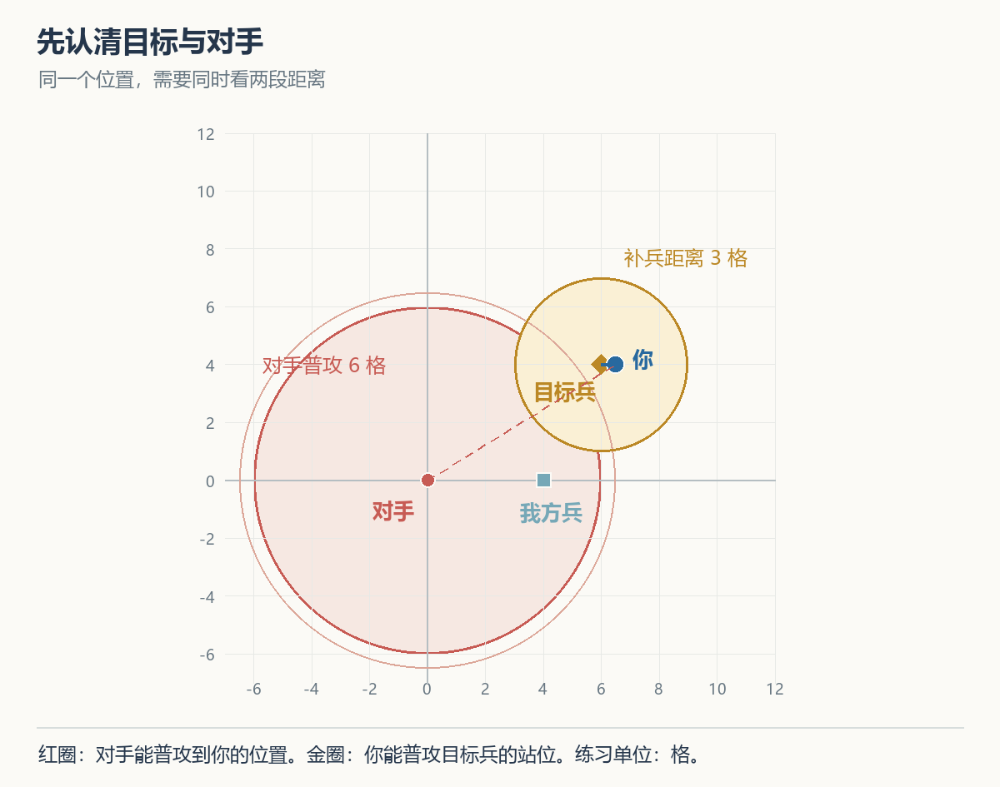
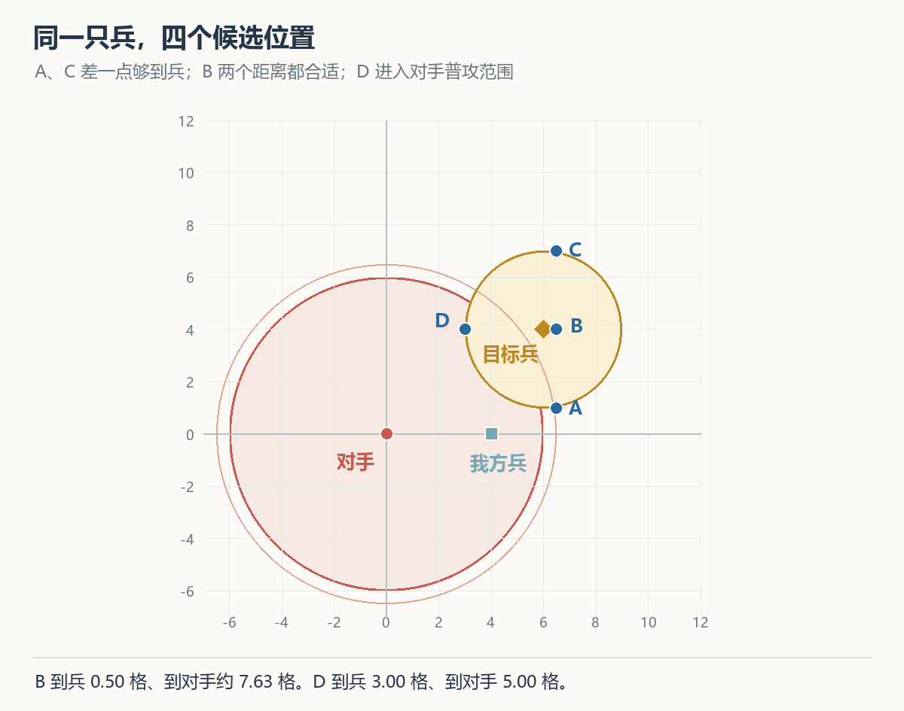
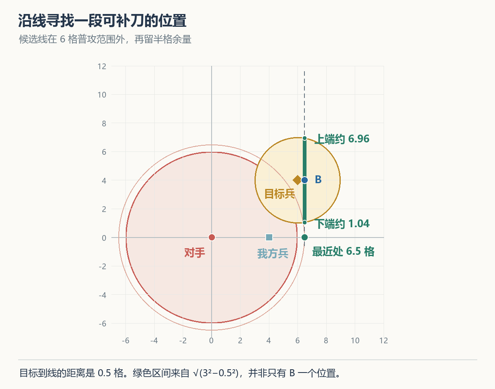
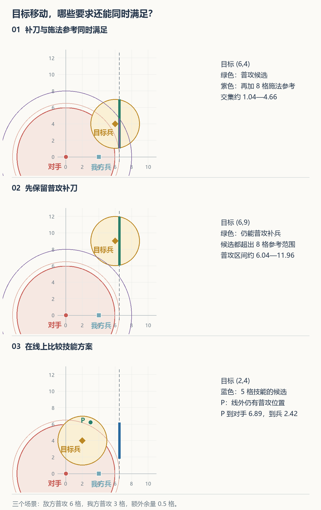
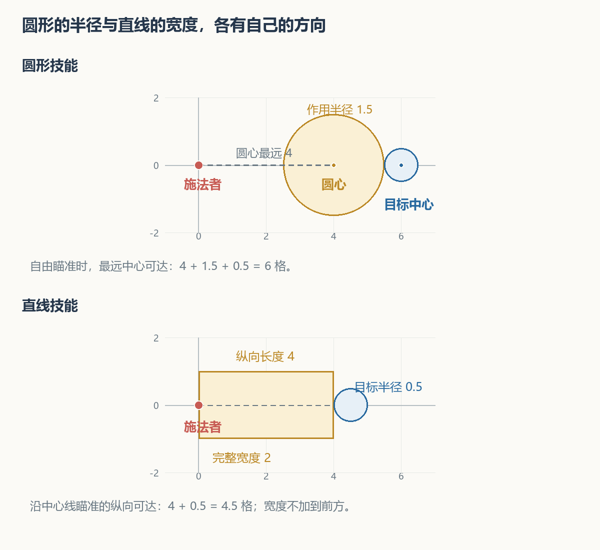
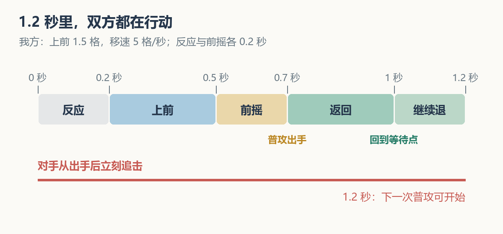
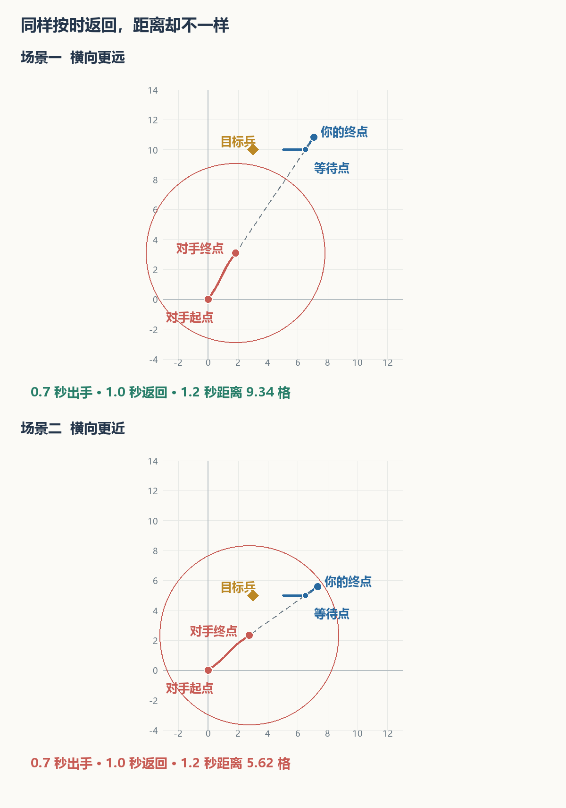
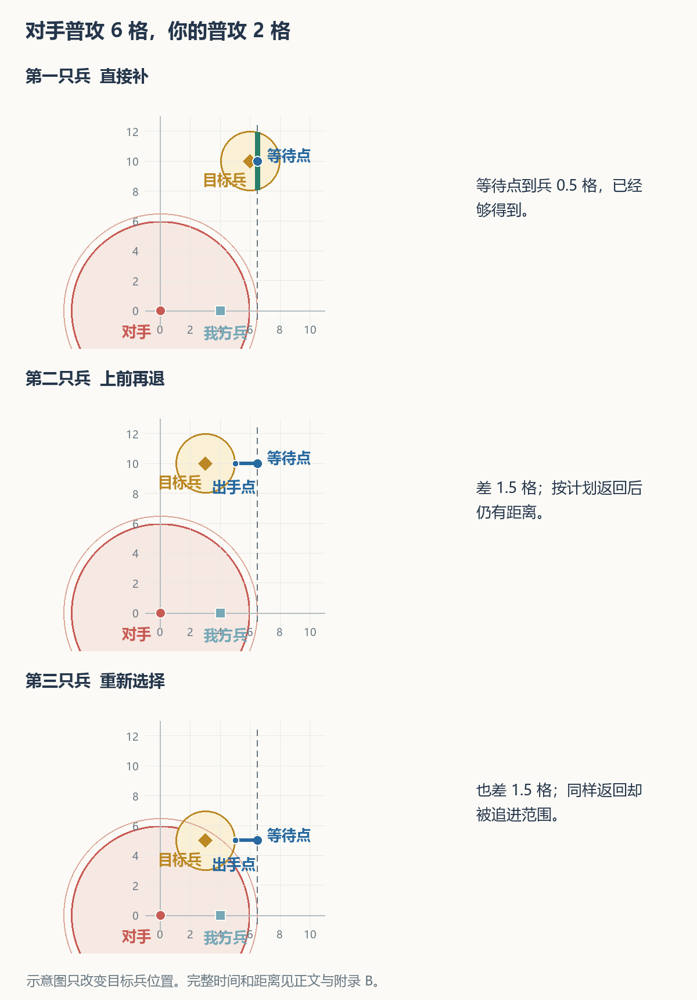

# 这一刀怎么补

看懂对线站位与出手机会

## 导读 先把这一刀看清楚

一只小兵快死了。你往前走，停下，普攻出手，再往后退。等你回到原来的位置，血条也少了一截。

你可能会把这件事归结为手速慢，或者对面的英雄手太长。可下一次，双方英雄都没换，你只是提前往旁边站了一点，同样的一刀却补得舒服多了。

差别藏在几个很小的地方：兵在哪边，对手离它多远，你从哪里出发，以及对手上一发普攻究竟进行到了哪一步。

这本书把这些地方逐个放大。我们会像暂停一段回放那样，先看位置，再让时间继续走，观察双方接下来能做什么。读到最后，希望你能解释自己的选择：为什么站这里，为什么现在上前，为什么这一刀值得等一等。

### 一张图里先认清四个角色

图中的红色圆点代表对手，蓝色圆点代表你。浅蓝色方块是对手准备攻击的我方小兵，金色菱形是你想补掉的敌方小兵。提到“目标兵”时，通常指后者。



图 1：红点与金色目标兵分别决定两种距离。你需要靠近目标，同时留意与对手的间隔。图中所有圆都按单位中心之间的有效距离绘制。

地图上的形状会随单位移动变化。书里的图会先把它们停住，让一个关系足够清楚，再改变一个条件。这样比较，你更容易知道结果究竟为什么变了。

### 书中的一格有多长

正文使用“格”作为练习单位。比如对手普攻范围是 6 格，你的普攻范围是 3 格，移动速度是每秒 5 格。这些是为了方便观察而选定的数字，不对应某个版本、某名英雄的整套属性。

这些攻击范围已经换成了单位中心之间的有效距离，包含该算例采用的体积处理。以后使用真实资料时，需要先弄清射程从哪里量起；附录会说明怎么换算。

读图时可以把格子想成一把临时的尺。图放大一倍，所有长度和每秒移动距离一起放大，判断仍然相同；一秒钟还是一秒钟。

### 从位置开始，再把时间放进来

前四章先研究一个定格画面：哪里够得到兵，哪里会被对手普攻到，技能又改变了哪些选择。第五章开始播放画面，计算上前、出手、回撤，以及对手追过来的过程。第六、七章把这些关系连起来，放回一段对线的思考中。

正文会用到圆、距离和简单的时间加减。遇到计算，可以先读结果和图，想一想它为什么会变。附录 A 给出完整模型，附录 B 给出随书代码与所有算例参数；想自行复算时，可以从那里进入。

第一章就从那次熟悉的经历开始：明明已经点到小兵，为什么还是挨了一下？

## 第一章 为什么一补刀就挨打

你看见残血兵，鼠标已经移过去了。注意力落在它还剩多少血、自己的普攻什么时候能打出来。对手看见的则是另一件事：你马上要为了这只兵靠近，并在攻击时短暂停留。

同一只兵，把两个人的动作连接起来了。

要理解这一刀，先把画面停在你决定上前的时刻。此时有两个不同的距离值得看：你离目标兵多远，你离对手多远。前者决定你的攻击是否够得到目标，后者决定对手是否够得到你。

### 两个圆之间的位置

设想对手的普攻能打到 6 格以内的你。以对手为中心画一个红圈，圈内的位置都值得警惕。再设想你能攻击 3 格以内的目标兵。围绕目标兵画一个半径 3 格的金圈：只要你的中心进入这个金圈，距离上就够得着这只兵。

第二个圆虽然画在小兵身上，表达的却是你的可选站位。因为“你离兵不超过 3 格”与“兵离你不超过 3 格”说的是同一段距离。把圆画在那里，能让我们同时比较许多位置。

两个圆可能相交，也可能隔开。金圈中落在红圈外的部分，提供了一种很有用的机会：你可以靠近目标兵，同时与对手保持超过其普攻范围的距离。

这也解释了为什么射程较短的一方仍可能补到某些兵。目标兵如果出现在远离对手的一侧，它周围的一部分位置就可能离对手很远。射程差是真实条件，小兵的位置同样会改变局面。

### 四个位置，四种感受

回到导读的图。对手位于左侧，目标兵在其右上方。我们比较 A、B、C、D 四个站位。它们采用同一组练习参数：对手普攻 6 格，你的普攻 3 格。



图 2：能否补刀与是否进入对手普攻范围，要分别看。表中的距离由图中坐标计算。

| 站位 | 离目标兵 | 离对手 | 在这个定格画面中的含义 |
| --- | ---: | ---: | --- |
| A | 约 3.04 格 | 约 6.58 格 | 超出对手普攻范围，但自己还差一点才能碰到兵 |
| B | 0.50 格 | 约 7.63 格 | 普攻距离足够，也与对手拉开了距离 |
| C | 约 3.04 格 | 约 9.55 格 | 离对手更远，目标兵却也够不到了 |
| D | 3.00 格 | 5.00 格 | 距离上刚能补兵，同时也进入了对手普攻范围 |

如果只看“离对手越远越好”，容易选到 C；如果只看“攻击指令已经能下达”，又容易忽略 D 的风险。B 的价值来自它同时满足了两个条件。

图中的 D 恰好在你的补兵边界上。实战中贴着边缘操作，会受到位置判断和单位移动的影响。提前留出一点距离余量，能减少刚觉得够得到、实际却还得向前挪一步的情况。

### 站得远，还要看下一步往哪里走

现在把画面播放一小段。你从 A 走向 B，对手也可能改变位置。原来的红圈会跟着对手移动，目标兵周围的金圈也会跟着兵移动。

因此，“B 在这张图里满足条件”回答的是此刻的站位关系。你从当前位置到 B 的路线，还需要单独观察。终点很好，不等于沿途每一步都一样舒服。

这件事在补刀前尤其容易被忽略。人在残血兵出现时才开始找位置，往往要临时走一段路；如果在它还没残血时已经调整到合适方向，真正出手时需要移动的距离就可能更短。你争取到的，是更从容的起点。

我们可以把刚才挨打的一刀倒放：在攻击出手前，你究竟是哪一步进入了红圈？是开始时就站得太近，还是点击目标后又自动往前走了几步？弄清这一点，比把整段经历归为“反应慢”更有用。

### 给普攻范围再留一点空隙

接下来的图里，我们会在对手的 6 格普攻圈外，再留出 0.5 格。这样，候选位置至少要与对手相隔 6.5 格。

这半格是练习中主动选定的余量。它帮助我们看清“正好在边缘”和“确实隔开了一段”之间的差别。选得更大，会压缩能补刀的位置；选得更小，则更靠近边界。具体留多少，要结合局面和你对距离的把握。

至此，你已经能用两个距离解释一次补刀。但还有一只兵尚未进入分析：对手准备补的那一只。它会帮助我们找到一个比较方便的观察方向。

## 第二章 别只盯着一只残血兵

对线上常有这样的片刻：你的目标兵正在掉血，对手也在等待他的目标。两个人各自盯着一只兵，却又不断根据另一人的动作调整位置。

如果只把“你想补的兵”留在画面中，就少了一条有用的信息。对手即将攻击哪只兵，会帮助你理解他目前面向的局部区域；等他真的出手，那一发攻击还会给你提供一个时间起点。

先沿用上一章的定格观察。我们把三个已知位置标出来：对手、对手准备攻击的我方小兵，以及你准备补掉的敌方小兵。你的位置留待选择。

### 用对手的目标找一个观察方向

从对手连一条线到他准备攻击的小兵。这条线给了我们一个局部的“正前方”。与它垂直的方向，则可以理解为图里的横向。

这样做很像拿起一张照片，把它转到更方便观察的角度。你依旧看同一个局面，只是更容易描述：目标兵靠前一些，还是更偏侧面？你正在朝对手靠近，还是主要沿横向移动？

下一章会沿这个方向，在对手普攻范围外放一条候选站位线。在线上比较位置，能减少每次需要同时处理的变化。

这个方向由一只具体小兵确定。如果对手换了目标，方向也应重新看。它表达的是当前局面的组织方式，不能当成对手接下来一定会怎么走的承诺。

### 同样的射程，也会有不同的机会

设想两个人的普攻距离完全一样。你可能直觉上认为，谁能打到谁就是对称的。对彼此的攻击距离而言，这种对称很容易理解；可补刀还有第三个位置——小兵。

把你的目标兵移到靠近你的一侧。你可以在离对手较远的位置接近它。再把它移到紧贴对手的位置，同样的普攻距离就会迫使你靠近危险区域。

英雄没换，射程没变，变化发生在目标的位置上。

同样地，换成对手的视角，也要使用他自己的补刀目标。他为了靠近那只兵而走到的新位置，又会改变你眼中的范围图。对线中的位置关系就这样一轮轮更新。

这能帮助你看懂一种常见现象：一方刚刚为了补兵走了半步，另一方的可选位置就变多了。这里未必发生了惊人的操作，可能只是双方目标不在同一个地方。

### 把注意力分给将要发生的动作

你当然不需要在每次补刀前画出完整坐标。图是在训练观察：除了看自己目标兵的血量，也抬眼看看对手离自己的目标多远、有没有开始攻击，以及出手后是否马上改变方向。

可以先在回放里选一个很短的片段。暂停在两只关键小兵都还没死的时候，指出双方各自最可能关注的目标。播放到对手出手，再暂停，看看你的移动是否已经开始。

如果你是在对手出手后很久才发现机会，问题偏向观察和反应；如果你早已看见，却得绕很远才能碰到自己的目标，问题更多在此前的站位。两种情况可能让你得到同样的结果，改善它们需要关注的动作却不同。

这种回看不需要给每一刀打分。找出一次具体的变化，并能说清“如果早一点站到这里，之后会少走哪一段”，就已经得到了一条可用于下一次观察的线索。

### 为什么先只留下两只兵

真实兵线里还有其他小兵，它们会移动、攻击，也可能挡路。我们先留下双方眼下最关心的两只，是为了让目标、方向和距离之间的关系显现出来。

当你熟悉这张简化图之后，再把其他条件放回来：目标还会存活多久，附近单位是否妨碍移动，对手是否保留了能改变位置的技能。每增加一个条件，都应该能指出它影响的是哪一步。

现在已知对手在哪，双方各自关心哪只兵，也有了方便观察的方向。下一步，我们沿对手普攻范围外的一条线走一走，看看可补刀的位置是如何出现、又如何消失的。

## 第三章 往旁边挪一点会怎样

上一章确定了局部的正前方。现在沿这个方向，从对手的位置向外走到 6.5 格：跨过他的 6 格普攻范围，再多留半格。

在这个位置画一条与刚才方向垂直的线。它刚好擦着半径 6.5 格的圆经过，数学上叫切线。

“切线”这个名字不用急着记。先看它的好处：线上离对手最近的地方，也有 6.5 格；从这里向两侧移动，距离会更大。所以，沿这条线寻找站位时，我们可以先把注意力集中在离目标兵有多远。

### 沿一条线，把位置一个个比较

还是那个目标兵。它离候选线最近的距离只有半格。你站在与它正对的位置 B，普攻当然够得到，因为你的范围是 3 格。

沿线往下走，你逐渐离开目标。走到一定位置，距离刚好变成 3 格；再多走一点，就够不到了。往上走也是一样。两个边界之间，形成一整段可选位置。



图 3：绿色线段是当前候选线上的补刀范围。金圆与候选线的两个交点决定端点，B 位于目标兵的正对面。

第一章的 A 与 C 为什么都差了一点？因为它们恰好位于这段绿色范围的外侧。肉眼看起来只隔了一小步，距离条件却已经发生变化。

这里也能看出，站位通常不只剩下一个答案。一段位置都能让你碰到兵，你可以再根据当前站在哪里、对手技能朝哪边释放、补完之后准备往哪里走，选择其中的一个。

### 愿意算一下的话，范围也不难求

从 B 沿候选线移动，你与目标兵之间会形成一个直角三角形。一条直角边固定为半格，另一条就是你沿线走出的距离，最长允许的斜边是普攻距离 3 格。

用勾股关系，沿线最多能偏离 B 的距离是：

`√(3² − 0.5²) ≈ 2.96 格。`

B 在图中的横向位置记为 4，那么两端约为 `4 − 2.96 = 1.04` 和 `4 + 2.96 = 6.96`。第一章里 A 的位置是 1，C 的位置是 7，确实都刚好在外面。

你不必在游戏中开平方。这个计算帮助我们看清一个趋势：目标离这条线越远，能横向活动的余地越小。如果目标到线的距离已经超过普攻范围，线上就找不到能攻击它的位置。

### 靠近兵、中间站、远离对手

有了一段候选位置，就可以提出不同的选择要求。

希望离目标兵最近，便取它在线上的正对位置；正对位置不在候选范围里，就取距离它较近的端点。希望取一个简单的居中位置，可以选线段中点。希望尽量拉开与对手的距离，则比较两端，选更远的那一个。

这些要求可能选到同一点。图 3 里，只考虑普攻补刀时，线段中点正好就是离目标最近的 B。等我们加上其他范围条件，线段被截掉一部分，两个位置才可能分开。

“远离对手”也有代价。越靠近补兵范围的边缘，目标稍微移动，自己越可能再次需要调整。相反，靠近目标虽然给补刀留出了空间，却可能靠近另一项威胁。每个点的长处来自一个具体要求；选择时要知道自己在争取什么。

### 横向移动为什么有时有用

假如你只沿着对手与你之间的方向前进，缩短与小兵的距离时，也可能迅速缩短与对手的距离。改成沿侧面接近，就有机会减少对目标的距离，而不以相同幅度靠近对手。

这要由三者的位置关系决定。把目标兵放到另一侧，原来有帮助的横向移动可能反而离目标更远。图上的绿色段已经把这种差异表示出来了：在线段里，你满足当前要求；走出线段，至少有一个要求发生变化。

所以，想模仿一个好站位，值得观察的是它与对手、目标兵之间的关系。仅仅记住“往左一点”或者“往右一点”，很容易在地图方向变化后失去作用。

### 这条线之外还有位置

候选线让计算变得简单，但地图比一条线大得多。

把目标移到更靠近对手的一侧，它到候选线可能超过 3 格，线上于是没有补刀位置。然而绕向侧上方，仍可能找到既离对手足够远、又离目标不超过 3 格的地方。我们将在下一章看到一个这样的点。

这告诉我们怎样理解工具给出的结果：找到一段位置，就得到了一组可比较的候选；没有找到，则需要看究竟哪个条件没满足，以及是否值得换方向继续找。

到这里，我们主要关心普攻。很多时候，你还想在补刀的同时保留某个技能的距离。加上这个要求，原来的绿色线段又会怎样变化？

## 第四章 够不到时怎样换个办法

一个位置既能补兵，又与对手拉开距离，看起来已经不错。可你还可能希望保留另一个选择：如果对手露出机会，自己有技能能够跟上。

这一章给图里增加技能。不过在画新圈之前，要先问清楚圈代表什么。

### 最大施法范围与具体技能

假设你当前可用技能里，最远的施法距离是 8 格。以你为中心看，对手在 8 格以内，可以说他落在这个最大的距离参考范围内。

但最远的技能可能是给友方使用的护盾。它虽然远，也不会因为对手在范围里就能拿来攻击对手。你想用于消耗的那个技能，可能只有 7 格；如果没有点名具体技能，就无法据此确定能否消耗。

“最大施法范围”适合用作一层参考。要判断一次具体行动，还要看具体技能能否作用于那个目标，以及它采用怎样的距离和形状。

把这个区别放回第三章的例子。普攻可选区间约从 1.04 到 6.96；如果再要求与对手相隔不超过 8 格，区间上端会被截到约 4.66。保留下来的位置同时满足补兵和这项施法距离参考。

如果真正想用的消耗技能只有 7 格，条件还会更紧。图中的 B 距离对手约 7.63 格，因此落在 8 格参考范围内，却超出了这个 7 格技能的有效距离。

判断时把技能名字和用途说出来，范围的含义就清楚许多。

### 先看是哪个要求没满足

现在把目标兵向侧面移远一些，移到练习图中的 `(6, 9)`。你的普攻范围仍是 3 格，对手的普攻范围仍是 6 格。

这时，线上依旧有一段能补刀的位置，约从 6.04 到 11.96。但这整段都超出了刚才的 8 格施法参考范围。

如果同时要求“能补兵”和“处在 8 格以内”，答案会变为空。放下后一项要求，你仍可以到侧面补兵。你放弃的是这一项距离上的便利，普攻补刀本身还在。



图 4：上图目标在 `(6,4)`，中图移到 `(6,9)`，下图移到 `(2,4)`。英雄射程不变，目标位置改变了各项条件能否同时满足。

这个判断习惯很实用。遇到不理想的位置，先说清楚缺的是哪一项：够不到兵，距离对手太近，还是某个技能暂时接不上。原因不同，可采取的办法也不同。

### 普攻差一点，技能能不能接上

把目标改到 `(2,4)`。它离候选线有 4.5 格，你的 3 格普攻已经够不到。但如果你有一个对这只兵有效距离为 5 格的技能，就能在线上找到技能补刀的位置。

在目标正对面的站位，技能距离够用。随后还要看它是否能伤害小兵、伤害是否足够，以及这次使用会消耗什么资源。范围图可以帮助你判断“手段够不够远”，实际选择仍然要包含技能用途。

还有另一种可能：离开当前候选线，换个方向。

同一张图里，点 P 位于 `(3,6.2)`，与对手约相隔 6.89 格，与目标兵约相隔 2.42 格。它满足了 6.5 格的距离要求，也在你的 3 格普攻范围内。当前候选线上没有普攻解，但平面上确实还存在一个。

P 的价值是提醒我们继续看图。至于你能否及时走到那里，路上是否被挡住，目标是否还活着，则是下一步要观察的事情。

### 画出技能真正覆盖的形状

有的技能向某个位置放一个圆。假设它的圆心最远能放到 4 格外，圆本身的半径是 1.5 格，目标的半径是 0.5 格。当落点可以自由选择、目标静止而且没有阻挡时，它最远可以触及中心在 6 格处的目标。

这个 6 来自 `4 + 1.5 + 0.5`。前面的 4 描述你能把圆心放到哪里，后面的两项描述两个圆什么时候碰得到。把这三件事画开，就不容易把施法距离与作用范围混在一起。

直线技能又不同。它有向前延伸的长度，也有横向宽度。加宽通常扩大的是两侧覆盖，不能把完整宽度直接加在向前的距离上。



图 5：两类技能把“远”和“宽”分配在不同方向。距离计算要与技能形状对应。

对手的技能也应这样看。如果我们画的是“对手朝兵线正面发射”的范围，你站在它侧面，能说明这个方向的释放没有覆盖到你。对手换一个方向或落点，图也会改变。

能不能在技能到达前走出去，又多出了时间问题：技能多久出手、飞得多快、你什么时候开始移动。单张范围图里还没有这些信息。

### 给自己保留几种选择

目前已经能得到几种局部选择：在合适位置普攻；暂时放下施法参考条件，先补到兵；使用确实能作用于目标的技能；或者换个方向继续观察。

这些选择可以同时存在。技能能够补到，不妨碍你比较一次短暂上前的机会；眼下没有找到位置，也可以等待对手移动，让局面发生变化。

接下来我们把画面播放起来。对手刚刚打出一发普攻，你能否利用下一次普攻尚未就绪的间隔，上前碰到目标，再退回来？

## 第五章 对手刚出手能不能上前

对手的普攻已经打出去了。你看见面前的残血兵，想到一个计划：趁他下一次攻击还没准备好，往前走一点，补一刀，再退回来。

这次我们允许你短暂离开候选线，向目标靠近。要判断计划是否成立，光看一张站位图已经不够。双方都会移动，时间必须加入进来。

### 从哪一刻开始计时

我们把对手上一发普攻已经出手的时刻记作 0 秒。你看见这个动作、作出反应，然后开始移动。

为什么强调“已经出手”？因为从开始抬手到攻击出手，本身要经过一段前摇。如果从出手时才开始观察，前摇已经过去，留给下一次攻击的等待时间通常少于一个完整攻击周期。

例如某个练习攻击每 1.5 秒开始一次，前摇占 0.3 秒。当前这一发出手时，从本次攻击开始已经过去了 0.3 秒；到下一次攻击可开始，剩下约 1.2 秒。若直接拿完整的 1.5 秒做窗口，就多算了 0.3 秒。

接下来的算例直接采用“还剩 1.2 秒”。它是已知的练习条件，避免把观察起点和攻击周期混在一起。

### 把一次补刀拆成几个动作

假设你已在等待位置，离进入普攻范围还差 1.5 格。你的移速是每秒 5 格，看到对手出手后需要 0.2 秒开始反应，自己的普攻前摇也取 0.2 秒。

上前 1.5 格需要 `1.5 ÷ 5 = 0.3 秒`。按“反应后上前，站定出手，立即原路返回”的计划，各阶段如下。

| 时间 | 你在做什么 |
| --- | --- |
| 0 到 0.2 秒 | 观察并反应，尚未移动 |
| 0.2 到 0.5 秒 | 上前 1.5 格，进入自己的普攻范围 |
| 0.5 到 0.7 秒 | 完成普攻前摇，在 0.7 秒出手 |
| 0.7 到 1.0 秒 | 原路返回等待位置 |
| 1.0 到 1.2 秒 | 继续远离对手，利用剩余时间拉开距离 |



图 6：各段时间相加，0.7 秒完成出手，1.0 秒返回。对手从 0 秒起就可以追击。

一个很有用的简式是：

**返回所需时间 = 反应时间 + 两倍单程走路时间 + 普攻前摇。**

这次是 `0.2 + 2 × 0.3 + 0.2 = 1.0 秒`，小于 1.2 秒。纯粹从时间看，计划来得及。

### 对手不会一直留在原地

现在让对手也动起来。他在普攻出手后，立刻以每秒 3 格的速度追你。

你反应的 0.2 秒里，他在靠近；你停下进行前摇时，他还在靠近。等你回到原来的等待位置，那只以对手为中心的普攻圈已经跟着他移动了一段距离。

因此，“退回原位”还没有回答最关键的后半句：此时，对手离你还有多远？

为了把这件事看清楚，我们比较两张几乎相同的图。两边都需要上前 1.5 格，使用同样的移速、反应时间和前摇，也都在 0.7 秒出手、1.0 秒返回。区别只在于目标与等待点的横向位置。



图 7：蓝线是你的移动，红线是对手追击。虚线连接截止时刻的双方位置，圆圈表示对手此时的普攻范围。

| 对照 | 场景一 横向更远 | 场景二 横向更近 |
| --- | ---: | ---: |
| 初始敌我距离 | 约 11.93 格 | 约 8.20 格 |
| 进入距离 | 1.50 格 | 1.50 格 |
| 普攻出手 | 0.70 秒 | 0.70 秒 |
| 返回等待点 | 1.00 秒 | 1.00 秒 |
| 1.20 秒时的敌我距离 | 约 9.34 格 | 约 5.62 格 |

对手的普攻范围为 6 格，我们希望保留的距离是 6.5 格。场景一超过了这个要求，场景二甚至已经进入 6 格普攻范围。

这两次动作的速度完全一样。改变结果的是出发时的距离关系，以及对手追击之后的位置。

### 两种不同的来不及

保持场景一的位置，把你的移速从每秒 5 格减到 2.5 格。单程便需要 0.6 秒。加上反应与前摇，你在 1.0 秒才能出手，回到等待点则要 1.6 秒。

对手在 1.2 秒时就绪。此时你已经出手，但还在回来的路上。即使这一刻双方仍然比较远，也不能把它算成原定“补完并返回”的计划已经完成。

再考虑一个更慢的动作：移速每秒 2 格，反应 0.4 秒，前摇 0.3 秒。光是攻击出手，就要 `0.4 + 1.5 ÷ 2 + 0.3 = 1.45 秒`。对手就绪时，你还没打出这一刀。

回放里，这几种结果值得分别观察：尚未出手、已经出手但未返回、按时返回却被追近。知道卡在哪一步，才知道下一次应当提前站位、减少走路，还是重新判断机会。

### 把这一刀的前后连起来

在这个短时计划里，一次可行结果要同时包含三件事：你的攻击已经出手，原定回撤已经完成，截止时刻还与对手保持足够距离。

其中，“攻击出手”是一个动作时刻。小兵是否在随后死亡，还与伤害、弹道和其他单位的攻击有关。这些问题会在附录的适用范围中集中说明。

现在，你已经可以解释两类机会：在一个位置直接补到，或者借一段时间上前再退。下一章把它们放在同一个长短手对线的例子里，看看目标兵换个地方，会打开或关闭哪些选择。

## 第六章 手短也有自己的机会

对手普攻距离长，你需要靠近才能碰到小兵。这种压力很容易让人只盯住双方射程的差距，觉得每一刀都得冒险往前走。

把前面学到的关系连起来，会看见更具体的情况。射程差决定你各自能伸到哪里；目标兵的位置决定你为了补这一刀需要站在哪里；对手的攻击节奏则决定某些路线是否有时间完成。

我们固定双方的练习参数：对手普攻 6 格，你的普攻 2 格，额外距离余量 0.5 格。你有一个有效补兵距离为 5 格的技能。需要移动时，你每秒走 5 格，对手每秒走 3 格；反应与前摇各 0.2 秒，敌方下一次普攻的剩余等待时间为 1.2 秒。

接下来只改变目标兵的位置。

### 第一只兵 走到侧面就能直接补

目标兵位于 `(6,10)`。候选线上的等待位置是 `(6.5,10)`，与兵只差半格。即使你的普攻只有 2 格，也已经够得到。

等待点到对手约有 11.93 格，明显大于 6.5 格。因此，这只兵提供了一个静态补刀机会。你无需为了进入普攻范围再往前跨一段。

目标出现在更靠侧面的位置，改变了长手与短手的相对压力。对手仍然拥有更长的普攻范围，但这个定格画面里，那段范围没有覆盖到你的候选位置。

从当前实际位置能否及时走到那里，还要结合回放看。这里先回答抵达之后的距离关系。

### 第二只兵 需要向前补上一小段

保持其他条件，把目标移到 `(3,10)`。等待位置仍是 `(6.5,10)`，但兵与等待点之间变成了 3.5 格。你的普攻只有 2 格，差出的 1.5 格需要靠移动补上。

这正是第五章的场景一。你可以沿目标方向进入普攻范围，0.7 秒出手，1.0 秒返回，在对手 1.2 秒就绪时仍保有约 9.34 格距离。

同时，5 格技能从等待位置也够得到这只兵。因此你面前有两种可比较的手段：一次符合模型条件的短时普攻路线，以及一次距离足够的技能使用。

该选哪一种，要继续看这只兵的血量、技能伤害和资源用途。比如你本就希望用这个技能处理附近多个目标，它的作用可能不只这一刀；如果它是接下来应对对手的关键手段，使用后的处境就值得多想一步。

这些取舍没有被距离计算自动排好顺序。图先告诉你哪些手段存在，再由局面决定哪一种更合适。

### 第三只兵 相同的路程变得危险

再把目标移到 `(3,5)`。等待点跟着来到 `(6.5,5)`。到兵仍是 3.5 格，你仍只需进入 1.5 格。单看自己的动作，整个时间表一项都没变。

但初始敌我距离缩短为约 8.20 格。对手追过来之后，在 1.2 秒时与你只剩约 5.62 格。他的 6 格普攻范围已经覆盖到你。

这次原定回撤计划没有满足距离要求。你可以继续比较技能补刀、换方向、等对手移动，或者放下这只兵。上一只兵那里成立的路线，不能只凭“都是向前走 1.5 格”就搬过来用。



图 8：三幅图的射程完全一致。位置变化让“直接补”“短时进出”和“重新选择”分别成为关注重点。

### 从一个结论走向一个观察

看到第一幅图，你可以在下一段对线里观察：有没有一些目标兵正在向离对手更远的侧面出现？如果有，我能否在它残血前就向那个方向调整？

看到第二幅图，你可以观察：我到底差多少距离才能碰到目标？我的普攻是否已经准备好？对手这一发攻击是否真的出手？

看到第三幅图，你可以观察：我以为“退回原位就好了”，可对手现在已经到哪里了？我是否把他当成了一个不会移动的红点？

这些观察比一个笼统的“短手要怂一点”更具体。它们让你在不同局面里识别出不同的机会，也让你知道某次失败究竟改变了哪一个条件。

### 留意下一次目标

一只兵补完，对手和兵线不会停止。你所在的位置，马上成为下一次判断的起点。

如果为了上一刀走得很深，下一只兵出现时，你可能还在往回走。如果提前选择了一个容易调整的侧面位置，两次补刀之间的移动可能更顺畅。要理解一段对线，可以把连续两三只兵的目标位置放在一起看，观察自己的路线是否反复折返。

这时，我们开始从单次计算回到真实对线：眼前这一刀与后面的动作相连。最后一章就讨论怎样把局部图里的判断带回游戏，而不在每次出手前都停下来做一道数学题。

## 第七章 把判断带回对线

书里的画面可以暂停，游戏里的小兵会继续掉血。你需要在很短的时间里看见位置、发现动作，然后作出选择。

读过前面的图以后，最值得带回去的是几个关系：自己与目标兵之间的距离，自己与对手之间的距离，以及双方接下来一小段时间能做什么。这些关系会帮助你解释局面，也会随着练习逐渐变成观察习惯。

### 在残血出现之前，位置已经有了影响

如果等到小兵只剩最后一点血，才发现自己站在不方便接近的位置，留给调整的时间就很少。你可能会本能地向它直走，在完成补刀的同时也走近了对手。

可以把观察提前到它尚未进入最后一击的时候。看一看它位于对手哪一侧，你可能从哪个方向接近，对手又在等哪只兵。提前移出的一小段距离，可能减少真正补刀时的临时移动。

这不要求你预测整条兵线。先关注眼前最可能成为下一次目标的一两只兵，就能把“快死了才冲过去”变成“有了准备再出手”。

### 出手之后，看见新的位置

一刀完成后，你的注意力容易停留在结果上：补到了没有，血量换得值不值。但位置关系已经更新，对手可能趁你的前摇靠近，下一只目标也可能在另一侧。

第五章已经说明，返回原来的点并不能让画面恢复原状。对手移动了，红圈就跟着移动。后退时重新看双方距离，比机械地回到一个记忆中的位置更有帮助。

同样地，如果对手为了自己的目标向另一侧走了，你的机会也可能变大。上一秒不适合进入的位置，下一秒值得重新观察。

### 有些刀，需要算得更完整

范围图能回答一部分“能不能”，实际对线还要回答“值不值得”。

一只兵的收益，与为了它可能付出的代价并不总是同一个量级。血量很紧时，再挨一次攻击可能迫使你离开后续位置；保留的关键技能，也可能影响你能否应对紧接着的动作。反过来，有时交一个技能还能同时处理其他目标，收益也会超出这只兵本身。

这里很难给每个局面写出统一答案。你可以先把理由说具体：这次选择得到了什么，花掉了什么，又把自己留在了什么位置。这样，即使最后决定放下这一刀，也能知道放下的是哪个机会，为之后保留的又是什么。

“工具找到一个距离上可行的位置”给了你一个候选。把候选放进血量、资源、兵线和视野的现场，才能形成行动。

### 用一小段回放区分问题

挑一刀印象深刻的补刀，不妨只看它前后两三秒。

先停在开始移动之前，认出对手和双方的目标兵。再播放到你的普攻出手，看看你为了这一刀走了多远，对手在这段时间去了哪里。最后停在回撤结束时，比较终点与起点。

如果普攻一直够不到，回到距离和目标位置；如果移动之后才被追近，回到时间与追击；如果已经出手却没收到兵，就需要看伤害、弹道与目标当时的血量。最后一种情况不能只靠换站位解释。

一次回看找出一个关键变化就够了。例如：“我开始时离兵多了半步，导致出手更晚”；或者：“两次走路时间相同，但这次离对手本来就更近”。把观察保持在这么具体的程度，下次遇到相似局面才有东西可以对照。

### 看懂一个失败，往往比记住一个好点更有用

如果只保存一张漂亮的站位截图，很容易忽略它成立的条件。对手可能刚交完关键技能，目标兵可能恰好偏向一侧，也可能有一段足够长的攻击间隔。

把其中一项改掉，再看图会怎样变化，理解就更扎实。目标向内移了一点，补兵范围会不会收缩？对手移动得更快，返回之后的距离还够不够？技能正在冷却，原来那个远距离方案还在不在？

数学在这里的作用很朴素：帮你分清条件变化后，哪些结论还能成立。能说清这种变化，就已经掌握了比记住一个坐标更有用的东西。

下一次看见残血兵时，你依旧会先想把它补到。但在那一瞬间，也许会顺便看见对手正在等的另一只兵，看见自己还差的一小段距离，以及出手之后准备退向哪里。那就是这些图开始回到实际操作的地方。

## 附录 A 数学建模

本附录给出正文所用模型的完整定义。长度、时间和速度的单位必须一致。正文采用格、秒、格每秒；所有给定值均为练习参数。公式使用局部直角坐标，旋转或平移整幅场景不会改变距离结论。

### A1 对象、距离与输入条件

| 符号 | 含义 | 核心代码对应 |
| --- | --- | --- |
| $E$ | 敌方英雄中心 | `enemy`、`Geo.E` |
| $F$ | 敌方准备攻击的我方小兵中心 | `own_minion`、`Geo.F` |
| $T$ | 我方准备补刀的敌方小兵中心 | `target_minion`、`Geo.T` |
| $P$ | 待选择的己方英雄中心 | `Geo.point(s)` |
| $R_e$ | 敌方普攻我方英雄的中心有效距离 | 处理口径后的 `enemy_aa` |
| $R_a$ | 己方普攻目标兵的中心有效距离 | 处理口径后的 `self_aa` |
| $R_c$ | 己方最大施法范围的中心参考距离 | `self_cast` |
| $D_h$ | 具体消耗技能对敌方英雄的中心有效距离 | `pressure_range` |
| $D_s$ | 补刀技能对目标兵的中心有效距离 | `skill_range` 或 `own_skill.target_reach` |
| $\delta$ | 主动选择的额外距离余量 | `safety_margin` |

要求 $E\ne F$，否则局部朝向无法定义。敌方确实能够攻击 $F$ 是场景前提，应按敌方对该小兵的有效距离另行判断；`solve_geometry` 并不验证这项前提。正文练习中 $\|F-E\|=4$，采用 6 格的练习普攻距离，满足该前提。

若普通攻击按双方玩法圆的边缘距离判定，资料射程为 $A$，则：

$$R_e=A_e+r_e+r_p,\qquad R_a=A_p+r_p+r_t.$$

$r_e,r_p,r_t$ 分别为敌方英雄、己方英雄、目标兵的玩法半径。若输入已经是中心有效距离，就直接使用，不再加半径。`aa_mode="edge"` 执行上述相加；`aa_mode="effective"` 使用现成中心距离。技能采用各自机制，不能默认套用普攻规则。

### A2 从全平面条件到候选线

记 $\rho=R_e+\delta$。只考虑避开敌方普攻与普攻补兵，全平面候选集合为：

$$\mathcal S=\{P:\|P-E\|\ge\rho,\ \|P-T\|\le R_a\}.$$

需要最大施法参考时，再与 $\|P-E\|\le R_c$ 相交。需要具体消耗距离时，另与 $\|P-E\|\le D_h$ 相交。$R_c$ 与 $D_h$ 的语义不同，前者包含当前可用的非伤害技能的距离参考。

当 $\delta>0$ 时，$\|P-E\|\ge\rho$ 保证静态位置严格超出普攻距离。当 $\delta=0$ 时，等号仍在可被普攻的边界上，严格排除普攻需要 $\|P-E\|>R_e$。

上游实现选择一条切线来缩小搜索范围。定义：

$$u=\frac{F-E}{\|F-E\|},\qquad n=(-u_y,u_x),\qquad Q=E+\rho u.$$

由于 $u,n$ 正交且单位长度，线上任一点可以写成：

$$P(s)=Q+sn,\qquad \|P(s)-E\|^2=\rho^2+s^2.$$

故整条候选线都在构造圆外或边界上。它只构成 $\mathcal S$ 的一种搜索方式，没有覆盖全平面。正文 G3 的点 $P=(3,6.2)$ 是明确的线外可行例子。

### A3 把距离变成区间

将目标相对于切点的位移投影到两个方向：

$$a=(T-Q)\cdot u,\qquad b=(T-Q)\cdot n.$$

$|a|$ 是目标到候选线的垂直距离，$b$ 是目标在线上的投影参数。于是：

$$\|P(s)-T\|^2=a^2+(s-b)^2.$$

若 $|a|>R_a$，普攻候选区间为空。否则：

$$I_a=[b-\sqrt{R_a^2-a^2},\ b+\sqrt{R_a^2-a^2}].$$

若 $R_c<\rho$，最大施法参考区间为空；否则：

$$I_c=[-\sqrt{R_c^2-\rho^2},\ \sqrt{R_c^2-\rho^2}].$$

上游还使用目标同侧约束 $I_{side}$：$b>0$ 时取 $[0,+\infty)$，$b<0$ 时取 $(-\infty,0]$，$b=0$ 时不限制。实现以 `EPS` 处理极小值。这个约束用于优先挑选目标一侧，与普攻安全的几何证明是两件事。

代码中的核心区间为：

$$I_{base}=I_a\cap I_c\cap I_{side},\qquad I_{last}=I_a\cap I_{side}.$$

前者对应 `legalI`，后者对应 `safeAaI`。补刀技能区间把 $R_a$ 换成 $D_s$，再与 $I_{side}$ 相交，对应 `skillSafeI`。具体消耗距离可按同样方式求 $I_h$，但 `pressure_range` 在当前实现中只用于点位提示，没有自动与 `recommendedI` 相交；使用者需要自行增加所需约束。

`recommendedI` 依次选非空的 `legalI`、`safeAaI`、`skillSafeI`。此优先顺序没有进行收益优化。区间的交集可用最大下界和最小上界计算，下界大于上界时为空。

正文 G1 中 $\rho=6.5,a=-0.5,b=4,R_a=3,R_c=8$，因此：

$$I_{last}\approx[1.041960,6.958040],\qquad I_{base}\approx[1.041960,4.663690].$$

对于非空区间 $[l,h]$，离目标最近的参数为 $\operatorname{clamp}(b,l,h)$；中点为 $(l+h)/2$；离敌方最远的代表点取绝对值较大的端点。这些目标彼此独立，不构成整体战术最优性的证明。

### A4 技能几何

对于可自由选择圆心、目标静止且无阻挡的圆形技能，圆心最远施法距离 $L$、作用半径 $h$、目标半径 $r$ 给出中心可达距离：

$$D=L+h+r.$$

这是自由瞄准的距离条件。若敌方实际把圆心放在 $Q$，则还要同时满足圆心放得出来与目标相交：

$$\|Q-E\|\le L,\qquad \|P-Q\|\le h+r.$$

对于沿 $u$ 发射的有限矩形直线技能，长度 $L$、完整宽度 $w$，令 $p=(P-E)\cdot u,q=(P-E)\cdot n$。点到矩形在两个方向上的超出量为：

$$d_x=\max(-p,0,p-L),\qquad d_y=\max(|q|-w/2,0).$$

目标圆与矩形相交当且仅当：

$$d_x^2+d_y^2\le r^2.$$

`Skill("line", L, w).target_reach(r)` 使用沿中心线直接瞄准时的纵向距离 $L+r$，没有把宽度加到纵向长度。`aimed_at_q_hits` 则检查固定方向的矩形碰撞。二者回答的问题不同。实际技能若有其他形状、阻挡或特殊目标规则，应采用对应机制。

### A5 进入、出手和返回

本计划从目标同侧最接近目标的等待点 $W=P(\operatorname{proj}_{I_{side}}b)$ 出发。此处的 $W$ 是算法选定起点，`simulate_window` 不接受玩家的任意实际起点，也没有计算玩家抵达 $W$ 的过程。

记 $d=\|T-W\|$，最短进入距离为 $e=\max(0,d-R_a)$。若 $e>0$，沿目标方向进入到攻击点：

$$H=W+\frac{e}{d}(T-W).$$

若 $e=0$，取 $H=W$。己方移速 $v_p>0$，反应时间 $\tau_r$，普攻前摇 $\tau_p$，则：

$$t_{hit}=\tau_r+e/v_p+\tau_p,\qquad t_{back}=\tau_r+2e/v_p+\tau_p.$$

此处 `hit` 表示普攻出手时刻，不表示伤害已经命中。小兵位置在本次短窗口内固定，己方普攻假定已经就绪。

以敌方上一发攻击出手为 $t=0$，若普通攻击周期模型适用，敌方攻速 $\alpha$、前摇 $\tau_e$ 给出：

$$t_{ready}=1/\alpha-\tau_e.$$

也可直接提供观测或明确假设的剩余时间。按时完成返回要求 $t_{back}\le t_{ready}$，等价于：

$$e\le\frac{v_p}{2}(t_{ready}-\tau_r-\tau_p).$$

括号为负时，连反应和前摇都容不下。这个不等式只检查时间，不包含敌方追击后的距离。

### A6 对手追击与数值判定

记己方和敌方位置为 $A(t),B(t)$。己方依次停留反应、匀速走向 $H$、停留前摇、匀速返回 $W$；返回后持续沿远离敌方的方向移动。敌方从 $t=0$ 开始向己方当前位置纯追击：

$$\dot B=v_e\frac{A-B}{\|A-B\|}.$$

在 $t\ge t_{back}$ 且双方不重合时，己方采用：

$$\dot A=v_p\frac{A-B}{\|A-B\|}.$$

截止时刻距离 $d_{end}=\|A(t_{ready})-B(t_{ready})\|$，相对于带余量边界的剩余距离为 $m=d_{end}-\rho$。理想模型要求完成出手、完成返回，且 $m>0$。

实现用离散纯追击近似：敌方每一步朝步骤开始时的己方位置前进；己方分段运动在反应结束、进入完成、攻击出手和返回时刻切开步骤。正文采用 `dt=0.002` 秒。上游额外计算临界距离：

$$\varepsilon=10^{-9}M+(v_p+v_e)\min(dt,t_{ready}),$$

其中 $M=\max(\rho,R_a,\|W-T\|,(v_p+v_e)t_{ready})$。只有出手和返回都完成且 $m>\varepsilon$，才令 `window_valid=True`。这是标记临界结果的尺度量，不是已经证明的全局积分误差上界。

一个独立于步长的保守距离下界也很有用。设初始距离 $d_0=\|W-E\|$，已在截止前返回，且之后径向追逃中双方不重合，则：

$$d_{end}\ge d_0-v_e t_{back}+(v_p-v_e)(t_{ready}-t_{back}).$$

理由是：到返回时，敌方最多走了 $v_e t_{back}$，而己方已经回到起点；返回后双方径向运动使距离以 $v_p-v_e$ 变化。

W1 代入得到 $d_{end}\ge9.326860$ 格，大于 6.5 格，支持正文的可行性结论。W2 的下界不足以直接判失败，正文的约 5.617315 格来自具体追击模拟；不能把“下界不够大”写成“实际距离必然不够”。

### A7 缩放与结论层次

全部坐标、距离、半径、技能尺寸、安全余量和移速乘同一正数，时间、攻速与前摇比例保持不变，模型中的距离关系和阶段时间保持对应。切线区间与输出距离随尺度变化。

在使用结果时，应分清静态可达、固定技能形状覆盖、计划出手、计划返回与截止距离五个层次。模型没有计算整局收益，也没有把一次出手等同于实际补到小兵。附录 C 汇总进入实战时仍需补充的条件。

## 附录 B 计算接口与案例

本附录提供可复算参数、调用示例和输出解释。它与附录 A 配合使用：A 说明模型，B 说明如何用随书代码得到正文数字。读者或教学 Agent 可以改变参数后重新计算，并按实际输出解释新的场景。附录 D 在书内收录了可独立运行的参考实现，无需跟随附件链接也能取得核心计算代码。

### B1 随书代码

本书附带三个主要计算文件：

- [上游计算核心](examples/upstream/last_hit_positioning_v3.py)：原样保留固定提交的几何与短时模拟实现。
- [本书案例程序](examples/book_cases.py)：定义练习参数、导出结果，并核对正文使用的重要结论。
- [计算结果](examples/results.json)：本书当前参数的完整输入和实际输出。

这些计算只需要 Python 3 标准库。在本书目录中执行：

```bash
python examples/book_cases.py --output examples/results.json
```

`results.json` 记录单位、来源提交、静态区间、代表点、时间窗口结果以及已核对的结论。绘图另使用 Pillow；阅读和复算上述数据不需要安装绘图库。

### B2 一个完整的调用例子

下面代码可保存到本书的 `examples/` 目录后执行。它复现第五章的 W1：

```python
from pathlib import Path
import sys

sys.path.insert(0, str(Path(__file__).resolve().parent / "upstream"))
from last_hit_positioning_v3 import solve_geometry, simulate_window

g = solve_geometry(
    enemy=(0, 0),
    own_minion=(4, 0),
    target_minion=(3, 10),
    enemy_aa=6,
    self_aa=2,
    self_cast=8,
    skill_range=5,
    safety_margin=0.5,
    aa_mode="effective",
)
result = simulate_window(
    g,
    self_ms=5,
    enemy_ms=3,
    reaction=0.2,
    windup=0.2,
    remaining_cooldown=1.2,
    dt=0.002,
)
print("普攻候选为空：", g.safeAaI.empty)
print("计算完成：", result.ok)
print("出手时刻：", result.attack_time)
print("已完成返回：", result.returned)
print("截止距离：", round(result.dist_ready, 3))
print("本计划可行：", result.window_valid)
```

对应输出为普攻候选为空、计算完成、出手时刻 `0.7`、已完成返回、截止距离约 `9.337`、本计划可行。等待点为 `(6.5,10)`，进入点为 `(5,10)`。在这条候选线上没有直接普攻位置，仍存在本次短时行动路线和技能候选。

### B3 参数怎样对应一个局面

`solve_geometry` 的三个位置分别是对手、对手的补刀目标、自己的补刀目标。它计算的是候选站位，没有传入己方当前坐标。`simulate_window` 则从 `g.staging_point()` 自动选定的等待位置开始。因此，使用真实局面时需要先判断玩家能否抵达该等待位置，不能把已有结果直接解释成“从玩家现在的位置走过去也来得及”。

| 参数 | 应提供的信息 | 使用口径 |
| --- | --- | --- |
| `enemy_aa`、`self_aa` | 本次攻击对象对应的普攻距离 | `effective` 已含体积；`edge` 还要填半径 |
| `self_cast` | 最大可用施法范围的中心参考 | 有限非负数；未知取 0 时，可直接读取 `safeAaI` |
| `pressure_range` | 点名消耗技能的中心有效距离 | 用于点位消耗距离提示，不自动筛掉候选 |
| `skill_range` | 对目标兵的中心有效距离 | 已含作用范围，避免重复相加 |
| `own_skill` | 明确技能形状与尺寸 | 与 `skill_range` 二选一 |
| `enemy_skill` | 要检查的敌方技能形状 | 非指向技能按朝向 Q 的固定释放检查 |
| `self_ms`、`enemy_ms` | 双方移速 | 长度单位与坐标相同；单位为长度每秒 |
| `reaction`、`windup` | 己方反应时间与本次普攻前摇 | 单位秒；正文全部显式给出 |
| `remaining_cooldown` | 从敌方已出手起算的剩余等待时间 | 提供时优先使用，单位秒 |
| `enemy_as`、`enemy_windup` | 无直接剩余时间时的攻速与前摇 | 采用 `1 / enemy_as - enemy_windup` |

核心也有默认反应、前摇和前摇比例，但它们是粗略参考。随书练习显式填写时间，避免把参考值当成读者或某名英雄的实测值。

圆形技能 `Skill("circle", L, h)` 的第三个参数是半径；直线技能 `Skill("line", L, w)` 的第三个参数是完整宽度。已换算好的中心有效技能距离可用 `skill_range`；不要再重复追加目标体积。

### B4 静态案例

G1–G4 的共同输入为：敌方中心 $E=(0,0)$，我方小兵中心 $F=(4,0)$；敌方普攻 $R_e=6$ 格，我方普攻 $R_a=3$ 格，最大施法参考 $R_c=8$ 格，额外余量 $\delta=0.5$ 格，`aa_mode="effective"`。

候选线为 $x=6.5$，因此下表的区间数值也是图中的纵向坐标；一般旋转场景中，它们是参数 $s$，不能直接当地图坐标。

| 案例 | 目标 T | 另给的有效技能距离 | 普攻候选区间 | 与施法参考相交 | 技能候选区间 |
| --- | --- | --- | --- | --- | --- |
| G1 | (6,4) | 消耗 7；未给补刀技能 | [1.041960,6.958040] | [1.041960,4.663690] | 未计算 |
| G2 | (6,9) | 消耗 7；未给补刀技能 | [6.041960,11.958040] | 空 | 未计算 |
| G3 | (2,4) | 消耗与补刀均 5 | 空 | 空 | [1.820551,6.179449] |
| G4 | (0,2) | 消耗与补刀均 5 | 空 | 空 | 空 |

G3 的线外点 $(3,6.2)$ 到对手约为 6.888 格，到目标约为 2.417 格，可直接满足静态普攻距离。G4 只表示当前候选线上未找到直接方案。搜索其他方向、使用时间窗口与判定整张平面是否无解，是另外的计算。

第六章第一只兵使用同一敌方参数，把我方普攻改为 2 格，目标放在 `(6,10)`。在等待点 `(6.5,10)`，到目标只有 0.5 格，普攻区间约为 `[8.063508,11.936492]`。该案例记录在结果文件的 `short_static` 中。

### B5 时间窗口案例

W1–W4 共同采用敌方中心 $E=(0,0)$、我方小兵中心 $F=(4,0)$。敌方普攻 $R_e=6$ 格，我方普攻 $R_a=2$ 格，最大施法参考 $R_c=8$ 格，补刀技能 $D_s=5$ 格，额外余量 $\delta=0.5$ 格。敌方移速为每秒 3 格，剩余时间 1.2 秒，步长 0.002 秒。不同输入如下：

| 案例 | 目标 T | 己方移速 | 反应 | 前摇 |
| --- | --- | ---: | ---: | ---: |
| W1 | (3,10) | 5 格/秒 | 0.2 秒 | 0.2 秒 |
| W2 | (3,5) | 5 格/秒 | 0.2 秒 | 0.2 秒 |
| W3 | (3,10) | 2.5 格/秒 | 0.2 秒 | 0.2 秒 |
| W4 | (3,10) | 2 格/秒 | 0.4 秒 | 0.3 秒 |

各例都要进入 1.5 格。由时间公式与追击模拟得到：

| 案例 | 计划出手 | 计划返回 | 截止距离 | 已出手 | 已返回 | 窗口成立 |
| --- | ---: | ---: | ---: | --- | --- | --- |
| W1 | 0.70 秒 | 1.00 秒 | 9.337409 格 | 是 | 是 | 是 |
| W2 | 0.70 秒 | 1.00 秒 | 5.617315 格 | 是 | 是 | 否，距离不足 |
| W3 | 1.00 秒 | 1.60 秒 | 7.817081 格 | 是 | 否 | 否，原定返回未完成 |
| W4 | 1.45 秒 | 2.20 秒 | 7.595921 格 | 否 | 否 | 否，原定攻击尚未出手 |

表中的“计划出手、计划返回”由公式计算，即使晚于截止时刻也显示。上游 `attack_time` 和 `return_time` 则仅在对应阶段已经完成时返回数值，否则为 `None`。因此 W4 的 `attack_time=None`，不能把它解释成出手只花了零秒。

`Sim.ok` 表示输入足以完成估算；`window_valid` 才表示既定计划满足判断条件。W2–W4 都可以 `ok=True` 而 `window_valid=False`。`danger_margin` 是距离减去敌方普攻范围，`margin` 则减去包含额外余量的半径，二者也应分开。

`window_valid=False` 描述本次指定计划，没有证明所有其他路径、起点或出手策略都失败。尤其 W3 尚未返回时仍有一定距离，可能需要另定计划分析，不能据此声称玩家此刻一定被打到。

### B6 如何改变案例并解释结果

先把要改变的条件落成一个有单位的参数，例如目标从 `(3,10)` 移到 `(3,5)`，或己方移速从 5 降为 2.5。保留其余输入，就能比较这一项变化带来的结果。

静态解释可从 `safeAaI`、`legalI` 和 `skillSafeI` 进入，再用 `g.point(s)` 还原某个位置。动态解释先看阶段完成情况，再看截止距离。引用结果时保留参数、单位和所采用的计划，读者便能知道这次结论适用于哪张图。

如果要检查临界数值，可以缩小 `dt` 比较截止距离是否仍落在同一边界侧；这能发现对步长敏感的结果，却不能代替误差证明。对于能够使用附录 A 保守下界的正例，可以先用下界支持结论，再把数值轨迹用于展示。

随书代码内的 `window_trace` 只为绘图记录同一更新过程，终点距离会与上游模拟结果比较。它不是另一套独立的游戏模拟器。当前书中 W1 具有保守下界支持；W2 的失败属于该离散追击模型的数值结果。

## 附录 C 模型与实战

本书研究局部站位与一段很短的行动过程。将图中的结论用于实际局面时，最有用的做法是认出哪些条件相同，哪些条件已经改变。

### C1 图中的安全具体指什么

静态图里的普攻距离，只对应给定敌方英雄对己方的攻击范围。其他英雄、塔、区域效果以及不同技能，都要另行考虑。额外留出的半格也是练习中主动选定的余量，不是一个适用于所有情境的固定安全值。

切线只是候选构造。线上有解提供一组站位，线上无解则没有回答整个地图。找到终点之后，抵达终点的路径、所需时间与沿途状态仍然重要。

### C2 小兵会动，也会被其他攻击打到

静态案例固定单位位置；短时模拟固定小兵位置，只移动双方英雄。真实目标移动，会改变你到达攻击范围所需的距离；目标在你出手之前死亡，则会让原来的补刀计划失去对象。

普攻出手也不等于完成击杀。伤害是否足够、弹道什么时候到达、其他攻击何时命中，都不在当前距离模型中。判断“这一刀是否补到”，需要增加小兵血量与伤害时间线。

### C3 技能和攻击时序有自己的机制

正文的短时窗口假定己方普攻已经准备好，对手在给定剩余时间结束前不能再次普攻。攻击重置、攻速变化、特殊前摇等会改变这些条件；拥有位移或控制的技能，也可能直接改变路径和时间。

技能图采用指向距离、圆形区域或有限矩形。它没有模拟技能弹速、施法延迟和目标实时躲避，也没有完整处理阻挡、穿透和特殊目标规则。实际技能的形状与计时不同，就应调整模型。

`self_cast` 是统一到中心参考口径后的最大施法范围，不能代替某个伤害技能的命中判定。全图技能在数学上可以单独表示无有限边界；当前代码接口只接受有限值，不能直接传入无穷大。若省略这层参考，使用普攻或具体技能对应的区间即可。

### C4 谁从哪里开始移动

时间模拟把己方直接放在算法选出的等待点，假定那里已经可以站立。对手从当前中心位置立即追击，方向始终朝向己方当下的位置；己方按固定的进入、前摇、原路返回、继续远离的计划移动。

这套轨迹没有处理地形、单位碰撞、绕路与视野，也没有搜索对手的其他行动策略。它适合比较同一计划下的距离和时间变化，不能自动代表真实玩家的完整路线选择。

### C5 参数、近似与练习数据

书中图形使用的是明确构造的练习参数。它们支持模型内的计算，不构成某一版本英雄属性的核实记录，也没有用于宣称实战胜率或补刀数的提升。

数值模拟采用 0.002 秒的步长。W1 的正例另外使用保守距离下界支持；W2 等具体截止距离来自离散更新。临界输出应结合步长敏感性与模型条件解释，不能仅凭输出的小数位数认定实战会有同样精度。

正文关于提前观察、回看短片段和比较行动代价的内容，是由模型组织出的练习建议。它们帮助读者形成可解释的观察方式，具体效果仍需要读者在自己的对线环境中检验。

## 附录 D 可独立运行的参考实现

下面的完整代码可复制到一个 Python 文件中运行，只使用标准库。它收录固定上游版本中从向量、区间、技能形状到短时模拟的连续定义，省去后面的控制台说明输出函数，并附上 W1 运行示例。相同代码也保存为 [standalone_model.py](examples/standalone_model.py)。

几何与模拟定义取自 Deeki-Sora 的 `last_hit_positioning_v3.py`，提交 `50db387dd1218f5a0578183bdfd031cdb9375573`；许可声明已包含在代码顶部。本书新增文末的运行示例。变量和输出含义见附录 A、B。

运行后输出 `W1: 9.337409 True`。改变目标坐标或速度时，文末针对 W1 的两项时间断言与成立断言也应随新场景调整；函数本身可直接用于其他参数。

```python
# MIT License
# 
# Copyright (c) 2026 Deeki-Sora
# 
# Permission is hereby granted, free of charge, to any person obtaining a copy
# of this software and associated documentation files (the "Software"), to deal
# in the Software without restriction, including without limitation the rights
# to use, copy, modify, merge, publish, distribute, sublicense, and/or sell
# copies of the Software, and to permit persons to whom the Software is
# furnished to do so, subject to the following conditions:
# 
# The above copyright notice and this permission notice shall be included in all
# copies or substantial portions of the Software.
# 
# THE SOFTWARE IS PROVIDED "AS IS", WITHOUT WARRANTY OF ANY KIND, EXPRESS OR
# IMPLIED, INCLUDING BUT NOT LIMITED TO THE WARRANTIES OF MERCHANTABILITY,
# FITNESS FOR A PARTICULAR PURPOSE AND NONINFRINGEMENT. IN NO EVENT SHALL THE
# AUTHORS OR COPYRIGHT HOLDERS BE LIABLE FOR ANY CLAIM, DAMAGES OR OTHER
# LIABILITY, WHETHER IN AN ACTION OF CONTRACT, TORT OR OTHERWISE, ARISING FROM,
# OUT OF OR IN CONNECTION WITH THE SOFTWARE OR THE USE OR OTHER DEALINGS IN THE
# SOFTWARE.

#!/usr/bin/env python3
# -*- coding: utf-8 -*-
"""切线候选站位与短时追击估算；所有长度使用同一自选单位。"""
from dataclasses import dataclass
from math import hypot, sqrt, inf, isfinite
from typing import Optional

EPS = 1e-12
# 默认值用于粗略估算。反应参考公开点击测试均值，前摇参考历史普通普攻样本。
DEFAULT_REACTION = 0.28
DEFAULT_WINDUP = 0.30
DEFAULT_WINDUP_RATIO = 0.20


def reference_windup(attack_speed=None):
    if attack_speed is None: return DEFAULT_WINDUP
    if not isfinite(attack_speed) or attack_speed <= 0:
        raise ValueError("攻速需要大于0。")
    return DEFAULT_WINDUP_RATIO / attack_speed


def nonnegative(name, value):
    if not isfinite(value) or value < 0:
        raise ValueError(f"{name}必须是有限的非负数。")


@dataclass(frozen=True)
class V:
    x: float
    y: float
    def __add__(self, o): return V(self.x + o.x, self.y + o.y)
    def __sub__(self, o): return V(self.x - o.x, self.y - o.y)
    def __mul__(self, k): return V(self.x * k, self.y * k)
    __rmul__ = __mul__
    def dot(self, o): return self.x * o.x + self.y * o.y
    def norm(self): return hypot(self.x, self.y)
    def unit(self):
        n = self.norm()
        if n <= EPS: raise ValueError("敌方英雄与己方关键小兵不能重合。")
        return V(self.x / n, self.y / n)
    def dist(self, o): return (self - o).norm()


@dataclass(frozen=True)
class I:
    lo: float
    hi: float
    @property
    def empty(self): return self.lo > self.hi
    def inter(self, o): return I(max(self.lo, o.lo), min(self.hi, o.hi))
    def clamp(self, x): return min(max(x, self.lo), self.hi)


def sideI(b):
    if b > EPS: return I(0, inf)
    if b < -EPS: return I(-inf, 0)
    return I(-inf, inf)


def reachI(a, b, r):
    if abs(a) > r: return None
    h = sqrt(max(0, (r - abs(a)) * (r + abs(a))))
    return I(b - h, b + h)


def fmtI(z):
    if z is None or z.empty: return "无"
    def f(x): return "+∞" if x == inf else "-∞" if x == -inf else f"{x:.3f}"
    return f"[{f(z.lo)}, {f(z.hi)}]"


@dataclass(frozen=True)
class Skill:
    """targeted: 中心有效距离；circle: 圆心距离+半径；line: 长度+全宽。"""
    shape: str
    range: float
    size: float

    def __post_init__(self):
        if self.shape not in ("targeted", "circle", "line"):
            raise ValueError("技能类型必须是 targeted（指向性）、circle（圆形）或 line（直线）。")
        nonnegative("技能距离", self.range)
        nonnegative("圆形作用半径／直线全宽", self.size)

    def target_reach(self, target_radius):
        # 直接瞄准静止目标；直线全宽不能加到纵向射程。
        if self.shape == "targeted": return self.range
        return self.range + target_radius + (self.size if self.shape == "circle" else 0)

    def aimed_at_q_hits(self, enemy, q, point, target_radius):
        if self.shape == "targeted": return enemy.dist(point) <= self.range
        if self.shape == "circle":
            if enemy.dist(q) > self.range: return False
            return point.dist(q) <= self.size + target_radius
        if enemy.dist(q) <= EPS: return None  # 零构造半径无法定义E→Q瞄准方向。
        direction = (q - enemy).unit()
        normal = V(-direction.y, direction.x)
        local = point - enemy
        along, across = local.dot(direction), abs(local.dot(normal))
        dx = max(-along, 0, along - self.range)
        dy = max(across - self.size / 2, 0)
        return hypot(dx, dy) <= target_radius


@dataclass
class Geo:
    E: V; F: V; T: V
    enemy_aa: float; self_aa: float; self_cast: float
    enemy_cast: Optional[float]
    u: V; n: V; Q: V; a: float; b: float
    aaI: Optional[I]; castI: Optional[I]; sideI: I; legalI: I
    skill_range: Optional[float]; skillI: Optional[I]; skillSafeI: Optional[I]
    safety_margin: float = 0
    self_radius: float = 0
    target_radius: float = 0
    own_skill: Optional[Skill] = None
    enemy_skill: Optional[Skill] = None
    aa_mode: str = "effective"
    pressure_range: Optional[float] = None

    @property
    def safety_radius(self): return self.enemy_aa + self.safety_margin
    def point(self, s): return self.Q + self.n * s
    @property
    def safeAaI(self):
        """放弃施压后的普攻区间，仍保留所设安全边界与目标侧约束。"""
        return I(1, 0) if self.aaI is None else self.aaI.inter(self.sideI)
    @property
    def skillPressureI(self):
        return I(1, 0) if self.skillSafeI is None or self.castI is None else self.skillSafeI.inter(self.castI)
    @property
    def recommendedI(self):
        if not self.legalI.empty: return self.legalI
        if not self.safeAaI.empty: return self.safeAaI
        return I(1, 0) if self.skillSafeI is None else self.skillSafeI
    def stagingI(self):
        # 短时补刀先选边界线上最近的等待点，不强求仍可施压。
        return self.sideI
    def staging_point(self):
        z = self.stagingI()
        return None if z.empty else self.point(z.clamp(self.b))
    def aggressive_point(self):
        z = self.recommendedI
        return None if z.empty else self.point(z.clamp(self.b))
    def midpoint(self):
        z = self.recommendedI
        return None if z.empty else self.point((z.lo + z.hi) / 2)
    def conservative_point(self):
        z = self.recommendedI
        return None if z.empty else self.point(max((z.lo, z.hi), key=abs))


def solve_geometry(enemy, own_minion, target_minion, enemy_aa, self_aa, self_cast,
                   enemy_cast=None, skill_range=None, *, safety_margin=0,
                   aa_mode="effective", enemy_radius=0, self_radius=0,
                   target_radius=0, own_skill=None, enemy_skill=None, pressure_range=None):
    """effective: 普攻已换算到中心；edge: 普攻射程加双方玩法半径。
    self_cast/enemy_cast 是全部可用技能的最大施法范围（统一中心口径）。
    pressure_range 是具体消耗技能的中心命中距离，与最大施法范围独立。
    skill_range 是旧调用的补刀中心有效距离，不能与 own_skill 同时传入。
    """
    for name, value in (("敌方普攻距离", enemy_aa), ("己方普攻距离", self_aa),
                        ("己方最大施法范围", self_cast), ("安全裕量", safety_margin),
                        ("敌方玩法半径", enemy_radius), ("己方玩法半径", self_radius),
                        ("目标兵玩法半径", target_radius)):
        nonnegative(name, value)
    for name, value in (("敌方最大施法范围", enemy_cast), ("补刀有效距离", skill_range),
                        ("消耗技能有效距离", pressure_range)):
        if value is not None: nonnegative(name, value)
    if aa_mode not in ("effective", "edge"): raise ValueError("普攻口径必须是 effective 或 edge。")
    if skill_range is not None and own_skill is not None:
        raise ValueError("补刀有效距离与技能形状参数只能选一种，避免重复扩大距离。")
    E, F, T = (V(*map(float, p)) for p in (enemy, own_minion, target_minion))
    if not all(isfinite(c) for p in (E, F, T) for c in (p.x, p.y)):
        raise ValueError("坐标必须是有限数字。")
    if aa_mode == "edge":
        enemy_aa += enemy_radius + self_radius
        self_aa += self_radius + target_radius
    rho = enemy_aa + safety_margin
    for name, value in (("有效敌方普攻距离", enemy_aa), ("有效己方普攻距离", self_aa),
                        ("构造切线半径", rho)):
        nonnegative(name, value)
    u = (F - E).unit(); n = V(-u.y, u.x); Q = E + rho * u
    d = T - Q; a = d.dot(u); b = d.dot(n)
    side = sideI(b); aa = reachI(a, b, self_aa); cast = reachI(rho, 0, self_cast)
    legal = I(1, 0) if aa is None or cast is None else aa.inter(cast).inter(side)
    if own_skill is not None:
        skill_range = own_skill.target_reach(target_radius)
        nonnegative("技能有效补兵距离", skill_range)
    sk = None if skill_range is None else reachI(a, b, skill_range)
    sk_safe = None if sk is None else sk.inter(side)
    return Geo(E, F, T, enemy_aa, self_aa, self_cast, enemy_cast, u, n, Q, a, b,
               aa, cast, side, legal, skill_range, sk, sk_safe, safety_margin,
               self_radius, target_radius, own_skill, enemy_skill, aa_mode, pressure_range)


def move_toward(p, target, speed, dt):
    d = target - p; length = d.norm()
    if length <= EPS: return p
    step = speed * dt
    return target if step >= length else p + d * (step / length)


def move_away(p, threat, speed, dt):
    d = p - threat; length = d.norm()
    return p if length <= EPS else p + d * (speed * dt / length)


def minimum_hit(staging, target, aa):
    distance = staging.dist(target)
    if distance <= aa: return staging, 0.0
    entry = distance - aa
    return staging + (target - staging).unit() * entry, entry


@dataclass
class Sim:
    ok: bool; reason: str
    staging: Optional[V] = None; hit: Optional[V] = None
    entry_dist: Optional[float] = None; entry_time: Optional[float] = None
    period: Optional[float] = None; returned: Optional[bool] = None
    return_time: Optional[float] = None; dist_ready: Optional[float] = None
    margin: Optional[float] = None; classification: Optional[str] = None
    attack_completed: bool = False
    attack_time: Optional[float] = None
    window_valid: bool = False
    ready_time: Optional[float] = None
    danger_margin: Optional[float] = None
    distance_tolerance: Optional[float] = None
    reaction_time: Optional[float] = None
    windup_time: Optional[float] = None


def simulate_window(g, self_ms, enemy_ms, enemy_as=None, reaction=DEFAULT_REACTION, windup=DEFAULT_WINDUP,
                    dt=0.002, *, enemy_windup=None, remaining_cooldown=None):
    """t=0 为敌方攻击出手；输入实测剩余冷却或 1/攻速-敌方前摇。
    己方攻击假设已就绪；完成前摇只证明攻击出手，不证明击杀小兵。
    己方阶段时刻精确拆分，敌方采用离散纯追击近似。
    """
    if reaction is None: reaction = DEFAULT_REACTION
    if windup is None: windup = DEFAULT_WINDUP
    values = (self_ms, enemy_ms, reaction, windup, dt)
    if self_ms == 0:
        return Sim(False, "没有我方移速，暂时算不了上前和回撤的时间；请补充移速。")
    if not all(isfinite(v) and v >= 0 for v in values) or self_ms <= 0 or dt <= 0:
        return Sim(False, "己方移速与步长须大于0；敌方移速和时间须有限且非负。")
    period = None
    if remaining_cooldown is not None:
        if not isfinite(remaining_cooldown) or remaining_cooldown <= 0:
            return Sim(False, "出手后剩余冷却必须是有限正数。")
        ready = remaining_cooldown
    else:
        if enemy_as is None or not isfinite(enemy_as) or enemy_as <= 0:
            return Sim(False, "请输入有效敌方攻速，或直接估计出手后剩余冷却。")
        if enemy_windup is None: enemy_windup = reference_windup(enemy_as)
        if not isfinite(enemy_windup) or enemy_windup < 0:
            return Sim(False, "敌方普攻前摇需要是不小于0的秒数。")
        period = 1 / enemy_as
        ready = period - enemy_windup
        if ready <= 0: return Sim(False, "敌方前摇须小于完整攻击周期。")
    if ready / dt > 2_000_000:
        return Sim(False, "输入不属于短时窗口，或步长过小；请缩短窗口或增大步长。")
    st = g.staging_point()
    if st is None: return Sim(False, "找不到这次补刀路线的等待位置。")
    hit, entry = minimum_hit(st, g.T, g.self_aa)
    entry_time = entry / self_ms
    entry_end = reaction + entry_time
    attack_time = entry_end + windup
    return_time = attack_time + entry_time
    A, B, t = st, g.E, 0.0
    def own_position(time):
        if time <= reaction: return st
        if time < entry_end: return move_toward(st, hit, self_ms, time - reaction)
        if time <= attack_time: return hit
        if time < return_time: return move_toward(hit, st, self_ms, time - attack_time)
        return st
    while t < ready:
        boundaries = [x for x in (reaction, entry_end, attack_time, return_time) if x > t]
        end = min(t + dt, ready, *boundaries)
        step = end - t
        next_B = move_toward(B, A, enemy_ms, step)
        A = move_away(A, B, self_ms, step) if t >= return_time else own_position(end)
        B = next_B; t = end
    distance = A.dist(B); danger_margin = distance - g.enemy_aa
    margin = distance - g.safety_radius
    # 相对容差随长度缩放，步长位移量用于标记临界结果，不是严格全局误差界。
    tolerance = max(g.safety_radius, g.self_aa, st.dist(g.T), (self_ms + enemy_ms) * ready) * 1e-9
    tolerance += (self_ms + enemy_ms) * min(dt, ready)
    completed = attack_time <= ready
    returned = return_time <= ready
    valid = completed and returned and margin > tolerance
    if not completed: classification = "来不及：对面下一次普攻转好时，你还没A出这一刀"
    elif not returned: classification = "来不及：A出了这一刀，但还没退回等待位置"
    elif margin < -tolerance: classification = "不够安全：虽然退回去了，但对面也追上来了"
    elif margin <= tolerance: classification = "时间很紧：结果接近边界，建议留更多余量"
    else: classification = "可以尝试：来得及A出这一刀并退回，距离余量也够"
    return Sim(True, "完成估算", st, hit, entry, entry_time, period, returned,
               return_time if returned else None, distance, margin, classification,
               completed, attack_time if completed else None, valid, ready,
               danger_margin, tolerance, reaction, windup)


if __name__ == "__main__":
    g = solve_geometry(
        enemy=(0, 0), own_minion=(4, 0), target_minion=(3, 10),
        enemy_aa=6, self_aa=2, self_cast=8, skill_range=5,
        safety_margin=0.5, aa_mode="effective",
    )
    sim = simulate_window(
        g, self_ms=5, enemy_ms=3, reaction=0.2, windup=0.2,
        remaining_cooldown=1.2, dt=0.002,
    )
    assert sim.ok and sim.window_valid
    assert abs(sim.attack_time - 0.7) < 1e-9
    assert abs(sim.return_time - 1.0) < 1e-9
    print("W1:", round(sim.dist_ready, 6), sim.window_valid)
```

## 来源说明

本书依据 Deeki-Sora 的 [last_hit_positioning](https://github.com/Deeki-Sora/last_hit_positioning) 项目及其《补刀站位原则：数学基础与局部行动窗口》，重新组织成面向普通玩家的图解读物。

采用的上游版本为 [2026-10-12 读取的固定提交](https://github.com/Deeki-Sora/last_hit_positioning/tree/50db387dd1218f5a0578183bdfd031cdb9375573)。距离换算、切线候选、区间交集、技能几何和短时追击的依据，可在该版本的数学文档与 `last_hit_positioning_v3.py` 中回查。

本书正文的练习参数、叙述组织和八幅图为本次编写。图按随书参数绘制；原项目中部分未随仓库提交的示例图片，没有作为本书配图来源。关于实际技能机制与英雄属性，应查阅对应游戏版本的资料。

随书原样提供的计算核心保留原作者的 MIT 许可：Copyright (c) 2026 Deeki-Sora。完整许可文本位于 [examples/upstream/LICENSE](examples/upstream/LICENSE)。

更细的章节与源码对应关系见 [来源索引](SOURCES.md)。全书计算参数、输出与复算入口见附录 B。
