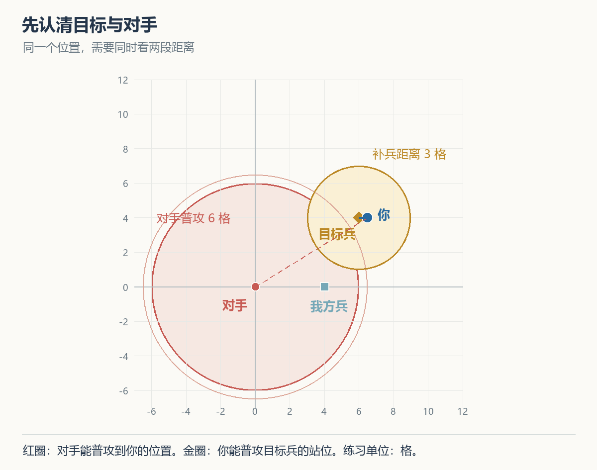

# 导读 先把这一刀看清楚

一只小兵快死了。你往前走，停下，普攻出手，再往后退。等你回到原来的位置，血条也少了一截。

你可能会把这件事归结为手速慢，或者对面的英雄手太长。可下一次，双方英雄都没换，你只是提前往旁边站了一点，同样的一刀却补得舒服多了。

差别藏在几个很小的地方：兵在哪边，对手离它多远，你从哪里出发，以及对手上一发普攻究竟进行到了哪一步。

这本书把这些地方逐个放大。我们会像暂停一段回放那样，先看位置，再让时间继续走，观察双方接下来能做什么。读到最后，希望你能解释自己的选择：为什么站这里，为什么现在上前，为什么这一刀值得等一等。

## 一张图里先认清四个角色

图中的红色圆点代表对手，蓝色圆点代表你。浅蓝色方块是对手准备攻击的我方小兵，金色菱形是你想补掉的敌方小兵。提到“目标兵”时，通常指后者。

图 1：红点与金色目标兵分别决定两种距离。你需要靠近目标，同时留意与对手的间隔。图中所有圆都按单位中心之间的有效距离绘制。

地图上的形状会随单位移动变化。书里的图会先把它们停住，让一个关系足够清楚，再改变一个条件。这样比较，你更容易知道结果究竟为什么变了。

## 书中的一格有多长

正文使用“格”作为练习单位。比如对手普攻范围是 6 格，你的普攻范围是 3 格，移动速度是每秒 5 格。这些是为了方便观察而选定的数字，不对应某个版本、某名英雄的整套属性。

这些攻击范围已经换成了单位中心之间的有效距离，包含该算例采用的体积处理。以后使用真实资料时，需要先弄清射程从哪里量起；附录会说明怎么换算。

读图时可以把格子想成一把临时的尺。图放大一倍，所有长度和每秒移动距离一起放大，判断仍然相同；一秒钟还是一秒钟。

## 从位置开始，再把时间放进来

前四章先研究一个定格画面：哪里够得到兵，哪里会被对手普攻到，技能又改变了哪些选择。第五章开始播放画面，计算上前、出手、回撤，以及对手追过来的过程。第六、七章把这些关系连起来，放回一段对线的思考中。

正文会用到圆、距离和简单的时间加减。遇到计算，可以先读结果和图，想一想它为什么会变。附录 A 给出完整模型，附录 B 给出随书代码与所有算例参数；想自行复算时，可以从那里进入。

第一章就从那次熟悉的经历开始：明明已经点到小兵，为什么还是挨了一下？
