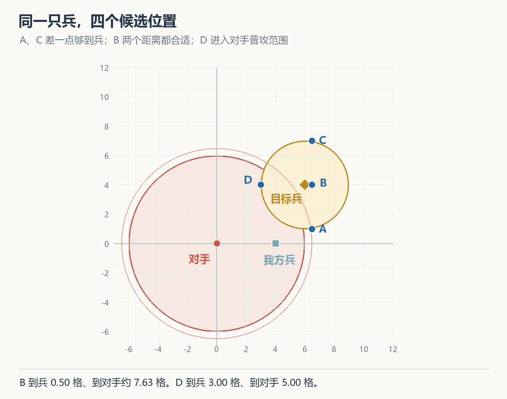

# 第一章 为什么一补刀就挨打

你看见残血兵，鼠标已经移过去了。注意力落在它还剩多少血、自己的普攻什么时候能打出来。对手看见的则是另一件事：你马上要为了这只兵靠近，并在攻击时短暂停留。

同一只兵，把两个人的动作连接起来了。

要理解这一刀，先把画面停在你决定上前的时刻。此时有两个不同的距离值得看：你离目标兵多远，你离对手多远。前者决定你的攻击是否够得到目标，后者决定对手是否够得到你。

## 两个圆之间的位置

设想对手的普攻能打到 6 格以内的你。以对手为中心画一个红圈，圈内的位置都值得警惕。再设想你能攻击 3 格以内的目标兵。围绕目标兵画一个半径 3 格的金圈：只要你的中心进入这个金圈，距离上就够得着这只兵。

第二个圆虽然画在小兵身上，表达的却是你的可选站位。因为“你离兵不超过 3 格”与“兵离你不超过 3 格”说的是同一段距离。把圆画在那里，能让我们同时比较许多位置。

两个圆可能相交，也可能隔开。金圈中落在红圈外的部分，提供了一种很有用的机会：你可以靠近目标兵，同时与对手保持超过其普攻范围的距离。

这也解释了为什么射程较短的一方仍可能补到某些兵。目标兵如果出现在远离对手的一侧，它周围的一部分位置就可能离对手很远。射程差是真实条件，小兵的位置同样会改变局面。

## 四个位置，四种感受

回到导读的图。对手位于左侧，目标兵在其右上方。我们比较 A、B、C、D 四个站位。它们采用同一组练习参数：对手普攻 6 格，你的普攻 3 格。

图 2：能否补刀与是否进入对手普攻范围，要分别看。表中的距离由图中坐标计算。

| 站位 | 离目标兵 | 离对手 | 在这个定格画面中的含义 |
| --- | ---: | ---: | --- |
| A | 约 3.04 格 | 约 6.58 格 | 超出对手普攻范围，但自己还差一点才能碰到兵 |
| B | 0.50 格 | 约 7.63 格 | 普攻距离足够，也与对手拉开了距离 |
| C | 约 3.04 格 | 约 9.55 格 | 离对手更远，目标兵却也够不到了 |
| D | 3.00 格 | 5.00 格 | 距离上刚能补兵，同时也进入了对手普攻范围 |

如果只看“离对手越远越好”，容易选到 C；如果只看“攻击指令已经能下达”，又容易忽略 D 的风险。B 的价值来自它同时满足了两个条件。

图中的 D 恰好在你的补兵边界上。实战中贴着边缘操作，会受到位置判断和单位移动的影响。提前留出一点距离余量，能减少刚觉得够得到、实际却还得向前挪一步的情况。

## 站得远，还要看下一步往哪里走

现在把画面播放一小段。你从 A 走向 B，对手也可能改变位置。原来的红圈会跟着对手移动，目标兵周围的金圈也会跟着兵移动。

因此，“B 在这张图里满足条件”回答的是此刻的站位关系。你从当前位置到 B 的路线，还需要单独观察。终点很好，不等于沿途每一步都一样舒服。

这件事在补刀前尤其容易被忽略。人在残血兵出现时才开始找位置，往往要临时走一段路；如果在它还没残血时已经调整到合适方向，真正出手时需要移动的距离就可能更短。你争取到的，是更从容的起点。

我们可以把刚才挨打的一刀倒放：在攻击出手前，你究竟是哪一步进入了红圈？是开始时就站得太近，还是点击目标后又自动往前走了几步？弄清这一点，比把整段经历归为“反应慢”更有用。

## 给普攻范围再留一点空隙

接下来的图里，我们会在对手的 6 格普攻圈外，再留出 0.5 格。这样，候选位置至少要与对手相隔 6.5 格。

这半格是练习中主动选定的余量。它帮助我们看清“正好在边缘”和“确实隔开了一段”之间的差别。选得更大，会压缩能补刀的位置；选得更小，则更靠近边界。具体留多少，要结合局面和你对距离的把握。

至此，你已经能用两个距离解释一次补刀。但还有一只兵尚未进入分析：对手准备补的那一只。它会帮助我们找到一个比较方便的观察方向。
