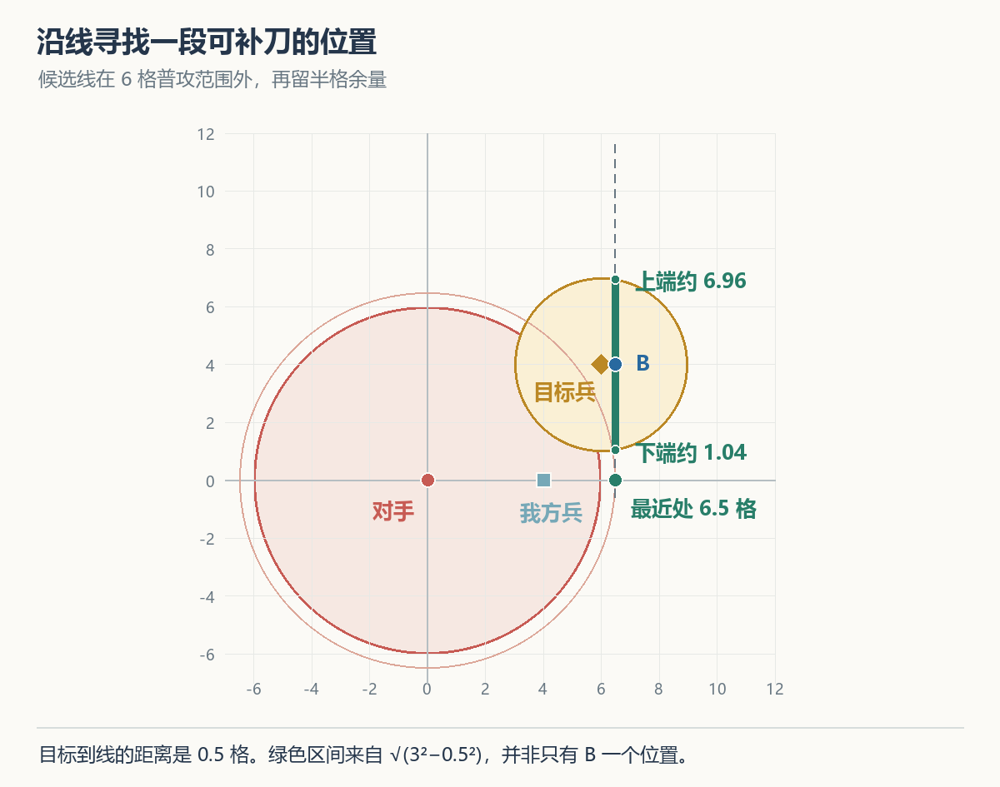

# 第三章 往旁边挪一点会怎样

上一章确定了局部的正前方。现在沿这个方向，从对手的位置向外走到 6.5 格：跨过他的 6 格普攻范围，再多留半格。

在这个位置画一条与刚才方向垂直的线。它刚好擦着半径 6.5 格的圆经过，数学上叫切线。

“切线”这个名字不用急着记。先看它的好处：线上离对手最近的地方，也有 6.5 格；从这里向两侧移动，距离会更大。所以，沿这条线寻找站位时，我们可以先把注意力集中在离目标兵有多远。

## 沿一条线，把位置一个个比较

还是那个目标兵。它离候选线最近的距离只有半格。你站在与它正对的位置 B，普攻当然够得到，因为你的范围是 3 格。

沿线往下走，你逐渐离开目标。走到一定位置，距离刚好变成 3 格；再多走一点，就够不到了。往上走也是一样。两个边界之间，形成一整段可选位置。

图 3：绿色线段是当前候选线上的补刀范围。金圆与候选线的两个交点决定端点，B 位于目标兵的正对面。

第一章的 A 与 C 为什么都差了一点？因为它们恰好位于这段绿色范围的外侧。肉眼看起来只隔了一小步，距离条件却已经发生变化。

这里也能看出，站位通常不只剩下一个答案。一段位置都能让你碰到兵，你可以再根据当前站在哪里、对手技能朝哪边释放、补完之后准备往哪里走，选择其中的一个。

## 愿意算一下的话，范围也不难求

从 B 沿候选线移动，你与目标兵之间会形成一个直角三角形。一条直角边固定为半格，另一条就是你沿线走出的距离，最长允许的斜边是普攻距离 3 格。

用勾股关系，沿线最多能偏离 B 的距离是：

`√(3² − 0.5²) ≈ 2.96 格。`

B 在图中的横向位置记为 4，那么两端约为 `4 − 2.96 = 1.04` 和 `4 + 2.96 = 6.96`。第一章里 A 的位置是 1，C 的位置是 7，确实都刚好在外面。

你不必在游戏中开平方。这个计算帮助我们看清一个趋势：目标离这条线越远，能横向活动的余地越小。如果目标到线的距离已经超过普攻范围，线上就找不到能攻击它的位置。

## 靠近兵、中间站、远离对手

有了一段候选位置，就可以提出不同的选择要求。

希望离目标兵最近，便取它在线上的正对位置；正对位置不在候选范围里，就取距离它较近的端点。希望取一个简单的居中位置，可以选线段中点。希望尽量拉开与对手的距离，则比较两端，选更远的那一个。

这些要求可能选到同一点。图 3 里，只考虑普攻补刀时，线段中点正好就是离目标最近的 B。等我们加上其他范围条件，线段被截掉一部分，两个位置才可能分开。

“远离对手”也有代价。越靠近补兵范围的边缘，目标稍微移动，自己越可能再次需要调整。相反，靠近目标虽然给补刀留出了空间，却可能靠近另一项威胁。每个点的长处来自一个具体要求；选择时要知道自己在争取什么。

## 横向移动为什么有时有用

假如你只沿着对手与你之间的方向前进，缩短与小兵的距离时，也可能迅速缩短与对手的距离。改成沿侧面接近，就有机会减少对目标的距离，而不以相同幅度靠近对手。

这要由三者的位置关系决定。把目标兵放到另一侧，原来有帮助的横向移动可能反而离目标更远。图上的绿色段已经把这种差异表示出来了：在线段里，你满足当前要求；走出线段，至少有一个要求发生变化。

所以，想模仿一个好站位，值得观察的是它与对手、目标兵之间的关系。仅仅记住“往左一点”或者“往右一点”，很容易在地图方向变化后失去作用。

## 这条线之外还有位置

候选线让计算变得简单，但地图比一条线大得多。

把目标移到更靠近对手的一侧，它到候选线可能超过 3 格，线上于是没有补刀位置。然而绕向侧上方，仍可能找到既离对手足够远、又离目标不超过 3 格的地方。我们将在下一章看到一个这样的点。

这告诉我们怎样理解工具给出的结果：找到一段位置，就得到了一组可比较的候选；没有找到，则需要看究竟哪个条件没满足，以及是否值得换方向继续找。

到这里，我们主要关心普攻。很多时候，你还想在补刀的同时保留某个技能的距离。加上这个要求，原来的绿色线段又会怎样变化？
