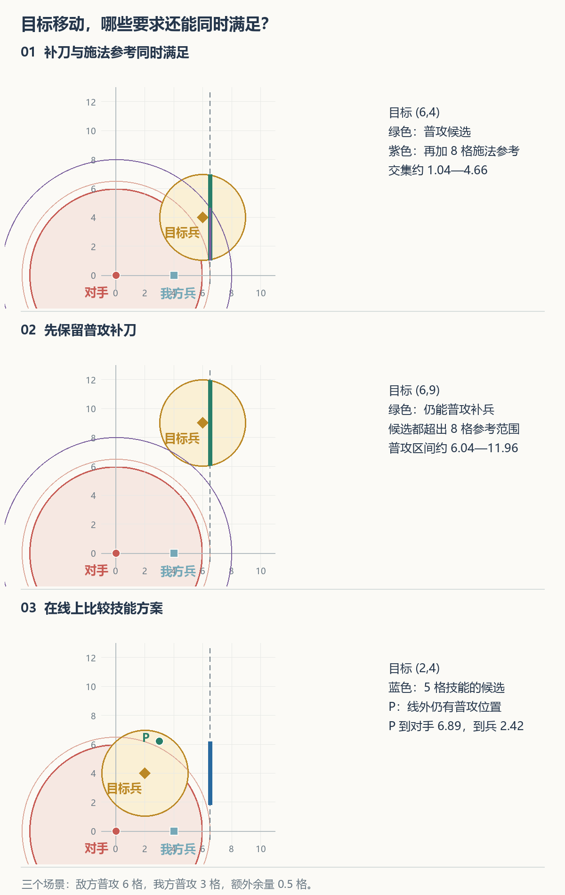
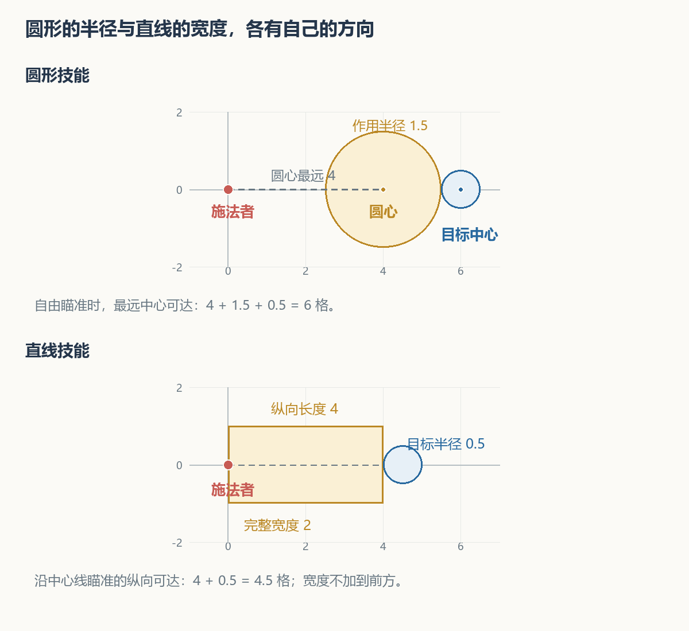

# 第四章 够不到时怎样换个办法

一个位置既能补兵，又与对手拉开距离，看起来已经不错。可你还可能希望保留另一个选择：如果对手露出机会，自己有技能能够跟上。

这一章给图里增加技能。不过在画新圈之前，要先问清楚圈代表什么。

## 最大施法范围与具体技能

假设你当前可用技能里，最远的施法距离是 8 格。以你为中心看，对手在 8 格以内，可以说他落在这个最大的距离参考范围内。

但最远的技能可能是给友方使用的护盾。它虽然远，也不会因为对手在范围里就能拿来攻击对手。你想用于消耗的那个技能，可能只有 7 格；如果没有点名具体技能，就无法据此确定能否消耗。

“最大施法范围”适合用作一层参考。要判断一次具体行动，还要看具体技能能否作用于那个目标，以及它采用怎样的距离和形状。

把这个区别放回第三章的例子。普攻可选区间约从 1.04 到 6.96；如果再要求与对手相隔不超过 8 格，区间上端会被截到约 4.66。保留下来的位置同时满足补兵和这项施法距离参考。

如果真正想用的消耗技能只有 7 格，条件还会更紧。图中的 B 距离对手约 7.63 格，因此落在 8 格参考范围内，却超出了这个 7 格技能的有效距离。

判断时把技能名字和用途说出来，范围的含义就清楚许多。

## 先看是哪个要求没满足

现在把目标兵向侧面移远一些，移到练习图中的 `(6, 9)`。你的普攻范围仍是 3 格，对手的普攻范围仍是 6 格。

这时，线上依旧有一段能补刀的位置，约从 6.04 到 11.96。但这整段都超出了刚才的 8 格施法参考范围。

如果同时要求“能补兵”和“处在 8 格以内”，答案会变为空。放下后一项要求，你仍可以到侧面补兵。你放弃的是这一项距离上的便利，普攻补刀本身还在。

图 4：上图目标在 `(6,4)`，中图移到 `(6,9)`，下图移到 `(2,4)`。英雄射程不变，目标位置改变了各项条件能否同时满足。

这个判断习惯很实用。遇到不理想的位置，先说清楚缺的是哪一项：够不到兵，距离对手太近，还是某个技能暂时接不上。原因不同，可采取的办法也不同。

## 普攻差一点，技能能不能接上

把目标改到 `(2,4)`。它离候选线有 4.5 格，你的 3 格普攻已经够不到。但如果你有一个对这只兵有效距离为 5 格的技能，就能在线上找到技能补刀的位置。

在目标正对面的站位，技能距离够用。随后还要看它是否能伤害小兵、伤害是否足够，以及这次使用会消耗什么资源。范围图可以帮助你判断“手段够不够远”，实际选择仍然要包含技能用途。

还有另一种可能：离开当前候选线，换个方向。

同一张图里，点 P 位于 `(3,6.2)`，与对手约相隔 6.89 格，与目标兵约相隔 2.42 格。它满足了 6.5 格的距离要求，也在你的 3 格普攻范围内。当前候选线上没有普攻解，但平面上确实还存在一个。

P 的价值是提醒我们继续看图。至于你能否及时走到那里，路上是否被挡住，目标是否还活着，则是下一步要观察的事情。

## 画出技能真正覆盖的形状

有的技能向某个位置放一个圆。假设它的圆心最远能放到 4 格外，圆本身的半径是 1.5 格，目标的半径是 0.5 格。当落点可以自由选择、目标静止而且没有阻挡时，它最远可以触及中心在 6 格处的目标。

这个 6 来自 `4 + 1.5 + 0.5`。前面的 4 描述你能把圆心放到哪里，后面的两项描述两个圆什么时候碰得到。把这三件事画开，就不容易把施法距离与作用范围混在一起。

直线技能又不同。它有向前延伸的长度，也有横向宽度。加宽通常扩大的是两侧覆盖，不能把完整宽度直接加在向前的距离上。

图 5：两类技能把“远”和“宽”分配在不同方向。距离计算要与技能形状对应。

对手的技能也应这样看。如果我们画的是“对手朝兵线正面发射”的范围，你站在它侧面，能说明这个方向的释放没有覆盖到你。对手换一个方向或落点，图也会改变。

能不能在技能到达前走出去，又多出了时间问题：技能多久出手、飞得多快、你什么时候开始移动。单张范围图里还没有这些信息。

## 给自己保留几种选择

目前已经能得到几种局部选择：在合适位置普攻；暂时放下施法参考条件，先补到兵；使用确实能作用于目标的技能；或者换个方向继续观察。

这些选择可以同时存在。技能能够补到，不妨碍你比较一次短暂上前的机会；眼下没有找到位置，也可以等待对手移动，让局面发生变化。

接下来我们把画面播放起来。对手刚刚打出一发普攻，你能否利用下一次普攻尚未就绪的间隔，上前碰到目标，再退回来？
