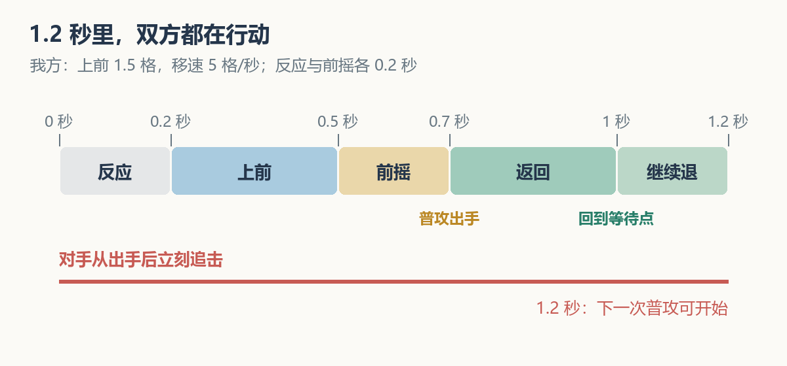
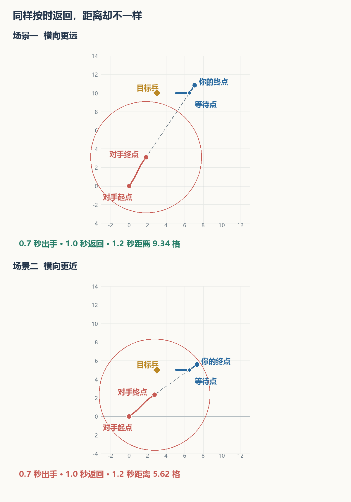

# 第五章 对手刚出手能不能上前

对手的普攻已经打出去了。你看见面前的残血兵，想到一个计划：趁他下一次攻击还没准备好，往前走一点，补一刀，再退回来。

这次我们允许你短暂离开候选线，向目标靠近。要判断计划是否成立，光看一张站位图已经不够。双方都会移动，时间必须加入进来。

## 从哪一刻开始计时

我们把对手上一发普攻已经出手的时刻记作 0 秒。你看见这个动作、作出反应，然后开始移动。

为什么强调“已经出手”？因为从开始抬手到攻击出手，本身要经过一段前摇。如果从出手时才开始观察，前摇已经过去，留给下一次攻击的等待时间通常少于一个完整攻击周期。

例如某个练习攻击每 1.5 秒开始一次，前摇占 0.3 秒。当前这一发出手时，从本次攻击开始已经过去了 0.3 秒；到下一次攻击可开始，剩下约 1.2 秒。若直接拿完整的 1.5 秒做窗口，就多算了 0.3 秒。

接下来的算例直接采用“还剩 1.2 秒”。它是已知的练习条件，避免把观察起点和攻击周期混在一起。

## 把一次补刀拆成几个动作

假设你已在等待位置，离进入普攻范围还差 1.5 格。你的移速是每秒 5 格，看到对手出手后需要 0.2 秒开始反应，自己的普攻前摇也取 0.2 秒。

上前 1.5 格需要 `1.5 ÷ 5 = 0.3 秒`。按“反应后上前，站定出手，立即原路返回”的计划，各阶段如下。

| 时间 | 你在做什么 |
| --- | --- |
| 0 到 0.2 秒 | 观察并反应，尚未移动 |
| 0.2 到 0.5 秒 | 上前 1.5 格，进入自己的普攻范围 |
| 0.5 到 0.7 秒 | 完成普攻前摇，在 0.7 秒出手 |
| 0.7 到 1.0 秒 | 原路返回等待位置 |
| 1.0 到 1.2 秒 | 继续远离对手，利用剩余时间拉开距离 |

图 6：各段时间相加，0.7 秒完成出手，1.0 秒返回。对手从 0 秒起就可以追击。

一个很有用的简式是：

**返回所需时间 = 反应时间 + 两倍单程走路时间 + 普攻前摇。**

这次是 `0.2 + 2 × 0.3 + 0.2 = 1.0 秒`，小于 1.2 秒。纯粹从时间看，计划来得及。

## 对手不会一直留在原地

现在让对手也动起来。他在普攻出手后，立刻以每秒 3 格的速度追你。

你反应的 0.2 秒里，他在靠近；你停下进行前摇时，他还在靠近。等你回到原来的等待位置，那只以对手为中心的普攻圈已经跟着他移动了一段距离。

因此，“退回原位”还没有回答最关键的后半句：此时，对手离你还有多远？

为了把这件事看清楚，我们比较两张几乎相同的图。两边都需要上前 1.5 格，使用同样的移速、反应时间和前摇，也都在 0.7 秒出手、1.0 秒返回。区别只在于目标与等待点的横向位置。

图 7：蓝线是你的移动，红线是对手追击。虚线连接截止时刻的双方位置，圆圈表示对手此时的普攻范围。

| 对照 | 场景一 横向更远 | 场景二 横向更近 |
| --- | ---: | ---: |
| 初始敌我距离 | 约 11.93 格 | 约 8.20 格 |
| 进入距离 | 1.50 格 | 1.50 格 |
| 普攻出手 | 0.70 秒 | 0.70 秒 |
| 返回等待点 | 1.00 秒 | 1.00 秒 |
| 1.20 秒时的敌我距离 | 约 9.34 格 | 约 5.62 格 |

对手的普攻范围为 6 格，我们希望保留的距离是 6.5 格。场景一超过了这个要求，场景二甚至已经进入 6 格普攻范围。

这两次动作的速度完全一样。改变结果的是出发时的距离关系，以及对手追击之后的位置。

## 两种不同的来不及

保持场景一的位置，把你的移速从每秒 5 格减到 2.5 格。单程便需要 0.6 秒。加上反应与前摇，你在 1.0 秒才能出手，回到等待点则要 1.6 秒。

对手在 1.2 秒时就绪。此时你已经出手，但还在回来的路上。即使这一刻双方仍然比较远，也不能把它算成原定“补完并返回”的计划已经完成。

再考虑一个更慢的动作：移速每秒 2 格，反应 0.4 秒，前摇 0.3 秒。光是攻击出手，就要 `0.4 + 1.5 ÷ 2 + 0.3 = 1.45 秒`。对手就绪时，你还没打出这一刀。

回放里，这几种结果值得分别观察：尚未出手、已经出手但未返回、按时返回却被追近。知道卡在哪一步，才知道下一次应当提前站位、减少走路，还是重新判断机会。

## 把这一刀的前后连起来

在这个短时计划里，一次可行结果要同时包含三件事：你的攻击已经出手，原定回撤已经完成，截止时刻还与对手保持足够距离。

其中，“攻击出手”是一个动作时刻。小兵是否在随后死亡，还与伤害、弹道和其他单位的攻击有关。这些问题会在附录的适用范围中集中说明。

现在，你已经可以解释两类机会：在一个位置直接补到，或者借一段时间上前再退。下一章把它们放在同一个长短手对线的例子里，看看目标兵换个地方，会打开或关闭哪些选择。
