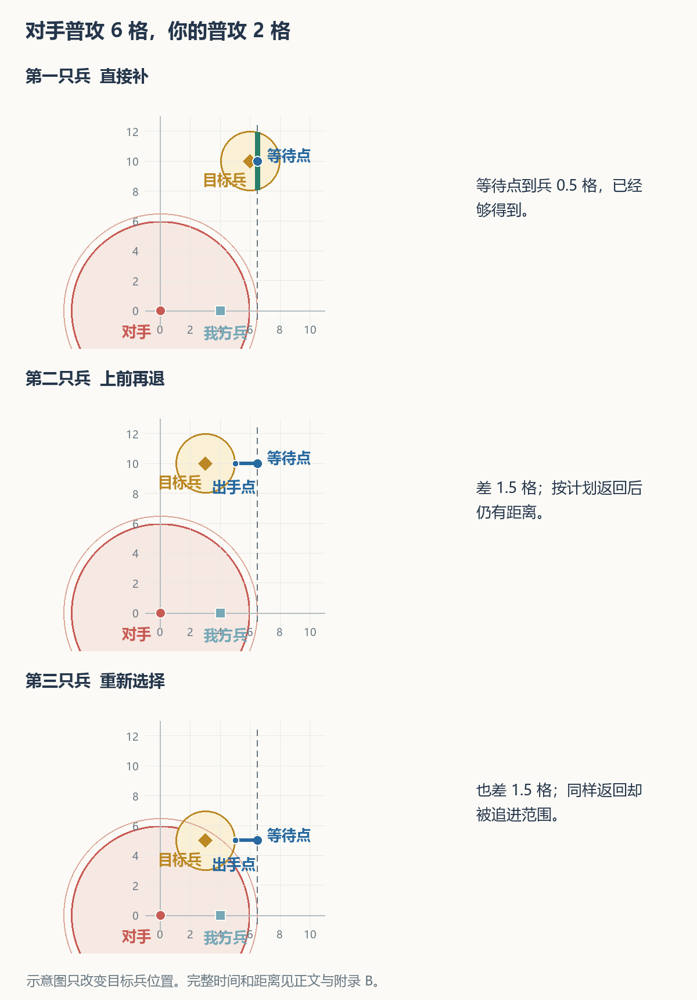

# 第六章 手短也有自己的机会

对手普攻距离长，你需要靠近才能碰到小兵。这种压力很容易让人只盯住双方射程的差距，觉得每一刀都得冒险往前走。

把前面学到的关系连起来，会看见更具体的情况。射程差决定你各自能伸到哪里；目标兵的位置决定你为了补这一刀需要站在哪里；对手的攻击节奏则决定某些路线是否有时间完成。

我们固定双方的练习参数：对手普攻 6 格，你的普攻 2 格，额外距离余量 0.5 格。你有一个有效补兵距离为 5 格的技能。需要移动时，你每秒走 5 格，对手每秒走 3 格；反应与前摇各 0.2 秒，敌方下一次普攻的剩余等待时间为 1.2 秒。

接下来只改变目标兵的位置。

## 第一只兵 走到侧面就能直接补

目标兵位于 `(6,10)`。候选线上的等待位置是 `(6.5,10)`，与兵只差半格。即使你的普攻只有 2 格，也已经够得到。

等待点到对手约有 11.93 格，明显大于 6.5 格。因此，这只兵提供了一个静态补刀机会。你无需为了进入普攻范围再往前跨一段。

目标出现在更靠侧面的位置，改变了长手与短手的相对压力。对手仍然拥有更长的普攻范围，但这个定格画面里，那段范围没有覆盖到你的候选位置。

从当前实际位置能否及时走到那里，还要结合回放看。这里先回答抵达之后的距离关系。

## 第二只兵 需要向前补上一小段

保持其他条件，把目标移到 `(3,10)`。等待位置仍是 `(6.5,10)`，但兵与等待点之间变成了 3.5 格。你的普攻只有 2 格，差出的 1.5 格需要靠移动补上。

这正是第五章的场景一。你可以沿目标方向进入普攻范围，0.7 秒出手，1.0 秒返回，在对手 1.2 秒就绪时仍保有约 9.34 格距离。

同时，5 格技能从等待位置也够得到这只兵。因此你面前有两种可比较的手段：一次符合模型条件的短时普攻路线，以及一次距离足够的技能使用。

该选哪一种，要继续看这只兵的血量、技能伤害和资源用途。比如你本就希望用这个技能处理附近多个目标，它的作用可能不只这一刀；如果它是接下来应对对手的关键手段，使用后的处境就值得多想一步。

这些取舍没有被距离计算自动排好顺序。图先告诉你哪些手段存在，再由局面决定哪一种更合适。

## 第三只兵 相同的路程变得危险

再把目标移到 `(3,5)`。等待点跟着来到 `(6.5,5)`。到兵仍是 3.5 格，你仍只需进入 1.5 格。单看自己的动作，整个时间表一项都没变。

但初始敌我距离缩短为约 8.20 格。对手追过来之后，在 1.2 秒时与你只剩约 5.62 格。他的 6 格普攻范围已经覆盖到你。

这次原定回撤计划没有满足距离要求。你可以继续比较技能补刀、换方向、等对手移动，或者放下这只兵。上一只兵那里成立的路线，不能只凭“都是向前走 1.5 格”就搬过来用。

图 8：三幅图的射程完全一致。位置变化让“直接补”“短时进出”和“重新选择”分别成为关注重点。

## 从一个结论走向一个观察

看到第一幅图，你可以在下一段对线里观察：有没有一些目标兵正在向离对手更远的侧面出现？如果有，我能否在它残血前就向那个方向调整？

看到第二幅图，你可以观察：我到底差多少距离才能碰到目标？我的普攻是否已经准备好？对手这一发攻击是否真的出手？

看到第三幅图，你可以观察：我以为“退回原位就好了”，可对手现在已经到哪里了？我是否把他当成了一个不会移动的红点？

这些观察比一个笼统的“短手要怂一点”更具体。它们让你在不同局面里识别出不同的机会，也让你知道某次失败究竟改变了哪一个条件。

## 留意下一次目标

一只兵补完，对手和兵线不会停止。你所在的位置，马上成为下一次判断的起点。

如果为了上一刀走得很深，下一只兵出现时，你可能还在往回走。如果提前选择了一个容易调整的侧面位置，两次补刀之间的移动可能更顺畅。要理解一段对线，可以把连续两三只兵的目标位置放在一起看，观察自己的路线是否反复折返。

这时，我们开始从单次计算回到真实对线：眼前这一刀与后面的动作相连。最后一章就讨论怎样把局部图里的判断带回游戏，而不在每次出手前都停下来做一道数学题。
