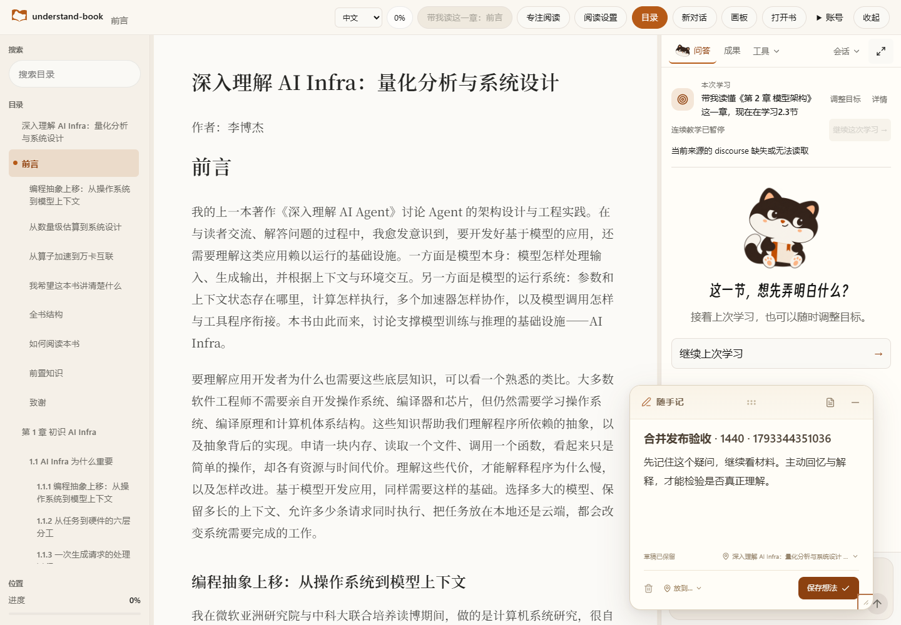
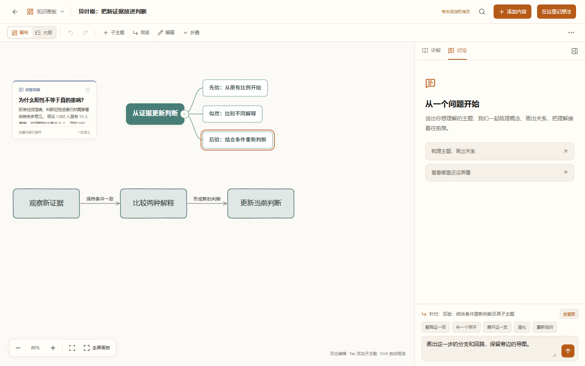

# 2026-10-30 待发布功能合并上线

2026-10-30 16:38 HKT 修正：本次前端包遗漏后台目录，导致 `/admin/` 和后台深链接 404；此前“admin 健康通过”只覆盖管理员账号和接口。后台已补齐，原缺陷包保留，安装、切换及公网验证已加入页面检查。见[故障与修复记录](../admin-static-repair-20261030/README.md)。

2026-10-30 15:16:36 HKT 已发布 `all-pending-20261030`，服务 PID 524591。用户本轮授权“把没上线的都上线吧”，覆盖此前暂缓发布的来源排版修复。入口：[understandbook.top](https://understandbook.top/index.html)。

## 已上线行为

- **随手记浮窗与关联**：默认 400×360，可拖动、八方向缩放、收起并保留设备草稿；不改变原页面布局、滚动位置或增加遮罩。全局入口默认只保存并记住产生现场，也可选择独立想法；从上下文入口进入默认放在该处。统一“放到…”支持对话消息／确切原句、画布／选中元素、记录过的演示页。同一想法保留唯一身份，修改在各处同步，移除展示位置保留想法。
- **画布表达与右侧提问**：流程、因果、对照和空间分组使用自由图形及连线；明确的层级需求使用可编辑主题树。桌面提问在右侧讨论面板底部，手机在讨论页显示，切换、全屏与收起保留草稿和选中对象。原有导图编辑和分支确认规则保留。
- **来源行内公式**：临时原文窗口把相邻文字与行内公式接回同一句；独立公式继续独立显示，引用高亮及来源 LID 保留。

## 发布来源

从实际线上 `board-source-publication-20261030` 取完整源码基线，在独立目录合入三组待发布改动。主工作树还缺少部分已经上线的空间笔记与可编辑导图源码，不能直接覆盖线上。比较时识别的 109 项改动已在线上；本次实际发布差异为 63 份源码和测试文件，见 [源码目录](release-source.json)、[完整补丁](source.patch) 与 [差异源文件包](source.tar.gz)。

合并修正了个人想法更新通知与空间笔记同名方法的冲突；个人想法画布连线补齐线上 `note_relation_id`、`reason` 字段并保持为空。既有导图测试同步“画布”标签，空间笔记测试保留完整网络上下文。此次未把原有空间笔记替换为个人想法。

本地最终候选 `.tmp/all-pending-release-20261030/merged`；远端正式源码 `/opt/understand-book/releases/all-pending-20261030`。原主工作树的用户修改保留，未替用户提交或推送。

## 验证证据

| 场景 | 结果 |
| --- | --- |
| 合并前端 | 171 项不同测试通过；类型检查、multi 构建通过 |
| Memory | 329 通过，1 项既有忽略；覆盖个人想法、空间笔记、导图及持久化 |
| Server 关联 | 2 通过；消息验证、演示收据实际页、重复画布放置和移除 |
| Runtime | 工具注册 13、画布作者 7，共 20 通过 |
| 浏览器夹具 | 浮窗与关联 16、画布及右侧输入区 4，共 20 通过；含 320/390/1024/1440px 和短屏 |
| Linux 正式构建 | server、manage_reader、publish_book、reader_maintenance、presentation_worker、video_audio_review 通过，最终构建 14 分 28 秒 |
| 真实生产数据副本 | 14 个来源 resolve/read 成功，原版引用、主读位保持；同一想法关联消息与已有画布，重复放置不重复，改动同步，移除位置不删原想法；实际 MiniLM 语义召回通过 |
| 真实候选页面 | 本次构建前端 + Linux 新后端，1440/390px 阅读中记录、保存、修改、两版历史、刷新恢复均通过，页面错误为 0 |
| 公网 | reader/admin 登录、书目、正文、聊天、额度和演示能力通过；页面引用的新资源与发布包一致；1440/390px 浮窗、自动聚焦、放置入口和收起通过 |

测试汇总：[tests-passed.json](tests-passed.json)；真实 API：[integration-qa.json](integration-qa.json)；真实候选浏览器：[browser-qa.json](browser-qa.json)；公网：[public-verification.json](public-verification.json)、[public-browser.json](public-browser.json)。逐项原始测试日志同目录。初次合并测试因共享依赖路径、缺少测试素材、旧文案和不完整 mock 失败，已修复验收环境／对应测试后通过，初次日志保留。未进行全仓测试或宣称全仓绿色；没有外部生成模型调用。

## 数据、发布与恢复

最终切换维护 9.8 秒，control schema 保持 22。60 份聊天文件、106 份画布文件、23 份个人记忆文件的原内容、1 个空间笔记本和 18 条额度记录保留。Memory schema 在账号实际加载时升级至 6；未加载的历史文件仍可保留 3/4/5，不主动重写。详见 [deployment.json](deployment.json)。

首次切换的数据门禁错误地要求所有历史文件都已采用 schema 5/6，发现未加载的旧文件为 3/4，自动恢复旧程序及切换前记忆文件，候选没有对外开放。修正为“未加载文件保持原格式，已加载文件可升级至 6”，再切换成功。首次结果保留在 [deployment-failure.json](deployment-failure.json)。

- 正式版本：`/opt/understand-book/releases/all-pending-20261030`。
- 前一版本：`/opt/understand-book/releases/board-source-publication-20261030`。
- 最终切换前配置与可变数据：`/opt/understand-book/backups/all-pending-20261030-retry`；首次备份也保留在 `backups/all-pending-20261030`。
- 构建、源文件和远端验收记录：`/opt/understand-book/acceptance/all-pending-20261030`。

开放入口后应保留新增用户数据，优先向前修复。旧程序不接受 Memory schema 6，不能只切回旧二进制，也不能用部署前备份覆盖上线后的新想法、关联、聊天或画布。未对外开放的失败切换才可恢复其停服时的记忆快照。本次自动恢复遵守这一边界。

## 验证边界与已知问题

- 公网没有 `adaelon` 的现有密码，因此该账号真实画布和写入场景使用完整生产数据副本；公网使用已有 reader/admin。没有修改生产密码、写入测试想法或发起生成模型调用。
- 浮窗在应用页面内移动和缩放，不是操作系统独立窗口。原页面可继续操作；在小屏上可以移动、缩小或收起便笺。
- 真实副本浏览器打开《AI Infra》前言时，原学习区显示“当前来源的 discourse 缺失或无法读取”，连续教学的接续操作不可用；普通正文阅读和本次想法功能可用。本次没有修改该资料的预构建数据，未把这一观察记为已修复。
- Cloudflare 会为 HTML 添加分析脚本，并拒绝默认 Python UA 的页面请求。公网检查采用项目现有验收 UA，比对本应用资源目录及 JS/CSS 实际字节，并另行使用真实 Edge；没有修改边缘访问策略。

远端临时数据副本、隔离服务与登录材料已清理，构建 swap 已删除、swappiness 恢复 0；本地预览进程已停止。自动审批拒绝删除本地两份 `*.private.json` 临时登录文件，未提供具体原因，因此保留在忽略的 `.tmp/all-pending-release-20261030/` 中；其中的验收会话已退出或随隔离服务停止而失效。见 [cleanup.json](cleanup.json)。
