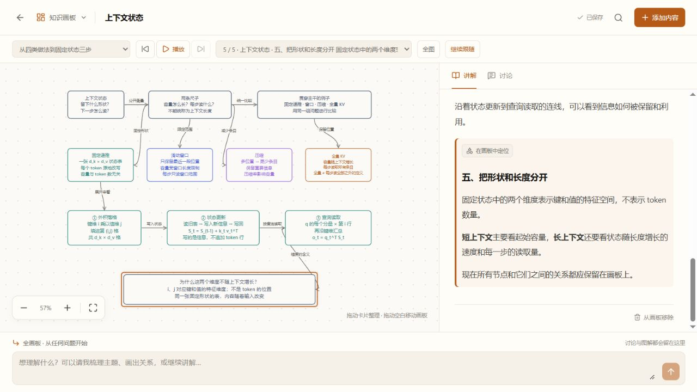

# 画板播放连线修复 · 2026-10-28

点击播放后，`projectBoardRoute` 将连线限制在路线显式列出的 `link` 中。只列节点的路线因此返回空的 `visibleLinkIds`；播放结束仍处于步骤视图，全部连线持续隐藏。`crates/server/src/tests/board_wb3_browser_host.rs` 的既有路线生成方式就会产生这种输入。

`packages/web/src/board-workspace.ts:projectBoardRoute` 现在让未单独安排揭示时刻的连线随两端出现；明确安排了揭示步骤的连线保留原有时序。显式揭示或聚焦连线时统一带出端点，以及连线作为端点的依赖。投影仍从当前步骤直接推导，回退、跳转和重开不依赖之前的播放过程，不修改画板存档。

## 验证

- 修复前新增四项回归：3 失败、1 通过，分别定位节点路线丢线、焦点线缺端点、真实组件播放后丢线，并保护显式揭示时序。
- `pnpm --filter @understand-book/web test -- src/board-workspace.test.ts src/board-canvas.test.ts`：53/53 通过。
- 补充依赖线先于被依赖线排列的自动显示用例后，单独重跑 `board-workspace.test.ts`：41/41 通过。
- `pnpm --filter @understand-book/web typecheck`：通过。
- 实际浏览器运行真实 `BoardWorkspace`，使用下方自包含示例数据：主路线播放完成后 `step-5 / playing=false / show_all=false`，11 个图形、10 条连线；缩放到全部内容后直接确认箭头、标签可见。重新打开仍保留第 5 步与 10 条连线。退到第 4 步为 9 条，切换全图恢复 10 条。
- 备用路线明确将「分开衡量」安排在第 3 步：第 1、2 步无该线，第 3 步出现。

## 重现入口

在仓库启动 `pnpm --filter @understand-book/web dev --host 127.0.0.1 --port 4174`，然后打开：

`http://127.0.0.1:4174/@fs/E:/allwork/download/agent/understand-book/docs/performance/board-playback-fix-20261028/playback.html?lang=zh-CN&reset=1`

夹具是 [playback.html](playback.html)，复用实际组件与样式，11 个图形和 10 条连线为同类示例，并非用户原画板存档。板书 API 由页面内数据提供，不调用模型或线上画板；视图保存在此本地页面的 localStorage。验证重新打开时移除 `reset=1`。

## 发布状态

2026-10-28 10:35:23 HKT 已与画板元素样式、公式排版合并发布至 `board-visual-math-20261028`；10:37:25 HKT 公网复核通过。刷新原页面即可使用修复。合并保留线上空间笔记及其共享关系线，详见[合并发布记录](../board-appearance-20261028/deployment/README.md)。
