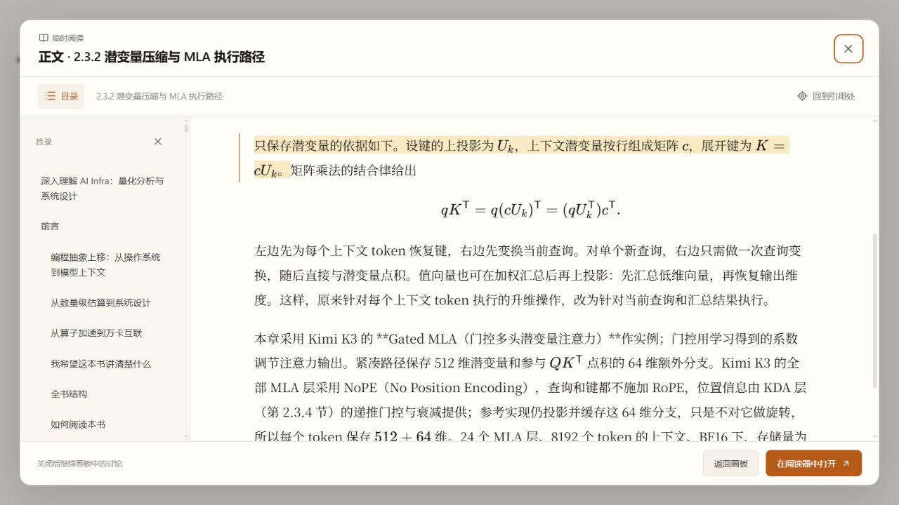

# 来源窗口行内公式断段修复

2026-10-30 15:16 HKT 已随 `all-pending-20261030` 合并上线。用户后续“把没上线的都上线吧”授权包含本修复；此前来源版本绑定修复保留。见[发布、验证及恢复记录](../all-pending-release-20261030/README.md)。

## 原因

《深入理解 AI Infra》2.3.2 的这句话，在原文结构中对应 7 个叶片：文字、`$U_k$`、文字、`$c$`、文字、`$K=cU_k$`、句号及后续文字，LID 为 `4.20.6.13` 至 `4.20.6.19`。下一个叶片 `4.20.6.20` 才是独立公式。

正常 Reader 用 `reader-flow.ts` 把行内公式接回所在句子。来源窗口此前却把每个叶片各自渲染为 `article` 和 `p`，使一句话变成 7 个独立段落；引用边线也重复出现。这是来源窗口的渲染问题，原文数据完整。上一次来源可用性验收遗漏了这处可见的排版缺陷。

## 实现

- `BoardSourceReader.vue:readingItems` 复用 `isReaderFlowSegment/shouldJoinReaderFlow`，把相邻文字与行内公式放进同一段。独立公式、标题及普通独立段落继续走原来的块渲染；列表与引用块保持原结构。
- `BoardSourceSegment.vue` 增加行内呈现，使用 `span` 与 `renderInlineMarkdown`。每个来源片段仍保留原 LID、文字和高亮范围，读位恢复和分页继续定位原片段；引用边线移到整段显示。
- `board-source-reader.test.ts` 新增真实 MLA 句子、跨页拼接、普通列表/引用块三个回归。既有来源权限、版本绑定和服务端数据不变。

## 验证

| 检查 | 结果 |
| --- | --- |
| 修复前的两个核心回归 | 均复现失败，7 个片段不在同一段内 |
| 来源窗口、摘录、App 来源交互 | 25/25 通过 |
| 隔离前端完整类型检查 | 通过 |
| 多用户前端生产构建 | 通过 |
| 1280×720 实际组件预览 | 句子连续，行内公式自然换行，独立公式分行，引用高亮保留 |
| 390×844 实际组件预览 | 正常换行；阅读区 scrollWidth 与 clientWidth 均为 380，无横向页面溢出 |
| 交互 | 向下加载至 2.3.3、回到引用处、关闭返回画板均通过 |

原文与引用范围从发布版本 `ai-infra-book-complete / 01a100f5-e3c3-72f3-8bfb-eb8a08774ab5` 只读提取，见 [actual-source.json](actual-source.json)。预览与构建使用实际线上前端源码快照，仅合入本次两个组件及测试；core 类型依赖复用同一发布基线的本地副本。未调用模型，未修改生产页面、服务或用户数据。

证据：[最终状态](verification.json)、[故障数据](diagnosis.json)、[精确改动](source.patch)、[失败回归](tests-before.log)、[通过回归](tests-final.log)、[类型检查](typecheck.log)、[生产构建](build-final.log)、[浏览器记录](browser-qa.json)。

[手机修复效果](mobile.jpg)

## 已知问题与验证边界

本地组件预览使用录制的真实来源响应，未载入该书插图；插图加载逻辑未修改。后续段落中的 `**Gated MLA（门控多头潜变量注意力）**` 仍会显示原始加粗标记，这是现有 Markdown 解析的另一处问题，本次没有更改共享解析规则。首次隔离类型检查因缺少 core 类型依赖失败，补齐同一基线依赖后完整检查通过。
