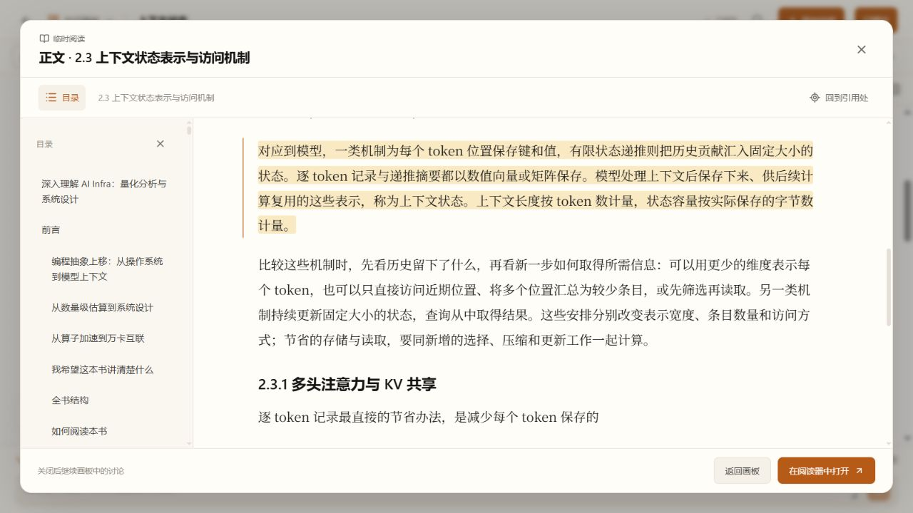

# 画板来源版本缺失修复

2026-10-30 13:03:37 HKT 已发布 `board-source-publication-20261030`。线上服务从实际运行的 `personal-notes-20261030` 合入本次修复，当前 PID 514831，control schema 22。维护入口持续 13.92 秒。新画板会在保存前绑定原文的确切出版版本；已保存画板缺失该字段时，读取过程使用原回合或画板记录中的版本恢复来源。

## 原因与修改

《上下文状态》导图最初的 revision 2 包含 9 个不同来源。原文、原出版版本和读者权限均存在，但来源记录没有 `publication_id`；网络读取走入需要明确出版版本的分支，在加载正文之前返回 `OBJECT_NOT_FOUND`。前端显示其文案 `Object is unavailable`，重试不会改变这份记录。初始证据见 [diagnosis.json](diagnosis.json)。

- `crates/server/src/board_author.rs:445`：在 prepare、revise、commit 处理前，给同书且缺少版本的来源补入冻结上下文中的 publication。候选与正式保存的答案、主题共享这份完整绑定；显式版本和其他书籍来源保持原值。
- `crates/server/src/board_api.rs:1130`：读取旧来源时，优先查对应答案、图形、演示或交付记录的原始回合；同书且缺少该回合版本时，使用画板自己的 publication。恢复只发生在内存，不重写历史画板，也不选择当前默认书或最新版本。既有访问权限与引文范围验证继续执行。
- `crates/server/src/board_source_publication_tests.rs` 和 authoring 回归：覆盖无学习空间的云端候选保存、正式提交后重新读取、旧来源 resolve/read、主读位和工作区 revision 不变、显式失效版本和其他书籍不能继承画板版本。

部署基线为服务器实际 release；主工作树中其他未上线改动未随本次发布。生产代码只改变上述两个入口，附加一份测试文件。合入内容见 [source.patch](source.patch)。

## 验证

| 验证 | 结果 |
| --- | --- |
| 两项新增回归 | 2/2 通过 |
| 画板作者相关回归 | 8/8 通过，其中包含一项新增回归 |
| 来源窗口相关回归 | 4/4 通过 |
| 不同测试总计 | 13 项通过 |
| Linux 正式构建 | 通过，14 分 51 秒；仅构建 server |
| 同一真实数据副本、旧程序 | revision 4 的 14 个不同来源全部 404 |
| 同一真实数据副本、修复程序 | 14 个来源全部 resolve/read 成功，均返回原出版版本与 20 段正文 |
| API 读取副作用 | 画板原 revision 文件逐字节保持，主 Reader 与 workspace revision 保持 |
| 浏览器实际点击 | 最初讲解及后续 MLA 讲解的来源均正常展开，引用高亮可见；向下阅读进入 2.3.3；返回画板后主阅读仍为原章节、10% 进度 |
| 公网发布后检查 | reader/admin 登录、授权书籍、目录与正文、聊天与额度、演示能力通过 |

用户在诊断后继续补充了导图，因此验证副本使用 revision 4，来源从 9 个增加至 14 个。旧版与修复版使用同一副本，并通过本机隔离端口运行；浏览器使用线上相同前端及候选 Linux 后端。没有发起模型调用。浏览器选择讲解会正常保存副本中的选择状态，未触碰生产导图。

测试记录：[汇总](tests-passed.json)、[新增测试](tests-fixed-3.log)、[画板作者回归](author-regressions-frozen.log)、[来源窗口回归](source-regressions-frozen.log)。后两组复用新增测试通过时的同一个冻结测试程序，避免并发工作树修改触发无关重编译。初次测试夹具未同步画板 head，已修正后通过；最终夹具在 Linux 构建结束后同步，确认全部差异位于 `cfg(test)` 模块且生产编译代码相同，见 [fixture-sync.json](fixture-sync.json)。

真实数据与发布记录：[旧版对照](baseline-qa.json)、[修复版来源验证](integration-qa.json)、[浏览器验收](browser-qa.json)、[切换及数据保留](deployment.json)、[公网检查](public-verification.json)。

## 数据保留与恢复

切换前确认没有运行中问答、模型、服务、Web 或后台复核任务。维护期间备份可变数据及配置，再切换服务、前端目录和演示 worker 路径。切换后比较 60 份历史聊天文件、106 份画板文件及 18 条额度记录，内容均保持；没有数据迁移。

- 新 release：`/opt/understand-book/releases/board-source-publication-20261030`。
- 原 release：`/opt/understand-book/releases/personal-notes-20261030`。
- 配置与可变数据备份：`/opt/understand-book/backups/board-source-publication-20261030`。
- 远程构建与验收：`/opt/understand-book/acceptance/board-source-publication-20261030`。

若需要回退程序，应先确认没有在途任务，恢复备份中的服务、环境、Nginx 及 sandbox 配置并重启检查。schema 未变，正常回退保留现有生产数据；上线后的新聊天和画板不能被部署前备份覆盖。

## 验证边界

生产服务器没有保存 `adaelon` 的现有登录密码，因此发布后的公网检查使用已有 reader/admin 账号；该用户真实导图的 14 个来源及浏览器点击验收使用完整生产数据副本。未重置生产密码或创建生产测试来源。新来源的生成后持久化路径由真实 authoring 单元回归验证，没有为验收重新调用模型生成导图。

临时数据副本、隔离服务、测试登录材料及构建用 swap 在验收后清理，系统 swappiness 恢复原值，见 [cleanup.json](cleanup.json)。
