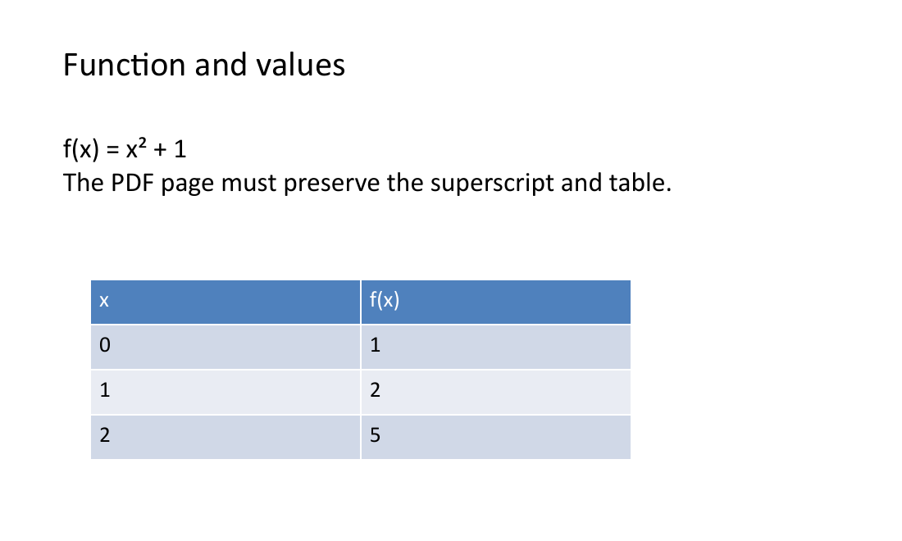
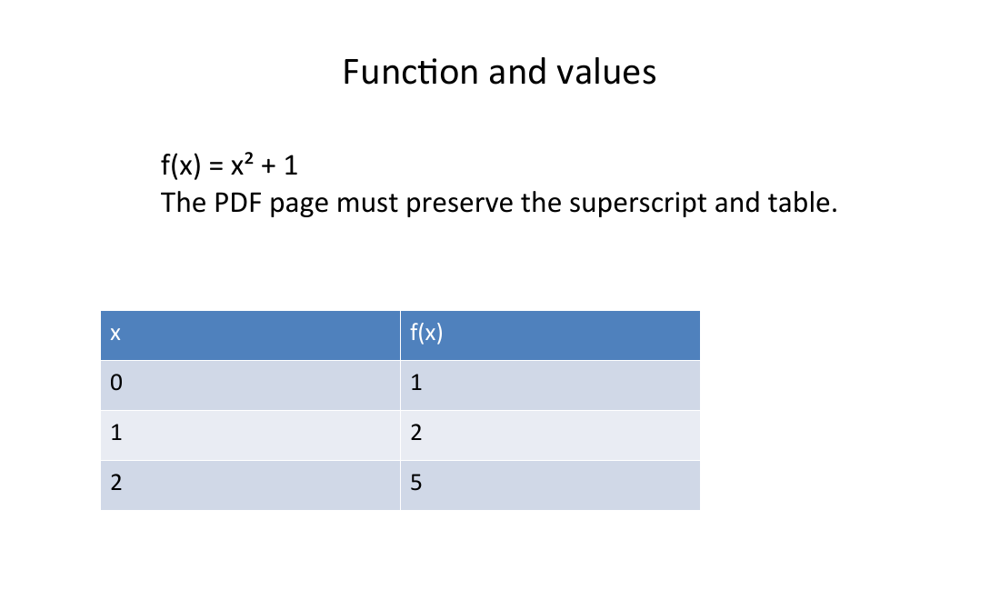
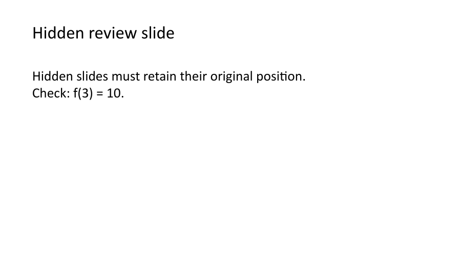

# C9 真实课件转换验收

2026-10-20 使用任务临时目录中的 LibreOffice 26.8.1.1，分别将原创的 [PPTX](original-exam.pptx) 和 [PPT](original-exam.ppt) 导入真实文档准备路径。两份文件包含三张幻灯片：文字目标、上标公式与原生表格、隐藏复习页。

[转换结果](conversion-result.json)确认两种输入均生成三页 PDF 与来源映射，隐藏页保持第三页；原件留存、重复准备复用以及后续 DSH 学习构建计划均通过。没有调用付费模型。

## 视觉结果

PPTX 第二页的公式上标和表格：

PPT 第二页的公式上标和表格：

隐藏第三页被导出并能定位：

文字层用于检索，公式和表格的完整视觉内容保留在 PDF 页面。以上材料是原创软件验收夹具，未作为正式课程发布。

## 复现

1. 准备 LibreOffice 及 `python-pptx`，运行 `scripts/create-exam-document-fixture.py tmp/cloud-document-acceptance/fixtures` 生成原创 PPTX。
2. 使用 LibreOffice `--headless --convert-to "ppt:MS PowerPoint 97"` 在同目录生成 PPT。
3. 将 `UNDERSTAND_BOOK_LIBREOFFICE` 指向绝对可执行路径，运行 `pnpm exec tsx scripts/verify-exam-document-conversion.ts tmp/cloud-document-acceptance`。
4. 通过现有 PDF 阅读器或 Poppler 渲染第二页与第三页，对照表格数值、上标和隐藏页。

本次转换器来自 [The Document Foundation 官方镜像目录](https://download.documentfoundation.org/libreoffice/stable/26.8.1/win/x86_64/LibreOffice_26.8.1_Win_x86-64.msi.mirrorlist)列出的南京大学镜像。下载的 MSI 具有有效的 The Document Foundation Windows 签名，采用 `/a` 行政解包到项目 `tmp/cloud-document-acceptance/libreoffice` 后执行。

实际服务开放 PPT/PPTX 时仍需在 Reader 与构建宿主配置对应环境变量；本次验证没有变更生产配置。
