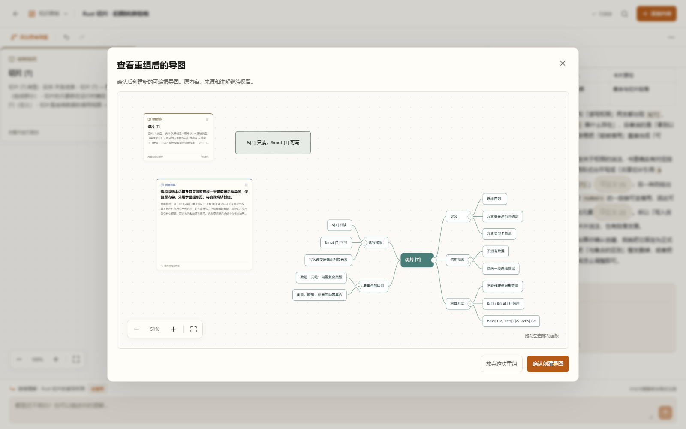
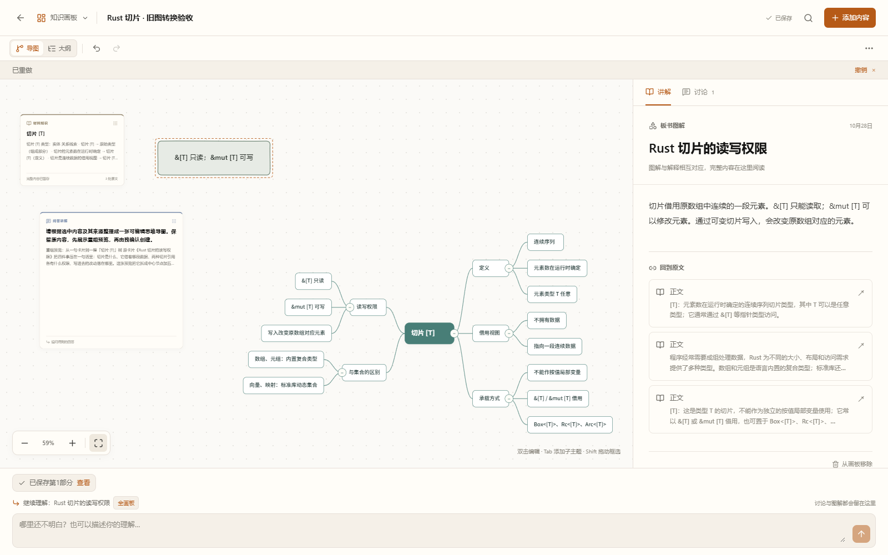
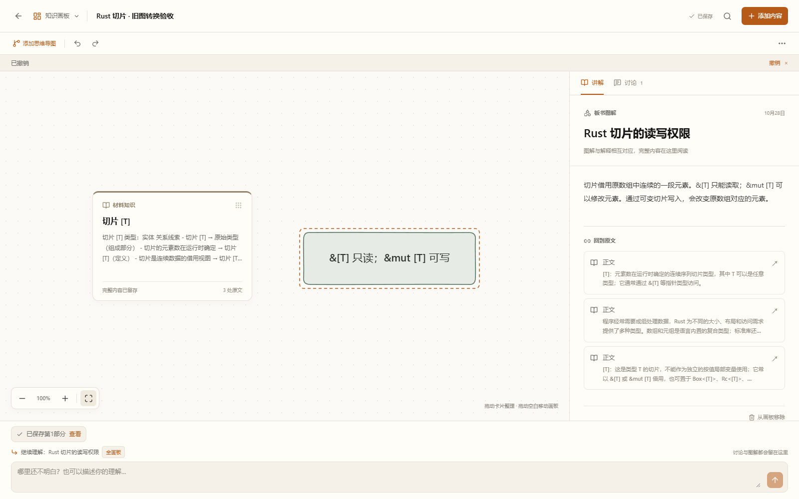

# 旧 Drawing 转可编辑思维导图：真实 Reader 验收

2026-10-28 完成一次真实模型转换。实际 Reader 的“将选中内容整理成导图…”入口产生了 1 张、19 个 Topic 的导图；确认前没有写入画板，确认后原材料卡片与旧 Drawing 完整保留，一次撤销移除新导图和该次新增讲解，同时保留原内容与交付回执。

## 输入与运行环境

- 脚本：`evals/semantic/mind-map-conversion.mjs`。
- 冻结二进制：`tmp/mind-map-bin/server.exe`，2026-10-28 18:48 构建；运行时复制为本轮自己的 `server.exe`。
- Reader：`packages/web/dist`，本轮独立复制其完整前端与候选预览资源，使用 Edge 无头浏览器、1600 × 1000 视口。
- 书籍来源：原工作区 `.understand-book/mastering-rust`，只读使用。通过正式 `boards/catalog` 和 `boards/import` 导入“切片 [T]”材料，保留 3 处原文来源。
- 旧图输入：公共 API 不再创建旧 Drawing，因此只在本轮隔离的 `memory/boards/unscoped/…` 追加 revision 3 快照。旧图表达“&[T] 只读；&mut [T] 可写”，`based_on` 指向 revision 2 的正式导入材料。没有改写历史快照或原工作区数据。
- 1 次实际用户请求；模型内部执行 10 次模型步骤（9 次 outer、1 次 tutor_presentation_plan），11 次工具调用；模型回合耗时 119.9 秒。匿名结果见 [summary.json](summary.json)。完整会话与模型轨迹仅保留在本地 `tmp/editable-mind-map-20261028/conversion-01/`，不包含在提交证据中。

## 实际结果

| 阶段 | 观察到的行为与断言 |
| --- | --- |
| Reader 发起转换 | 点击旧 Drawing，再点击“将选中内容整理成导图…”。实际请求携带 `convert_to_mind_map`、所选旧图 ID 和当前 revision 3。 |
| 等待模型完成 | 117 次轮询都验证完整 `BoardDocument` 与转换前完全相等。没有新 Topic、没有新增讲解卡、没有交付回执提前写入。 |
| 候选完成 | `requires_confirmation=true`、`previewed=true`，存在 `commit_review`；回合 `completed` 且 `incomplete=false`。模型曾收到一次 `BOARD_CONVERSION_COMMIT_REQUIRED`，随后按要求提交为待确认候选，并未绕过确认。 |
| 实际 Reader 预览 | 点击“预览重组后的导图”，打开真实弹窗；19 个 Topic 全部渲染，原图和材料卡仍在预览中。独立加载同一正式预览资源检查，`ready=true`、`issues=[]`。此时持久化画板仍为 revision 3。 |
| Reader 确认 | 点击“确认创建导图”，保存为 revision 4；只有 1 个 AI 编辑事务。19 个主题的内容、层级、来源和样式与预览一致。原有两项逐字段完全不变。 |
| 来源 | 19 条新 Topic 的 `based_on` 均能在指定历史 revision 中解析，包含对选中内容或其材料的实际引用；匿名结果见 [provenance.json](provenance.json)。 |
| Reader 撤销 | 点击工具栏“撤销画板修改”，保存 revision 5；可见内容与转换前完全相等，Topic 和 mind map 数量回到 0，旧图、材料与 1 条交付回执仍在。 |
| 浏览器 | 无 page error。实际预览、确认后和撤销后的截图均已人工查看。 |

下方“确认后”和“撤销后”图片使用同一隔离数据副本的后续 UI 重做/撤销（revision 6/7）重新采集，等待“显示全部内容”触发的视图保存结束、顶部明确显示“已保存”。原始内容验证发生在 revision 4/5；原始截图与数据保留在本地。视图保存只调用 `boards/view.save`，不改变内容 revision；本次实测 fit 后约 783ms 显示“已保存”。补图没有调用模型。







## 一次验收脚本修正

首次运行在 UI 已成功确认后停止：脚本把预览新主题的 `created_at` 与提交后的创建时间也要求相等。实际产品会在确认时赋予新主题真正的创建时间，这是合法变化。直接比对证实新 Topic 的差异只有该字段；比较现在只对新主题排除 `created_at`，所有原有项目仍逐字段严格比较。

初次失败报告和截图保存在本地 `tmp/editable-mind-map-20261028/conversion-01/prior-attempt-1/`。修正后通过 `--resume --finish-accepted` 打开同一冻结运行、同一已接受文档，完成来源、事务与实际 Reader 撤销验证，新增模型请求为 0。本地最终 `run.json` 保留那条历史失败和后续通过记录，状态为 `completed`，没有把历史失败删除或覆盖成成功；提交中只保留 [summary.json](summary.json) 中的原因和续跑结论。

## 复现

从项目根目录运行，使用新的输出目录保留既有证据：

```powershell
node evals/semantic/mind-map-conversion.mjs --server tmp/mind-map-bin/server.exe --web-dist packages/web/dist --out tmp/editable-mind-map-20261028/conversion-new
```

本次仅续跑已确认文档的命令为：

```powershell
node evals/semantic/mind-map-conversion.mjs --server tmp/mind-map-bin/server.exe --web-dist packages/web/dist --out tmp/editable-mind-map-20261028/conversion-01 --resume --finish-accepted
```

该续跑命令要求本地画板仍与已保存的接受结果完全一致；本次已完成撤销，不能再次对当前 revision 5 直接执行这个续跑命令。

## 验证边界

这是一次真实模型与正式 Reader 调用链的成功证据，覆盖旧图转换、待确认预览、保存、来源与撤销。旧图是明确声明的合法隔离 fixture，不是从生产游客记录迁来的历史 Drawing；书籍材料和生成过程是真实的。本次不测量用户是否理解，也不把候选布局检查等同于教学效果。
