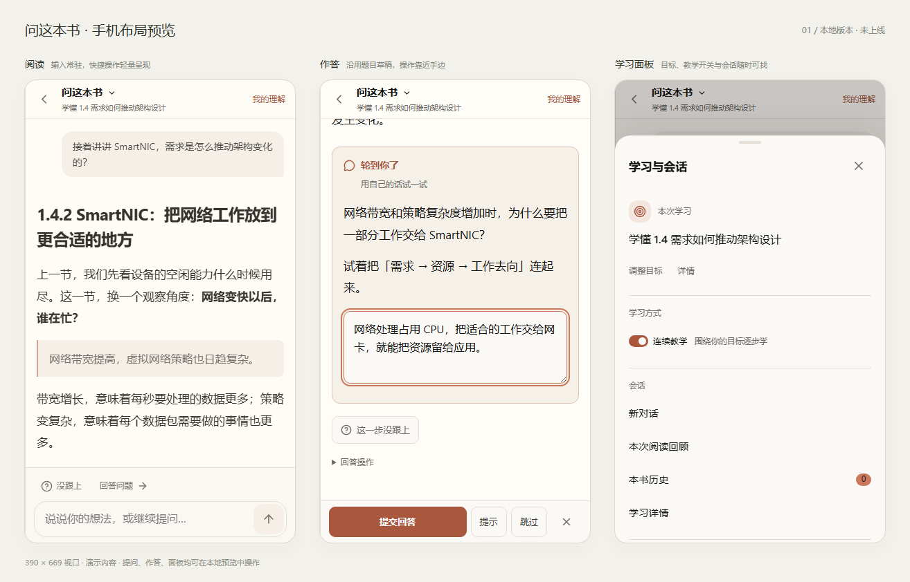

# 手机学习布局：本地预览（2026-10-13）

用户要求先看一版，暂不上线。本轮仅修改本地前端代码并提供交互预览，没有提交、推送或发布；生产版本仍为上一轮三栏布局 `7b94889`。

## 预览入口

- 本地交互页：http://127.0.0.1:4174/mobile-learning-preview.html
- 独立手机页面：http://127.0.0.1:4174/mobile-learning-preview.html?embedded=1
- 启动：在 `packages/web` 运行 `pnpm dev --host 127.0.0.1 --port 4174`。
- 页面支持 390×669、390×844、320×568 三种视口，以及阅读、提问、作答、学习面板四种状态。使用真实布局和教学组件，演示请求只在页面内存中响应，不读取或写入真实学习数据。预览入口未加入生产构建输入。

## 实现

- `RightRail` 在 1024px 以下使用紧凑顶栏。左侧返回阅读，中间显示学习目标摘要并打开“学习与会话”，右侧直达“我的理解”。已有学习目标、教学开关和会话操作通过 Teleport 移入底部面板，保留组件和编辑状态。
- 提问输入框默认常驻，输入与发送按钮合为一个圆角区域，作为主要交互入口。上方的“没跟上 / 回答问题”为小号、无填色的辅助操作。进入作答后底部切换为该题的提交操作，关闭作答恢复提问框及其草稿；多行输入可缩回一行，不隐藏输入入口。
- 点“回答问题”定位并聚焦已有题目输入框。`TutorActivities` 将当前题目的提交、提示等操作移到屏幕底部；题目及作答草稿仍由原组件持有，沿用原提交与重试协议。
- 作答输入和目标输入补齐 `data-workspace-input`，沿用现有 visualViewport 键盘处理。切换到作答时收起普通提问，收起编辑、关闭面板和切换阅读不清空草稿。
- `ReaderWorkspace` 在手机问答期间隐藏重复的外层导航。阅读工具和菜单改从学习面板访问；返回阅读后原导航恢复。桌面三栏布局保持原有行为。

## 测量与验证

| 视口 | 对话区高度 | 视口占比 | 底部操作高度 |
| --- | ---: | ---: | ---: |
| 390×669 | 504px | 75.3% | 109px |
| 390×844 | 679px | 80.5% | 109px |
| 320×568 | 403px | 71.0% | 109px |

测量见 [layout-metrics.json](layout-metrics.json)，三个视口均无横向溢出。390×669 的可滚动对话区为 504px，比线上原布局的 361px 多 143px（约 40%）。常驻提问框比只保留三个按钮的初版多用 48px 底部空间，换取随时输入和发送；测量对象是对话容器，不是其中实际文字的占比。

- 68 项组件测试通过：RightRail 53、TutorActivities 9、ConversationLearningGoal 6。原来按 `button:last-child` 查发送按钮的测试改用 `.send-agent`，避免匹配新加入的编辑器收起按钮。
- 初版 25 项浏览器测试通过：手机预览 4、手机交互 4、桌面/手机教学布局 4、真实 App 学习入口 5、移动工作区 8。恢复常驻输入后重新通过其中相关的 20 项，新增检查输入框默认可见、切换作答仍保留提问草稿及发送后继续显示输入框。
- 键盘用例模拟 visualViewport 变为 350px（普通提问另覆盖 offsetTop=80），确认作答框、发送与提交按钮位于可视区域。
- TypeScript 检查及 Vite 生产构建通过。截图采集未发现页面运行错误。

截图：[交互预览页](interactive-preview.png)、[提问](asking-390.png)、[作答](answering-390.png)、[学习面板](learning-panel-390.png)、[小屏阅读](reading-320x568.png)。

## 已知限制

- 当前是本地演示，回复和作答记录使用固定演示逻辑；真实 App 的接口行为另由上述浏览器用例验证。
- 尚未在实体 iPhone / Android 上验收软键盘、浏览器地址栏和安全区域组合；当前证据来自 Chromium 的浏览器与视口模拟。
- 待用户看过布局后决定后续调整与是否发布。
