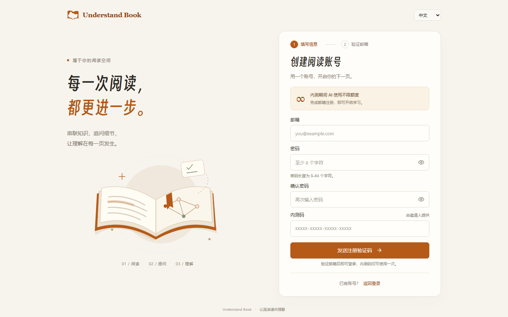
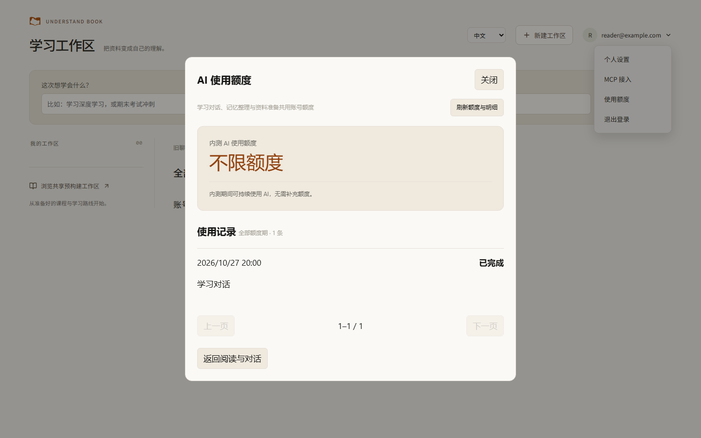
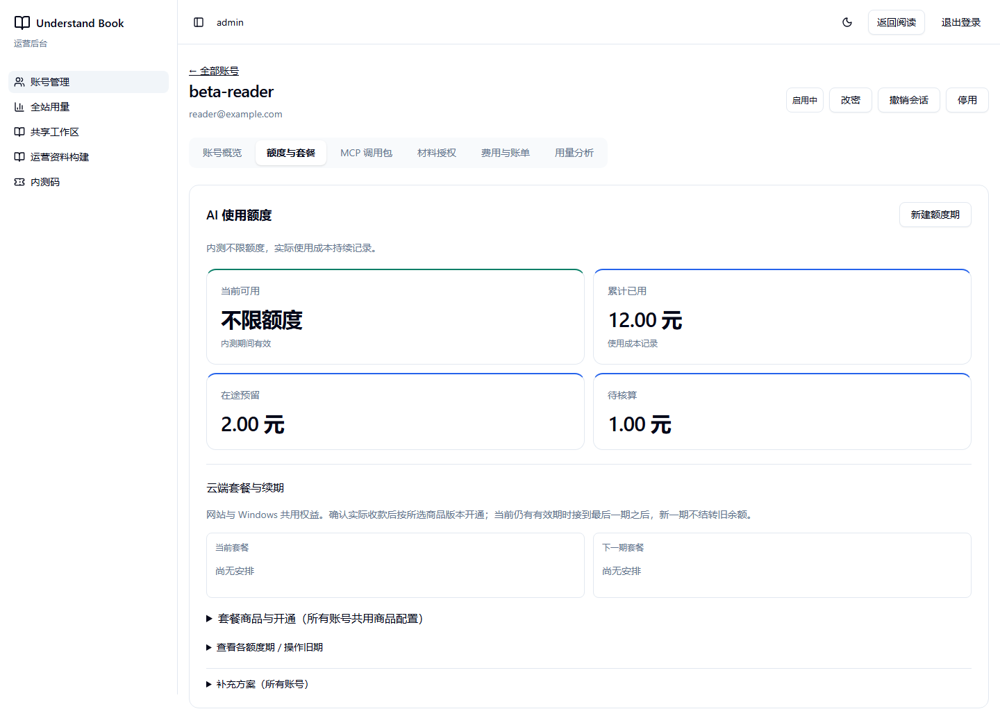

# 新邮箱账号内测不限额度 · 2026-10-27

新完成邮箱注册的账号在内测期间 AI 使用不限额度，取消注册赠送 10 元及 30 天到期。注册页、成功提示、账号额度页和运营后台同步展示该权益。决策见 [ADR-0159](../../adr/0159-email-accounts-and-single-use-beta-invites.md)。

## 实现

- `account_registration.rs:open_beta_allowance`：与建号、邮箱验证、核销内测码同事务建立不限额期及管理回执；不写入金额赠送和收款。重复完成返回原回执，各写入阶段失败均回滚。
- `control_store.rs`、`unlimited_allowance.sql`：schema 21 增加 `allowance_periods.unlimited`，既有期默认保持有限额。新注册期沿用原账本和外键；技术截止时间为 `9999-12-31 UTC`，界面显示“内测期间”。
- `account_allowance.rs:AllowanceBalance::can_reserve`：模型、构建、个人准备、音频转写与复核、联网搜索和读取共用准入判断，累计金额及待核算占用不阻断不限额账号。成本记录和已确认的单任务预算继续生效。
- `AccountAccess.vue`、`AccountAllowance.vue`、`PersonalPreparations.vue` 与中英文目录：不限额提示、使用记录及刷新；不限额账号不显示余额耗尽、30 天到期或补充额度提示。
- 后台账号列表、详情、额度期及操作回执显示不限额度，同时保留实际费用、在途预留和待核算数据。

## 验证

- [服务端测试日志](server-tests.log)：77 项通过、3 个人工浏览器服务 fixture 按原定义忽略。覆盖实际 HTTP/SQLite 注册、重试、逐阶段回滚、90 天后权益查询、schema 20 升级及旧余额保留；实际计费入口模拟超过 10 元后的继续调用、待核算占用、停止资格和单任务上限。
- 前端 35 项通过：注册与密码组件 15、额度组件 8、语言切换 4、翻译目录 1、后台额度页 7。覆盖不限额账号累计使用 12 元时不显示余额不足，以及刷新后的权益显示。
- `pnpm --filter @understand-book/web build:multi` 与 `pnpm --filter @understand-book/admin build` 通过，包含两端类型检查。
- [页面验证](visual-qa.json)：实际生产构建完成 8 组浏览器检查。注册和成功提示覆盖 1440×900、320×568、英文 390×844；额度页覆盖同样尺寸及刷新、关闭；后台列表与详情覆盖桌面和 390×844 手机。页面异常为零，直接检查截图确认排版。界面使用隔离响应，后端使用真实测试服务与数据库；没有外部邮件或付费模型调用。

## 发布状态与范围

当前为源码及本地验证完成，尚未发布到线上。上线时需要部署 schema 21 的服务端与两端页面。

规则适用于更新后完成邮箱注册的新账号。既有账号、游客的 5 元体验额度、远程 MCP 次数和已确认的个人任务预算沿用原规则。资料与存储权益继续按各自授权管理。
