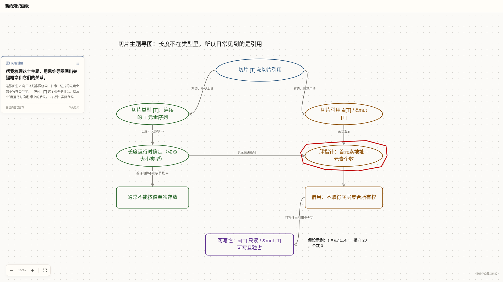
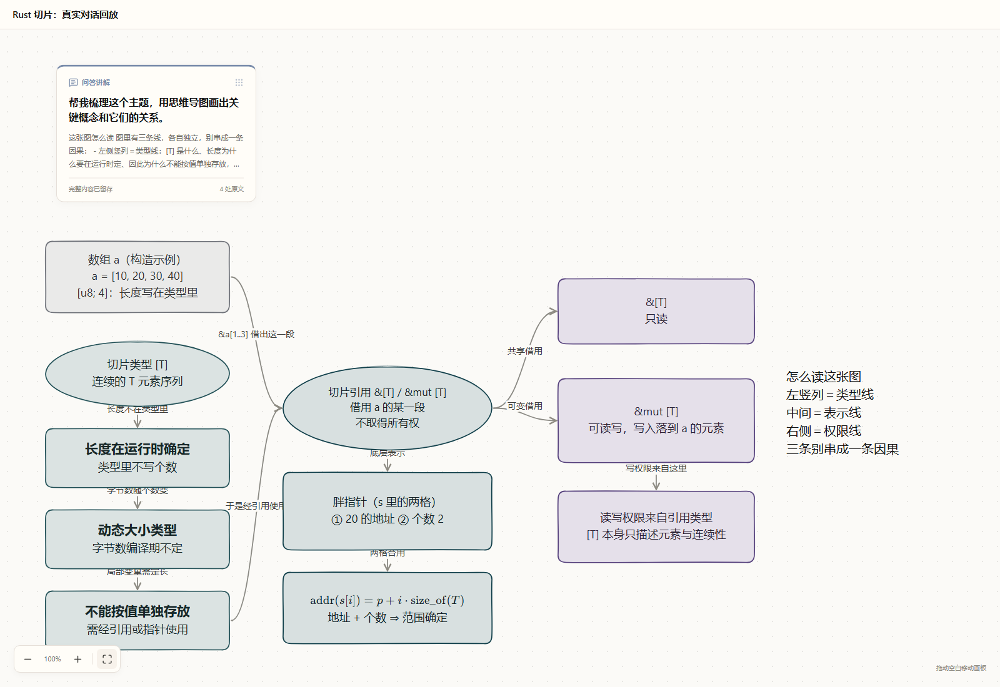
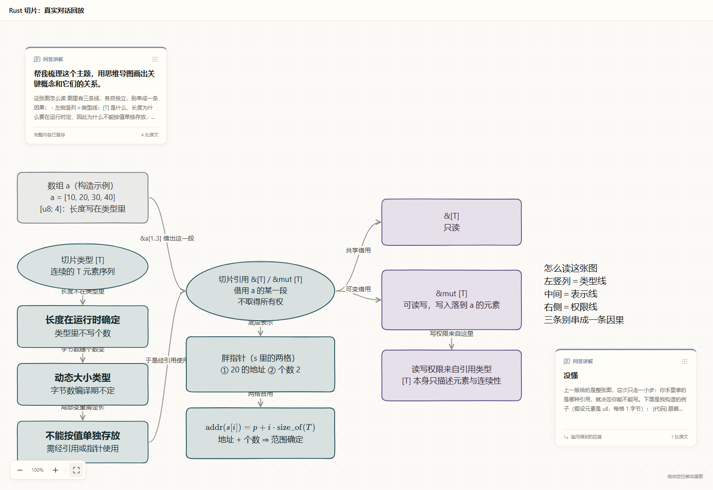

# 原生画板表达规划与 Rust 游客对话回放

## 场景与实现

游客先对《Mastering Rust》30.2–30.3 的选段请求“帮我弄懂这段”，再要求画思维导图，最后选中“可写性由引用类型决定”这一解释块说“没懂”。原记录最后一轮约 260 秒、6 次预览后取消，未交付最终讲解；取消原因未确认。

本次改动覆盖这条真实路径：

- `crates/server/src/board_api.rs:FrozenBoardFollowUp::request_context` 从接受时的画板版本解析精确解释块，`agent_run.rs:execute_model` 将结构化选择送入 `RunContext.board_request_context`。完整旧答案只作背景。
- `crates/runtime/src/orchestrator.rs:expression_coach_packet/prepare_expression_coach` 将现有表达教练接入 `board.author plan`。普通 observing 模式也可使用；新图直接 prepare 时先规划，不创建预先编好的候选，下一次采样消费规划后再制作。
- 原生画板和 HTML 演示分别缓存本轮规划，复用同一执行器。几何、字体和预览修订复用规划；纯文字局部回答不增加规划调用。既有 active Tutor 审核保留。
- `expression_coach_conversation` 在本轮作者开始工作前提取最近两轮已完成的可见问答；排除工具结果、内部推理和本轮制作过程。前文、当前选择、原文证据与作者方案分开提供，避免“这个主题”只有作者自述可供教练判断。
- `tutor_explanation_principle.md` / `tutor_writing_rules.md` 将对象、动作、结果放在术语概括前，约束局部困惑的范围、事实条件与因果关系。规则同时用于普通问答；没有写入 Rust 专项答案。
- `BoardCanvas.vue` 不再把每个原生图元的回复归属画成一条箭头；保留卡片回复线和作者显式连线。`BoardLink.based_on` 省略时默认为空数组。

## 回放方法

`evals/semantic/rust-board-replay.mjs` 使用真实本地服务、实际前端画板渲染器和现有 provider 配置；新建 memory/private 目录，不接入游客线上会话。模型为 `deepseek-v4-flash`，本地书原文与历史 source revision 一致。前两轮使用原请求，第三轮选择本次实际生成的可写性内容；生成的前文不同于历史，因此不是固定历史状态的逐字继续。

```powershell
cargo build -p server --bin server
pnpm --filter @understand-book/web build
node evals/semantic/rust-board-replay.mjs --out tmp/rust-board-improvement-20261028/replay-02
```

原会话的私有输入在 `tmp/visitor-rust-review-20261028/session-events.private.json`，不随本记录分发。脚本支持 `--history`、`--book`、`--server`、`--web-dist`。新图未能唯一匹配可写性块时先保存前两轮，检查实际块后以 `--resume --selected-block <id>` 或 `--resume --selected-item <id>` 继续，不替模型编写回答。

## 首次候选的实际失败

`replay-01` 完成三轮，但内容未通过验收。耗时约 26 / 188 / 38 秒，模型调用数 4 / 14 / 3；画图轮包含一次表达规划，仍做了 4 次预览。第三轮选中的是模型将借用和可写性合并的 `borrow-and-mut`，范围比历史 `map-mut` 更宽。

导图仍是抽象术语链，没有具体数组及操作；图中再次写出“当不了变量 / 字段 / 参数”，正文把胖指针与借用规则强连成必要因果。第三轮虽然直接完成文字回答，却把 `[u8; 5]` 的赋值误说成使原变量失效的移动。调用流程成功不代表教学内容改善。

这一轮暴露了教练缺少前文问答的实际缺口，也促成共享提示词的重排：以前“对象与过程”规则没有优先约束开头，生成内容仍让抽象链占据主导；新规则不允许用“我推导的、未核实”替确定结论免责。

事实核对使用 [Rust Reference 的 DST 规则](https://doc.rust-lang.org/reference/dynamically-sized-types.html)、[Copy 文档](https://doc.rust-lang.org/std/marker/trait.Copy.html)及[借用说明](https://doc.rust-lang.org/book/ch04-02-references-and-borrowing.html)。本地 `rust-fact-counterexamples.rs` 实际编译运行，确认 DST 可作结构体最后字段、整数数组赋值保留原数组，以及共享引用最后使用后可再作可变借用。原始失败答案、图和调用记录保留于 `tmp/rust-board-improvement-20261028/replay-01/`。

## 最终候选验证

第二次回放 `replay-02` 完成三轮。首轮从数组 `a = [10, 20, 30, 40]`、`s = &a[1..3]` 实际读到 `20/30` 开始，再说明 `s[0] = a[1]`、地址与长度。导图保留该数组入口，将“类型、表示、权限”分别连接，未再出现字段禁令、长度装在指向的数据里、胖指针导致借用规则的错误。

新图把正文合并为 `map-main`，没有独立可写性解释块。第三轮因此选择图中真实存在的 `d-perm` 节点（“读写权限来自引用类型；[T] 本身只描述元素与连续性”），仅发送原话“没懂”。系统直接用可变切片写入说明 `s[0] = 99 → a[1] = 99 → [10, 99, 30, 40]`，未扩展 DST 或重画全图。该代码实际编译运行得到预期数组；同一行的类型和借用都替换为只读引用后，赋值产生 `E0594`。

| 请求 | 历史记录 | 最终候选 |
| --- | --- | --- |
| 解释选段 | 30.9 秒，3 次模型调用 | 44.4 秒，5 次模型调用；先走具体读取例子 |
| 思维导图 | 195.0 秒，10 次模型调用，3 次预览 | 134.4 秒，9 次模型调用，1 次预览；含 1 次表达教练调用 |
| 选中可写性后“没懂” | 260.4 秒，16 次模型调用，6 次预览，取消 | 19.8 秒，3 次模型调用，0 次绘图调用，完整文字交付 |

图及追问回放均由实际 `BoardCanvas` 渲染，浏览器错误为零。独立渲染回归还覆盖旧回答＋新回答＋十个原生图元，自动回复线由 11 条变为 1 条，显式教学连线保留，并操作缩放及适应画板。







相关回归共 52 项通过：原生/混合形式教练 6、HTML 教练 5、既有画板审核交付 6、plan/link 契约 1、服务画板上下文 13、普通 Tutor 规则 5、前端画板 15、memory 连线默认值 1。Server 编译、Web 类型检查及生产构建通过。`tmp/rust-board-improvement-20261028/` 保存测试日志，`replay-02/` 保存最终答案、运行活动、选择上下文、画板文档与截图。教学内容经另一代理独立核对最终产物，主代理直接检查图和代码运行结果。

## 已知问题

首轮结尾自行追加了“把 head 那一行换成 &mut，其余不变，看为什么编译不过”的练习，改动范围不明确。若将类型与右侧借用都正确改为可变，原例可编译；因此不能将三轮结果描述为全部没有问题。实际注入记录没有强制收尾提问的指令，已有规则要求题目必要且答案有支持，这一处属于模型未遵守约束。原始答案保持原样，没有手工删改以制造通过。

画图轮发生过两次 `LID_PROVENANCE_REQUIRED` 和一次工具参数 JSON 格式拒绝，模型随后恢复并完成。没有因为最终交付成功而抹去这些记录。按约定未增加普通回答的强制付费事实审核；此次验证支持核心讲解和追问行为改善，不提供生成内容零错误保证。

## 验证边界

历史记录与两次本地回放不是多样本性能基准，不据此承诺稳定提速。模拟“没懂”检验的是系统如何利用选择上下文和改变讲法，没有新的真人学习证据，不能据此判定原游客已经理解。模型调用数包含当轮所有被记录的模型活动；原始 token 回执保留在运行记录中，不把历史 system 快照字符数当作同时有效上下文或计费量。

## 线上发布

2026-10-28 13:58:50 HKT 已以当时线上版本为基线合并发布，保留空间笔记及其他既有功能。维护 9.63 秒，无数据迁移；Linux 预览、旧数据读取和公网实际渲染通过。刷新 [Understand Book](https://understandbook.top/) 使用新版。详细回执与恢复点见[部署记录](deployment/README.md)。
