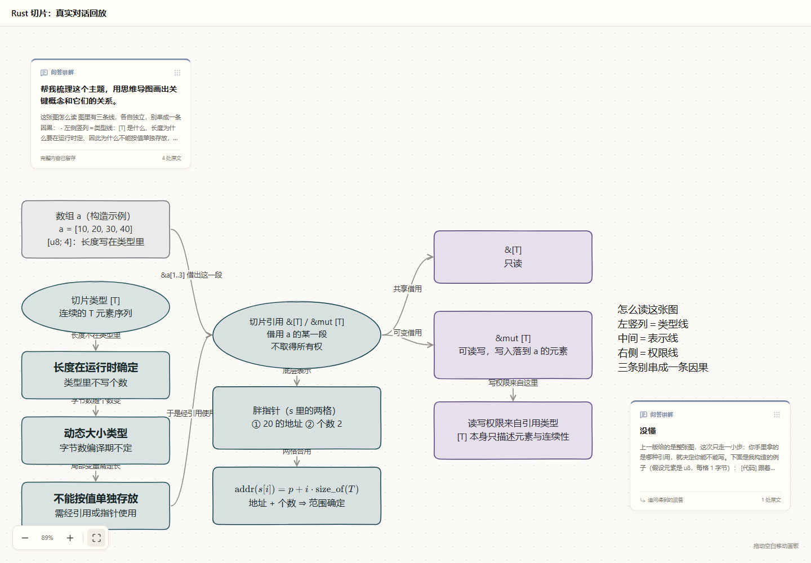

# Rust 讲解与画板规划上线记录

2026-10-28 13:58:50 HKT 已发布到 [Understand Book](https://understandbook.top/)。当前 release 为 `/opt/understand-book/releases/rust-board-teaching-20261028`，服务 PID 392557，schema 21。维护窗口 9.63 秒，无数据迁移。14:00:20 HKT 公网浏览器验证通过。

## 发布内容与合并依据

以线上 `board-visual-math-20261028` 为基线，三方合并本次 15 个变更文件，保留已有空间笔记、笔记关系、数学排版、邮箱注册与内测额度行为。两处提示词冲突手工合并，保留线上空间笔记说明及新的精确选择、局部讲解和表达规划要求。补丁见 [release.patch](release.patch)，文件范围见 [release-source.json](release-source.json)。

本次上线普通模式下的原生画板表达教练、最近两轮可见问答上下文、精确选择块传递、按本轮与制作形式复用规划、具体例子优先的共享教学提示词，以及减少原生图形自动回复箭头的修复。普通局部文字回答可直接完成；既有 active Tutor 流程保留。实现与真实模型回放见[上一级记录](../README.md)。

## 验证

- 在最终 release 目录完成 Linux release 编译，六个服务相关程序构建成功；临时编译交换空间已移除，系统参数恢复。见 [build-completion.json](build-completion.json)。
- 合并后的多人前端完成类型检查与生产构建，57 项画板／工作区测试通过。实际渲染 Rust 第二轮回放的最终画板：12 个图形、10 条显式关系、0 条多余自动回复线；另一个连线样例保留 1 条卡片回复线与 1 条教学连线，缩放与适应画板可用。见 [visual-qa.json](visual-qa.json)。
- 合并后再验证 6 项原生／混合形式表达教练测试和 15 项服务端画板测试，覆盖精确选择与线上空间笔记共存。
- 使用最终 Linux 程序和正式服务账户运行真实浏览器预览，浏览器错误与检查问题均为 0。见 [linux-preview.json](linux-preview.json)。
- 在隔离数据副本验证 3 个现有账号、书库、正文、历史、空间笔记及 8 张旧画板；不调用模型。见 [integration-qa.json](integration-qa.json)。
- 切换后核对首页、阅读器、管理入口及 9 份引用静态资源，文件内容与候选发布一致。读者和管理员均可登录、读书、查看历史与额度，制作能力可用。见 [public-verification.json](public-verification.json)。
- 公网浏览器加载实际新版渲染资源，显示相同 Rust 回放画板，12 个图形与 10 条关系线完整，无多余回复线或浏览器错误；测试画板只注入验证浏览器，未写入游客线上会话。见 [public-ui.json](public-ui.json)。

## 数据与恢复点

切换时没有正在执行、排队或后台复核任务。50 份历史聊天、85 份画板文件逐字节保持，13 条额度周期记录保持，schema 仍为 21。切换回执见 [deployment.json](deployment.json)。

上一版 `/opt/understand-book/releases/board-visual-math-20261028` 保留。配置与可变数据备份为 `/opt/understand-book/backups/rust-board-teaching-20261028`。发布流程在开放公网前失败会恢复旧配置和旧服务，不倒退生产数据；开放公网后的恢复须以当时的新数据为准。

## 已知问题

真实模型回放的首轮末尾仍有改动范围含糊的练习题；该问题及画图时恢复过的工具参数拒绝完整保留在[回放记录](../README.md#已知问题)。本次上线没有重新调用线上模型，不将部署健康检查视为新一轮教学质量评测。
