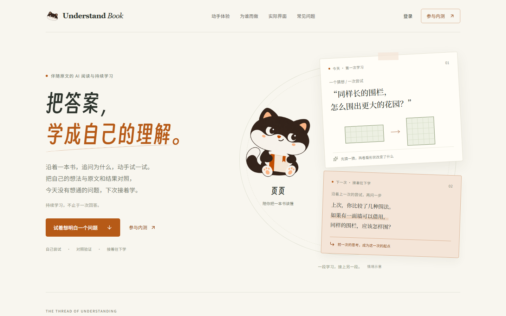

# 得意黑展示字体接入

2026-10-13，本地实现与验证完成。

## 展示字体

**决策**：得意黑统一品牌、欢迎引导与展示标题。

**否决**：
- 全局替换正文与操作文字：长文阅读与密集信息需要稳定的字形。
- 只替换首页两处：书架、学习入口与分享画面缺少连续的品牌识别。

**命门**：使用原始字形与 400 字重；得意黑自身已有倾斜，关闭人工合成字形。

## 覆盖位置

| 页面 | 使用位置 |
| --- | --- |
| 产品首页 | 首屏、主要分区、受众、截图说明及原则标题；页页名称 |
| 书架与账号入口 | 书架主标题、登录、注册与账号恢复标题 |
| 学习入口 | 助手欢迎语、学习详情、学习引导与空态标题 |
| 理解与回顾 | 理解记录主标题、阅读回顾主标题 |
| 分享图片 | 导出卡片标题；分页前加载，并内嵌进图片的渲染文档 |

正文、导航、表单、列表、书名封面与原始材料沿用现有字体。

## 字体来源与打包

- 来源：[Smiley Sans v2.0.1 官方发行版](https://github.com/atelier-anchor/smiley-sans/releases/tag/v2.0.1)。
- 原文件：`SmileySans-Oblique.ttf.woff2`，1,150,924 字节，内容未经修改。
- 项目资源：[SmileySans-Oblique.woff2](../../../packages/web/src/assets/fonts/SmileySans-Oblique.woff2)。
- 许可：[SIL OFL 1.1 与版权声明](../../../packages/web/public/licenses/SmileySans-OFL.txt)，生产包位于 `licenses/SmileySans-OFL.txt`。
- 共享定义：[brand.css](../../../packages/web/src/brand.css)，界面通过 `--font-display` 使用；本地托管，页面采用 `font-display: swap`。
- 分享图：[reading-share-layout.ts](../../../packages/web/src/reading-share-layout.ts) 在排版前加载得意黑，并与正文和公式字体一起嵌入导出 SVG，再生成 PNG。

## 验证

- `pnpm exec vue-tsc --noEmit` 通过；`VITE_MULTI_USER=1` 的 Vite 生产构建通过，确认输出包含字体和许可证。
- `reading-share.test.ts`、`ShareImagePanel.test.ts` 共 17 项通过。
- [display-font-share.spec.ts](../../../packages/web/playwright/display-font-share.spec.ts) 通过：加载得意黑、保持正文书体、实际导出 SVG 含字体数据、1080 × 1440 PNG 标题产生可见像素。
- [19 组页面与尺寸结果](verification.json)：首页 320 / 390 / 768 / 1024 / 1440；登录、注册、书架、助手欢迎、学习引导、理解记录、阅读回顾分别检查 390 / 1440。使用真实页面或组件与固定接口数据，检查标题字体、字重、横向溢出以及正文未受影响。
- 已人工查看首页、分区、书架、注册、助手欢迎、学习引导、理解记录、阅读回顾与导出图。

## 效果

[手机首页](home-390.png) · [助手欢迎](welcome-390.png) · [学习引导](learning-390.png) · [导出分享图](share.png)
