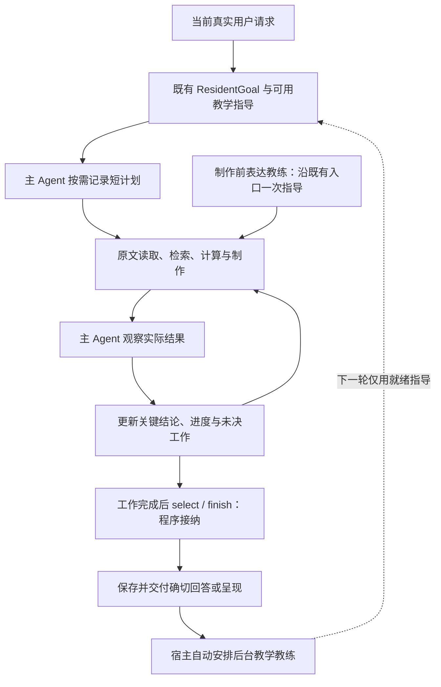

# 切片方案：主 Agent 计划执行与教练指导

日期：2026-10-29。对应 [ADR-0176](adr/0176-main-agent-planned-teaching-and-coach-guidance.md)。**MA0–MA5 已实现并上线。** 实际结果统一见[实施报告](https://github.com/adaelon/understand-book/blob/625b4405af3b011e87d4eb256f819c8075f88613/docs/performance/main-agent-planned-20261029/README.md)；发布与恢复点见[上线记录](https://github.com/adaelon/understand-book/blob/625b4405af3b011e87d4eb256f819c8075f88613/docs/performance/main-agent-planned-20261029/deployment/README.md)。

源码核对基点：`bbf18a8c12bdf7b99ed402cc95195356f376d4e8` 的当前工作树；工作区另有无关修改及未跟踪实验材料。后续执行先查看实际差异，按本文的符号和合同定位，不复原或覆盖其他工作。源码行号会变化，函数与数据类型为主要定位依据。

## 1. 目标与执行范围

让主 Agent 在同一个工具循环里完成计划、取证、判断、制作、修订和最终交付。教练继续提供教学节奏和表达方法指导；独立内容审稿移出默认用户等待路径。保留当前认可的回答深度、来源可靠性、用户参与与学习接续。

适用于普通文字、图表、原生图板、演示页及沿同一 select 链交付的媒体讲解。保留各形式的实际读取、观察、预览、版本和操作回执。独立审核代码可供已有离线评估使用，不为本次增加用户可见的审核模式或自动后台审稿任务。

实施顺序为 `MA0 → MA1 → MA2 → MA3 → MA4 → MA5`。MA2 的真实记录与教练取证验证完成后，才移出默认审稿调用。多个切片涉及同一 `orchestrator.rs`，按顺序合入，避免并行改动同一调用链。

### 1.1 后续 agent 的最短阅读顺序

1. ADR-0176 与本文，确定目标状态、保留边界和当前未完成状态。
2. [同首稿实验报告](https://github.com/adaelon/understand-book/blob/625b4405af3b011e87d4eb256f819c8075f88613/docs/performance/teaching-shared-rules-20261029/README.md)，了解漏检、质量与计时边界。
3. [Goal 工作计划](../crates/runtime/src/goal.rs) 与 [ADR-0155](adr/0155-goal-work-plan-and-version-centered-presentation-context.md)，复用已有数据和工具。
4. [Runtime 调度](../crates/runtime/src/orchestrator.rs) 的 `review_delivery_candidate`、`tutor.step`、`goal.update` 分支；[服务端教学](../crates/server/src/teaching.rs) 的 `prepare_select/preflight_step/record_agent_review` 和实际交付入口。
5. [教练调度](../crates/server/src/teaching_coach.rs)、[原阅读恢复](../crates/server/src/teaching_coach/observations.rs)、[审核历史](../crates/memory/src/agent_work.rs)，确认取消审批不会破坏数据接续。

## 2. 已确认的现状

| 机制 | 当前源码落点 | 本次处理 |
| --- | --- | --- |
| 默认交付审稿 | `orchestrator.rs:review_delivery_candidate`；`select` 调用；纯文字事实通过后再做解释审 | 从默认路径移出，含对应视觉综合审稿与拒稿重审循环 |
| 交付程序检查 | `server/teaching.rs:prepare_select/preflight_step`、Runtime select/finish 与预览约束 | 保留，作为来源、版本、状态、实际操作及交付登记 |
| 主 Agent 计划 | `goal.rs:GoalWorkingState/GoalUpdate::Working`、`orchestrator.rs` 的 goal.update | 直接复用，使复杂回答实际使用短计划 |
| 教学设计 | `memory/teaching_design.rs:TeachingDesign` | 保持目标、关系组织和呈现设计职责 |
| 教学教练 | `teaching_coach.rs:ensure_turn/after_delivery/prepare_execution` | 逐轮自动后台执行，仅注入就绪指导，前台不等待 |
| 表达教练 | `orchestrator.rs:prepare_expression_coach`、`tutor_coach/presentation.rs` | 保留图板／演示制作前同步指导及每运行每形式缓存 |
| 教师工作历史 | `memory/agent_work.rs:append_agent_work_review/agent_working_state` | 保留真实历史；停止依赖新 review 来产生当前计划或知识摘要 |
| 正式学生测评 | `tutor.step assess → tutor::evaluate → teaching_assessments/Performance` | 保留隔离模型评分、冻结题面／合同和受助条件 |

### 2.1 性能依据及适用边界

已保存的最新同首稿结果为 181.053 → 225.061 秒、10 → 9 次调用、正文修改 1 → 2 次，总输入减少 23.02%。最终稿独立复核通过，但没有提速。最后样本主 Agent 请求累计约 24.8 秒，事实审核约 181.3 秒，解释审核约 14.3 秒；其余为工具与运行开销。依据见 [comparison.json](https://github.com/adaelon/understand-book/blob/625b4405af3b011e87d4eb256f819c8075f88613/docs/performance/teaching-shared-rules-20261029/comparison.json)。

这一组从首次真实事实审核开始，冻结了 1,193 字符首稿及初始 19 段来源。它没有衡量新标准对重新生成首稿的影响，也没有覆盖绘图、演示和跨模型稳定性。新流程移除审核阶段后，不能拿“225 秒减去审核时间”当预测，不能直接与旧边界宣称端到端改善。

## 3. DeepTutor 固定源码参照

当前参照固定为官方仓库提交 `1ea7df155447f4caf0e3abc86b3ff5395479cd4a`，不以会变化的 main 链接作为执行依据。

| 参考代码 | 核对到的机制 | 本项目如何采用 |
| --- | --- | --- |
| [prompts/en/system.md](https://github.com/HKUDS/DeepTutor/blob/1ea7df155447f4caf0e3abc86b3ff5395479cd4a/deeptutor/capabilities/solve/prompts/en/system.md) | 先安排少量步骤，执行后记录，路线受阻再调整 | 主 Agent 的复杂任务工作指导；短追问不强制规划往返 |
| [tools.py：SolvePlanTool](https://github.com/HKUDS/DeepTutor/blob/1ea7df155447f4caf0e3abc86b3ff5395479cd4a/deeptutor/capabilities/solve/tools.py#L70) | 记录简短任务分析及有序步骤 | 映射现有 goal.update working，不新增 plan 工具 |
| [tools.py：SolveFinishStepTool](https://github.com/HKUDS/DeepTutor/blob/1ea7df155447f4caf0e3abc86b3ff5395479cd4a/deeptutor/capabilities/solve/tools.py#L146) | 保存步骤结果并保留当前进度 | 按阶段更新现有工作状态；不为每次检索单开往返 |
| [tools.py：SolveReplanTool](https://github.com/HKUDS/DeepTutor/blob/1ea7df155447f4caf0e3abc86b3ff5395479cd4a/deeptutor/capabilities/solve/tools.py#L214) | 路线变化时给出原因并替换计划 | 在已有 working 中重排后续项，保留有效成果与未决问题 |
| [session.py：SolveSession](https://github.com/HKUDS/DeepTutor/blob/1ea7df155447f4caf0e3abc86b3ff5395479cd4a/deeptutor/capabilities/solve/session.py#L35) | 当前步骤、结果、进度与有限重规划状态 | 复用 Goal revision 和会话日志；不引入其进程内会话表 |
| [loop.py：SolveLoopCapability](https://github.com/HKUDS/DeepTutor/blob/1ea7df155447f4caf0e3abc86b3ff5395479cd4a/deeptutor/capabilities/solve/loop.py#L20) | 在同一个聊天工具循环中接入计划能力 | 继续使用 Resident 循环，不增加规划／协调 Agent |

旧版参照固定为 `2384bd8e75aecce1922ba5c18b6c949ca2c51dd2`：

- [investigate_agent.yaml](https://github.com/HKUDS/DeepTutor/blob/2384bd8e75aecce1922ba5c18b6c949ca2c51dd2/src/agents/solve/prompts/en/analysis_loop/investigate_agent.yaml)：先明确缺少什么知识，再做具体查询，复用已取得材料。
- [solve_note_agent.yaml](https://github.com/HKUDS/DeepTutor/blob/2384bd8e75aecce1922ba5c18b6c949ca2c51dd2/src/agents/solve/prompts/en/solve_loop/solve_note_agent.yaml)：已完成部分与尚未覆盖部分分开处理。
- [旧主循环](https://github.com/HKUDS/DeepTutor/blob/2384bd8e75aecce1922ba5c18b6c949ca2c51dd2/src/agents/solve/main_solver.py#L623)：参考对象是资料与任务进度管理，不将旧双循环宣称为独立成文审核。

取舍：DeepTutor 的 done 是模型声明，重规划预算耗尽也不能证明质量；其逐步折叠上下文不直接移植。我们保留原始消息、实际来源和确切成果版本，关键条件保持可读取。既有取消、预算和无进展停止继续生效，不额外照抄一个固定重规划次数，也不把资源耗尽标成任务完成。

## 4. 目标流程与职责



箭头表达职责，不要求每个节点各调用一次模型。正文取证、自检和输出由同一主 Agent 完成；计划记录与阶段更新不能演变成固定多轮规划仪式。用户改变目标、要求直接讲解或停止时，以实际请求和既有接纳规则为准。

教学教练在下一轮用户输入前只看已发生事实，不预言用户回答；表达教练负责本轮图板／演示方法指导。两者都不签发“当前答案正确”的凭证。表达教练已有同步成本要单独计量，不能因教学教练后台执行就宣称所有教练调用都不在关键路径。

## 5. 计划、提示词与上下文合同

### 5.1 复用已有工作计划

正常 Reader 在 `server/lib.rs:append_pending_agent_turn` 建立 ResidentGoal，经 `run_admission` 冻结进 Runtime。工作更新沿 `persist_goal → GoalUpdated → 会话投影` 保存和恢复。无 Open Goal 的底层入口没有 goal.update，本次不扩展该入口。

保持现有字段：

```json
{
  "operation": "working",
  "focus": "核对能够解释全书主线的关键案例",
  "open_questions": ["案例中的结果是实际发生，还是假设条件？"],
  "next_move": "读取案例的措施、结果及相邻条件段",
  "items": [
    {"id": "structure", "description": "从目录与导言确定全书主线", "status": "completed"},
    {"id": "case", "description": "核对关键案例的措施、结果和条件", "status": "in_progress"},
    {"id": "delivery", "description": "连接主线、案例与方法并完成讲解", "status": "pending"}
  ]
}
```

这是工作状态示例，不是《失败的逻辑》的已发生读取。省略 items 保持原项；传入数组按现有合同整体更新，空数组清空；修订时保留仍有效的工作及身份。无需新增评分、哈希、独立 Todo 表或自报“已验证”字段。

工作结果写入现有 focus、next_move、必要的项描述及 open_questions，并依靠真实工具记录和来源定位回读。计划只保留继续工作需要的简短结论，不要求模型记录完整思考过程。完成某项不自动更新 requirements、Goal 状态、实际交付或学习者掌握。

### 5.2 主 Agent 的工作指令

修改既有共同规则和主讲入口，保持单一权威来源。后续实现可按实际工具合同压缩以下指令，不把它另做成重复 system 模块：

> 以当前完整请求确定交付范围。需要多步取证或制作时，用现有工作计划记录少量具体成果；简单追问直接完成必要工作。每一步依据实际原文和工具结果推进，保留条件、口径、来源与未决问题；搜索定位不等于读取。发现路线有误时调整后续项，复用仍然成立的成果。按阶段更新计划，不为微小动作单独安排规划往返。完成前由你确认事实依据、必要解释和实际呈现；依据不足就继续处理或如实交代无法完成的具体部分。通过宿主接纳后交付确切结果。当前用户请求优先于先前计划和教练预案。

保留完整关系取证、标题归属、条件与事实区分、解释深度、实际预览和用户表达依据。将“等待独立事实／解释审核”“复审才能关闭本轮问题”“accepted draft 等于审稿通过”等默认指令改成真实的新流程。离线审核专用提示词保留在实际评估入口。

### 5.2.1 教学任务怎样决定下一步

计划是当前工作状态，不是自动推导下一步的引擎。下一步由同一个主 Agent 在正常采样中，结合当前请求、已读来源、真实用户表达、实际交付、TeachingDesign 与可用教练指导判断。程序核对读取、引用、版本和操作事实；来源是否足以支持解释、当前帮助是否适合学习者仍是模型的语义判断，不增加一个逐项批准计划的模型。

重要工作项的描述应说清要解决的具体关系或形成的成果，必要时带上完成依据；open_questions 记录仍缺的条件或尚未确认的理解，next_move 写能处理该缺口的具体动作。其含义是“要讲清什么、现在缺什么、下一步取得什么结果”，不是把“检索—分析—回答”换一种写法。沿现有字段表达，不新增必填表单、证据评分或每步自报验证状态。

教学内容与执行工作分开使用已有信息：TeachingTarget 的 learning_focus / expected_performance 说明本轮要让哪处关系可理解、可使用；TeachingDesign 的关系块与 focus 组织解释；真实用户表达及帮助条件限制对学习者的判断；教练给出 support / invite / conclude 建议及可能需要的阅读。Goal 工作项把这些安排落实为读取、比较、计算、制作、观察和交付。当前请求与实际新证据可以改变建议，不等待教练重新批准。

| 当前实际缺口 | 主 Agent 的下一步 | 何时可以转向后续工作 |
| --- | --- | --- |
| 只有目录、检索摘要或相关段落，关键主张尚缺依据 | 定位并读取支持该关系的原文及必要续段；独立范围可批量读 | 顺序的成员与先后、比较的双方与条件、案例的措施与结果及连接条件已得到所需支持；检索命中本身不算完成 |
| 来源中事实、假设、推论或标题归属尚不清楚 | 补读相邻条件或可靠结构，核对主张身份，保留其他已成立内容 | 能准确表达原文所支持的强度与归属；不能靠泛化、删掉必要解释或重复同一检索关闭缺口 |
| 事实已经支持，但从条件到结论的解释缺连接 | 把缺失连接讲出来，按需要选择例子、比较或可观察呈现 | 用户请求所需的对象、动作、中间连接与条件已在实际回答中出现；不为缺少表达而无目的扩大取材 |
| 不能确定用户是否理解或能应用 | 结合其实际表达和已获帮助继续支撑；仅当一次表达会影响后续教学且符合请求时，邀请一次具体回应 | 依据真实回应调整；“继续”、沉默、看过演示及教师讲过都不算掌握，也不阻止用户要求的直接讲解 |
| 图板、页面或媒体尚未实际观察／操作 | 沿既有工具观察确切成果与关键状态，修正实际问题 | 所需呈现已观察、操作已发生、版本与交付一致；源码或成功回执不能代替可见效果 |
| 当前请求所需解释、依据和实际成果均已具备 | 程序接纳并交付，完成当前任务或停在真实用户回应边界 | 交付完整回答或合适的邀请；本轮完成不等于整本书已教完，也不等于用户已经掌握 |

这是提示词落实和验收的行为约定，不是每次运行必须填写的清单或机械顺序。缺少事实依据与缺少学习者理解依据必须分开：前者补原文，后者不能靠多读几段原文消除。对于“这本书讲什么”，应完成用户要求的整体解释；不能因为把课程拆成小步骤而只交付第一步，也不能强制先通过测验。已知的多个来源缺口一次组织补读，完成一组有意义的工作后再更新计划，避免把审核往返换成规划往返。

### 5.3 上下文与完成含义

动态状态继续沿既有 ContextFragmentLedger 追加和退休。只让最新计划决定当前工作，不反复携带旧行动指令；用户消息、工具调用配对、来源和已保存版本保持原记录。没有可靠重读定位时不丢弃关键原文；模型摘要不能授予引用、已读或预览资格。

当前计划与旧 AgentWorkReviewed 分开。新路径停止产生审稿自动抽取的 agent_work.understanding；没有本轮 review 时，不显示假的 current review、revision_requested 或 accepted_by_review。旧真实审核及纠错可查，不能作为当前回合必须重新审批的依据。

## 6. 交付、记忆、教练与正式测评

### 6.1 select 的新含义

`select` 仍是“程序接纳并登记确切交付”。保留 `prepare_select/preflight_step`、来源范围与引用校验、活动入口、当前设计绑定、页面／图板版本、实际工具回执、私有题面／评分合同和交付不可变性。

移出默认 `review_delivery_candidate` 及其事实、讲解、视觉综合模型调用；移出相关拒稿重审门槛。终答仍需与真实选定正文及已完成操作一致，但不再要求模型审稿通过。程序发现引用或版本等错误时返回具体错误，主 Agent 修正后继续；这仍是实际错误处理，不是新增语义审核。

`finish=true` 沿现有直交付路径使用确切正文，避免再调用模型复述。实际已有候选的局部修改继续复用；旧拒稿专用 draft_ref/open_issues/issue_updates 不再是默认交付必填项。仅为旧审批服务且没有其他消费者的运行状态可在对应切片清理，历史 trace 不删。正式题目、邀请和帮助的时序仍按当前合同记录。

### 6.2 独立于审核的真实取证链

既有通道已存在，实施时验证并保留：

```text
原 turn 已保存的工具调用与成功结果
  → recover_turn_text_read_ranges(book, messages)
  → freeze_original_reads / freeze_coach_read_ranges
  → job.input.context.verified_read_ranges
  → with_material 按原来源版本取得正文
  → 教练判断真实用户表达
```

入口为 [observations.rs](../crates/server/src/teaching_coach/observations.rs) 的 `freeze_original_reads/with_material/reviewed_ranges`、[Runtime](../crates/runtime/src/orchestrator.rs) 的 `recover_turn_text_read_ranges` 和 [存储](../crates/memory/src/tutor_coach.rs) 的 `freeze_coach_read_ranges`。

恢复函数识别受支持的成功 book.text/book.text_batch；媒体沿既有真实 source bindings。模型不提供 verified_read_ranges，搜索摘要、教学 target、计划说明不能替代读取回执。旧审核携带的范围继续作为历史补充，不能成为新回合教练运行的必需条件。

### 6.3 记录与学习证据

禁止用 `decision=accept` 的空审核调用 `tutor_record_review/append_agent_work_review`，禁止伪造 issue 已解决或审核已通过。原始会话、实际交付、用户表达、帮助和来源继续持久保存；当前未决工作使用 GoalWorkingState，不新建知识记忆工具或迁移框架。

真实交付继续触发 `after_delivery`。无新 AgentWorkReviewed 的回合也应能生成教练任务、恢复原文并保存理解观察。只有实际用户表达与当时帮助支持学习证据，教师讲过、计划完成、工具成功均不证明用户掌握。

`tutor.step assess` 保留独立一次模型判读：已提交用户答案、冻结私有合同、原题与来源 → 评估 → teaching_assessments 和 Performance。它不是教师成稿审核，不在移除范围内；私有评分标准不能进入公开讲解。

### 6.4 图板、演示与媒体

主 Agent 必须看到用于交付的真实图表、图板和页面预览。修改确切候选后旧预览失效；关键交互状态、适用视口和播放回执按原机制观察。页面源码、渲染成功或工具返回 success 不能替代实际可见结果。

保留 `prepare_expression_coach` 和 `board.author / presentation.author prepare` 的现有指导入口，不把它与 `review_delivery_candidate` 合并删除。保留 pending_plot_refs、ReviewPreview、作者采样已观察状态和确切版本检查；代码名称含 review 不构成删除依据。新流程仍可由作者据预览进行局部修订。

## 7. 实施切片

### MA0：冻结当前基线与最小场景

**状态：完成。基线源码、工作区差异、构建、材料及三个原问题场景已冻结；回放准备与原生用量测试通过。** 保存当前可运行基线、源码差异、模型配置、材料版本及调用记录入口。复用既有实验工具与真实失败材料；不另建评测框架。优先确认现有回放能从原问题起跑并记录原生 usage。

具体产出：新旧流程共同的原始问题和材料条件；原稿／补齐证据／修正稿的离线语义样例；正文、局部追问、图板或演示、连续教练、正式作答的最小功能夹具。目录沿 docs/performance 既有约定，正文记录控制在一份报告中。

验证目的：发现比较起点不同、样例错误标注或用量漏算。若发生，先修正夹具和计量，不开始付费对照。旧同首稿样例只用于复核已知缺陷，不把旧审核意见塞入新完整运行。

### MA1：让既有工作计划进入主 Agent 的实际工作

**状态：完成。计划指导进入既有固定模块，复用 Goal schema 与恢复合同；12 项相关测试通过。** 修改 [goal.rs](../crates/runtime/src/goal.rs)、[agent_prompt.rs](../crates/runtime/src/agent_prompt.rs) 及必要工具指导，复用 working/items 的已有序列化与持久化；不新增计划 Agent 或计划 schema。主讲共同质量规则保留原义，移交前的同步审批仍暂时存在。

复杂任务以具体成果组织短计划；阶段完成时记录结果与缺口；短追问不强制调用。关键新证据触发后续计划调整，既有成果、原要求和来源记录不被覆盖。

验证目的：发现 working 更新误改用户要求、清空遗漏 items、恢复丢失当前计划或把 completed 当实际交付。复用已有 Goal 测试和会话恢复夹具；只为新行为补最小回归。不能用“出现过计划调用”证明规划质量，语义效果留到 MA5。

### MA2：解除当前工作与新审核记录的依赖

**状态：完成。无审核回合不继承当前 review，真实阅读恢复与教练接续回归通过；旧历史保留。** 核对并调整 `refresh_tutor_working_fragments`、服务端工作状态投影和提示词，让当前工作取自 Goal 和真实成果，旧 review 仅以历史身份可查。保留原 turn 消息、实际交付及教练阅读恢复链；不预设新数据表或作者笔记事件。

重点文件：[orchestrator.rs](../crates/runtime/src/orchestrator.rs)、[server/teaching.rs](../crates/server/src/teaching.rs)、[memory/agent_work.rs](../crates/memory/src/agent_work.rs)、[teaching_coach.rs](../crates/server/src/teaching_coach.rs)、[observations.rs](../crates/server/src/teaching_coach/observations.rs)。

验证目的：在**没有任何新 AgentWorkReviewed** 的真实交付夹具中，教练仍能取得用户原话、帮助先后和已读完整范围；短展示引用不截断此前实际阅读，失败／未读范围不混入。旧 review 可查询，未生成假的通过或解决记录；教练未就绪时下一轮继续。失败则修正接线，不能用 fake accept 绕过。

### MA3：把默认 select 改为程序接纳与交付

**状态：完成。Runtime 累计 980 项通过，16 项外部／专项保持忽略。** MA1、MA2 已通过，默认 select 不再调用同步内容审核。 在 select 分支移出同步 `review_delivery_candidate`，保留 preflight 与实际持久化。同步修改 `finish/revise/delivery_text/board_candidate_revision` 描述、共同质量标准和回执，使“接纳”明确指宿主已校验并保存，而非模型审核通过。

保留其他实际使用审核函数的离线入口；不要给线上增加长期旧／新开关。只清理确定没有运行消费者的拒稿状态。新旧版本对照使用冻结构建，不依赖功能开关。

验证目的：以记录调用目的的受控 adapter 检查正常文字和带视觉交付不会调用 tutor_delivery_review/tutor_explanation_review；同时确认无效来源、过时版本、未完成操作仍被程序拒绝，finish 直交付只有一次且内容一致。不能用“错误工具都不报错了”当成功，也不能用合成 accept 让测试通过。

### MA4：接通各类呈现、教练与正式作答

**状态：完成。相关服务端回归、真实 HTML 操作、图板预览与正式作答通过；原有全量测试失败单列于实施报告。** 检查图表／图板／页面仍由作者实际观察，局部修改后正确更新候选与预览，用户要求的媒体动作仍有真实回执。保留表达教练缓存和后台教学教练调度；保留正式题目 submit/revise/assess、帮助记录与学习证据。

验证目的：检测移除审稿时误删 ReviewPreview、跳过作者看图、重复制作教练、漏记实际交付、下一轮教练失去原文或正式作答停在未评状态。受控功能测试覆盖调用身份，真实浏览器覆盖图板／页面关键状态；视觉检查发现裁切或交互错误就修正。静态构建成功不能替代视觉验收。

本切片不新建规划界面。已有进展界面仅显示实际工作状态；若原文案把程序接纳写成“AI 审核通过”，同步改为真实状态，用户不需要理解内部 schema。

### MA5：原问题完整对照与独立质量验收

**状态：完成限定对照与验收记录。三组初始配对及三次具体失败驱动的复测共九次；文字本次等待缩短，图板最终交付，整体费用收益未证明，质量限制如实保留。全部样本、逐份质量判断及原生用量见 [实施报告](https://github.com/adaelon/understand-book/blob/625b4405af3b011e87d4eb256f819c8075f88613/docs/performance/main-agent-planned-20261029/README.md)。** 同模型、同配置、同材料与用户偏好，分别运行冻结基线和候选，从用户问题接纳开始到实际交付结束。教练可用状态及历史前缀一致，不把同题试跑形成的新记忆带入另一组。

首组覆盖《失败的逻辑》完整解释、局部追问和一项有真实预览的图板／演示请求；另外验证一次连续教学接续和正式作答，可复用 MA4 的合适夹具。真实调用先做每场景各一组配对；只有波动或具体未解失败会改变判断时追加，并记录原因、费用边界和全部失败。现有授权不包含的新增费用或部署按项目规则处理，不自动扩大实验。

独立内容评测只在交付后读取问题、原文和实际作品，不向运行中作者反馈，不以作者自述或计划完成判定合格。旧深度保护应转成评测要求：核对相关案例、方法、因果连接、条件与阅读路线，纠错时不能靠删掉有价值内容过关。增加未放入提示词的少量独立样例，避免只会修这一个交通案例。

记录前台首个有用输出及完整交付时间、主模型调用、工具与计划更新、正文重写、原生输入／缓存／非缓存输入及输出、实际费用、教练耗时与调用。主 Agent、表达教练、教学教练、正式评分分别归属；离线验收开销另列。非缓存输入和输出不因总输入下降而省略。

验收结论必须同时回答：回答事实与深度是否达到原标准；真实呈现是否可用；连续教练与学生评分是否正常；前台等待是否有可辨别改善；计划更新是否把节省的成本吃回去。若质量失败，保留样本并修正当前候选；若证据不足，明确未证明收益。不能仅以同步审核调用归零宣告性能完成。

## 8. 具体源码接点

以下均为本次核对的现有入口；实施时用符号重新定位。

| 路径 | 关键接点 |
| --- | --- |
| [runtime/goal.rs](../crates/runtime/src/goal.rs) | GoalWorkingState、GoalWorkItem、GoalUpdate::Working、当前工作投影 |
| [runtime/orchestrator.rs](../crates/runtime/src/orchestrator.rs) | goal.update schema/执行；review_delivery_candidate；select/finish；refresh_tutor_working_fragments；recover_turn_text_read_ranges；prepare_expression_coach |
| [runtime/tutor.rs](../crates/runtime/src/tutor.rs) | 工具 schema 与主讲指令；review 函数供实际评估保留；evaluate 用于正式学生作答 |
| [共同质量标准](../crates/runtime/src/teaching_quality_contract.md) | 保留内容与来源原则，调整默认审核职责措辞 |
| [runtime/tutor_coach.rs](../crates/runtime/src/tutor_coach.rs)、[表达教练](../crates/runtime/src/tutor_coach/presentation.rs) | 两种指导的输入、输出及职责 |
| [server/teaching.rs](../crates/server/src/teaching.rs) | prepare_select/preflight_step、record_agent_review、实际交付与 assess |
| [server/teaching_coach.rs](../crates/server/src/teaching_coach.rs)、[observations.rs](../crates/server/src/teaching_coach/observations.rs) | after_delivery、prepare_execution、freeze_original_reads、with_material、理解观察接纳 |
| [memory/agent_work.rs](../crates/memory/src/agent_work.rs)、[memory/tutor_coach.rs](../crates/memory/src/tutor_coach.rs) | 真实旧审核身份、教练已读范围持久化 |
| [server/agent_run.rs](../crates/server/src/agent_run.rs)、[run_admission.rs](../crates/server/src/run_admission.rs)、[session_event/projection.rs](../crates/server/src/session_event/projection.rs) | Goal 保存、冻结、恢复；运行和任务费用归属 |
| [memory/assessment.rs](../crates/memory/src/assessment.rs)、[learning_evidence.rs](../crates/memory/src/learning_evidence.rs) | 冻结判题结果与受助表现证据，保持既有行为 |

已有回放入口：[teaching-revision-replay.mjs](../evals/semantic/teaching-revision-replay.mjs)、[teaching-patch-replay.mjs](../evals/semantic/teaching-patch-replay.mjs)、[rust-board-replay.mjs](../evals/semantic/rust-board-replay.mjs)。先读其起止边界和默认配置，再复用或定向扩展；文件存在不代表适合直接运行或已通过。

## 9. 交付状态、已知限制与文档接续

当前 MA0–MA5 的本地实现、功能回归、九次真实模型对照及浏览器验收记录已完成。各切片状态与完整结果见[实施报告](https://github.com/adaelon/understand-book/blob/625b4405af3b011e87d4eb256f819c8075f88613/docs/performance/main-agent-planned-20261029/README.md)；本轮未部署。

已有独立审稿发现过真实错误，也出现过漏检。新架构将更多语义判断交给主 Agent，不能保证质量自动不变；计划是执行依据，不能替代取证。表达教练仍有同步成本，后台教学教练仍有模型费用，整体收益以实际计量为准。

实施完成时同步 [架构](架构.md)、[Architecture](architecture.md)、[代码链路](代码链路.md) 与必要工具说明；注明哪些现状已经改变。保留 ADR-0155、0143、0172 的工作／要求／实际交付／理解分离，按 ADR-0176 限定性替代旧同步审稿要求。旧实验、真实审核记录和失败结论不改写。

后续发布只使用通过本范围验收的构建，按项目既有发布合同执行；本方案和 ADR 接受不等于已发布或已取得性能收益。
