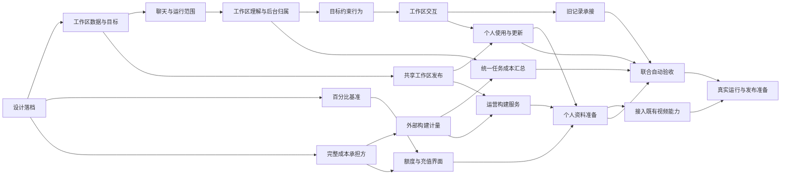

# 目标工作区与统一 Agent 额度：实施切片

日期：2026-10-18。状态：D0、W1–W6、Q1–Q5、S1–S2、B1–B2、V1、E1已完成并通过对应验收；最新E1联合记录见§18。E2真实运行、成本对照与发布准备尚未开始，未部署。

行为合同以[设计方案](设计方案-目标工作区与统一Agent额度.md)为准，术语见 [CONTEXT](../CONTEXT.md)，决策见 [ADR-0170](adr/0170-goal-scoped-learning-workspaces-and-shared-releases.md) 与 [ADR-0171](adr/0171-all-agent-cost-accounting-and-percentage-allowance.md)。接手入口为[本线 checkpoint](../SESSION_CHECKPOINT_WORKSPACE_QUOTA.md)。

## 1. 工作树与实施方式

落档基线为 HEAD `402d9be` 的当前工作树，已有跨书补讲、发布、呈现、缓存及其他未提交修改。下面的路径是接点，新增文件会明确标注；每片开始核对其当前实现并只修改所需部分。表中“待开始”不代表已有相邻功能需要重写。

设计阶段形成方案、决策、术语和实施入口；实施记录按切片追加于§8–§17。数据库变更沿用项目现有升级、备份与恢复路径，原私有记录和费用事实保持可回读。

## 2. 依赖与交付里程碑



图展示主依赖；每片的依赖项为准。工作区线与额度线可以并行。视频能力沿原视频方案推进；文本版联合验收可先完成，完整书与视频工作区在 V1 及其前置能力完成后验收。

| 里程碑 | 必要切片 | 可交付结果 |
| --- | --- | --- |
| M1 目标工作区 | W1–W6 | 必填目标、跨资料连续聊天、按工作区理解、旧记录可选择带入 |
| M2 统一成本与百分比额度 | Q1–Q5 | 托管运行、后台和已接入构建路径完整记账；固定比例充值、历史和汇总 |
| M3 共享预构建工作区 | M1、M2、S1–S2、B1 | 运营构建并发布，两个用户复用公共成果，私人学习独立 |
| M4 个人资料与视频 | B2、V1、原视频前置切片 | 有预算的个人资料准备，以及书与视频共同参与工作区学习 |
| M5 完整验收候选 | E1–E2 | 当前可用能力的自动和真实运行证据、迁入与上线操作说明 |

## 3. 工作区与目标

### W1 工作区、目标与资料成员

**状态：已完成，2026-10-18。** 数据、账号接口和生成类型已接入；存储与真实HTTP验收见§8。

- **依赖**：D0。**产出**：用户拥有的学习工作区、目标版本、确切资料成员和归档状态；创建、读取、改目标及增减资料接口。
- **接点**：`crates/server/src/control_store.rs`；拟新增 `crates/server/src/learning_workspace.rs` 及对应 SQL；`crates/base-schema/src/lib.rs` 与生成类型。沿用用户身份与 `PublishedBookRef`。
- **行为**：创建要求用户填写或接受目标，允许空资料集合；改目标保留旧版本；成员引用确切版本；新学习 ID 与原 Reader 现场 ID 分开。
- **验收**：创建空目标失败，合法目标和两书成员重开后保持；未获授权材料不能作为可读成员；更改目标不修改旧版本；账号 A 不能操作账号 B 的工作区。
- **失败后动作**：修存储和授权接点，不用前端隐藏代替服务端归属。

### W2 工作区聊天、运行与资料读取

**状态：已完成并通过验收，2026-10-18。** 实施接点和验证证据见§9。

- **依赖**：W1。**产出**：聊天和 Run 绑定学习工作区；跨资料工具使用当前工作区范围。
- **接点**：`server/lib.rs` 的 `AgentChatSession`、`session_runtime.rs`、`run_scope.rs`、`run_admission.rs`、`reader_workspace.rs`、`workspace_registry.rs`；`runtime/library.rs`、`server/cross_book.rs`、`interaction_input.rs`。
- **行为**：回合保留原提问现场和目标版本；切资料继续同一聊天；已有运行保持原范围；新运行取得变更后的成员。账号已授权但未加入的材料不可由该运行读取。
- **验收**：A 工作区两书互读与引用，第三本只获账号授权仍不能读；切到 B 时 A 的结果仍写回 A；移出资料后新任务不再读取，旧引用按原来源可回看；重启恢复原聊天。
- **失败后动作**：修运行传递、资料过滤或来源归属；W3 完成前不宣布理解范围已隔离。

### W3 理解、教学与后台任务归属

**状态：已完成并通过验收，2026-10-18。** 学习数据库升级为schema2，control数据库保持schema15。实施接点和验证证据见§9。

- **依赖**：W2。**产出**：工作区范围内的事实、理解、修订及投影；每工作区可恢复的阶段会话；后台任务保留原归属。
- **接点**：`memory/learning.rs`、`learning_evidence.rs`、`teaching.rs`；`server/teaching.rs`、`cross_book.rs`、`multi_user_review.rs`、`user_runtime.rs`；`runtime/tutor.rs`。
- **行为**：查询、分页、重建和 `supersedes` 同时使用工作区边界；全局稳定偏好仍归用户；账号级画像任务保留相关工作区来源并扣一次额度。用户级教学开关控制主动推进。
- **验收**：同一用户 A、B 都含同一本书，A 的局部困难不自动进入 B；A 的修订不能覆盖 B 的解释；后台任务执行期间切工作区，记录仍归原任务；重建理解投影与重开结果一致；关闭主动教学仍可记录有依据的普通理解。
- **失败后动作**：修持久归属、投影键或后台上下文；不从最后打开的页面推断任务所有者。

### W4 大目标约束与阶段推进

**状态：已完成并通过切片验收，2026-10-18。** 已接入实际模型请求、明确改向、阶段版本及旧安排失效；固定回放与持久恢复证据见§10。真实模型语义质量按原计划在E2验证。

- **依赖**：W3。**产出**：每次规划可取得大目标、用户约束及阶段焦点，目标变更后的接续行为。
- **接点**：`runtime/agent_prompt.rs`、`run_context.rs`、`orchestrator.rs`、`tutor_continuation.rs`；`server/teaching.rs` 与 `tutor_api.rs`；现有 Goal 和 TutorSession 事件。
- **行为**：Agent 可在目标内调整路径；明确用户改向写入目标新版本；临时插问保留目标；旧目标的主动安排不在新目标下继续派发。
- **验收**：固定回放“深度学习补链式法则”“考前只剩三天”“临时插问”“明确改向”四种行为，检查目标原话、修订、任务引用及继续动作；E2 使用真实模型验证相关性和深度选择。
- **失败后动作**：代码保证目标状态和归属，提示与上下文修复语义选择问题；不能以记录中存在目标字段证明 Agent 已遵守目标。

### W5 工作区入口与连续阅读交互

**状态：已完成并通过切片验收，2026-10-18。** 已接入创建、切换、目标与资料管理、草稿和读位恢复；真实服务与浏览器、桌面及窄屏证据见§10。

- **依赖**：W4。**产出**：创建/切换工作区、目标栏、资料列表、聊天和理解入口，保持原阅读器交互。
- **接点**：`packages/web/src/NetworkApp.vue`、`App.vue`、`network-client.ts`、`network-context.ts`、`api.ts`；`components/LeftRail.vue`、`RightRail.vue`、`UnderstandingSpace.vue`、`ConversationLearningGoal.vue`。`App.vue` 接入托管Reader共用的阅读界面，首轮不扩展独立离线存储。
- **行为**：创建只填一句话目标；切资料改变焦点并保留讨论；切工作区恢复各自状态；目标修改可见。托管Reader的桌面、窄屏和附属窗口使用相同学习归属。
- **验收**：从产品入口建两工作区、加入两书、跨书追问、查看引用、返回和刷新；目标和输入草稿不会被另一工作区替换；等待中的回答可回到原归属。
- **失败后动作**：修前后端上下文传递与恢复，不重复创建聊天以掩盖范围问题。

### W6 旧记录选择与承接

**状态：已完成并通过切片验收，2026-10-18。** 旧记录保留入口、明确选择关联、历史上下文与来源预览、Agent只读接续均已接通；验收证据见§11。

- **依赖**：W3、W5。**产出**：已有单书聊天、学习和来源的保留入口，以及“带入已有学习记录”操作。
- **接点**：`session_store.rs`、`session_event.rs`、`memory/learning.rs`、`learning_evidence.rs`、W1 数据与 W5 界面；现有存储升级/备份路径。
- **行为**：旧记录缺少学习工作区时保持原事实，用户确认目标并选定后以引用关联；必要的因果和来源引用可回读。用户明确带入另一工作区已有记录采用同一关联机制。
- **验收**：含聊天、参考书证据和修订链的旧数据升级后可读；未选择的同书记录不进入新理解视图；重复带入不重复生成学习事实；带入后新解释不改旧空间记录。
- **失败后动作**：修关联和投影读取；不批量推断用户目标或改写原证据身份。

## 4. 成本与额度

### Q1 固定基准与百分比接口

**状态：已完成，2026-10-18。** 固定基准、百分比授额和余额/历史接口通过验收；商业值待配置，Q4界面见§12。

- **依赖**：D0。**产出**：额度期固定基准、销售档位的百分比换算、余额及历史基准投影；既有期绑定入口。
- **接点**：`account_allowance.rs`、`allowance_admin.rs`、`charge_admin.rs`、`control_store.rs` 和额度 SQL；沿用 `MicroCny` 与 `ReceiptFen`。
- **行为**：充值只增加内部授予量；新基准只用于新额度期；历史按原期计算；期限、收款、原费用记录保持原事实。
- **验收**：73%−2.3%+50%=120.7%；充值后历史仍为2.3%；不同历史期正确使用各自基准，同一跨期任务分组显示各期消耗；多笔低于0.1%的费用在合计中完整累加；0、负可用、过期和待核算都有明确投影。
- **失败后动作**：修单位、基准归属或舍入位置；商业价格和 B 的值在上线前配置，不在测试中冒充产品定价。

### Q2 统一成本承担方与任务关联

**状态：费用基础已完成，2026-10-18。** 账号/平台承担、父任务及显式工作区归属通过验收；真实聊天与记忆来源的工作区上下文已由W2/W3接入，记录见§9。

- **依赖**：D0；工作区字段正式接入依赖 W1/W3。**产出**：平台运营费用入账，用户与后台成本关联工作区和父任务。
- **接点**：`runtime/model_spend.rs`、`server/model_spend_store.rs`、`model_rates.rs`、`run_admission.rs`、`multi_user_review.rs`；现有费用 SQL 和 `admin_usage.rs`。
- **行为**：`OperatorTask` 可记录平台成本而无读者额度期；原 `ReaderRun/ReaderTask` 继续结算；相关子调用归集到父任务，费用记录本身只扣一次。
- **验收**：一次包含回答、压缩、修复和记忆审核的任务逐项入账；平台构建不减少任何读者余额；账号级整理不归最后打开的工作区；失败、取消、重复回执和人工免扣保留原费用事实。
- **失败后动作**：修发送路径、归属或结算，不依赖可关闭的观测导出补账。

### Q3 TS 构建与外部执行器费用接入

**状态：已完成并通过切片验收，2026-10-18。** 任务预算与账本、DSH真实启动边界和回执恢复已接入；当前执行能力及证据见§12。

- **依赖**：Q2。**产出**：构建任务预算、执行准入和费用回执贯通；原阶段恢复可复用。
- **接点**：`packages/core/src/automatic-build-metrics.ts`、`automatic-build-budget.ts`、`automatic-build-dispatch.ts`、`automatic-build-task-store.ts`、`automatic-build-executor-session.ts`；`crates/server/src/model_spend_store.rs`。逐类登记当前实际执行入口。
- **行为**：可控的付费执行开始前预占，完成后按实际回执结算；一次执行的总额与内部明细只采用一个扣账层级；父任务上限限制并行子任务准入。个人构建累计用户扣减以已确认上限封顶，实际超出成本归平台；缺字段或不可用用量保留待核算或估计身份。
- **验收**：同一构建经历成功单元、失败单元、取消和恢复，成功单元不重付；传输重试单独计量；迟到/重复回执不双扣；并行任务不能各拿完整剩余预算；实际费用超预占、并行结束及迟到用量时，用户累计扣减仍不超任务上限，平台差额与完整成本一致；部分用量不标精确结算；不能约束预算的路径不能用于个人付费构建。
- **失败后动作**：修对应执行入口与费用关联；保留运营路径可用范围并准确报告未知，不能由最终 Token 汇总倒推已确认账单。

### Q4 百分比使用、补充与后台授额界面

**状态：已完成并通过切片验收，2026-10-18。** 百分比余额/历史、补充方案、人工收款、赠送和更正已接入，真实前后端及手机布局验收通过；接口与证据见§12。

- **依赖**：Q1、Q2。**产出**：用户额度、历史、任务预计消耗和补充入口全用百分比；后台保留精确账目。
- **接点**：`packages/web/src/account-allowance.ts`、`components/AccountAllowance.vue`、`network-client.ts`；`apps/admin/src/pages/allowance.tsx` 及现有收款/授额接口。
- **行为**：余额可超过100%，主卡最低0%；明确有效期、预占和待核算；购买显示货币价格及增加的百分比；人工收款成功才授额，重试沿原回执。
- **验收**：在真实前后端接口上完成补充、赠送、更正、历史翻页与账号切换；百分比与Q1结果一致；充值不改旧明细；付款与额度单位各自正确；小额消耗可见而不丢失。
- **失败后动作**：修 API 投影或格式化，不用前端独立维护余额。

### Q5 任务、工作区与平台成本汇总

**状态：已完成并通过切片验收，2026-10-18。** 原账本汇总、原期比例与Reader/后台入口已接入；服务端、组件及真实浏览器证据见§13。

- **依赖**：W3、Q2、Q3、Q4。**产出**：学习任务的前台与后台用量合账，工作区归集、账号合计和平台准备成本报表。
- **接点**：`admin_usage.rs`、`charge_admin.rs`、`apps/admin/src/pages/usage.tsx`；Q4 用户任务明细；现有成本事实查询。
- **行为**：迟到的后台结算更新原任务；跨工作区账号级整理独立列示；未知和确认成本分列；公共成果被多人复用时只保留实际发生的构建费用。跨期百分比按期和基准分组，后台精确费用可跨期汇总。
- **验收**：用实际发送事实核对明细合计、工作区小计和账号总计；平台费用不混入用户消耗；同一后台任务相关多个工作区时账号只扣一次；待核算未被合计成0；两期采用不同B时，同一任务分别显示原期比例而无混合百分比总数。
- **失败后动作**：修父子归集与查询口径，保留原收费事实。

## 5. 共享发布与构建服务

### S1 共享工作区发布

**状态：已完成并通过切片验收，2026-10-18。** 公共清单、版本、可见范围、动态就绪情况、运营发布和导出已接入；服务端、组件及真实浏览器证据见§13。

- **依赖**：W1。**产出**：工作区发布清单、版本、可见范围、公共编排和就绪声明；运营发布入口。
- **接点**：`published_library.rs`、`online_publication.rs`、`control_store.rs`；新增 `crates/server/src/workspace_publication.rs/sql`、`apps/admin/src/pages/workspace-releases.tsx`；复用现有材料发布与账号授权。
- **行为**：清单引用确切资料发布；目标、适用范围、主题联系和路线可独立修订；私人目标产物和学习记录不进入公共清单。
- **验收**：发布包含两份已准备资料的工作区；缺资料、缺必要能力或缺授权时不能标完整可用；新版本与旧版本同时可解析；发布导出只有明确选择的公共内容。
- **失败后动作**：修发布清单、已有授权衔接或能力声明，不复制私人存储充当公共内容。

### S2 使用共享工作区与选择更新

- **状态**：已完成并通过验收，实施合同与证据见§14。
- **依赖**：W5、S1；完整理解隔离沿 W3。**产出**：共享列表、目标确认、个人实例、版本更新及归档入口。
- **接点**：W1 存储、S1 发布模块、`NetworkApp.vue`、`components/LeftRail.vue`、`RightRail.vue` 及工作区 API。
- **行为**：开始学习只引用预构建成果，生成私人目标与工作区；新版可预览变化并由用户接入；个人目标及私人追加资料保留，旧来源继续指向旧版本。
- **验收**：两个用户使用同一发布，无新增构建调用；各自产生的对话和理解互不混入；更新一人的实例不改变另一人；目标和私人资料保留；无权资料无法借共享入口读取。
- **失败后动作**：修实例化、更新合并或来源归属；费用复用正确性在Q5/E1联合核对。

### B1 运营构建与共享发布闭环

- **状态**：已完成并通过验收，实施合同与证据见§14。
- **依赖**：Q3、Q5、S1。**产出**：运营者选资料、确认准备范围和预算、启动/查看/继续构建、选择成果并发布共享工作区。
- **接点**：现有 BuildIntent/BuildPlan、`automatic-build-*` 任务与发布模块，Q3 费用入口、S1 发布接口；运营后台已有任务操作位置。
- **行为**：已有成果优先复用；公共编排和资料成果按各自版本保存；成本归运营任务；任务预算与实际消耗可查。
- **验收**：两书准备，其中一本已有成果；只对缺失工作调用模型；中断后继续复用已完成单元；发布前能力真实，发布后用户可使用；成本与已发生调用或有依据的待核算记录一致。
- **失败后动作**：修计划依赖、恢复、计量或发布衔接；不再实现一套构建执行器。

### B2 个人资料准备与工作区接续

- **状态**：已完成并通过切片验收。个人上传、逐次调用额度准入、百分比确认、原工作区接续及复用见§17；当前支持的资料和视频准备范围见该节已知限制。
- **依赖**：B1、S2、Q4。**产出**：用户在工作区加入个人资料，查看预计额度、确认上限，准备完成后继续原学习任务。
- **接点**：BuildIntent 控制入口、材料导入路径、W1 资料成员、Q3 费用准入、Q4 界面；沿现有原文/语义就绪合同开放能力。
- **行为**：用户任务绑定发起工作区与账号；目标修改复用有效公共成果；暂停或额度不足保留结果；继续时明确当前预算和有效额度期。
- **验收**：资料准备占用同一账号额度；工作区切换后成果仍归发起处；预算不足停止后续付费执行；补充后显式继续；已有成果复用不再扣构建费；仅改学习目标不重建全部资料。
- **失败后动作**：修任务范围、预算或能力接入，不将整个工作区等待语义构建作为唯一状态。

### V1 视频加入统一工作区与成本体系

- **状态（2026-10-18）**：已完成接入并通过切片验收。原 VI1–VI18 能力、学习工作区、混合共享发布、选择更新及 B1 视频预构建保留；B2 个人视频准备和跨资料检索、真实取帧、原声复核、引用归属在§17完成。外部 CLI 未提供的金额仍待核算，完整语义预构建由平台承担；E1联合验收在§18通过，E2真实运行与发布准备待做。实施与证据见[视频工作区接入](视频工作区接入-20261018.md)、[后台预构建](视频后台预构建-20261018.md)及[个人准备与跨资料媒体](个人资料准备与跨资料媒体-20261018.md)。
- **依赖**：B2；视频源/问答部分依赖原视频方案 VI1–VI3、VI5–VI7；对应视觉、联合抽取与原音频功能随 VI4、VI8a–VI14、VI15–VI18 完成接入。
- **产出**：视频作为工作区成员，与书籍联合引用；付费转写、视觉、翻译、抽取和音频复核按真实计量接入Q2/Q3。
- **接点**：按[视频切片方案](切片方案-视频理解与渐进伴读.md)选用的服务与正式入口；工作区资料范围、来源绑定、费用费率和回执扩展。
- **验收**：同一问题读取书中原文和视频真实片段；视频引用保持原时段；转写未就绪时界面能力真实；失败块恢复不重复处理成功块；时长计价服务保存实际时长与费用，未知仍待核算。
- **失败后动作**：修相应视频能力或费用适配，既有文本里程碑保留独立验收结果。V1全部完成须覆盖原视频方案承诺的完整能力，不以最早播放/问答闭环代替。

## 6. 联合验证与发布准备

### E1 自动路径联合验收

**状态：已完成并通过A–D联合验收，2026-10-18。** 真实后台和浏览器链路通过，上传入口及纯媒体私人理解修复见§18。

- **依赖**：W1–W6、Q1–Q5、S1–S2、B1–B2；视频完成后加入V1。
- **产出**：临时真实数据库、实际工具循环、受控模型响应和真实浏览器入口组成的联合用例；逐项记录替身范围。
- **场景A**：同一用户两个工作区共用一份资料，资料读取、理解修订、后台任务和目标变化均按归属工作，切换与重启后仍可接续。
- **场景B**：两用户使用同一共享发布，用户状态独立、公共成本只记录一次；其中一人升级版本、添加私人资料，另一人的范围保持原样。
- **场景C**：完成一次回答及后台整理，随后构建发生重试、取消、恢复和迟到回执；实际费用、预占、待核算、平台承担和120.7%算例一致。
- **场景D**：已有额度期和单书学习记录升级，原账与证据可回读，只有用户选择的记录进入新工作区。
- **失败后动作**：返回对应W/Q/S/B/V切片修复并重跑受影响场景；不因一次失败无差别重跑全部模型调用。

### E2 真实运行、成本对照与发布准备

- **依赖**：对应版本的E1通过；完整书与视频版本另须V1完成。运营价格、基准与有效期配置已确定；真实模型验证使用明确的测试预算。
- **产出**：真实Provider/Harness任务记录、用户界面观察、可取得的供应商费用依据、已确认与未知成本清单，以及候选版本的迁入和恢复运行说明。
- **验收**：真实Agent在不同大目标下选择合适解释与下一步；同工作区跨资料接续；一份公共构建和一次私人构建进入正确承担方；回答、压缩、后台整理实际执行并可核对费用。记录首次可用时间、构建/复用时实际调用次数与消耗，用于确认复用确实减少重复工作。
- **费用边界**：供应商尚未提供完整依据的项目明确保留待核算；以调用回执证明路径，以实际账单核对可核对部分，不能把费率估算写成供应商实扣。
- **失败后动作**：归属或费用错误修对应切片；目标相关性或教学质量问题修行为与上下文。通过后交付发布候选和剩余边界，实际部署按后续发布安排执行。

## 7. D0设计落档验证

设计落档检查用于发现新文档的断链、切片依赖缺项、标识冲突和额度算例错误，发现后修正文档。D0阶段未修改功能，也未执行模型、构建或业务回归。后续W1/Q1/Q2的实现验收记录在§8；S1可在W1后并行。

2026-10-18 核对通过：5份新增文档的42处本地链接均存在；18个实施切片标识完整且无重复；47条文字依赖无环，28条图示依赖与文字一致；ADR-0170/0171无编号冲突；百分比算例为120.7%。代码块、占位文字和空白检查无问题，既有文档的差异空白检查通过。上述结果仅证明本次文档一致性，功能验收按各片实施后记录。

## 8. W1 / Q1 / Q2 实施记录（2026-10-18）

本轮工作树基线仍为 `402d9be`，保留其他工作线修改。服务数据库升级到 schema15；新建与历史升级执行同一组工作区、额度基准和费用归属 SQL，历史升级在一个事务内完成。本轮相关验收通过；未提交、未部署。

### W1 工作区接口

`multi_user_host → authorization → ControlStore.learning_workspace_* → learning_workspaces / learning_workspace_goals / learning_workspace_members`。接口使用登录账号，不加载或创建阅读现场。

| HTTP 接口 | 输入和行为 |
| --- | --- |
| `GET /api/learning-workspaces` | 返回当前账号的工作区 |
| `POST /api/learning-workspaces` | `{goal:{text,constraints?},members?:PublishedBookRef[]}`；非空目标必填，可无资料 |
| `GET /api/learning-workspaces/{id}` | 当前目标、全部目标版本、确切资料成员及是否仍有读取授权 |
| `POST /api/learning-workspaces/{id}/goal` | `{goal:{text,constraints?}}`；追加目标版本 |
| `POST /api/learning-workspaces/{id}/members` | `{published_book_ref:{book_id,publication_id}}`；加入已有授权的确切版本 |
| `DELETE /api/learning-workspaces/{id}/members` | 同上；移出成员 |
| `POST /api/learning-workspaces/{id}/archive` | `{archived:true或false}`；归档只读，恢复后可修改 |

成员授权被撤销时保留资料身份，返回 `readable=false`。类型由 base-schema 生成至 `packages/core/src/generated`。工作区目标原话、约束和旧版本按输入保存。

### Q1 固定额度基准

`admin_api → allowance_admin::Mutation → allowance_bases / allowance_period_bases → account_allowance::balance / charge 历史投影`。既有额度期升级后明确为未绑定，不猜测商业数值。管理员创建新期可携带 `basis:{version,basis_micro_cny}`，或者为既有期绑定一次；已有期和已有基准版本不能换值。

| 新增后台接口 | 关键输入 |
| --- | --- |
| `POST /api/admin/users/{owner}/allowance-basis` | `operation_id,period_id,revision,basis` |
| `POST /api/admin/users/{owner}/allowance-percentage-adjustments` | `operation_id,period_id,revision,basis_version,delta_milli_percent,reason` |
| `POST /api/admin/users/{owner}/percentage-receipts` | 百分比授额字段及原收款字段 `amount_fen,paid_at,channel,external_ref?,note` |

销售输入以千分之一百分点为单位，`50000` 表示50%；换算必须得到整数内部额度。收款金额独立记录。余额与历史增加原期基准和百分比投影，原金额字段保留至Q4接入；百分比值使用十进制字符串，附非零和低于0.1%的标识。历史先按原额度期精确汇总，再格式化，`period_groups` 覆盖完整筛选结果，不受明细分页影响。到期、尚未生效、关闭、未建期、待核算和亏空均有明确状态。

### Q2 成本承担与任务归属

`ModelAdapter → ModelSpendPort → model_call_charges` 继续逐次记录发送；新增 `cost_owner`、`parent_task_ref`、`learning_workspace_id` 与 `related_learning_workspace_ids`。旧费用继承账号承担及原运行/任务引用，原始发送、回执、金额和人工更正保留。

`operator_port` 接收平台任务，允许无用户、无读者额度期，确认成本入账但用户扣减为零。`port_with_attribution` 将任务归属固定在执行端口，校验工作区属于付费账号；前台切换不会改变归属。账号级记忆复核仍按尝试记录实际费用，父任务固定为原复核作业，不从当前阅读现场推断学习工作区。

后台平台任务使用 `operator_task_ref` 查询，与同名账号任务分别读取；平台行显示“平台”并保留费用明细。现有读者人工核账接口对平台费用返回 `CHARGE_ACCOUNT_REQUIRED`，不修改费用事实；迟到的供应商用量仍可自然结算。

### 本轮边界

- W1完成数据与服务接口；W2/W3接入聊天、运行和理解的后续实施见§9，W4/W5目标规划与产品入口实施见§10。
- Q2提供并验证显式工作区/父任务费用归属；从真实聊天与记忆来源提取工作区上下文已在§9接入。无学习工作区来源的旧账号级复核保持空关联。
- 外部Harness构建费用准入和回执在Q3，百分比产品界面在Q4，完整任务汇总在Q5。平台供应商费用的人工更正入口尚未提供，当前保留未知并接受迟到回执；该入口可随运营构建管理接入。现有读者人工免扣继续保留实际供应商成本。
- 商业基准和销售价格尚未配置，测试数值只用于验收。未执行付费模型或外部构建，未部署。

### 验收结果与复现

验证目的为发现归属串写、额度分母变化、漏记/重扣费用、历史升级丢失及平台明细混账；发现失败则修对应W1/Q1/Q2路径。本次所有选定的功能验收和回归通过。

| 验收组 | 结果及具体证据 |
| --- | --- |
| W1存储 | 5项通过：空目标拒绝、两资料重开、原话与历史目标保留、确切版本授权与撤销、跨账号读写隔离、归档和恢复 |
| W1服务入口 | 真实本机HTTP通过创建、读写目标/成员、A/B隔离、归档、授权撤销；读取与重开结果一致，未产生旧阅读现场 |
| Q1额度 | 6项通过：120.7%算例、原费用2.3%保持、重复收款不重复授额、跨期不同基准及分页、小额累加、零/负/待核算/过期、旧期绑定及错误配置拒绝 |
| Q2成本 | 3项通过：平台失败/晚到/重复/未发送、取消及归档后的结算、人工免扣、账号归属；本机真实HTTP完成回答/压缩/修复/记忆审核/平台准备五次发送，账号扣减44 micro_cny、平台成本11 micro_cny且账号扣减0；同名账号与平台任务明细分别返回 |
| 历史与回归 | schema14升级15逐字段和rowid保留收据/费用/回执/人工更正，二次重开一致，失败整体回滚；既有schema1–8、12、13升级及收款、预占、结算、后台复核和运营报表回归通过 |
| 类型与后台 | 5个相关类型导出通过；后台相关4项测试与类型检查通过，平台行可点击且没有错误账号链接 |

执行命令与结果（两轮Rust集合部分重叠，不重复计数）：

```text
cargo test -p base-schema --lib -- export_bindings_learningworkspace export_bindings_workspacegoal export_bindings_publishedbookref
# 5 passed
cargo test -p server -p runtime --lib -- w1_ q1_ q2_ workspace_quota model_spend::tests adm1_ adm3_ adm5_ adm6_ inv1_upgrades default_book_grants_upgrade_schema12 online_publication_schema13
# Runtime 9 passed；Server 40 passed
cargo test -p server --lib --test learning_workspace_tests -- w1_ q1_ q2_ adm9_ adm6_
# 最后改动后：Server lib 19 passed / 1 ignored；W1集成5 passed
pnpm --filter @understand-book/admin test -- src/lib/usage.test.ts src/pages/usage.test.tsx
# 4 passed
pnpm --filter @understand-book/admin typecheck
# passed
```

去重后服务端库44项、工作区存储5项、运行时9项、生成类型5项、后台4项，共67项通过；既有隔离HTTPS候选部署用例默认忽略，本轮没有启动候选部署。模型回执来自本机受控Provider，验证实际HTTP、计费与归属路径；不作为真实付费供应商账单或Agent教学质量验收。编译仍有既有ts-rs属性告警；`operator_port`待B1生产调度接入，当前在本轮真实HTTP测试中使用。


## 9. W2 / W3 实施记录（2026-10-18）

### 9.1 工作区、聊天和运行接口

- `POST /api/workspaces` 在原 `published_book_ref`、`attachment_id` 外接受可选 `learning_workspace_id`。`book/open` 省略此字段沿用当前学习范围；提供另一个工作区ID则切换学习范围，显式 `null` 返回旧单书模式。
- 场景响应和账号聊天历史返回 `learning_workspace_id`。现场checkpoint保存学习身份和各工作区已选聊天；同工作区切资料保留聊天，切回工作区恢复此前明确选中的聊天。
- 聊天身份写入 `AgentChatSession` 和 JSONL `SessionCreated`。每次准入读取最新目标和成员，冻结到 `FrozenTurn.learning_workspace_id / learning_workspace_goal / learning_workspace_members` 与回合 `ReadingScene`。原 `RunScope.workspace_id` 继续表示阅读现场。
- `library.list` 在分页前与冻结成员相交；`library.read`、`library.learning` 在资料加载前检查同一成员集合，实际读取继续检查当前账号授权。成员变更影响下次准入，撤销授权立即影响现有调用。保存的历史来源仍按确切发布和当前授权解析，不要求继续作为新任务的成员。
- `ModelSpendStore::port_with_attribution` 收到原运行学习工作区和父任务；归档后的新发送被拒绝，已发生调用照常结算。

### 9.2 私人理解、教学与后台归属

`UserRuntime.learning_store_for_workspace` 创建持有明确范围的 `LearningStore::with_workspace`。事实、因果引用、assessment、理解、修订、分页、设计谱系和投影都使用该范围；`supersedes` 不能引用另一工作区。学习数据库schema1→2以事务迁移，旧事实JSON及序号保持原值，旧数据继续处于独立的无工作区范围。

Tutor开关保留账号级语义，各工作区保存自己的阶段和当前选择。一个工作区的阶段变更不使另一个工作区的在途教学绑定失效；关闭开关会暂停各工作区阶段，重新开启后仍由明确恢复操作接续。关闭主动教学时，有用户原话与实际来源依据的普通理解仍可记录。

原书级局部画像增加 `ProfileScope::Workspace { learning_workspace_id, book_id }`，解析、缓存、治理操作和证据列表使用一致范围。稳定的Global偏好仍可全局复用，旧Book事实只在旧范围内读取。后台复核与历史回填保存原学习工作区、实际覆盖回合的目标版本、原回合资料映射；同一聊天跨书时，候选资料归属取引用的原回合。账号画像复核费用的primary工作区为空，`related_learning_workspace_ids`取持久来源，父任务使用稳定复核job身份，每次实际调用只扣一次。

### 9.3 验收证据

验证目的为发现切换后串写聊天或理解、成员过滤错误、旧引用丢失、局部画像泄漏、后台任务来源漂移及重复扣费；出现失败则修对应范围传递、持久记录、过滤或结算路径。最终选定集合全部通过，按最后一次回执去重为 **memory 46项、runtime 16项、server 147项，共209项**；没有待修复的验收失败。

本轮分批执行，夹具修复后只复验受影响用例。原始日志按执行顺序保存在 `target/w2-w3-validation.log`、`target/w2-w3-server-validation.log`、`target/w2-w3-final-validation.log`、`target/w2-w3-retest.log`、`target/w2-w3-observation-retest.log`，包含初次失败与最终修复回执。复现整个选定集合可使用：

```text
cargo test -p memory -p runtime --lib --no-fail-fast -- w2_ w3_ cross_book_ resident_library_ learning::tests learning_evidence::tests teaching::tests assessment::tests profile_api::tests profile::tests review::tests backfill::tests
cargo test -p server --lib -- w2_ w3_ cross_book_ resident_library_ mu5_ mu6_ jl1_ jl2_ jl3_ jl4_ jl5_ jl6_ jl7_ q2_ adm6_ tutor_loop_tests:: tutor_tests:: session_event::tests
```

选定服务端集合另有6个默认忽略入口：3个浏览器宿主、2个需配置真实模型的验收入口、1个由父测试调用的进程终止子入口。父测试 `jl4_process_kill_preserves_messages_and_never_reexecutes_tools` 已通过；本轮没有启动浏览器宿主或付费模型验收。真实网络路径使用本机HTTP Provider受控响应，证明调用、归属和结算路径。

| 切片场景 | 具体证据 |
| --- | --- |
| W2连续聊天与恢复 | `w2_workspace_chat_crosses_books_and_reopens_with_original_turn_scope` 使用实际准入和工具循环；两书共用聊天、切B后A结果仍写回A、切回恢复明确选中的聊天、第二本书引用保存确切发布、移出成员后旧引用可读、重开后归属不变 |
| W2资料和目标变化 | `w2_library_scope_filters_before_paging_and_keeps_live_authorization` 验证成员过滤先于分页、仅账号授权的第三本书不可读、授权撤销立即生效；`w2_new_runs_refresh_members_and_goal_while_accepted_input_stays_frozen` 验证新准入取得新成员与目标，已有输入保持原快照 |
| W3理解和修订 | `w3_same_book_evidence_corrections_pages_and_projection_stay_in_workspace`、`w3_cross_book_understanding_stays_in_original_workspace_with_tutor_off` 验证同书A/B隔离、修订不能覆盖另一空间、证据分页和投影重建一致、关闭教学仍可保存有依据的普通理解 |
| W3阶段接续 | `w3_workspace_stages_restore_independently_with_one_global_teaching_switch`、`w3_ordinary_understanding_and_frozen_preparation_stay_in_origin_workspace` 验证各工作区独立阶段、账号教学开关、原运行教学准备与实际交付归属 |
| W3局部画像 | `w3_profile_api_binds_local_facts_to_workspace_and_preserves_global_preferences` 通过实际服务处理入口验证局部事实、快照、证据、缓存、纠正和遗忘均按工作区；Global偏好共享，跨工作区治理不能修改其他范围的事实 |
| W3后台与历史回填 | `w3_review_retry_and_restart_preserve_original_workspace_and_goal`、`w3_backfill_keeps_workspace_on_reopen_and_scopes_candidates`、`w3_review_book_scope_follows_original_evidence_turn_after_material_switch` 覆盖任务重试/重开、实际回合区间的目标版本、跨书原证据与候选归属 |
| W3真实发送及费用 | `w3_background_review_real_transport_keeps_origin_after_switch_and_archive` 用本机HTTP Provider验证归档任务不派发、恢复后的等待期切B、结果和相关费用仍归A、单次扣减11 micro_cny；前台发送费用绑定原运行工作区，归档后拒绝新发送但原回执仍可结算 |
| 历史升级 | `w3_schema_upgrade_preserves_legacy_fact_bytes_and_sequence_without_adopting_them` 验证学习数据库升级保留旧事实JSON及序号，旧范围没有自动进入新工作区；旧聊天和既有运行恢复路径同步回归 |

验收修复保留原场景要求：引用夹具补齐实际定位与读取流程；教学和画像夹具先建立工作区聊天。另有三项旧运行测试对齐当前工作树既有的降级回答合同：回合完成但请求未完成、保留Provider警告与降级诊断、记录第三次模型调用，同时保留原资料、笔记与冻结输入断言；本轮没有修改该生产降级逻辑。

### 9.4 该轮边界与后续

- W2/W3完成时，目标版本冻结已可用；W4规划和阶段推进的后续实现及验收见§10。
- W2/W3验证服务与真实调用路径；W5创建、切换、目标栏和连续阅读界面的后续实现及验收见§10。
- W6提供旧记录的明确选择带入。旧记录保持可读，没有自动归并到新工作区。
- 普通笔记仍沿既有资料归属；本片隔离的是理解事实、教学阶段和局部画像。
- 既有可观测性导出的用途白名单尚未收录 `available_answer`，降级调用在该投影中显示为 `unknown`；实际HTTP请求、模型调用记录和私有降级诊断仍保留。本轮未修改这一观测映射。
- control数据库保持schema15，学习数据库升级为schema2；上线继续沿现有备份流程。未部署、未运行外部付费模型。

## 10. W4 / W5 实施记录（2026-10-18）

### 10.1 大目标进入实际规划与阶段推进

每个工作区运行从接纳时的目标快照建立 `WorkspaceGoalContext`。普通问答、教学、后续采样和最终回答都携带独立的 `workspace_goal.v1`，包含用户原话、约束、目标版本、当前阶段焦点及主动教学状态。聊天的 `goal.update` 继续管理当前交付计划；工作区大目标由新的 `workspace.goal.update` 修改。存在大目标不会打开用户已关闭的主动教学。

Agent 根据完整当前用户消息判断是否明确改向；代码核对消息原话、目标版本、新目标及新增约束的文字来源。没有“目标”关键词的自然改向也受支持，例如“深度学习先不学了，接下来只准备三天后的期末考试。”临时插问保留原大目标，补前置知识后规划回到大目标；考试期限和已知考纲进入阶段深度及下一步的选择上下文。

成功改向写入目标新版本，并通过 `SyncWorkspaceGoal` 暂停旧阶段、清除旧当前选择；旧阶段不能恢复，同批工具中的旧 Tutor 操作也会被拒绝。下次采样使用新目标并撤去旧阶段工具。阶段仍保留明确的 `material_scope`：跨资料普通问答带同一大目标，范围外页面展示原阶段并提供回原资料的提示，不自动扩展该阶段。

运行的原目标快照保持不变。当回合明确接受的新目标以 `WorkspaceGoalUpdated` 事件另存，恢复只读该回合的接受记录，不用页面最新目标覆盖历史来源。如果目标已保存而学习事件或回合记录写入失败，运行以 `WORKSPACE_GOAL_COMMIT_INCOMPLETE` 结束，不再用旧目标调用模型；下一回合同步已保存的新版本。已经产生的模型成本仍保留。

### 10.2 创建、切换与连续阅读

托管 Reader 的学习入口可用一句目标创建空工作区，随后加入或移出资料、编辑目标并查看版本。阅读界面区分工作区大目标与当前阶段；主窗口及附属窗口的教学请求携带同一学习工作区身份。

切换资料沿用同一个 Reader 场景与工作区聊天。场景checkpoint增加按学习工作区、确切发布资料保存的阅读位置；重新打开工作区恢复最后资料，各份资料分别恢复读位。只有相同学习范围才可复用此前同资料的checkpoint，新工作区不会继承另一工作区的同书位置。`book/open` 的显式 `null` 返回旧单书范围，省略参数继续沿用当前范围。

纯文本输入草稿按账号、学习工作区、聊天保存，支持跨资料和刷新；含引用草稿另外绑定原发布资料，避免换书后引用位置错绑。等待中的运行使用原回合资料恢复，同工作区聊天可收到跨资料完成的结果；阅读副作用仍绑定原场景。切到另一工作区后，回答和草稿各归原工作区。Agent 接受改向后的完成回执会刷新对应工作区的目标栏。

### 10.3 验收记录

验证针对目标遗漏、临时问题覆盖目标、改向后旧阶段继续、持久化失败后继续规划、同书读位串区、跨书聊天中断以及切换后草稿或等待结果串区；失败时修对应运行投影、阶段绑定、持久化或界面恢复路径。最终按最后回执去重为 **memory 13项、runtime 58项、server 185项、前端组件77项、真实浏览器1项，共334项通过**。前端类型检查和生产构建通过，没有待修复的切片验收失败。

原始证据：`target/w4-memory-validation.log`、`target/w4-w5-final-rust.log`、`target/w4-w5-server-regression.log`、`target/w5-browser-fixes-retest.log`；前端为 `target/w5-web-tests.log`、`target/w5-web-final-tests.log`、`target/w5-workspace-final.log`、`target/w5-web-typecheck.log`、`target/w5-web-build.log`。初轮前端恢复夹具失败已由最后6文件45项集合修复复验，其余4文件32项保持通过。浏览器最终回执为 `target/w5-browser-validation.log`（1 passed，18.3秒），跨书实时流的原始失败保留在 `target/w5-cross-book-stream-failure.log`。宿主已正常关闭，不计作额外产品验收用例。

截图保存在 `docs/performance/workspace-w4-w5-20261018/`：`workspace-reader-desktop.png`、`workspace-management-mobile.png`、`workspace-reader-mobile.png`。已人工查看；390px宽度没有横向溢出，目标栏、切换入口与独立草稿正常显示。

| 切片场景 | 验收入口与断言 |
| --- | --- |
| W4补前置知识回到大目标 | `w4_deep_learning_prerequisite_plan_returns_to_original_goal` 执行实际工具循环，核对深度学习目标进入请求、局部链式法则计划及回到反向传播的下一步 |
| W4考试期限与临时插问 | `w4_three_day_exam_constraint_reaches_plan_and_continuation`、`w4_temporary_question_cannot_replace_workspace_direction` 核对三天和考纲约束、继续计划、未修改目标及未开启主动教学 |
| W4明确改向 | `w4_explicit_redirection_updates_effective_goal_but_keeps_run_provenance` 和服务端 `w4_goal_replays_chain_rule_exam_temporary_question_and_explicit_redirection` 核对自然改向、同批旧工具失效、新旧版本分存和JSONL重开 |
| W4阶段与保存失败 | `w4_goal_edit_stops_old_continuation_and_next_question_starts_new_stage` 核对旧选择失效与新版阶段；`w4_goal_commit_failure_stops_planning_and_next_turn_uses_committed_revision` 用SQLite失败触发器验证目标已保存后停止当前运行、只调用一次模型、新回合读新版本 |
| W5读位、空聊天与旧范围 | `w5_workspace_material_positions_restore_without_crossing_scope_after_reopen` 覆盖两区同书读位隔离、两书分别恢复、空聊天带正确工作区、持久重开；`w5_explicit_null_returns_to_legacy_reading_without_adopting_workspace_chat` 验证返回旧范围 |
| W5组件及附属窗口 | `NetworkApp.learning-workspace.test.ts`、`NetworkApp.chat.test.ts`、`ConversationLearningGoal.test.ts` 等覆盖工作区入口、草稿、目标版本刷新、主/附属Tutor请求归属、范围外阶段提示以及旧恢复功能 |
| W5真实浏览器 | `playwright/learning-workspace.spec.ts` 配合 `w5_browser_host`，从真实入口创建两区、加入两书、跨书追问和查看引用、改目标、刷新、保留独立草稿、等待中切区后回看回答，并检查桌面和390px窄屏 |

浏览器联调修复了真实服务的空聊天响应缺少 `learning_workspace_id`：新工作区首次打开资料因此无法通过聊天归属校验，输入被禁用。响应现已补齐归属，空聊天与已存在聊天使用同一校验规则。另一个实际缺口是运行观察许可仍使用聊天首书，而实时流使用原回合资料；跨书回答虽然已保存，却被实时通道拒绝。许可改用原回合的确切发布引用，并补充流描述符匹配断言。其余验收夹具按实际接口修正了GET请求体、资料标题定位与场景响应中的 `result` 层级。

复现Rust与前端选定集合：

```text
cargo test -p memory --lib -- w4_ learning::tests export_bindings_tutorstate export_bindings_tutorsession export_bindings_tutoraction
cargo test -p runtime -p server --lib --no-fail-fast -- w4_ w5_ tool_registry::tests tool_exposure::tests tutor_continuation_tests goal::tests
cargo test -p server --lib -- w2_ w3_ mu5_ mu6_ tutor_loop_tests:: tutor_tests:: session_event::tests
pnpm --filter @understand-book/web test -- src/NetworkApp.learning-workspace.test.ts src/NetworkApp.chat.test.ts src/NetworkApp.resumption.test.ts src/components/ConversationLearningGoal.test.ts src/components/TutorPanel.test.ts src/useTutorControl.test.ts src/network-client.test.ts src/NetworkApp.recovery.test.ts src/NetworkApp.mcp.test.ts src/NetworkApp.recap.test.ts
pnpm --filter @understand-book/web typecheck
pnpm --filter @understand-book/web build
```

浏览器使用临时账号和临时发布资料，实际HTTP路由、运行调度、资料读取、持久化和来源解析都走生产路径；只有模型响应及本机代理身份受控。先在一个终端运行 `cargo test -p server --lib -- w5_browser_host --ignored --nocapture`，等 `W5_BROWSER_READY` 后在 `packages/web` 运行 `pnpm exec playwright test playwright/learning-workspace.spec.ts --reporter=line --workers=1`。宿主占用4176/4177端口，最长运行15分钟；结束后POST到本机控制端口 `/stop` 关闭宿主。

### 10.4 当前边界与后续

- W4固定模型回放验证实际请求、工具循环、阶段与持久记录；真实模型在自然输入下的相关性、深度和改向判断仍在 E2 验收。
- W5覆盖托管 Reader 的工作区入口和连续阅读，独立离线模式继续使用原单书入口。
- W6的旧记录选择带入实施见§11；Q3外部构建计量、Q4百分比产品界面和共享预构建工作区继续按原依赖推进。
- control数据库保持schema15、learning数据库保持schema2；新增checkpoint字段及事件沿用既有存储。未部署，未调用外部付费模型。

## 11. W6 实施记录（2026-10-18）

### 11.1 保留入口与明确选择

托管 Reader 的“旧聊天与学习记录”入口可直接查看原聊天、学习解释、修订链及来源。工作区管理提供“带入已有学习记录”，显示当前大目标及版本、原记录归属与回合数，先查看再勾选提交。预览为只读窗口，保留当前聊天、Reader 现场和输入草稿；当前工作区的“我的理解”另列“带入的原记录”。

本片以聊天为选择单位，提交原聊天 ID、列表时已提交的位置 `through_seq` 和用户确认的目标版本。目标已变更时保留未完成选择，刷新目标供重新确认。旧单书范围和其他工作区均可选；不会根据同书关系自动纳入历史，也不会自动将历史引用资料加入工作区。

### 11.2 原事实与引用关联

学习数据库沿现有事务升级从 schema2 到 schema3，新增 `linked_learning_records`。唯一关联为“目标工作区、原学习范围、原聊天”，只保存选择的聊天位置、回合 ID 和首次关联时间。原聊天 JSONL、学习事实、解释及评估保持原身份、原范围和原内容。

重复带入同一位置直接返回已有选择，不复制事实；明确选择更新的位置时合并回合，仍只有一份关联。原聊天未来新增回合不会自动进入目标范围。选定事实之后产生的纠正与修订仍可沿原修订链读取。

关联读取从精确聊天、选定回合的学习者表达或动作出发，保留明确的因果依赖、活动设计、帮助交付、参考书依据、评估以及修订祖先和后继。不反向扩大到复用同一交付的其他聊天，也不沿历史全局理解快照吸入未选资料。当前理解投影继续只读取目标范围；新提问产生的新事实和解释写入当前工作区，原掌握状态和旧阶段不会随关联自动继承。

历史来源按原绑定中的资料与发布版本解析，已修正回顾中参考书来源误用聊天主书版本的问题。原发布无法访问或旧记录未保存发布版本时，继续显示当时保存的标签和引用片段及不可用原因。

### 11.3 Agent 读取接点

新增 `workspace.records.read` 只读工具，支持列出已带入聊天及分页读取原聊天、事实、解释和评估。普通问答在首轮请求接收已带入记录的摘要与历史使用规则，相关内容由 Agent 按需读取；不要求开启主动教学。服务端根据运行冻结的工作区读取关联，拒绝未选聊天，结果明确原归属及“历史参考、非当前掌握状态”。原回合的大目标、该回合接受的改向和引用提问均从保存的快照回读。

接口：`GET /api/me/learning-records` 列出已有记录；`GET /api/me/learning-records/:session_id?through_seq=…` 只读预览；`GET /api/learning-workspaces/:id/records` 列出关联；`POST` 同一路径提交 `{session_id,through_seq,goal_revision}`。关联写入与预览均不采用或切换原聊天。

### 11.4 验收记录

定向检查针对升级丢失、原记录被改写、重复复制事实、同书未选聊天混入、原引用错绑、目标变更后误带入及预览切走当前现场；失败时分别修存储关联、历史范围、来源解析或界面状态路径。最终按最后回执去重，**memory 11项、runtime 39项、server 22项、前端30项、真实浏览器1项，共103项通过**。类型检查与生产构建通过。服务集合中1个ignored是按需启动的浏览器宿主，已另行启动并正常关闭，不计作额外产品验收用例。

| 切片场景 | 验收入口与断言 |
| --- | --- |
| 旧数据升级且原事实不变 | memory `w6_version_two_upgrade_adds_only_empty_reference_storage` 核对schema2升级到3后仅新增空关联表；server `w6_legacy_record_links_keep_original_jsonl_reference_sources_and_revision_chain` 核对旧无工作区字段JSONL、原字节不变、重开仍可读 |
| 参考书与修订链 | memory `w6_selected_turns_keep_reference_sources_revision_chain_and_idempotent_links` 保留参考资料证据、必要帮助事实及三代修订；server通过真实来源解析核对参考书发布，撤销访问后仍保留原引用片段 |
| 未选同书记录隔离、重复不新增事实 | memory同一测试核对重复关联、事实数量与原内容、未选聊天和未来回合不混入、伪扩回合不能扩大实际保存选择；server `w6_selection_keeps_unselected_chat_out_and_checks_current_goal_before_linking` 核对目标冲突、空工作区选择及真实运行端口拒绝未选聊天 |
| 新解释不改原范围 | memory测试在目标工作区写入和纠正新解释后比对原记录；`w6_assessment_and_design_causes_are_read_in_origin_without_inheriting_performance` 核对评估及设计原因可回读，而当前能力投影不继承 |
| 其他工作区与原目标 | server `w6_other_workspace_links_freeze_chat_prefix_until_another_explicit_selection` 核对原工作区身份、来源目标后来改向后旧回合仍保留原目标、未来回合明确再选才加入且关联仍唯一 |
| 旧来源缺发布版本 | server `w6_old_source_without_publication_keeps_saved_excerpt_without_guessing_current_book` 重开缺原发布字段的旧JSONL，核对标签与片段保留、原文不可用原因明确、当前版本可访问也不猜为原来源 |
| Agent实际读取循环 | runtime `w6_selected_history_enters_actual_model_read_loop_without_enabling_teaching` 核对首次摘要、实际工具调用和后续模型请求中的原话/身份，不开启教学；服务端端口补充原范围和未选聊天拒绝断言 |
| 界面选择、预览与恢复 | `LearningRecordsPanel.test.ts`、`UnderstandingSpace.test.ts` 等覆盖固定位置和目标版本提交、重复禁选、新位置可再选、冲突保留选择、旧目标/改向/约束及原来源修订链展示、不改scene/chat |
| 真实浏览器 | `playwright/learning-records.spec.ts` 在真实HTTP服务上创建两段旧聊天，预览来源，只选一段带入目标工作区，核对原详情前后内容不变、未选记录不带入、刷新保留关联和草稿、理解入口可回看、390px无横向溢出 |

原始证据：`target/w6-memory-runtime.log`、`target/w6-server-validation.log`、`target/w6-ui-tests.log`、`target/w6-ui-goal-tests.log`、`target/w6-ui-typecheck.log`、`target/w6-ui-build.log`、`target/w6-browser-validation.log`。前端最后两文件19项替代首轮对应18项，另外三文件11项保持通过，去重30项。浏览器最终1 passed（15.0秒）；截图 `docs/performance/workspace-w6-20261018/selected-records-desktop.png` 与 `original-record-mobile.png` 已人工查看。

联调补齐了历史详情缺少引用提问、原目标和当回合改向快照的缺口；沿原冻结输入和回合事件读取，未用当前目标替代。浏览器夹具中的“先记下”触发了与本片无关的阅读偏好处理，受控模型未配置该响应；改用普通问候建立未选聊天。旧单书返回入口也按实际页面改为“打开书”。最终全流程通过；可选旧资料source_manifest缺失、切换期间旧现场请求被拒绝沿既有路径处理，未出现页面异常。

复现选定集合：

```text
cargo test -p memory -p runtime --lib --no-fail-fast -- w6_ learning::tests tool_registry::tests tool_exposure::tests
cargo test -p server --lib -- w6_ w2_ w3_ w4_ w5_ session_recap_tests jl8_network_recap
pnpm --filter @understand-book/web test -- src/components/LearningRecordsPanel.test.ts src/components/UnderstandingSpace.test.ts src/NetworkApp.learning-workspace.test.ts src/NetworkApp.recap.test.ts src/components/SourceExcerpt.test.ts
pnpm --filter @understand-book/web typecheck
pnpm --filter @understand-book/web build
```

浏览器复用§10的 `w5_browser_host`：启动临时HTTP宿主后，在 `packages/web` 运行 `pnpm exec playwright test playwright/learning-records.spec.ts --reporter=line --workers=1`，结束后POST到4177的 `/stop`。模型响应受控，实际资料读取、运行、存储和API均走生产路径。

### 11.5 当前边界与后续

- 本片以聊天及选定位置为单位；原聊天有新增记录时可再次明确选择。历史原文访问沿当前资料权限，保存的原引用片段独立保留。
- 控制数据库仍为schema15，学习数据库为schema3；上线沿既有备份和升级流程。未部署、未调用外部付费模型。
- 后续推进Q3外部构建成本、Q4百分比产品界面及S1共享预构建工作区；E2负责真实模型在自然输入下的历史使用质量。

## 12. Q3、Q4 实施与验收（2026-10-18）

### 12.1 构建预算、准入和费用回执

`external_build_costs.rs/sql`沿既有`model_call_charges`和`charge_reports`保存外部构建费用，control schema升级为16，同一升级事务加入任务预算、确认版本、执行/调用关联和补充方案表。schema15已有账本保持原值；任一步失败会回滚整次升级。

管理员沿原认证、Origin和CSRF调用`/api/admin/build-tasks/:task`系列接口：`POST /budget`登记承担方、账号/工作区归属、累计精确上限和确认；提高上限需新确认及当前版本；`POST /admit`在同一事务校验父任务剩余预算和账号可用余额；`POST /receipts`接收确认、部分、未知或确定未发送的回执；`GET /charges/:call`用于恢复。父预算只是准入限制，不另记一笔消耗。

同一次执行固定使用`execution_total`或`calls`。内部用量可以作为总额依据，不能再作为第二层费用扣减。传输重试保留同一逻辑调用和新的实际调用身份。重复准入不会再次发送，相同回执幂等，冲突回执保留核对依据。并行子执行共用父预算，结算时用户累计扣减以已确认上限封顶；完整供应商成本保留，超出部分归平台。人工免扣后的迟到确认只补成本，不恢复用户扣减。

部分/未知回执保留原用量依据与占用，确定未发送才释放为零。已经准入的迟到费用沿原额度期保存，不因工作区归档或当前期改变而丢弃。`planning_allowance`仅用当前有效期基准表达计划上限和剩余量；跨期历史仍使用各笔原期基准。

### 12.2 当前实际执行入口

| 入口 | 本轮接入行为 | 费用能力 |
| --- | --- | --- |
| DSH `build-control` → `executor-host` → `llm/stream` | 调用Build Engine原调度/恢复，实际子执行启动前准入；取消、失败及终态都提交执行总额回执；连接中断先写本地回执，下一次启动前重放 | 平台构建可启用；模型流只能提供部分观察，保留待核算，不能冒充完整账单 |
| Codex MCP构建 | 创建时拒绝声称已接账的`external_cost`，保留原运营构建入口并返回`operator_unaccounted` | 当前没有可控制的启动前准入及终态费用回调，不能用于个人付费构建 |
| 本地嵌入/确定性加工 | 继续既有本地执行路径 | 当前不产生模型供应商费用，不为进程启动虚构一笔费用 |

`ExternalBuildCostBinding`只持久化承担方、预算与确认；Cookie/CSRF等连接凭据由运行中的运营宿主注入。已发布的两个执行profile都不能约束完整外部费用，因此在创建前拒绝个人付费；调用方不能通过自报能力解锁。DSH可通过`UNDERSTAND_BOOK_EXTERNAL_BUILD_COST_CONFIG`所指运行时JSON注入`{binding,connection}`，也可由宿主传入`config.externalCost`；详细字段见`packages/dsh-plugin/src/config.ts`、`build-control.ts`和`packages/core/src/external-build-cost.ts`。父任务ID为`invocation_ref`，本地回执位于`driverRoot/external-build-cost/<invocation_ref>/<call_id>.json`。

恢复使用原调用身份及账本状态：完成单元沿原构建恢复跳过；费用回执重试不启动新执行。准入响应丢失且确定尚未启动时持久化`not_sent`意图，恢复查账后释放；若服务端没有该调用则记未准入。已结算或已释放的调用不降级成未知。进程在发送边界意外退出而没有终态证据时保留未知，等待原调用回执核对。

### 12.3 百分比产品界面与人工充值

Reader额度页直接使用服务端Q1投影：余额允许超过100%、主卡最低0%、在途和待核算分别列出，小额非零显示“低于0.1%”。使用记录按原期基准显示，按期合计覆盖完整筛选结果，翻页不改变合计。账号切换清空旧数据，旧响应不能进入新账号页面。

`GET /api/account/allowance`增加`replenishment.offers`，只返回适配当前有效期基准的已启用方案。运营在`/api/admin/allowance-offers`保存实际现金价格、增加的千分之一百分点、适用基准和联系说明；没有商业默认值。用户阅读方案不授额，运营确认实际收款后沿`percentage-receipts`在同一事务保存现金与授额，原操作号重试返回原回执。

后台赠送/调整、收款授额和额度更正均输入百分比，现金继续以元显示。`percentage-receipt-corrections`沿原收款额度期追加现金和额度差额，保留原收款、原授额和原期基准。修改补充方案不改历史回执。旧额度期可显式绑定固定基准；后台精确成本明细继续保留。

已存在的任务预占作为预计占用显示百分比，Q3提供构建计划上限/剩余百分比合同。个人上传的计划估算、预算确认与启动页面依赖B2，不从当前缺失的完整外部费用中推算一个可售价格。

### 12.4 验收记录

本轮检查针对实际失败：账本会否漏记/重复扣减或突破上限，恢复会否重发成功单元，前后端金额/百分比会否混用，原历史及账号边界会否变化。失败时修改对应准入、回执、投影或界面路径。

| 检查 | 结果与可检出的失败 | 证据 |
| --- | --- | --- |
| Rust服务端首轮42项、计划百分比补测8项 | 去重43项通过。覆盖Q1/Q2回归、Q3预算/结算8项、Q4方案与收款更正2项、原运营账本及升级回滚 | `target/q3-q4-server-validation.log`、`target/q3-planning-validation.log` |
| Core及DSH定向检查 | Core16项、DSH8项全部通过。检查个人付费创建阻断、实际启动准入、费用离线恢复、成功单元复用及费用身份稳定 | `target/q3-core-cost-tests.log`、`q3-dsh-cost-tests.log`、`q3-dsh-recovery-tests.log`；准入不消耗语义重试的补充断言见`q3-admission-no-send.log` |
| TS客户端→实际Rust HTTP | 1项综合验收通过：准备、部分回执重放、迟到总额、预算不足、已结算恢复、未知恢复、连接凭据边界。平台成本95 micro_cny，账号扣减0 | `target/q3-http-acceptance-retest.log`；`packages/core/test/external-build-cost-http.acceptance.ts` |
| Reader组件与额度格式 | 9项通过；零/亏空/过期/预占/待核算、小额、原期历史及身份切换 | 本会话worker工具执行记录，未另建日志 |
| 后台界面与操作回执 | 23项通过（MCP兼容15、原操作回执3、百分比helper1、Q4界面4）；现金与比例单位、原操作重试、原历史和方案配置 | 本会话worker工具执行记录，未另建日志 |
| 真实Reader＋后台＋HTTP浏览器 | 1项完整流程通过（21.1秒）；方案不自动授额→登记50%→赠送10%→更正−10%，现金1.23→1.00，原授额仍50%，历史2.3%不变，翻页及切账号通过 | `target/q4-browser-validation.log` |
| 390px定向布局复验 | 1项通过（11.9秒）；长百分比与%在同一行、额度弹窗无横向溢出，刷新按钮文字完整 | `target/q4-mobile-validation.log` |
| 类型与生产构建 | Core、DSH、Web、Admin类型检查通过；DSH/Web/Admin生产构建通过 | `target/q3-core-typecheck.log`、`target/q3-dsh-build.log`及本会话worker工具执行记录 |

本轮去重共102项通过：Rust43、Core/DSH24、Web/Admin32、真实HTTP1、浏览器2。两项DSH完整恢复分别模拟响应丢失和提交后中断，最终均完成全书；各13次真实host启动对应13次准入和13份部分回执，Pass1生成次数均为1。`target/q3-dsh-recovery-tests.log`保存173秒和150秒的完整结果。原DSH验收候选helper尚未适配现行outline/fragment/chapter阶段，更新测试候选后完成恢复验收；未修改结构生产逻辑。

定向命令（均在仓库根；两个前端构建由各自包目录执行`pnpm build`）：

```powershell
cargo test -p server --lib -- q1_ q2_ q3_ q4_ adm3_ adm5_ adm7_ control_store::tests
cargo test -p server --lib -- q3_
pnpm --filter @understand-book/core exec vitest run test/external-build-cost.test.ts test/build-execution-profile.test.ts test/dsh-build-session.test.ts
node --import tsx --test packages/dsh-plugin/test/external-cost.test.ts packages/dsh-plugin/test/model-boundary.test.ts packages/dsh-plugin/test/commit-recovery.test.ts
pnpm --filter @understand-book/web exec vitest run src/account-allowance.test.ts src/components/AccountAllowance.test.ts
pnpm --filter @understand-book/admin exec vitest run src/pages/mcp.test.tsx src/lib/allowance.test.ts src/lib/operations.test.ts src/pages/allowance.test.tsx
node --import tsx packages/core/test/external-build-cost-http.acceptance.ts
pnpm --filter @understand-book/web exec playwright test playwright/percentage-allowance.spec.ts --workers=1 --reporter=line
pnpm --filter @understand-book/web exec playwright test playwright/percentage-allowance.spec.ts -g 'mobile percentage' --workers=1 --reporter=line
```

HTTP及浏览器先运行忽略的`q4_browser_host`测试提供4186服务和4187 fixture控制端；后台开发入口在4184，Reader由Playwright启动4174。fixture内的金额与调用均受控，没有真实付款或付费模型发送。浏览器及HTTP验收后宿主均已关闭。

浏览器固定使用73%授额，除了2.3%主调用还包含21笔各1 micro_cny的小额，因此实际初始余额为70.6979%，补充、更正后的余额为120.6979%；主历史消耗仍是2.3%。三张截图位于`docs/performance/quota-q3-q4-20261018/`，桌面Reader、运营后台与390px手机均已查看。手机主卡由并排改为上下布局，长百分比及刷新按钮不再拆行。第一次浏览器失败为验收期望舍入与列表选择器，按实际Q1投影及明确使用记录列表修正后完整流程通过。HTTP首轮Host适配失败修正测试传输后通过，生产客户端未为fixture改动。

### 12.5 已知边界与后续

- Q3保留当前外部执行器的真实能力边界：DSH平台执行费用仍可能待核算，Codex原书籍运营入口尚未接账；个人付费构建继续关闭。后续视频独立执行入口的准入与部分回执见§16；当前没有真实付费供应商账单的验收。
- 运营上线前配置固定基准B、销售档位、现金价格和有效期。测试中的金额仅为验收数据。充值仍由人工确认收款，自动支付不在本切片。
- Q5继续任务/工作区/平台成本汇总；S1/S2继续共享发布与个人使用，B1/B2继续运营构建服务及个人资料准备界面。平台费用的通用人工更正页面尚未提供；外部任务可接受其原调用的确认回执。

## 13. Q5、S1 实施与验收（2026-10-18）

### 13.1 费用汇总与原账本口径

新增`cost_summary.rs`从`model_call_charges`按承担方、账号、稳定父任务、主工作区和原额度期聚合。`GET /api/account/cost-summary`只返回当前账号；`GET /api/admin/cost-summary`提供账号、工作区、账号级整理、平台和任务分页。可选`from/to`沿香港自然日筛选，省略则读取全部历史；`limit/offset`只分页任务，账号及工作区合计不会随翻页改变。

同一任务的前台回答、压缩和修复等调用按`parent_task_ref`归集，旧记录使用原run/task身份。后台迟到结算更新原任务和原期。真实画像复核继续使用独立`memory-review:<job_id>`父任务，无主工作区；相关工作区只说明来源，不被重复分摊。每笔费用只来自已有调用事实，汇总和共享读取不新增费用。

返回的`account/workspaces/account_level/tasks/platform`均分别表达已确认成本、账号扣减、在途占用、待核算、未知数量和需核对数量；存在未知或争议时，完整供应商成本为`null`，已确认部分仍可查。账号任务因封顶或免扣产生的平台承担差额独立展示，不再伪造一笔平台调用。平台自身任务与同名账号任务按承担方隔离。

`period_groups`带原`period_id`、开始/结束时间、固定基准和该期百分比。Reader主展示用途、工作区目标、额度期日期及比例，标识放在折叠核对项。两期的百分比不相加；后台精确成本可以跨期合计。`/account/usage`及`/admin/charges`新增父任务、主工作区或账号级整理钻取，后台另可筛选承担方；Reader始终限定自己承担的账号费用。

### 13.2 共享公共清单与版本

`workspace_publication.rs/sql`新增`workspace_releases`；control schema由16升至17，沿原初始化/升级事务执行，失败整体回滚。发布复用`AdminStore::apply`、管理员权限、Origin/CSRF及`operation_id`回执。发布载荷为`{release_id,expected_version,visible_to_users,manifest}`；第一次期望版本为0，之后必须使用当前最新版本。每次追加独立版本，相同操作号重试返回原回执，旧版本的公共编排与发布快照保持。

`manifest`显式保存名称、公开发布者、公开目标、适用范围、先修要求、确切资料版本及必要能力、主题联系和建议路线。主题及路线仅引用已选择的资料。发布不读取私人工作区、BuildIntent、聊天或理解存储；载荷拒绝未定义的私人字段。

接口为`POST /api/admin/workspace-releases`；Reader和后台分别有`GET /api/workspace-releases`、`GET /api/admin/workspace-releases`及各自的`/:release_id/versions/:version`与`/export`。后台`/admin/workspace-releases`页面提供创建、选择资料/能力、修订新版、详情与导出。列表支持分页，每个版本独立授权可见。

`readiness_at_publication`保存发布当时事实；`availability`依据当前资料和授权计算。材料缺失、必要能力缺失或可见读者的材料授权不齐时标为`incomplete`。正文与Tutor按各自所需产品判断：缺不相关图片不阻止阅读，缺BookStructure阻止Tutor。共享可见范围不自动授予材料权限。Reader只收到自己的授权状态，后台检查全部指定读者。

导出固定为`{schema,release_id,version,manifest}`，仅含显式公共内容及版本身份。发布、查询及导出不会触发构建或新增模型调用；个人实例、共享使用入口和选择升级仍由S2承接。

### 13.3 验收记录

本轮检查分别检测账目归集漏项/重复、不同期基准混用、未知费用被当作零、发布副作用改写私人记录、版本覆盖和授权变化后错误声明可用。发现失败时只修改对应查询、版本、能力判断或界面路径。

| 检查 | 结果与覆盖 | 证据 |
| --- | --- | --- |
| Rust首轮与新增场景复验 | 首轮35项，复验10项，去重37项通过。新增Q5三项、S1七项；回归Q1–Q4、adm7及ControlStore | `target/q5-s1-server-validation.log`、`target/q5-s1-final-server-validation.log` |
| Q5实际发送事实 | 真实ProviderRegistry到本机受控HTTP模型发送五次；核对父任务、工作区、账号和平台、隔离、明细筛选；另验迟到结算、两期不同B、归档、分页、免扣未知及外部封顶差额 | `crates/server/src/tests/q5_cost_tests.rs` |
| S1公共发布 | 双资料、缺材料/能力/权限、操作重试与冲突、旧新版本、撤权/恢复、公共导出边界、schema16→17回滚保留及重开、可选资产与Tutor必要产品区分 | `crates/server/src/tests/s1_workspace_publication_tests.rs` |
| Reader及后台组件/逻辑 | 31项通过：新增7项（Reader Q5 2、后台Q5 2、S1 3）；相关回归24项，含原额度、操作回执及API身份切换 | 本轮worker工具执行记录 |
| 类型与生产构建 | Web/Admin类型检查与生产构建通过 | 本轮worker工具执行记录；仅现有大包、PDF导入和Lottie提示 |
| 实际HTTP及浏览器 | 完整流程通过；刷新修正后复验9.7秒通过。跨期迟到归集、平台未知分列、版本发布/导出、撤权/恢复及共享读取不增费 | `target/q5-s1-browser-validation.log`、`target/q5-s1-browser-final-validation.log`；`packages/web/playwright/q5-s1-cost-publication.spec.ts` |

定向命令：

```powershell
cargo test -p server --lib -- q5_ s1_ q3_ q4_ q1_ q2_ adm7_ control_store::tests
cargo test -p server --lib -- q5_ s1_
pnpm --filter @understand-book/web test src/components/AccountCostSummary.test.ts src/components/AccountAllowance.test.ts src/account-allowance.test.ts
pnpm --filter @understand-book/admin test src/pages/workspace-releases.test.tsx src/pages/cost-summary.test.tsx src/pages/usage.test.tsx src/lib/usage.test.ts src/pages/allowance.test.tsx src/lib/operations.test.ts src/lib/api.test.ts
pnpm --filter @understand-book/web build
pnpm --filter @understand-book/admin build
pnpm --filter @understand-book/web exec playwright test playwright/q5-s1-cost-publication.spec.ts --workers=1
```

浏览器先运行忽略的`q5_s1_browser_host`提供4188实际服务和4189控制端；后台Vite在4184，Reader由Playwright在4174启动。使用临时账号、确切发布材料及真实账本事件；没有真实付款或付费模型调用。

本轮去重共69项通过：Rust37、Web/Admin31、完整浏览器1。浏览器断言原期迟到结算由2.7%更新为3.4%，新期2.3%保持；跨工作区账号级整理0.5%只计一次，平台已确认0.09元与未知费用分列且平台调用不扣账号额度。随后从后台发布双资料v1、修订v2、导出公共清单；旧版导出完全保留，撤销材料授权时当前可用性变为不完整，恢复后可用，发布时快照始终保留。两账号查询和导出后，账号/平台调用数、确认成本和扣减均未增加。

桌面与390px手机共5张截图位于`docs/performance/quota-q5-s1-20261018/`，已逐张查看。截图检查发现新费用汇总刷新后，原今日/期间报表仍保留旧快照；现已复用React Query让两处刷新同时更新汇总、原报表及展开明细。新增同一组件场景先验证0.085→0.092，再展开明细验证0.092→0.099；修复后完整浏览器复验9.7秒通过，刷新后的截图已更新。最后对展开明细补充失效范围，定向复验同一组件用例通过，不重复计数。发布回执的期望版本标签改为“提交时的最新版本”。验收宿主与开发服务在完成后关闭。

### 13.4 已知边界与后续

- S1完成公共发布及运营入口。S2继续共享列表、目标确认、个人实例、选择更新与归档；B1接运营构建到发布的产品流程，B2接个人资料准备。
- Q5汇总已有真实费用记录。外部执行器边界仍与§12一致：DSH可接平台成本但流观察为部分/未知，Codex原书籍运营路径尚未接账，后续视频入口见§16；个人付费构建保持关闭，平台费用通用人工更正页仍未提供。
- control schema17、learning schema3；部署前沿既有备份和升级流程。商业基准、销售档位和首批共享内容由运营确定。本轮未部署。

## 14. S2、B1 实施与验收（2026-10-18）

### 14.1 S2 共享使用、私人实例与选择更新

Reader共享目录展示公开目标、资料版本、主题联系、建议路线及当前可用性。用户接受或修改目标、填写约束后，`POST /workspace-releases/:id/versions/:version/use`在同一事务内创建私人学习工作区、初始目标、确切资料成员及共享版本关联。`operation_id`按账号去重；开始使用复用既有成果，没有构建或账本写入。两人的聊天、理解和目标分别沿W2/W3保存。

`GET /learning-workspaces/:id/shared-release`返回当前关联及该用户可见的新版；`GET .../preview?version=N`展示材料增减、必要能力、公开目标、描述和编排差异。用户可保留原版，或通过`POST .../update`携带`operation_id`、`expected_version`、`version`明确接入新版。更新事务替换公共成员并追加版本选择历史，保留个人目标及其历史。私人添加意图单独保存，覆盖“私添Y→公共新版也包含Y→下一版移除Y”的连续流程；用户主动移除才清除该私人身份。

共享更新不改写原聊天、学习事实、来源绑定或JSONL；已接受运行保持原版本，新运行使用当前成员。Reader当前资料被替换时优先接续同书新版，否则转到工作区内可读资料，保留当前聊天和工作区管理界面。可见版本、资料实际能力与原资料授权分别检查，无权资料不能借共享入口读取。

管理员`POST /admin/workspace-releases/:id/archive`沿原操作回执归档或恢复共享入口。归档阻止新使用，已有实例、旧版本和来源沿原授权继续访问；Reader工作区管理区也提供个人归档/恢复。

### 14.2 B1 运营构建到公共发布

后台`/admin/operator-builds`提供任务创建、已有成果选择、缺失资料位置、实际计划查看、平台预算确认、启动/暂停/继续、成本状态及选择成果发布。任务持久记录选定资料、原计划、执行引用和状态；`operator_builds`不承担原Engine内部执行与恢复。服务端接口为`/admin/operator-builds`列表/创建、`/:id`读取、`/:id/{prepare,start,continue,pause}`管理操作以及`/:id/publish`发布，管理修改均沿AdminStore操作回执。

原DSH插件从`UNDERSTAND_BOOK_OPERATOR_BUILD_CONFIG`读取连接与已存在的根会话，串行接续队列。`prepare`调用原BuildControl/Engine准备实际公共计划，不调用模型；后台确认计划与预算后才执行。`/next`领取任务，`/:id/materials/:material/progress`记录计划、原构建引用及状态，`.../import`沿PublishedLibrary真实导入，`/:id/finish`保存结果。宿主重启恢复同根会话后可继续原活动任务；创建成功但进度回执丢失时依首次确认找回原invocation。中途需要决定时沿原DSH问答，后台提示到已连接宿主回答。

多个材料的执行通过`ExternalBuildCostBinding.task_ref`共用同一Q3平台父预算，原发送准入及终态回执负责记账，Q5提供同任务汇总。首次确认、时间和invocation初始预算固定，继续时可提高当前任务预算，已发生费用和完成单元保持。平台任务没有账号扣减；部分或未知费用保留待核算占用，不能当成零成本。

已有成果直接复用，缺失资料完成后使用固定导入操作号写入原PublishedLibrary，导入重试返回同一成果。选定成果通过原S1不可变公共清单发布；服务端只接受该运营任务的确切成果，实际能力和授权仍沿S1检查。任务创建时明确选择成果授权账号，确认执行后授予复用成果，导入时授予新成果；发布时另选公共可见范围。

真实联调补齐标准Markdown/EPUB成果与导入、教学入口的合同：v1清单的`truth_file=source.txt`才是包内原文，`canonical_source.path`原本记录构建输入位置。导入器在发布副本中将路径规范到包内原文，移除未复制的快照路径，源工作区清单保持不变；教学入口识别同一标准清单，v2原文和PDF校验保持。共享当前能力沿原教学就绪函数读取实际公共产物，历史发布快照保留。这个接点由实际Engine完成产物触发，并以同一任务、原13份费用回执及服务重启后的继续导入验证。

ControlStore升至schema18，在原升级事务中加入S2实例、选择历史、操作去重、私人材料身份、共享归档五表和运营任务表，learning schema3不变。schema17升级失败整体回滚，既有公共版本、私人工作区、费用及操作回执保留；旧schema15/16升级路径同步经过原事务。

### 14.3 验收记录

本轮去重共115项通过：Rust51、Reader36、Core14、Admin10、DSH原引擎1、真实Rust HTTP完整闭环1、实际浏览器2。重复复验不另计数。类型检查与构建结果独立列出。

| 验证范围 | 结果与证据 |
| --- | --- |
| Rust服务端与原导入回归 | 去重51项通过。S2六项、B1两项、标准v1导入两项及S1/Q3/Q5/ControlStore/原发布相关回归；首轮过滤另匹配三个已有Tutor预算用例，也包含在51中。日志`target/s2-b1-server-validation.log`、`s2-b1-final-server-validation.log`、`b1-importer-server-validation.log`、`b1-readiness-server-validation.log`；最终导入/教学/S1/B1定向26项全通过 |
| S2 Reader组件与回归 | 去重36项：S2五项、工作区界面四项、network-client二十一项、已有记录六项。新增更新后当前Reader切到新版而保留聊天与私人资料的场景 |
| B1客户端组件与执行合同 | Core14项、Admin10项通过；Admin含准备/启动/成果发布、等待决定、共享归档和原操作回执。日志`target/b1-core-validation.log`、`b1-admin-validation.log`及`b1-admin-final-validation.log` |
| 原DSH+实际Engine | 单一完整流程通过（140.7秒）：两资料复用一本，计划准备零模型；创建成功但进度回执丢失后、提额后及宿主重建后仍使用原invocation；暂停后继续不重复Pass1，13份执行回执归同父任务。`target/b1-dsh-operator-validation.log` |
| DSH到真实Rust HTTP | 实际创建/计划/确认/执行/暂停/提额继续/导入/发布；79次受控模型请求对应13次实际执行及13份部分费用回执，Pass1候选仅1份。服务重启后沿原任务、原invocation继续，恢复模型请求0、执行与费用回执数不增；平台承担，账号扣减0，13000 micro-CNY保持待核算。新v2发布快照ready，原v1 incomplete快照保留。`target/b1-http-acceptance-result.json`、`b1-http-acceptance-final.log` |
| S2真实浏览器 | 完整1项通过，流程6.2秒。两账号目标确认和实例化；一人私添资料、先保留原版再接入v2，另一人保持v1；目标、私添资料、旧原文保留；撤权不能更新/读取，恢复后可用；共享/个人归档恢复；前后调用、确认成本与扣减不增。`target/s2-browser-validation.log` |
| B1后台到Reader浏览器 | 完整1项通过，最终流程6.5秒。后台新建双资料复用任务、准备/确认/发布、零模型费用；查看真实DSH任务实际计划及13笔待核算，读者从该真实新发布确认目标创建实例、打开新构建正文；使用前后账本不增。`target/b1-browser-validation.log` |
| 类型与生产构建 | Web、Core、Admin、DSH类型检查通过；Web默认与`VITE_MULTI_USER=1`托管入口、Admin、DSH生产构建通过。`target/s2-web-build.log`、`s2-web-hosted-build.log`、`b1-{core,admin,dsh}-typecheck.log`、`b1-{admin,dsh}-build.log` |

本轮桌面和390px共6张截图存于`docs/performance/workspace-s2-b1-20261018/`，已逐张查看。Reader验收等待实际正文可见后截图，避免仅以场景切换或顶栏出现判定加载完成；后台表格在窄屏内横向滚动，任务详情和计划按宽度换行。最终正文截图验证已导入资料可实际阅读。

主要复跑入口：

```powershell
cargo test -p server --lib -- s2_ tests::b1_operator_build_tests:: tests::mu3_tests:: tests::s1_workspace_publication_tests::
$env:UNDERSTAND_BOOK_TEST_NODE = (Get-Command node).Source
node --import tsx --test packages/dsh-plugin/test/operator-build.test.ts
node --import tsx packages/dsh-plugin/test/operator-build-http.acceptance.ts
pnpm --filter @understand-book/web exec playwright test playwright/shared-workspace-instances.spec.ts --workers=1
pnpm --filter @understand-book/web exec playwright test playwright/operator-builds.spec.ts --workers=1
```

浏览器及HTTP脚本使用忽略的`s2_b1_browser_host`（4190服务、4191控制），Admin开发入口4184、Reader4174。先完成S2的零费用对比，再跑DSH HTTP任务与B1浏览器。复验服务重启时，保存fixture JSON后用`B1_ACCEPTANCE_FIXTURE`及`b1_resume_browser_host`重开原服务根；设置`UNDERSTAND_BOOK_OPERATOR_ACCEPTANCE_TASK`为原任务即可验证恢复，已有发布会沿同一release追加版本。验收使用临时账号和本机受控模型，没有真实付款或外部付费调用。

### 14.4 已知边界与后续

- 运营执行需要已连接的DSH原根会话，配置文件包含当前服务连接及管理员会话，资料和成果路径须由构建宿主与服务共同访问。恢复原根会话后继续原任务；后台展示宿主等待与需要决定的状态。
- 本轮执行沿真实Engine、实际Rust HTTP服务、原导入器和账本，模型内容使用本机受控替身；真实付费供应商费用依据及自由教学行为仍由E2验收。DSH部分费用继续待核算，个人付费构建仍未开放；Codex原运营构建尚无完整计量回调。
- B2继续个人资料准备、额度确认与学习接续；V1和E1/E2沿原依赖推进。平台费用通用人工更正页面、自动支付及多人共编私人工作区仍未提供。
- 本轮未提交、未部署；上线前沿原备份升级流程处理control schema18，并配置真实宿主、商业基准、销售档位、首批内容与公共构建预算。

## 15. 2026-10-18：现有视频 worktree 接入

按用户指定，将 `understand-book-video-understanding` 的 VI1–VI18 及后续未提交视频修改接入当前工作目录，保留 W/Q/S/B1。现有视频预构建、发布、Reader 和 Agent 媒体工具已合入；新增混合学习工作区的资料身份、草稿隔离、时间来源、明确选择更新、真实能力检查和后台复用发布接点。

定向回归、编译产物的真实短片段预构建、混合共享工作区及完整课程浏览器验收已通过。完整结果和复跑入口见 [视频接入记录](视频工作区接入-20261018.md)，长期证据见 [实际构建与浏览器验收](performance/video-workspace-integration-20261018/README.md)。本次未提交、未部署。

本阶段先完成现有能力整合和已构建成果的复用、共享及私人实例。随后完成的 B1 新视频自动调度、真实进度、默认省略额外教学资产和外部费用接线见 §16；跨资料取帧/原声及其他依赖尚未完成，V1 维持部分完成。

## 16. 2026-10-18：视频后台一键构建与统一费用

**状态：本轮请求的后台视频闭环已实现并完成场景验收，未提交、未部署。** 后台保存新视频资料与平台预算后一次启动；实际 Engine 串联原导入、Whisper 转写、翻译、视觉索引、图谱和原讲解结构。界面显示已完成单元的阶段进度，未知总量不显示估算百分比；刷新、暂停和宿主重建沿原任务恢复。

后台新资料默认 `build_tutor:false`，视频不生成额外 Tutor 教学资产，原始来源理解保留；书籍默认跳过正式对象、认知材料和教学发布，保留基础理解与 BookStructure，明确开启时继续原完整流程。纯视频任务可直接排队，混合新书籍任务仍需确认书籍计划。

同日补充：新计划默认 `pass2:disabled`，后台、DSH、计划编译与命令入口一致；明确开启才加入长程关系复核，已确认计划继续原范围。该默认修改另经 44 项定向回归、类型检查、编译及编译 CLI 验证通过，详见视频后台预构建记录。

每次实际 Codex 进程启动前进入同一 Q3 平台父预算，成功、失败、取消和未发送分别留回执；部分/未知金额占用待核算预算。增加预算可继续原任务，不重建已接纳内容、不清除原待核算。后台费用明细按父任务与平台承担方查询，进入原 Q5 汇总；共享复用不再次构建或向读者扣费。

真实 8 秒视频经过新编译 Engine、本地语音识别、原生 MCP 执行协议、HTTP 服务和账本完成共享发布。4 次外部启动各有部分回执；验证暂停后宿主重建、预算不足阻止启动、提额后接续、最终成果脱离暂存库可读，以及完成后继续为 0 新执行。浏览器覆盖一次创建/启动、2/5 的阶段进度与刷新、未知总量、预算继续、回执、真实成果再发布和 390px 布局，页面错误为 0。

实现接点、各组回归计数、复跑条件、费用能力限制与长期证据统一见[视频后台预构建记录](视频后台预构建-20261018.md)和[验收证据](performance/video-operator-20261018/README.md)。Control schema18、learning schema3 保持不变。

## 17. 2026-10-18：B2个人准备与V1跨资料媒体完成

**状态：B2、V1接入已完成并通过切片验收，未提交、未部署。** W1–W6、Q1–Q5、S1–S2、B1完成状态保留；E1自动路径联合验收和E2真实运行、成本对照及发布准备仍待做。本节更新§14–§16记录时尚未开放的能力。

### 17.1 个人准备和额度确认

工作区提供EPUB/MD/TXT/MP4分块上传、已有成果引用、实际计划与可估算额度展示。书籍经百分比上限和有效额度期确认后进入原B1队列，任务固定账号、发起工作区与原构建身份。准备中可切换工作区、暂停和继续；成果导入与加入原工作区同事务完成，原大目标、已接纳单元和私人资料添加意图保留。重复创建和已有成果复用不再构建；仅改目标不重建资料。

DSH新增`provider_calls_v1`，每次实际模型发送前复用Q3账号和父任务预算准入，服务端冻结费率并依据完整用量结算。缺缓存细分、缺用量或缺回执仍待核算；预算不足阻止下次发送，补充后明确继续。跨期需重新确认，历史消耗按原期基准显示。旧粗粒度DSH与视频CLI模式仍保持平台部分回执能力；没有重复计算执行总额。

### 17.2 视频与跨资料来源

个人视频复用原导入和本地Whisper，原文准备完成即加入发起工作区，无付费CLI调用。运营侧完整翻译、视觉索引、图谱、原讲解结构及共享成果仍沿已接入的VI1–VI18和B1使用。

同工作区的书籍聊天可显式检索、取帧并复核另一份视频的原声。工具、派生读取提示及来源都保留确切资料版本；运行冻结成员与当前授权共同限制读取。参考视频的文本证据、画面观察和音频复核归原资料，当前阅读现场不变；复核不覆盖已保存转写。

### 17.3 验收结果

- 52项去重定向测试全部通过：Server19、实际原声1、Runtime11、DSH6、Core15。覆盖重复上传/创建、原工作区归属、跨期确认及基准、预算拒绝与迟到回执、恢复、缺用量、引用版本、撤权和真实取帧。
- 真实编译Engine、原生DSH、Rust HTTP及账本完成个人书籍准备；49次受控模型调用逐笔结算，测试费率下总计637 micro-CNY，待核算0。预算拒绝前0调用，首个单元接纳后暂停，宿主重建再继续复用；改目标及引用已有成果不增加调用。
- 同一HTTP入口完成真实8秒MP4上传、本地转写和导入，生成2段原文，账号模型扣减0。跨资料原声另以真实FFmpeg和Whisper验证，当前书籍不变，保留原时间轴、词级识别结果及原转写。
- 浏览器7.6秒通过：81,016字节分3块上传、1.25%上限确认、暂停、切换、明确继续、归回原工作区及继续阅读；页面错误0，390px无横向溢出。中间执行状态由受控宿主驱动，实际执行由独立HTTP场景覆盖。
- Core/DSH/Web类型检查和Engine/DSH/Web生产构建通过；默认关闭Pass2与额外Tutor材料的既有行为保留。

完整接口、计量合同及复跑条件见[实施记录](个人资料准备与跨资料媒体-20261018.md)，长期结果和截图见[验收证据](performance/b2-v1-20261018/README.md)，接续入口为根`SESSION_CHECKPOINT_WORKSPACE_QUOTA.md`。

### 17.4 已知限制

个人视频当前提供本地转写和原文学习，完整语义预构建仍由平台承担；原始PDF需先经既有工作台对齐。生产需连接DSH宿主、共同可访问的目录、有效模型费率及本地媒体工具。本轮模型内容与用量来自受控执行器，没有真实付费供应商调用或生产部署；真实模型行为、供应商账单对照和全功能联合发布沿E1/E2推进。

## 18. 2026-10-18：E1联合验收与上传入口完成

**状态：E1已完成并通过联合验收，未提交、未部署。** 此前切片完成状态保留；E2真实运行、成本对照和发布准备尚未开始。完整实现、测试范围与命令见[联合验收记录](联合验收-工作区与统一额度-20261018.md)，结果见[证据目录](performance/workspace-e1-20261018/README.md)。

### 已完成与修复

- 工作区个人资料入口改为点击、键盘选择和拖放上传区，显示格式、文件名、大小、真实字节进度和保存状态，适配390px宽度。
- 修复纯画面/原声来源无法保存私人理解：`TeachingTarget.media_bindings`由本轮已绑定来源派生，保留确切媒体目标，纯媒体不补造文字行号。旧文字记录仍可读取，普通Tutor目标输入沿原合同。
- 新增A–D联合用例和完整浏览器路径，复用原编译Engine与DSH HTTP验收。schema18/learning schema3、默认Pass2关闭及不构建额外Tutor材料均保持不变。

### A–D结果

| 场景 | 验收结果 |
|---|---|
| A：工作区边界 | 同一用户、同份资料、两个工作区的目标和私人理解独立；实际工具读取、后台归属、理解修订、切换与重启接续通过 |
| B：共享与视频 | 两用户使用同一混合发布；真实取帧和媒体私人理解成功；一人增加私人资料并明确更新，另一人保持旧版；原媒体来源可回读，公共费用不重复 |
| C：统一费用 | 回答及后台整理进入原账；构建失败收费、重试、发送前取消、重启、未知及迟到回执正确；成本23,270、用户23,000、平台270 micro-CNY，余额120.7%，重复回执不重复扣减 |
| D：历史升级 | v15控制边界升级至18后原账可读；原聊天文件和理解证据不改写，只承接选定记录；重复带入无新增事实，重开可回读 |

### 验证证据

- 28项去重定向测试通过：Server6、Memory21（含类型导出6）、Runtime1；Web类型检查和多人生产构建通过。
- 实际编译Engine、原生DSH、Rust HTTP与账本通过：49次受控模型调用逐笔结算，测试费率637 micro-CNY、待核算0；低预算在调用前拒绝，暂停和宿主重建复用已接纳单元。
- 真实8秒MP4、本地Whisper、2段转写、原工作区导入通过；个人视频没有付费CLI请求或模型额度扣减。
- 浏览器完整用例11.6秒通过：81,016字节分3块上传、键盘/拖放、真实40%进度、1.25%确认、暂停/接续、继续学习、历史带入、真实视频和共享更新；0页面错误、390px无横向溢出。桌面、手机、上传中与完成状态截图已查看。
- 4190/4191临时宿主与4174页面服务已关闭。前轮已通过的完整视频语义构建和真实原声复核证据保留，本轮不重复计入测试数。

### 已知限制与下一步

本轮模型内容和用量受控，费用为测试费率计算，不是供应商实扣。真实模型目标遵循、教学质量、公共/私人构建成本对照及迁入恢复运行说明按E2推进，并使用明确测试预算。个人视频完整语义构建仍由平台提供；原始PDF仍需工作台来源对齐，外部CLI缺失金额继续待核算。
