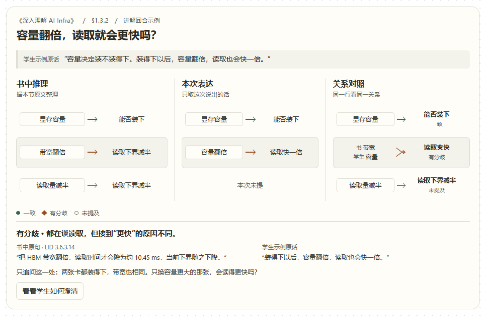

# 切片方案：讲后三图对照

2026-11-23 · [ADR-0192](adr/0192-visible-teach-back-reasoning-comparison.md) 已接受。下文定义普通文本书的交互、证据合同与分步交付范围。切片 1–3 的实现和验证见[学习主线实施记录](实施记录-学习主线与课程入口.md#讲后三图对照--普通阅读)。当前图结构、锚点读取及交互以[切片 4](#4--升级双侧显式局部论述图锚点防截断取证与节点联动对照)为准。

## 一轮反馈长什么样

读者在一条已交付的普通文本书讲解下点「我来解释一下」，或在课内讲解阶段使用既有「把观察变成自己的解释」表单，直接用自己的话讲，不先领一道 AI 出的题。提交后，反馈紧跟这次表达，**书图与表达图同时展开，下方呈现当前焦点的对照**。首次提交前不揭示参考图；点击入口、尚未发出的草稿，或在解释框里发出的单纯求助／新提问，都不是学习者的解释。

以《深入理解 AI Infra：量化分析与系统设计》§1.3.2 为例。问题是“这 70 GB 权重已经装得下，换卡时看什么才知道它能不能读得更快？”以下学生原话是设计示例：“容量决定装不装得下。装得下以后，容量翻倍，读取也会快一倍。”

| 书中推理（直接回答本问题） | 本次表达（据学生原话） | 关系对照 |
| --- | --- | --- |
| 显存容量 → 能否装下权重 | 显存容量 → 能否装下权重 | **一致**：两边都用容量判断容纳能力。 |
| 前提：读取量不变且处于读取瓶颈；带宽翻倍 → 纯读取时间下界由约 20.90 ms 降到 10.45 ms | 前提：已能装下；容量翻倍 → 读取快一倍 | **有分歧**：结论都指向“更快”，书中改变带宽（且指向时间下界），学生改变容量。 |

> **书中提到的另一种思路（非本题换卡要求，默认折叠，不标为「未提及」）：** 带宽不变、把读取量减半，纯读取时间下界同样减半（LID `3.6.3.15`）。主对照行严格限定在直接回答当前问题的 2–4 条核心关系，避免把相邻段落的延伸方案堆成“漏答扣分表”。



另附早期概念草图[窄屏示意](design/teach-back-comparison/mobile.png)。这些草图记录了首版行表的设计。切片 4 在宽容器并排显示两张局部图，在窄容器上下排列，图下方保留选中焦点的成立条件、判断及两侧引文。

选第二行，书侧、学生侧与对照一起高亮，下方并排显示书中原句（支持多段引文，如 LID `3.6.3.8`、`3.6.3.14`）“把 HBM 带宽翻倍，读取时间才会降为约 10.45 ms，当前下界随之下降。”和本次原话“装得下以后，容量翻倍，读取也会快一倍。”读者可回原段，也可直接针对这一行选择**「你把我听反了」**或**「改一下我的想法」**，或直接在底部主输入框回复追问。无分歧即收口；有分歧时默认只追问最关键一处，如：“两张卡都装得下，要搬的数据和带宽也一样，只换容量更大的卡，会读得更快吗？”

若学生点「改一下我的想法」或回复“前一句把带宽说成容量了”，新的对照回合显示**原因已澄清**，并记录为看过三图后的新表达；他是否区分时间下界与实测仍未表达。若学生原话写的是“仓库已经够大，再扩仓也不会把货搬快，得加宽车道”但 AI 误把“车道”听成“容量”，他点**「你把我听反了」**后，系统仅据首次原话重核解读，不计入看图帮助；若一开始比喻就指代清楚且讲通了，直接采用该讲法并收口，不为换了比喻再问一轮。

## 图从哪里来：两阶段编排与软降级

| 读时输入 | 在本例怎样用 | 可以据此断定什么 |
| --- | --- | --- |
| [BookStructure](../packages/core/src/book-structure.ts)（可选增强） | 从当前讲解定位到“从资源下界到实测校准”主线和本章算例。 | 定本次所讲的范围，不把全章重点当作学生必须背出的节点。 |
| [Pass1 概念、断言与局部边](../crates/base-schema/src/lib.rs)（可选增强） | 从 `3.6.3.14` 的有向局部 `builds_on` 找到比较读取与计算下界的 `3.6.3.8`。 | 得到应回读的主张位置与边方向；节点共现、共享 LID 或一条边都不是推论成立的证明。 |
| [Discourse](../packages/core/src/discourse-index.ts)（可选增强） | `3.6.3.9` 解释 `3.6.3.8`；`3.6.3.14` 回答 `3.6.3.13`；`3.6.3.15` 接着比较减少读取量。 | 保留段落功能与关系方向；“回答”或“接着说”不能直接画成“导致”。 |

- **确定性局部取证投影与软降级。** 现有 `book.context` 在 `Via::Edge` 中丢弃了源／目标方向与 claim 名称，且 `discourse_context_items` 排在末尾易被 `k` 截断。由公共 Reader 在 [read-tools](../crates/read-tools/src/lib.rs) 上新增面向三图的确定性局部取证投影：围绕原回答或当前课步骤的锚点 LID，保留 Pass1 边的确切方向（`source_lid -> target_lid`）与 claim 文本、完整 `TechnicalLearningDiscourseItem`（含 `mode / local_function / rhetorical_move / relations`）和对应 `BookStructure` 主线。三件套按**有则增强、缺则软降级**处理：若当前普通文本书缺少 `BookStructure` 或 `Discourse`（例如未跑完三件套的本地导入书或当前仓库内的 `ai-infra-book-complete` 根目录），自动退回原回答已验证出处 LID 与局部 `book.text` / `book.search_text`；先回读原句再画书侧关系，原文仍不足标「书中依据不足」。只连接同一来源版本内的锚点，不要求 Pass2、`cognitive_materials` 或全书重抽。
- **公共 Reader 统一两阶段编排（Resident 与本机 ACP 共用）。** 不依赖外部 Agent 自行遵守提示词隔离，也不要求 ACP 暴露额外图谱工具：
  1. **非解释分流闸门：** 读者在解释入口若发的是纯求助或无关新问（如“HBM 带宽是什么，能先讲一遍吗？”），直接按普通问答回复，不生成空三图，不写入理解证据。
  2. **阶段 1（盲抽学生表达）：** Reader 开启干净的无历史模型调用（ACP 同样以隔离临时目录且**不挂载书 MCP** 运行），仅传入：`原问题 + 极简主题／实体指代词表（由原问题与锚点标题确定性提取，不带原讲解正文）+ 本轮提交原话`。若原回答来自「带我学这一段 / 概览」而没有具体用户问句，阶段 1 仅给小节标题与原回答引用段落的核心实体词表（不含讲解正文），确实无法消解的代词保留学生原词不猜。绝不传入书侧参考图、原讲解正文、教师答案或私下判据。先冻结学生侧关系与原话引句；只有结论就只画结论，不倒推理由。
  3. **阶段 2（书侧取证与关系对照）：** Reader 向模型传入确定性局部取证投影、受控读文工具（允许按需补读同书源邻近原文）与阶段 1 冻结产物，生成书侧关系、对齐行、可选旁路折叠提示与最多 1 处关键追问。若原回答无具体问句，则以学生本次提到的核心主题与该节主线收束书侧图（同样限 2–4 条），不把整节概览全摊开。
  4. **Reader 确定性核验与等待呈现：** 模型负责同义、方向、条件与替代解法判断；Reader 负责核对 `source_id / source_revision`、本轮实际已读 UTF-16 原文覆盖、书中与学生逐字引句、以及对齐行引用的两侧关系 ID 是否全部真属本轮。引用合法不代表语义正确。首次格式或引句核验未通过时，由 Reader 附诊断私下修正 1 次（沿用闭卷 `revision_prompt` 模式）；仍失败才报错、保留原话并允许重试。等待期间界面展示两步真实进度（“正在整理你的表达 → 正在核对书中原文与对照”），待两阶段与核验均通过后再**整卡齐出**，保证显示回执的原子性，不先露出半成品再撤回。

## 切片 1–3 的数据结构与布局

三图以一份结构化教学交付持久化，避免把复杂关系硬塞进 1:1 扁平文本或丢掉前提条件：

```json
{
  "round_id": "tb:turn_123:r1",
  "source": { "source_id": "ai-infra", "source_revision": "<sha256>" },
  "book_relations": [
    {
      "id": "b2",
      "condition": "读取量不变且处于读取瓶颈",
      "premise": "HBM 带宽翻倍",
      "relation_type": "causes",
      "conclusion": "纯读取时间下界由约 20.90 ms 降到 10.45 ms",
      "evidence": [{ "lid": "3.6.3.14", "quote": "把 HBM 带宽翻倍，读取时间才会降为约 10.45 ms，当前下界随之下降。" }]
    }
  ],
  "student_relations": [
    {
      "id": "s2",
      "condition": "已能装下",
      "premise": "容量翻倍",
      "relation_type": "causes",
      "conclusion": "读取快一倍",
      "quotes": [{ "turn_id": "turn_123", "text": "装得下以后，容量翻倍，读取也会快一倍。" }]
    }
  ],
  "rows": [
    {
      "row_id": "row_2",
      "book_relation_ids": ["b2"],
      "student_relation_ids": ["s2"],
      "status": "divergent",
      "summary": "结论都指向“更快”，书中改变带宽（且指时间下界），学生改变容量。",
      "divergence_condition": "容量翻倍但带宽与读取量不变时，书中判断读取不加速，学生判断快一倍。"
    }
  ],
  "side_notes": [
    { "label": "书中提到的另一种思路（非本题换卡要求）", "text": "带宽不变时，把读取量减半也可使读取下界减半。", "evidence": [{ "lid": "3.6.3.15", "quote": "…" }] }
  ],
  "follow_up": { "row_id": "row_2", "question": "两张卡都装得下，要搬的数据和带宽也一样，只换容量更大的卡，会读得更快吗？" }
}
```

- **表达能力约束**：`premise` 可省略（承接“只说结论无理由”）；`relation_type` 显式区分 `causes | requires | contrasts | defines | rebuts | supports | concludes`，不把非因果一律画成“导致”；每条 `row` 支持 `1:1 / 1:N / N:1 / 1:0 / 0:1` 关系组对齐，允许多段 LID 引文；`status` 固定覆盖 7 类：`consistent`（一致）、`divergent`（有分歧）、`omitted`（本题核心未提）、`alternative_valid`（另一种成立的解释）、`unverified_against_passage`（据本段待核对）、`insufficient_book_basis`（书中依据不足）、`clarified`（原因已澄清）。
- **容器自适应布局（Container Query，而非视口宽度）**：
  - **宽容器（`>= 560px`，如全屏问答或展开视图）**：三列横排，同一行对齐同一关系，选中某行下方并列展开书句与学生原话。
  - **窄容器（`< 560px`，包括桌面默认 `384px` 右侧分栏与 `390px / 320px` 手机）**：按关系行分卡，每张行卡内用清晰文字标签分成三层（书中推理 / 本次表达 / 关系对照）同时呈现，零切换、零横向滑动，且完整保留成立条件与中英文长文案可读性；选中行卡后紧邻下方展开双侧原句与纠正入口。不仅靠颜色区分状态，键盘方向键／回车选行与点击得到相同引文。

> **阶段说明（切片 1–3 基线 → 切片 4 升级）：** 上述扁平 `book_relations / student_relations` 与三列行卡是切片 1–3 已落地的首版基线；[切片 4](#4--升级双侧显式局部论述图锚点防截断取证与节点联动对照) 将其升级为显式双侧局部有向图（`book_graph / student_graph` 的 `nodes + edges`）与「上方双局部图并列（窄容器上下叠放）+ 图上编号状态锚点 + 下方单焦点对照栏」，后续修改以切片 4 契约为准。

## 回合、帮助与回看

- **归属与存储。** Reader 沿原聊天接纳真实表达；书内入口绑定所选回答回合，课内入口另绑定当时的 CourseRun、课和步骤。三图本身作为结构化教学事实（复用 [teaching.rs](../crates/reader-service/src/teaching.rs) 事实日志）持久化，[learning_evidence.rs](../crates/memory/src/learning_evidence.rs) 仅写入指向该事实的衍生理解假设（`Hypothesis`）及更正链，不强塞扁平字符串替代三图结构。单侧依据就只留单侧引用。三图是同一份私人回合结果的三个视图。
- **先提交，后展示，跨模式透传。**
  - 首次提交时即固定先前已展示的原讲解为前置 `support_delivery_refs`（明确属于讲后开放解释，而非闭卷独立回忆）。
  - 三图卡片在前端实际渲染可见后，发送显式显示回执（沿既有 `/tutor/display` 语义扩展支持三图交付），服务器收到回执后才将该三图交付计入后续表达的 `support_delivery_refs`。点开早已展示的线不算重新教学，渲染失败也不算学生看过。
  - 若读者看过三图后再对同一目标点「练到会」，`ClosedBookPractice` 自动感知该三图已揭示过书中推理，要求出题避开已代答条件、用新变式检验独立性。
- **两条纠正路径与对话流兼容。**
  - **「你把我听反了」（`dispute_interpretation`）**：仅围绕**首次提交原话**重核解读，通过 `supersedes` 更新原轮解读版本，**不把本次纠错记作看图后的受助表达**；若用户输入了首次原话里根本不存在的新理由，提示改按「改一下我的想法」记录，防止把看图后学会的内容倒记给原话。
  - **「改一下我的想法」（`revise_understanding`）**：记为新一轮学习者表达，绑定已确认显示的上一轮三图交付 `support_delivery_refs`，重新运行两阶段对比并交付新回合的三图。
  - 读者可在指定行内输入，也可在底部**主输入框**直接回复当前追问触发澄清；每次澄清都作为新回合追加在原聊天线性历史中（兼容 [ADR-0188](0188-follow-up-conversations-and-path-preview.md) 追问树与 [ADR-0191](0191-long-conversation-state-and-rule-evaluation.md) 线性回放），卡片顶部提供整轮切换「首次表达／澄清后」，不拆开三图对应关系。若读者在主输入框改问无关新话题，自然结束本次三图对话，不锁死聊天。
- **恢复、失败幂等与适用范围。**
  - 刷新、重开、切换聊天再返回时直接读取已持久化交付，不重跑模型；原文版本已不可定位时展示已保存的引句快照并提示版本已变，禁用跳段，不跳到新版的同号段落。
  - 每次提交携带客户端幂等 `operation_id / expression_id`；生成失败保留原话与重试入口，重试复用同一表达身份，不在聊天里叠出两条重复用户消息，也不推进课程。
  - 仅对普通文本书的已交付讲解（及对应课程讲解）开放；视频、乐谱、无出处拒答或跨书回答暂不开放三图入口。
- **闭卷边界。** 「我来解释一下」是开放式表达；「练到会」是独立的显式闭卷动作。活动中或暂停的闭卷现场不显示书图、对照、证据预览，也不能从历史绕回解答；离开闭卷回到普通现场后才可查看已交付对照。课程推进、正式评估和长期掌握仍由原有规则接纳。

## 实施切片

### 1 · 拆开阅读入口，从一条讲解走通两阶段三图

- **入口拆分**：[RightRail.vue](../packages/web/src/components/RightRail.vue) 与 [App.vue](../packages/web/src/App.vue) 将原绑在 `startClosedBook` 的单动作拆为三个明确动作：**「我来解释一下」**（聚焦原回答下的开放解释输入，带可取消的绑定提示条）、**「练到会」**（显式闭卷，保留原 `startClosedBook` 及收起资料提示）和**「给我一道应用题」**。
- **后端核心**：在 `read-tools` / `reader-service` 落地确定性局部取证投影（Pass1 有向边 + 完整 Discourse + 软降级）、非解释分流闸门、两阶段盲抽与对照编排（含 1 次有界校验修正）、三图结构化持久化、显式显示回执与重试幂等。
- **前端交付**：新增容器自适应三图组件（覆盖默认 `384px` 分栏窄卡与全屏三列），支持选行高亮、并排双侧原句、回跳原段与旁路折叠提示；单侧缺依据时如实说明。

**验收：**用普通文本书（覆盖含完整三件套的书，以及当前缺 `BookStructure / Discourse` 的 `.understand-book/ai-infra-book-complete` 软降级路径），从真实阅读回答提交本页样例，而非加载预写数据。确认：普通阅读下「我来解释一下」「练到会」「给我一道应用题」三动作共存且各自走通；没有先出题、没有建认知材料；输入纯求助句时降级为普通问答不出空三图；三图随同一反馈首次显示并上报显示回执，第二行保留成立条件并能回到 `3.6.3.14` 及原提交，旁路思路折叠展示不标「未提及」；失败后重试仍只有一次提交。

### 2 · 区分两类纠正，补齐主框联动与全宽度交互

- **纠正与澄清**：在行内提供显式「你把我听反了」与「改一下我的想法」两动作，并支持底部主输入框直接回复当前追问；新回合落入聊天线性历史，卡片内支持整轮切换「首次表达／澄清后」并分别展示当时的帮助条件。
- **窄容器与可访问性**：完成全屏（≥560px 三列）、桌面默认 `384px` 侧栏、以及 `390px / 320px` 手机（分层行卡）的中英文实测与键盘导航。

**验收：**覆盖正确比喻、理由错但结论相近、只说结论、书中依据不足、AI 听反后点「你把我听反了」、看图后点「改一下我的想法」六类输入；断言「你把我听反了」不记看图帮助且不允许把新理由倒记入旧原话，「改一下我的想法」正确绑定三图显示回执。选中分歧→查看两句→澄清→刷新→回看首次表达，旧引句不改、版本切换不拆行。在桌面分栏（384px）、全屏和 390／320 px（中／英文）直接操作，确认零切换、零横滑、关键条件不被截断、证据与输入可达。

### 3 · 升级课内讲解解释，接入本机 ACP 并守住闭卷与回课边界

- **课内融合**：[InquiryCoursePlayer.vue](../packages/web/src/components/InquiryCoursePlayer.vue) 在 `explanation` 阶段把既有「把观察变成自己的解释」表单的反馈直接升级为三图对照——由现有 `CourseActivityTutor` 同一套反馈承载三图载荷（不与旧纯文本 Coach 并行跑两份评语），复用原课程 `reflection` 接纳与多轮推进规则，消除双“解释”入口和重复作答；下方 `contextual-practice` 在讲解与反馈阶段统一提供清晰的显式「练到会」和「给我一道应用题」。
- **跨模式与双运行时**：打通三图显示回执向同目标 `ClosedBookPractice` 的帮助透传；让本机 ACP 复用公共 Reader 的同一两阶段编排（阶段 1 隔离目录无 MCP、阶段 2 共享确定性取证投影与只读原文工具），本机与云端共用归属与可见范围。

**验收：**在课内 `explanation` 提交解释、看到三图并澄清后重开原课，核对聊天、课次、步骤、实际帮助及推进规则，确认无需重复抄写且无自动越权通关。从同一位置另开「练到会」，验证闭卷感知已揭示的三图并出变式，且作答、暂停恢复和历史回看均看不到对照或引文；离开后回到原反馈。对开放该入口的本机 ACP 与内置 Resident 分别留一份实际交付，不以一种入口替代另一种。

### 4 · 升级双侧显式局部论述图、锚点防截断取证与节点联动对照

切片 1–3 落地后，真实书库样本（如《财富自由革命之路》`038 自由意志主义与市场经济` `LID 40.2`）暴露出两类结构性问题：

1. **三列行表切碎推理链并造成长句复读，缺少直观局部图**：学生连续说出的 3 步推理链（`不侵犯他人自由 → 两人互动合法 ─需要→ 双方自愿非强迫 ─得出结论→ 自愿交易合法且应被保护`）被拆散进三行，前后节点不共享 ID，读者只能跨行脑补连接；书侧允许无 `premise` 且不限节点字数，模型把 75 字定义塞进单条 `defines`，遇到 `1:N` 拆行对齐时同一大段话在左侧原样重复渲染三遍，淹没了真正的差异点。
2. **超长单段被 `1600` 字截断且模型漏翻页，误伤正确推论**：当整讲正文落在单个超长段落（如 `LID 40.2` 共 4,447 UTF-16 单元），`Discourse` 因只建跨段 `LID -> target_lid` 边而使 `relations` 为空，`Pass1` 也只有 `claim -> concept` 描述边；`teach_back_read_passage` 初次仅读前 `1600` 字，刚好截在后半段“交易受保护的原则 / 自由交易是需要被保护的”之前。阶段 2 虽收到 `discourse.local_summary` 与 `claim:40.2:market_basis` 的“受保护”线索，却未主动调用 `read_lids` 续读，把原文明确支持的推论误标为 `unverified_against_passage`。

本切片将“三列逐行文字表”升级为真正的**作者局部论述图 vs 读者解释图并列对照**，同时补齐超长锚点的确定性取证：

- **锚点防截断与线索驱动续读（[crates/read-tools/src/teach_back.rs](../crates/read-tools/src/teach_back.rs) + [crates/runtime/src/teach_back.rs](../crates/runtime/src/teach_back.rs)）**：
  - 区分**核心锚点段（`anchor_lids`）**与**外围邻居段**：核心锚点段放宽初始连续读取预算（单锚点提升至 `6400` UTF-16 单元，多锚点在总预算内优先读完锚点段正文），避免同一段内的前提与总结结论被 `1600` 字硬切腰斩；外围邻居段仍维持 `1600` 字与按需 `read_lids`。
  - 若超长锚点段超出初始预算仍有 `next_start_utf16`，当阶段 1 抽出的学生节点词项、同段 `Pass1 claims` 或 `discourse.local_summary` 指向未读区间（或锚点剩余原文包含学生结论关键词）时，在进入阶段 2 对照前确定性补读对应分页，不把核心锚点翻页赌在模型自觉上。
- **跨段 `Discourse / Pass1` 骨架 + 段内显式命题拆解（[crates/runtime/src/teach_back.rs](../crates/runtime/src/teach_back.rs)）**：
  - **跨段关系**：答案跨越多个 `LID` 时，沿用 `Discourse` 的有向关系（`causes / results_in / supports / contrasts / explains / answers / depends_on`）与 `Pass1` 局部有向边提供段落间推理方向，区分核心因果链与举例／过渡／旁路。
  - **段内拆图**：答案落在单段或长段内部（即使 `discourse.relations` 为空）时，阶段 2 结合 `Pass1 claims`、`discourse.local_summary` 线索与已读原文，围绕当前问题拆出由**短命题节点 + 有向边**组成的作者局部论述图（`book_graph`），禁止把包含前提、条件与结论的整段原文糊成单个无边长句节点。
- **显式双局部有向图合同与确定性核验（[crates/runtime/src/teach_back.rs](../crates/runtime/src/teach_back.rs) + [crates/reader-service/src/teaching/](../crates/reader-service/src/teaching/)）**：
  - 将扁平关系升级为 `book_graph` 与 `student_graph`（各自含 `nodes` 与有向 `edges`），保留 `rows` 作为**编号焦点对照组（`① ② ③`）**，维持 `row_id` 与既有 `TeachBackReply`、`TeachBackFollowUp`、课程回看及闭卷透传接口一致：

```json
{
  "round_id": "tb:turn_123:r1",
  "source": { "source_id": "justin-sun-z-library-sk-1lib-sk-z-lib-sk", "source_revision": "<sha256>" },
  "book_graph": {
    "nodes": [
      { "id": "bn1", "label": "不侵犯他人同等自由", "condition": null },
      { "id": "bn2", "label": "自由支配自身与财产", "condition": null },
      { "id": "bn3", "label": "互动出于双方自愿同意", "condition": null },
      { "id": "bn4", "label": "活动具有天然合法性", "condition": null },
      { "id": "bn5", "label": "自由交易应受保护", "condition": "市场经济基础" }
    ],
    "edges": [
      {
        "id": "be1", "from": "bn1", "to": "bn2", "relation_type": "defines", "condition": null,
        "evidence": [{ "lid": "40.2", "quote": "只要个人不侵犯他人的同等自由，个人应该享有绝对的自由，以其自身。和财产从事任何活动" }]
      },
      {
        "id": "be2", "from": "bn3", "to": "bn4", "relation_type": "causes", "condition": null,
        "evidence": [{ "lid": "40.2", "quote": "如果这个活动本身啊就是双方的自愿，而且双方也同意进行这个活动，那么这个活动就具有了天然的合法性" }]
      },
      {
        "id": "be3", "from": "bn4", "to": "bn5", "relation_type": "supports", "condition": null,
        "evidence": [{ "lid": "40.2", "quote": "它是我们整个市场经济体系的基本基础，然后这种交易呢，自由交易是需要被。保护的啊" }]
      }
    ]
  },
  "student_graph": {
    "nodes": [
      { "id": "sn1", "label": "不侵犯他人的自由", "condition": null, "quotes": [] },
      { "id": "sn2", "label": "两人互动具有合法性", "condition": null, "quotes": [] },
      { "id": "sn3", "label": "双方自愿非强迫", "condition": null, "quotes": [] },
      { "id": "sn4", "label": "自愿交易合法且应被保护", "condition": null, "quotes": [] }
    ],
    "edges": [
      { "id": "se1", "from": "sn1", "to": "sn2", "relation_type": "defines", "condition": null, "quotes": [{ "turn_id": "turn_123", "text": "自由意志在于只要不侵犯他人的自由，那么两个人之间的任何互动都具有合法性" }] },
      { "id": "se2", "from": "sn2", "to": "sn3", "relation_type": "requires", "condition": null, "quotes": [{ "turn_id": "turn_123", "text": "需要双方自愿非强迫" }] },
      { "id": "se3", "from": "sn3", "to": "sn4", "relation_type": "concludes", "condition": null, "quotes": [{ "turn_id": "turn_123", "text": "任何双方自愿的交易都具有合法性，应该被保护" }] }
    ]
  },
  "rows": [
    {
      "row_id": "row_1",
      "book_edge_ids": ["be1"], "book_node_ids": [],
      "student_edge_ids": ["se1"], "student_node_ids": [],
      "status": "consistent",
      "summary": "起点边界一致：都以不侵犯他人（同等）自由作为个人互动自由的前提。"
    },
    {
      "row_id": "row_2",
      "book_edge_ids": ["be2", "be3"], "book_node_ids": [],
      "student_edge_ids": ["se2", "se3"], "student_node_ids": [],
      "status": "consistent",
      "summary": "叙述顺序略有调整，但“双方自愿非强迫 → 自愿交易具有合法性且应受保护”的闭环与原文一致。"
    }
  ],
  "side_notes": [],
  "follow_up": null
}
```

  - **Reader 确定性核验规则**：
    1. **短节点硬上限**：`node.label` 单行且紧凑（如中文 `≤ 22` 字 / 总长 `≤ 60` 字符），成立条件放入短 `condition` 字段；超长节点由核验器拒绝并触发私下修正，要求浓缩为命题短语、将完整原句留给 `evidence / quotes`。
    2. **连通拓扑与孤立结论边界**：阶段 1 保持无讲解正文、无书工具隔离盲抽，学生前后相接的推理步骤复用同一 `node_id` 连成链／分支／合流；仅当学生只给出孤立结论未说理由时，允许零度孤立节点（`edges` 不引用该节点，此时该 `student_node.quotes` 必填），如实呈现“只有结论节点、缺前提连线”。阶段 2 除 `insufficient_book_basis` 外，`book_graph` 至少包含 1 条 `from != to` 的有向边（上限 6 个节点、5 条边），每条边（及任何零度书侧节点）须通过本轮已读 UTF-16 区间逐字引文校验。
    3. **不重复归属的焦点对齐**：每条边与每个零度孤立节点必须且只能归属一个 `row` 焦点组（允许同一组内连通子图 `1:1 / 1:N / N:1 / 2:2 / 1:0 / 0:1` 对齐；不把互不相干的两处分歧塞进同一组），从合同层根除同一书侧关系跨多行重复挂载。
    4. **已存记录与下游兼容**：`closed_book::displayed_reasoning`、`learning_evidence` 摘要及 SQLite 历史读取同步适配 `book_graph / student_graph`；切片 1–3 已落盘的旧回合 JSON 在读取或前端视图层按单跳边确定性投影为局部图，不破坏已有存档回看。
- **前端双局部图并列与焦点联动布局（[TeachBackComparisonCard.vue](../packages/web/src/components/TeachBackComparisonCard.vue)）**：
  - **去掉第三列重复文字墙**，改为**「顶部轮次与焦点锚点条（`① ② ③`）+ 中部双局部有向图 + 底部单焦点对照与引文面板」**：
    - **宽容器（`>= 560px`，全屏问答、课内 `CourseActivityTutor` 与 `CourseReviews`）**：左右并列展示「书中局部论述图」与「本次表达局部图」，每张图只画一份完整局部拓扑，绝不重复渲染节点。
    - **窄容器（`< 560px`，桌面 `384px` 右侧分栏、`390px / 320px` 手机）**：上下叠放「书中局部论述图」与「本次表达局部图」，保留真实节点卡与有向连线，零横向滑动、不退回三层重复文字卡。
  - **确定性分层有向图排版**：基于 `nodes + edges` 做轻量确定性 DAG 分层布局（可换行的 HTML/SVG 节点卡 + SVG 有向箭头与关系词胶囊标签），支持链式 `A→B→C`、多前提合流 `A+B→C`、一因多果分支及零度孤立节点。
  - **图上状态编码与单焦点联动**：节点与连线按所属 `row` 对应同号焦点。两图共用暖纸底与墨色正文。选中的路径与箭头用陶土橙，节点铺浅杏色，其余连线用暖灰。判断由状态圆点、标签和文字表达：一致／已澄清用灰绿，分歧用暗砖红，待核对／书中依据不足／本题核心未提用赭黄，并保留待核或缺项的虚线提示。学生侧只画其实际表达。初始默认聚焦 `follow_up.row_id` 或首个非一致焦点；点击任一节点、连线或顶部 `① ② ③` 标签（以及键盘方向键导航），**两侧对应子图同步高亮、非焦点保留暖灰连线**，底部单一面板联动展示该焦点的状态、一句话对照说明、分歧条件、并列「书中原句（跳回 LID）」与「本次原话（回到表达）」、追问及「你把我听反了 / 改一下我的想法」。

**验收：**
- **合同与组件**：`cargo test -p read-tools --lib teach_back` 与 `cargo test -p runtime --lib teach_back` 覆盖超长锚点全文读取、超长节点标签打回修正、无边长句定义打回修正、零度孤立结论合法、焦点组不重复归属及旧存档投影兼容；`pnpm verify:course:local` 回归通过。Playwright 在中英文全屏、`384px` 分栏、`390px / 320px` 手机实测确认两张局部图的节点与有向箭头连线清晰可见、无重复节点、无横向溢出，点击节点或键盘切换可同步高亮双侧子图并完成跳段、「你把我听反了」与「改一下我的想法」。
- **真实模型双样本**：（1）复跑 AI Infra §1.3.2 跨段样本（Resident 与本机 ACP），确认跨段因果局部图、容量／带宽分歧高亮与折叠旁路；（2）复跑《财富自由革命之路》`LID 40.2` 超长单段样本并提交本节 3 步链原话，确认不再因 `1600` 字截断漏读后半段的“交易受保护”，左侧生成连通的作者局部论述图（无三遍复读），右侧生成连通的 3 步学生解释图，焦点对照与原文逐字引句准确对齐。

## 验证与接手

- **程序与界面。** 在[入口组件回归](../packages/web/src/App.learning-entry.test.ts)和[对话教学浏览器用例](../packages/web/playwright/conversation-learning-design.spec.ts)补齐三动作共存、非解释分流、两类纠正、主框联动与软降级路径，保留同一回合全屏、`384px` 侧栏及 `390 / 320px`（中英文）实际截图；在 Reader 和 memory 真实 SQLite 断言引句、源版本不可定位降级、显示回执顺序、`dispute_interpretation` vs `revise_understanding` 帮助归属、重试幂等以及闭卷感知三图帮助。用 `pnpm verify:course:local` 检查既有闭卷及回课没有退化，该命令本身不证明三图成立。
- **教学语义。** 按[课程真实模型试验的取证与预算方式](实施记录-书籍与成套课程入口.md#一次真实模型回课试验)补讲解场景，保留原文、两阶段实际输入（证明阶段 1 不含原讲解正文与书工具）、学生原话、三图交付与实际追问。若学生侧出现了只在书中才有的理由，先修阶段 1 输入与隔离；引文都对但把下界当实测，修关系解读；同义表达仍被追问，修对照判断。记录本段实际读了哪些材料、两阶段合计用了几轮、两阶段各自及端到端耗时，再判断是否节省交互。
- **首次试用。** 让实际读者指出“AI 哪条线听懂我了，哪条线没听懂”，并从那条线完成一次核对或纠正。能渲染、能恢复和读者能用它说清分歧，是不同的验收结果。

普通阅读的行内纠正、主框澄清与整轮回看见[普通阅读实施记录](实施记录-学习主线与课程入口.md#讲后三图对照--普通阅读)。课内讲解、本机 ACP 与同目标闭卷变式的使用入口、实际样本和验证范围见[切片 3 实施记录](实施记录-学习主线与课程入口.md#切片-3--课内解释本机-acp-与闭卷变式)。双局部图的复验入口与当前验收结果见[切片 4 实施记录](实施记录-学习主线与课程入口.md#切片-4--双局部图与焦点对照)。
