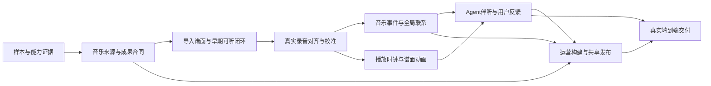

# 音乐预构建与交互伴听：实施切片

日期：2026-10-22。状态：M0–M8 已进入实施与联合验收。音乐合同、预构建、播放器、Agent 与运营发布接线已落地；完整舒伯特逐音符小样和可共享贝九内容尚未通过验收。实际证据、复现入口及未完成项见[音乐伴听验收](验收-音乐伴听.md)。

行为决策见 [ADR-0175](adr/0175-curated-music-prebuild-and-guided-listening.md)，术语见 [CONTEXT](../CONTEXT.md)。本计划继承 [ADR-0170](adr/0170-goal-scoped-learning-workspaces-and-shared-releases.md) 的目标工作区和共享发布、[ADR-0171](adr/0171-all-agent-cost-accounting-and-percentage-allowance.md) 的统一成本、[ADR-0174](adr/0174-teaching-coach-and-participation-planning.md) 的系统逐轮教练职责。

## 1. 首批交付与既有边界

首批采用运营者精选作品、录音和乐谱，预构建后供用户伴听。先交付舒伯特《音乐瞬间》第 3 首完整小样，再交付贝多芬第九交响曲的一个选定片段。贝九片段保留作品、乐章及前后段落定位；完整乐章的定位概览与片段内的深度理解分别声明覆盖。

用户提供的《看见舒伯特｜音乐瞬间第3首.mp4》是视觉与交互参照。M0 确定实际构建使用的录音、谱本和引用资料，并记录授权依据；参考视频的提供不等于获准公开传播其中的录音、谱面或画面。

用户可观察到的成品行为是：原录音播放时，谱面正确跟随；用户可以关注某个声部或主题，点击回听、比较片段，并从“这一遍听什么”逐渐理解音乐。Agent 根据用户实际反馈选择解释和材料，能带用户回到可核对的原声与谱面。

本轮沿以下既有接点实现音乐能力：

| 现有接点 | 本线复用方式与需补齐部分 |
| --- | --- |
| `packages/core/src/automatic-build-*`、`build-intent-v2.ts` | 复用任务、计划、预算、候选接纳、恢复和发布；新增音乐阶段及其依赖 |
| `crates/server/src/published_library.rs`、`workspace_publication.rs`、`learning_workspace.rs` | 复用资料发布、可读授权、公共工作区和私人学习归属；补齐纯音乐资料的能力投影 |
| `crates/base-schema/src/video.rs`、`packages/core/src/source-manifest.ts` | 复用稳定来源与可修订解释的约定；当前 `VideoMaterial` 强制转写，`MediaLocation` 绑定视频，因此需明确音乐类型分支 |
| `crates/server/src/video_media.rs`、`video_playback.rs` | 复用适用的媒体探测、资产读取和播放服务；当前视频来源约定 `media/original.mp4` 路径并有等待转写阶段，音乐需补充自己的导入分支 |
| `packages/web/src/components/VideoReaderPane.vue`、`ReaderPane.vue` | 复用 Reader 布局、现场提问和返回来源的交互；新建音乐谱面与播放组件 |
| `crates/runtime/src/tutor.rs`、`tutor_coach.rs`、`crates/server/src/teaching_coach.rs` | 复用教学交付、后台教练和理解证据；新增音乐读取与播放动作 |
| `crates/runtime/src/video_audio.rs` | `video.review_audio` 目前是 Whisper 语音识别，主模型接收工具结果；不承担音乐听觉分析 |

新增音乐类型仅覆盖本线需要的媒体、谱面、事件与动作，不借此进行全项目泛媒体重构。书籍和视频原合同保持可用，纯音乐不生成伪造 transcript 或虚构正文 LID。

## 2. 构建产物与最小行为合同

预构建核心是可定位音乐事件：发生了什么、由哪些材料支持、怎样帮助用户听见。事件可以时间重叠，也可以通过同一主题连接相距很远的片段。

| 产物 | 最小内容 | 生命周期 |
| --- | --- | --- |
| 作品与谱面结构 | 作品、乐章、谱本、小节、音符对象、乐器、乐器组、谱面声部及其关系；有依据的乐句、段落和主题联系 | 原始谱本及其位置稳定；解释与划分可修订 |
| 具体录音及演奏映射 | 录音版本、原媒体区间、演奏经过次序、重复出现、对齐方法、可用精度与校准依据 | 绑定具体录音和谱本；换录音重新建立映射 |
| 音乐事件与全局联系 | 参与声部、当前角色、变化、证据、前后联系及适合的听觉关注 | 可修订语义；不承担原材料身份 |
| 可选听辨素材 | 原声 A/B 对照、循环区间、谱面突出方案、必要的旋律或节奏合成示范 | 关联所用来源版本与事件；标明生成方式 |
| 能力与覆盖 | 可播放、可查谱、基础定位、逐音符同步、已接纳语义、可用示范各自的范围与缺口 | 随已接纳成果发布；失败范围保持可见 |

乐器、谱面声部和音乐角色分别表达。一个声部可包含多条谱面声线；同一主题可以由不同声部接续或共同演奏；旋律、伴奏、低音支撑等角色按片段变化。M0 的实际谱本决定需要落实的多声线、移调乐器、合奏分谱等细节，不能仅按显示名称推断关系。

来源至少区分谱面事实、录音观察、引用分析和解释性表述。录音观察保存实际处理的片段与方法；只有读谱或看到分析文字时，不写成已经听过录音。模型或工具对声音的能力通过 M0 验证，未验证的演奏判断保留未确认状态，不能作为已接纳解释发布。

稳定引用落在确切录音区间、谱本位置和原发布。事件拆分、乐句合并或解释修订不改变旧笔记的所指。SVG 对象 ID 用于当前谱面定位；渲染器重新排版或更换版本时，通过保存的谱源对象映射重新取得位置，不把浏览器坐标或临时 SVG ID 当作唯一来源身份。

对齐保存“演奏中的一次出现”，不能仅以谱面音符为键。同一小节经过反复时有多次出现；同时发声的和弦与不同声部有各自关联。起音、持续显示和淡出分别表达，谱面时值不冒充录音里实际发声的结束时刻。

基础小节／乐句定位与逐音符同步分别记录覆盖和精度。Verovio 的生成播放时间用于谱面和示范，不直接当作真实演奏时间。舒伯特成品要求实际逐音符跟随；小节内匀速插值可用作明确标注的粗定位，不能据此宣布该能力完成。

连续动画由客户端播放器时钟驱动。Agent 选择关注声部、角色、主题以及播放区间，调用离散动作；不逐帧输出动画，也不在播放过程中循环调用模型。动态讲解、活动安排和用户理解记录在交互时形成。

## 3. 依赖与交付里程碑

| 里程碑 | 必要切片 | 可实际查看的结果 |
| --- | --- | --- |
| 第一条可听闭环 | M0–M2 | 产品 Reader 中可播放实际样本、查看谱面、按人工确认的短片段往返；尚不宣称自动理解或逐音符动画 |
| 完整舒伯特小样 | M3–M6 | 全曲逐音符跟随、基础声部关注、三类听辨活动及有来源的交互讲解 |
| 可共享的精选伴听 | M7–M8 | 运营构建和发布、独立私人学习、成本归属，以及贝九选段的声部关系和主题传递 |

推荐顺序为 M0 → M1 → M2 → M3，然后 M4 与 M5 可并行，完成后进入 M6；M7 的接线可在 M1 后准备，但公开可用成果依赖 M4 及对应能力证据，最终由 M8 联合验收。每片结束记录实际接点、输入、产物、验证和下一步，追加到既有[代码链路](代码链路.md)。

下文保留各片的目标、依赖与完成标准；实际实现状态见每片开头。文件名指向本轮实施接点。每次检查针对可达的具体失败，复用已有有效证据。

## M0 样本、内容授权与真实能力证据

**状态：真实样本、来源与能力实验已落地；独立听核、起音真值及贝九共享素材未完成。依赖：无。**

**目标行为**：用真实舒伯特录音与对应谱本证明首版所需的读取、谱面渲染和对齐路径可行，并确定贝九选段的实际范围。

**输入**：视觉参考视频；待选的舒伯特完整录音、MusicXML／原谱、贝九候选录音和谱本；必要的分析资料；既有运营执行环境和预算入口。

**产出**：拟新增 `evals/music/README.md` 与样本材料清单，记录版本、来源、许可、媒体位置、覆盖范围和回放方式。选取局部节奏、重复／变化、声部关系三类真实案例，给出可复查的谱位、录音区间及人工听核依据。量化自动对齐后的校准工作量，保留实际耗时与调用成本。

**实施接点**：先在 `evals/music/` 固定输入；探测复用 `video-import.ts` 和 `video_media.rs` 中适用逻辑。实际候选音乐分析或对齐工具在此实验，不提前锁定供应商；付费调用沿现有费用准入，不新增实验账本。

**机械验证**：实际文件可解码、MusicXML 能转成可用 SVG、样本片段能按原时轴复现；比较候选对齐和人工锚点，报告偏差及失败位置。通过实际请求或工具执行记录确认音频输入已送达处理环节，再用不同短片段核对结果是否受实际声音支持；输出文字不同本身不证明音频已被处理。

**音乐与视觉判断**：人工确认谱本与演奏对应、反复路径、显著声部和三类案例；查看连贯播放画面，确定光点、淡出和谱行移动的设计参照。为两份真实样本的节奏密度确定同步误差的可接受范围，机械偏差与听觉可接受性分别记录。

**失败后动作**：解析丢失当前所需记号则修正结构化谱本或选择可用谱本；自动对齐不足则保留有记录的人工校准路线；音乐模型不能支持录音判断时缩小自动判断范围。若所需逐音符效果在合理校准量内仍不可达，记录证据并调整实施方法，不把粗映射作为成功。

## M1 音乐来源、演奏出现与成果合同

**状态：合同及 Rust/TypeScript 双端校验已实现并验证。依赖：M0。**

**目标行为**：一条音乐事件能准确回到确切录音区间和谱位，经历反复、解释修订与重新排谱后仍保持来源可追溯。

**输入／产出**：输入 M0 样本与已确认能力；输出权威类型、生成类型、最小样本夹具和音乐能力覆盖合同，落实第 2 节的三层产物及稳定引用。

**实施接点**：拟新增 `crates/base-schema/src/music.rs`、`packages/core/src/music-contract.ts`；接入 `base-schema/src/lib.rs`、`source-manifest.ts`、`crates/read-tools/src/lib.rs` 和现有来源呈现分支。沿现有发布、账号与工作区引用，不另建音乐用户或发布身份体系。

**关键行为**：原录音、原谱和已发布版本可定位；演奏出现与谱位是多对一关系；跨声部主题和重叠事件可表达；每个结论附来源类型。覆盖按实际区间和能力区分，未处理、失败和只有基础精度的区间不可混成逐音符就绪。

**机械验证**：用真实样本固定同一谱位两次出现、同时和弦、重叠事件、语义拆分及新排版后读取旧引用；拒绝引用不存在的谱对象和越出原录音的区间。验证音乐无 transcript 仍可声明合法资料，并定向确认原书籍／视频来源不变。

**失败后动作**：修正来源或映射合同，不用新增文字段落替代音乐身份；已有引用保持指向原发布。仅为本线引入必要类型，不为未来任意媒体增加通用适配框架。

## M2 导入、谱面渲染与第一条可听闭环

**状态：导入、谱面和播放器闭环已实现；两份真实样本完成构建，正式服务媒体、校准和共享发布链路通过。依赖：M1。**

**目标行为**：从实际产品入口打开舒伯特样本，听原录音、查谱，并在三个人工确认的片段和谱位间往返。

**输入／产出**：输入录音、MusicXML、谱本来源和 M0 锚点；输出音乐准备态资料、服务端 Verovio 生成的 SVG、谱源对象到渲染对象的映射，以及可播放的 Reader 页面。早期锚点明确为人工准备，只支持其已确认范围。

**实施接点**：拟新增 `packages/core/src/music-import.ts`、`music-score.ts`、`crates/server/src/music_media.rs`、`packages/web/src/components/MusicReaderPane.vue`；接入 `source-manifest.ts`、`ReaderPane.vue`、`NetworkApp.vue`、发布资产服务及现有媒体读取授权。

**关键行为**：保留原文件和元数据；原声与合成示范有不同标签；谱面可缩放、选择声部并返回当前片段。服务端预渲染先满足桌面及项目支持的窄屏布局，首版不依赖浏览器分发 Verovio。加载和失败状态可恢复，媒体失败时不显示“正在播放”。

**机械验证**：导入重开后录音和谱面仍可读；从页面点击片段到准确原时轴；对象映射能解析到真实 SVG；非法或缺失材料给出具体失败，未授权账号不能借音乐资产入口读取。引用现有授权覆盖，新增入口只补必要覆盖。

**音乐与视觉判断**：在真实 Reader 查看全曲谱面和贝九选段总谱，检查音符、谱号、声部名、换行、缩放和控件；实际听三段并确认跳转意义。仅渲染成功不视为谱面内容正确。

**失败后动作**：修正转谱损失、资产接线或布局；保留早期闭环为可打开产物，后续切片持续在这一入口推进。

## M3 真实录音对齐与人工校准

**状态：真实音频候选、局部校准修订及图形工作台已实现；两份真实素材的 API、桌面和窄屏保存/重开验证通过。原录音逐音符覆盖仍为 pending，独立听核与起音精度验收未完成。依赖：M2。**

**目标行为**：舒伯特完整录音和贝九选段各有可复查的演奏路径与定位；需要逐音符呈现的范围具备真实起音映射。

**输入／产出**：输入谱面结构、录音和 M0 选定方法；输出小节／乐句锚点、展开反复的演奏出现、音符起音候选、已接纳校准和精度覆盖。校准保存原候选、变更位置及依据，使用现有候选接纳与修订约定。

**实施接点**：拟新增 `packages/core/src/music-alignment.ts`；接入 `automatic-build-dispatch.ts`、`automatic-build-executor-session.ts`、`automatic-build-task-store.ts` 和进度投影；在现有构建工作台增加对齐检查与局部调整，不另建任务队列。

**关键行为**：录音真实速度、停顿、反复和所选谱本的演奏路径进入映射；同时起音、连音及延音按样本可支持的依据处理。只有起音证据时，动画结束采用明确的呈现规则，不能写成已测得物理止音。某一区间重新校准不会清空其他已接纳范围。

**机械验证**：对 M0 人工锚点计算偏差并按错误位置回看；跨反复回跳和随机定位都能取得正确出现；失败后恢复保留已接纳片段。换录音或谱本后旧映射不能被误认为适用。

**音乐判断**：连续回听全首舒伯特及完整贝九选段，核对起音与谱位；重点听速度变化、句尾、密集音符和多声部进入。报告实际偏差与校准量，按 M0 确定的范围判定是否达到逐音符呈现条件。

**失败后动作**：修正候选、演奏路径或局部锚点；不能通过隐藏错位或匀速插值抬高精度声明。未达到逐音符条件的区间保留基础定位，舒伯特完整小样继续待完成。

## M4 音乐事件、全局联系与听辨素材

**状态：事件查询、前后关系、全局导航与谱面合成示范已实现；样本事件以谱面依据为主，实际听辨核验未完成。依赖：M3。**

**目标行为**：Agent 可以查到一处可听见的变化、参与声部及前后联系，并取得帮助用户听辨的原声和谱面材料。

**输入／产出**：输入结构化谱、对齐、已验证的音乐分析结果和引用资料；输出局部音乐事件、作品地图、主题关系、动态声部角色及可选听辨素材。舒伯特覆盖全曲；贝九深度覆盖选段，并提供有来源的乐章定位概览。

**实施接点**：拟新增 `packages/core/src/music-events.ts`、`music-structure.ts`、`music-demonstrations.ts`；接入既有图谱／讲解结构读取及 `automatic-build-*` 阶段。新增音乐字段与查询保留音频、谱面来源，不能套用文本跨度编造正文。

**关键行为**：先读局部真实材料，再比较相关出现，最后建立全局联系。主题相同、相似或变形需有具体依据；谱上参与不等于录音里突出。简化旋律、节奏或声部示范从谱面生成并标为“谱面合成示范”，不声称来自原演奏分离。

**机械验证**：事件能解析到原声与谱面；前后关系能返回两端材料；查询可同时取得重叠事件及当前声部角色；覆盖缺口不能在全曲地图中成为已深度分析区间。校准修订后相关事件读取新映射，旧引用继续回到旧发布。

**音乐判断**：逐项核对 M0 三类案例及贝九声部交接案例，确认描述与实际材料一致、对照能听出所说变化、合成示范保留教学所需内容。生成数量和字段齐全不构成音乐理解通过。

**失败后动作**：删除或修正无依据的解释，补取相关片段；若某个变化难以听辨，调整关注对象、片段长度或示范。未经实际验证的录音观察不进入已接纳成果。

## M5 播放时钟驱动的谱面动画

**状态：播放时钟、光点/尾迹、声部选择、循环/倍速及跟谱已实现并用确定合成时轴验证；真实演奏的全曲效果仍依赖 M3。依赖：M3；主题角色模式读取 M4 成果。**

**目标行为**：原声播放时彩色光点、音符／声部高亮和短淡出准确跟谱，谱行平滑推进；用户能主动查谱并一键回到正在播放的位置。

**输入／产出**：输入已接纳时间映射、SVG 对象位置和当前教学关注；输出 `MusicReaderPane.vue` 中可暂停、拖动、调速、循环和缩放的正式交互。拟新增 `packages/web/src/music-playback.ts`、`music-score.ts` 和相关样式。

**关键行为**：每次绘制从播放器当前位置计算活动出现及其呈现阶段；暂停、缓冲、跳转和恢复后重新定位，不依赖独立累加的动画计时。和弦与多声部可同时点亮；手动浏览暂离自动跟随，点击返回后恢复。

**视觉规则**：初学默认突出少量关注对象，完整谱面随时可查；可选择按声部着色或按音乐作用着色，一次保持一种清楚规则。主题转交时保留主题颜色并更新乐器标签；用名称和高亮区域共同表达含义，光晕不遮住音符。

**机械验证**：在真实样本上覆盖暂停／继续、往返拖动、循环边界、倍速、反复、缩放和窗口尺寸变化，确认当前时间只选择正确出现；卸载／重开释放旧播放与绘制任务。通过局部区间索引和可见谱行处理，避免每帧遍历全曲和反复读取全部布局。

**视觉与性能判断**：在项目实际支持的桌面和窄屏视口完整播放样本，检查清晰度、跟随、手动浏览和恢复。记录谱面载入、可交互时间、绘制耗时及明显卡顿位置；贝九多声部密度作为实际负载。首轮建立基线，再依据主线程阻塞和听看结果确定需修正的瓶颈，不预设无依据的吞吐指标。

**失败后动作**：先区分录音对齐误差与播放器绘制误差，分别回到 M3 或本片修正；谱面密度引起卡顿时限制可见渲染范围、复用位置结果，保持全部音乐数据可查询。不能通过降低采样精度掩盖错位。

## M6 Agent 伴听、参与活动与理解记录

**状态：音乐读取/动作、原来源、冻结问题、私人理解与教练接线已实现；真实模型首轮交付及示范/原声切换通过。第五次四轮联测仅首轮完整，后续因讲解顺序和调用预算未通过；已修订提示与工具指导，完整四轮和响应速度仍未验收。依赖：M4、M5。**

**目标行为**：用户从基础问题进入短片段听辨，Agent 能提示关注、比较、示范、回到原声，并根据“听见了／没听出来”的实际反馈调整帮助。

**输入／产出**：输入当前工作区目标、录音与谱面位置、关注声部、已发布事件和用户表达；输出音乐读取／定位／播放／循环／关注动作及执行结果，接入既有 TeachingDesign、帮助交付和理解记录。

**实施接点**：拟新增 `crates/runtime/src/music.rs`、`crates/read-tools/src/music.rs`；接入 Runtime 工具注册、`tutor.rs`、`tutor_coach.rs`、`crates/server/src/teaching_coach.rs`、来源呈现、Reader 动作通道和既有学习记录。

**职责**：系统仍按 ADR-0174 在成功教学回合后调度独立教练，教练负责阶段节奏和参与活动安排；Resident 按当前用户输入取证、准备材料、执行教学与公开回应，下一轮自动取得已有指导。音乐不新增独立教练循环，用户当前输入保持优先。

**动作与现场**：提问保存明确录音出现、区间、谱位与选中声部，播放继续后所指不漂移；可按“刚才这里”回听。播放只在用户操作或当前明确教学动作中发生，动作结果反馈成功／失败；用户暂停或转向后，不被旧安排重新启动。解释之间留出完整聆听空间，默认不让讲解语音与原声重叠。

**机械验证**：“刚才这里”跨反复仍回到原出现；读取局限于当前工作区授权材料；播放失败不记为用户已经完成聆听；切工作区后旧回应与后台记录仍归原工作区。沿用已有教练调度验证，只补音乐上下文和执行结果的贯通场景。

**真实教学判断**：运行一次真实模型伴听，依次覆盖用户能辨认、仍听不出、临时追问和主动继续听。核对实际来源、素材选择、帮助是否改变，以及理解记录是否来自用户证据；不能以完成播放或点过按钮推断已经理解。

**失败后动作**：分别修工具接线、来源不足或教学选择；复用教练与理解审核修正流程。尚未验证的听觉分析能力不能通过提示词写成已经具备。

## M7 运营构建、共享发布、授权与成本

**状态：运营构建、能力判定、许可门槛与共享发布已实现并验证；安装态 Engine、后台及暂停恢复/双用户实际 HTTP 链路通过。公开能力按已完成范围发布。依赖：M1；发布已接纳音乐理解依赖 M4，伴听能力依赖 M5–M6。**

**目标行为**：运营者在现有后台选择音乐资料、范围和预算，查看／继续构建，发布可用范围；不同用户复用公共成果而保持私人学习独立。

**输入／产出**：输入音乐 BuildIntent、已接纳成果与素材使用依据；输出既有 Build Engine 的音乐阶段执行、成本记录、不可变资料发布和共享工作区清单。发布可用性按录音、谱面、对齐、语义及示范分别投影。

**实施接点**：`automatic-build-publication.ts`、`automatic-build-budget.ts`、`automatic-build-metrics.ts`；`crates/server/src/operator_builds.rs`、`published_library.rs`、`workspace_publication.rs`、`model_spend_store.rs`；`apps/admin/src/pages/operator-builds.tsx`、`workspace-releases.tsx`。

**关键行为**：音乐分析、对齐与示范的实际执行沿已有预算和任务归属；运营公共构建归平台，读时教学和后台教练沿既有用户费用规则。已接纳单元恢复时复用；新发布累积仍适用成果，旧用户笔记继续指向原发布。两个用户开始伴听不重复触发公共预构建。

**授权与许可**：记录具体谱本、录音、分析资料及示范所用音源的使用依据，沿现有发布操作执行。MusicXML 格式可用于商业实现，但不授予内容使用权。Verovio 采用 LGPLv3，可用于商用与闭源产品；首版在服务端预渲染，保留所用版本、许可及可见署名。若以后向浏览器或桌面分发库，再按实际打包方式落实对应源码、修改及替换／重新链接等条件，不能把服务端方案的处理直接套到客户端。依据见第 5 节。

**机械验证**：在真实运营任务上完成中断恢复、局部失败与重试，核对费用事实和已接纳单元；缺素材依据或必需能力时不能声明该范围可公开伴听。两用户复用同一发布，私人聊天、理解、目标和进度独立；更新其中一人不改变另一人及旧引用。

**失败后动作**：修正计划依赖、费用归属、资源齐全性或发布投影，沿已有账本与发布边界解决。授权依据不满足时保留内部样本状态，不将其发布为可商用内容。

## M8 真实端到端交付与后续入口

**状态：媒体、图形校准、动画与运营发布链路已有真实验收证据；首批原声精度、完整四轮教学、响应速度及真人学习效果未通过，完整首批交付未完成。依赖：M6、M7。**

**目标行为**：从用户实际入口开始，完整使用精选舒伯特小样和贝九选段；运营者能够按同一流程维护成果。

**输入／产出**：输入正式候选发布、实际支持的运行环境和两类样本；产出拟新增 `docs/验收-音乐伴听.md`，集中记录版本、来源、覆盖、真实交互、关键截图／录屏、对齐偏差、人工判断、费用与已知问题。完成状态以此证据更新，不以“计划全部执行过”判断。

**机械验收**：完成运营构建 → 发布 → 两用户进入工作区 → 播放／查谱／提问 → 对照和示范 → 返回来源 → 重开恢复 → 新版接入。核对真实工具调用、引用、教练指导、理解归属和费用；只补联合流程暴露的缺口，不重复已充分覆盖的底层检查。

**音乐与教学验收**：舒伯特全曲逐音符跟随；贝九选段可指认参与乐器、动态角色和至少一处有依据的声部关系。请初学者在伴听后重听实际片段，观察其能否自己指出一个主题回来、节奏变化或旋律与伴奏的关系，并说出听到的依据。保留实际反馈，不将教学目标写成已达事实。

**视觉与性能验收**：以用户参考效果和现有 Reader 为依据，实际操作桌面及窄屏、完整谱／关注声部、长时间播放、跳转及循环；复查 M5 暴露的具体性能问题。类型检查或屏幕截图均不能单独证明同步动画正确，需连贯播放证据。

**失败后动作**：按来源／对齐、语义、播放、教学、发布归回对应切片，修复本次范围内问题后复验受影响场景。完整舒伯特或贝九选段尚有必需能力缺失时，准确记录剩余工作，不标记首批交付完成。

## 4. 已知限制与后续范围

个人任意音频上传、通用扫描谱识别（OMR）、自动全乐团声源分离、实时跟随外部演奏，以及完整贝九的全曲深度构建，均不属于首批交付。首批可用人工录谱和校准补足精选材料，但应记录实际内容制作成本。

真实录音 STFT/DTW 已在两份样本执行，候选仍待独立起音标签与连续听核；本轮没有证明音乐大模型直接理解原声。当前样本不具备已接纳的原录音逐音符覆盖，完整舒伯特小样继续待完成。

首版服务端预渲染提供确定的谱面布局；浏览器实时重新排谱及客户端 Verovio 分发留待真实需求出现后决定。原声乐器分离不是声部理解和谱面突出显示的前提；合成示范的音色与演奏表现也不等于原录音。

贝九选段外的乐章概览仅用于定位和有依据的背景解释，不能据此声称已完成选段外逐音符对齐或深度音乐分析。作品、谱本、录音与材料授权分别确认。

## 5. 外部依据

以下官方资料于 2026-10-22 核对，用于本方案的格式、渲染与许可判断；具体实施版本及样本结果由 M0 记录。

- [MusicXML 4.0 规范与 FSA 声明](https://www.w3.org/2021/06/musicxml40/)：数字乐谱交换格式及规范许可。
- [Verovio 许可说明](https://book.verovio.org/introduction/licensing.html)与 [LGPLv3 正文](https://www.gnu.org/licenses/lgpl-3.0.html)：商业使用、署名与分发义务。
- [Verovio SVG 结构与样式](https://book.verovio.org/interactive-notation/css-and-svg.html)：对象标识、结构与可操作样式。
- [Verovio 输出格式](https://book.verovio.org/toolkit-reference/output-formats.html)：SVG、MEI、MIDI、timemap 与展开映射；生成播放时间不等于实际录音对齐。
