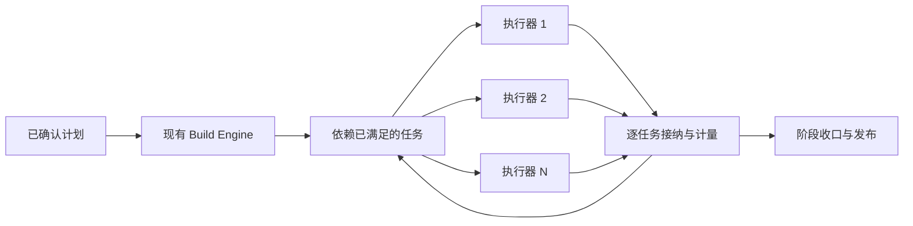

# 预构建吞吐与执行器复用

日期：2026-10-29。状态：书籍跨批次持续领取与 BookStructure 动态接续已实现、验证并安装，完成证据见[当前实施记录](performance/continuous-workers-20261029/SESSION_CHECKPOINT.md)。用户指定直接接续《动手学深度学习》原构建观察速度，不重跑独立对照。原 S1a 只覆盖同一有界 dispatch，现已补齐同阶段跨批次生命周期、动态任务、等待及上下文轮换；完整阶段加速倍数尚无结论。S2a（视频翻译/discourse 两槽并行）、S3（同次构建常驻转写）与 S4（音乐完整重建增量复用）的既有结果保留；原安装记录见[插件接入](performance/prebuild-engine-activation-20261028/README.md)。

实现与验证：[书籍连续执行](performance/continuous-executor-20261028/README.md)、[视频独立批次并行](performance/video-parallel-20261028/README.md)、[本地常驻转写](performance/video-transcription-resident-20261028/README.md)、[音乐增量处理](performance/music-incremental-20261028/README.md)。前期依据见[可行性记录](performance/prebuild-feasibility-20261028/README.md)。真实书籍/视频语义模型的端到端性能对照尚未运行。

## 目标与选择

2026-10-29 已授权范围：完成书籍同一阶段跨 dispatch 连续领取、提交后动态产生的结构任务接续、等待与上下文轮换，保持 `full` 质量与并发 8。最终实测按用户最新要求使用深度学习书的原进度续建，保留切换前后同类任务的实际时间、工作量及重试；不再重启《失败的逻辑》的隔离对照。

worker 的稳定身份绑定同一次 invocation，当前任务 assignment 仍保留原独立 lease、session、候选与回执。每批结束后由 Engine 刷新当前阶段的就绪任务并接续；暂时无就绪任务保留 worker 等待，阶段边界、故障、用户决定及上下文轮换仍明确结束该 worker。任务分配使用本次构建内的调度临界区，生成保持并行。

验收包含：同一连接跨越多个独立 dispatch；后一项只能在前一项提交后生成的真实结构链；并发领取唯一性、等待、恢复与上下文轮换；相同真实书籍、起始成果、模型、质量及并发下的阶段耗时和任务接续间隔。真实模型对照必须与固定候选机制测试分别报告。

采用固定容量的执行器队列，让执行器完成当前任务后继续领取已就绪任务。引擎负责领取、接纳、费用和阶段推进；主 Agent 在启动、阶段边界和需要用户决定时参与。执行器在上下文接近可用容量、来源切换或运行失败时轮换。

首要指标是相同输入、范围和质量要求下的完整预构建耗时；辅助记录首个可用成果时间、每分钟接纳单元数、空槽等待、启动次数及模型输入量。书籍和视频的模型工作、转写与媒体处理、音乐本地处理分别限制资源，避免同一个并发数字同时控制不同负载。

先保持当前书籍并发额度，单独验证执行器复用；视频从一个常驻转写进程和少量语义执行槽开始。容量调优在复用对照之后进行，比较减少启动和改变并发两项工作的独立效果。

## 改动前基线与证据

| 路径 | 当前行为 | 对方案的影响 | 依据 |
| --- | --- | --- | --- |
| Codex 书籍 | 新计划默认最多 8 个执行器；当前普通公共任务的 V4/V5 handoff 在一个工作单元提交后返回 DONE，即使 dispatch 仍有后续单元 | 将已有规划批次接成真实连续执行，减少逐单元退出和补位 | [提交分支](../packages/core/src/automatic-build-executor-session.ts)、[中间提交用例](../packages/core/test/automatic-build-executor-session.test.ts)、[连接状态](../packages/core/src/build-executor-connection-state.ts) |
| DSH 书籍 | 默认并发 1，上限 3；控制循环已自动等待任一任务完成再补位，每次 launch 仍重新创建 child | 已有程序补位可以复用；优先改变 child 生命周期和任务绑定 | [控制循环](../packages/dsh-plugin/src/build-control.ts)、[执行器宿主](../packages/dsh-plugin/src/executor-host.ts) |
| 视频转写 | 默认按 5 分钟切块，逐块启动 Python；每次创建 small.en 模型，配置 8 个 CPU 线程 | 一个模型实例连续处理音频块，有明确的重复加载消除机会 | [转写调度](../packages/core/src/video-transcript.ts)、[Whisper 适配器](../packages/core/src/video-whisper.py) |
| 视频语义 | 翻译逐组执行；视觉每组最多 6 个任务；graph/discourse 每次最多 3 个任务，组与组之间等待完成 | 可先并行独立批次，再验证连续消费带来的启动收益 | [翻译](../skills/build/video-translation.ts)、[视觉](../skills/build/video-visual-units.ts)、[语义批次](../skills/build/video-semantic-series.ts) |
| 音乐 | 当前接纳精选标注，执行本地解码、乐谱解析/渲染和谱面合成，模型调用为 0；恢复仍会重复部分本地处理 | 优先复用已完成产物；当前没有音乐语义子代理可池化 | [音乐构建](../packages/core/src/music-import.ts)、[运营入口](../skills/build/music-operator-build.ts)、[验收记录](performance/music-operator-20261022/README.md) |

历史书籍记录证明主 Agent 补位存在过明显空等：2026-09-27 从 17:41:23 收到完成通知，到 17:52:37 才调用下一次 step。它是旧运行中的实际事件，不能作为当前平均耗时。[原始记录](adr/0140-codex-native-subagent-refill-boundary.md)

已有优化应作为新基线：10 月 20 日完成画像阶段增量补位；10 月 23–24 日完成同次决策来源复用、认知首包和调度分段计时。后者的大型本地回放最终 step 中位数约 1.43 秒，未包含真实模型、child 启动和整书完成时间。[增量补位](performance/automatic-build-incremental-refill-20261020.md)、[最新本地测量](performance/prebuild-first-batch-20261023/README.md)

音乐两个现成完整重建样本分别为 7,268 ms 和 8,907 ms，覆盖舒伯特与贝多芬选段；保留了校准、事件和原音频。直接校准入口只更新清单、编选记录和历史，已跳过媒体解码及渲染。[原始结果](performance/music-calibration-20261022/rebuild-replay.json)、[直接校准实现](../packages/core/src/music-import.ts)

视频已有 77.4 分钟、16 个音频块的真实样本：转写至状态保存约 24.3 分钟，其中推理约 20.4 分钟，模型加载共 30.5 秒，占 2.09%。常驻模型可消除重复加载，但这部分对该样本的收益有限；进程启动、模块导入和抽音尚需分解。[原始记录](../evals/video/results/vi3-20261010/verification.json)

## 连续执行的调度方式

1. 固定的是同时工作的执行槽。任务数量、依赖和预算继续由 Engine 的原持久状态决定。
2. 每个执行器同一时刻只处理一个已领取任务。该任务提交被接纳后，由程序交付下一份输入；语义失败重试只作用于当前任务。
3. 结果、证据、输入身份、尝试和费用按任务独立保存。worker 存活不改变任务是否完成，暂停或重启后从已接纳成果继续。
4. worker 保留有用的同源上下文，但历史输入和输出也计入模型上下文容量。在接近预算时主动结束当前会话，下一会话从持久任务状态继续；图片输入需要一起计量。
5. 任务已完成、当前暂无可执行任务、阶段完成、需要用户决定、worker 需要轮换分别表达。等待依赖时采用现有受控等待，避免让模型反复轮询。
6. 视频翻译已通过同一连接内 `DELIVER_INPUT` 连续处理两个任务，说明传输基础支持连续交付。普通书籍需要先改变单工作单元 DONE 语义及 handoff 的恢复绑定；跨 dispatch 延续再扩展 Engine 的领取边界。

当前连接完成后再次 open 会返回 `connection_terminal`，换 handoff 会返回 `handoff_ref_mismatch`。直接把 spawn 改成 followup 无法完成复用；还必须修改连接/会话合同、Engine 任务领取及角色说明。Codex 的 `followup_task` 仍需要主 Agent 发起，也不能单独消除补位等待。

当前 Codex 宿主已实测可通过 `followup_task` 继续使用已完成的同一个原生子代理。推荐在一次有界执行中由 Engine 连续交付任务，Root 负责初次创建及必要轮换；这条路线不要求外部程序具备 Codex 原生子代理创建接口。宿主续用成功与专用构建 MCP 的新任务接续分别验收，证据见[可行性记录](performance/prebuild-feasibility-20261028/README.md)。

## 书籍改动边界

优先在任务数量多、同阶段且依赖已就绪的段落/画像任务上接入连续消费。当前 `pass1`、部分画像任务已在规划层按输入量、单元数和预测服务时间组批，但当前普通书籍 V4/V5 handoff 仍在每个单元提交后结束；BookStructure 和部分教学任务在规划层即为一单元一 dispatch。保留单个任务输入上限和原质量门槛，按实际输入、输出和历史上下文决定 worker 轮换。

最小切片先使一个有界 dispatch 内的多个单元在同一运行中连续提交：每个任务仍有独立的 session、sink、lease、attempt 和回执，Engine 接纳后交付下一项。当前 handoff 的 recovery_identity 包含确切工作单元，不能仅删除返回 DONE 的分支或放开 ref 检查；必须将执行器会话的生命周期与单任务恢复身份分开。

Engine 在同一个 invocation 下为存活 worker 领取下一单元，沿用已有任务租约与接纳路径。主 Agent 不再为这些单元重复完成“接收终态、refill、spawn”。跨阶段由原阶段收口生成下一阶段就绪任务；首个切片允许在阶段边界返回控制端。

DSH 沿用当前 `consume → step → launch` 的所有权、取消和费用处理，拆开 worker 生命周期与单任务生命周期。Codex 需要同步更新 Engine、executor 角色、构建技能及发布安装合同。现有每次工具调用的执行额度与真实任务预算继续适用。

本机 DSH 已通过公开 `agents.create()` 持有同一 child、连续两轮 followup 的受控实验，工具持续有效、历史累积、释放正常。官方 continuable 子会话在空闲后可以释放 Agent，再次消息可能冷恢复；首个切片优先在同一有界运行内接续工具输入。DSH 公共接口没有清空已处理历史的 reset，达到上下文边界时轮换 child。每次请求的输入成本及任务计量继续分别记录。

主要接点：

- `packages/core/src/automatic-build-executor-session.ts`：提交后的连续任务交付、任务与 worker 生命周期。
- `packages/core/src/automatic-build-dispatch-runtime.ts`、`automatic-build-lease.ts`：唯一领取、当前任务恢复和预算边界。
- `packages/core/src/build-executor-connection-state.ts`：会话延续及完成语义。
- `packages/dsh-plugin/src/executor-host.ts`、`build-control.ts`、`executor-bridge.ts`：宿主复用、取消和计量。
- `skills/build/SKILL.md`、`skills/executor/SKILL.md` 及对应发布副本：新协议的实际使用方式。

## 视频改动边界

### 常驻转写模型

先把一次构建内的 Whisper 改为启动一次、加载一次、连续处理未完成音频块。初次保持一个进程及当前推理配置，保留切块边界、重叠处理、结果校验、逐块进度和费用准入。每个块落盘后即可独立恢复；进程失败只重新执行缺失块。

现有原始转写结果已记录 `load_ms` 和 `inference_ms`。已找到长视频样本的模型加载占比为 2.09%，因此常驻转写低于书籍接续和视频语义并行的实施优先级。视频抽音是否占主要耗时另行用阶段计时判定；如成立，再比较一次抽音后切片与当前逐块抽音。

### 独立语义任务并行

先开放同阶段、冻结输入的翻译与 discourse 独立批次，以 2 个语义执行槽做对照，再按吞吐和服务限流决定是否增加。视觉并行同时保留领取前的已接纳相同画面复用，避免本来能跳过的重复画面被同时送给模型。每个执行器连续处理自己的有界任务批次，随后接下一批。

当前翻译/视觉任务会读改写整份 plan；视觉失败路径还会查找全局 running 任务。多个进程直接共用这些状态无法保持各自任务归属。最小实现是在现有视频控制端统一领取和更新状态，执行器只提交所领取任务的结果；发布清单继续单点汇总。费用回执、运行目录和错误报告都绑定确切任务。

graph 输入会读取已接纳概念，后续任务据此识别相同概念。首个切片保留这条依赖顺序；并行 graph 需要先定义同一冻结输入下的概念合并与关系接纳，另做对照。discourse 的准备虽然复用了 graph 函数，但实际模型输入不包含先前概念或关系，关系端点也局限于当前候选；冻结同一发布快照并集中写入后可以并行。

现有流程等待整份翻译后再处理视觉、等待视觉后再执行 graph/discourse。独立批次稳定后，再将阶段调度缩小到已接纳的局部范围；只有来源、帧、转写及所需发布均已就绪的范围才能向下游交付。

主要接点：`video-transcript.ts` / `video-whisper.py`、三个视频 run 入口、`video-operator-build.ts`，以及 `video-translation.ts` / `video-visual-units.ts` 的任务状态和 `video-enrichment.ts` 的累计清单。

## 音乐改动边界

直接校准入口已增量更新，不需要再改。优化范围限定为完整 rebuild/失败恢复：按录音、谱本、渲染参数及示范请求的实际变化复用已完成的音频检查、谱面解析/渲染及未变化的合成示范。缺失产物重新生成；来源变更沿原资料修订规则处理。

复用依据沿用现有来源身份、参数和构建结果，补齐缺少的阶段完成记录、渲染参数/处理版本和示范请求比较，不另建整套缓存服务。多个作品可以在现有运营队列中受控并行，单个作品的状态与发布仍独立。

当前自动音乐理解不属于该实现。未来增加原声分析、音乐事件生成或跨片段关系模型时，再把相应语义任务接入同一执行方式。内容编选、实际听核和对齐校准的耗时，应与机器构建耗时分别统计。

## 实施顺序与完成判据

2026-10-28 已完成 S1a、S2a、S3 和 S4。书籍保持同一有界 dispatch 内连续交付和逐项恢复；视频翻译/discourse 共用单写入控制端并行消费；Whisper 在一次构建中加载一次；音乐复用已完成且输入未变的阶段。跨 dispatch 长期复用、视觉并行与局部阶段流水仍为后续扩展。

本轮机制及性能证据：书籍三单元从三个任务启动边界变为一个连接内完成；视频语义受控一槽/两槽对比中位数降低 19.1%；本地真实 36 秒视频两块转写均值降低 16.94%，完整 segments/正文不变；两份音乐重复构建中位耗时降低 75.2% 与 92.6%。这些指标对应不同场景，不相加，也不代表整书或任意长视频的收益。音乐首轮单独记录，不用复用速度替代首次处理速度。

音乐最终打包运营入口另做两轮完整进程对照，包含每次引擎启动和进度确认，重复构建均值从 5.33 / 8.05 秒降为 1.49 / 2.08 秒，分别降低 72.1% / 74.2%。新引擎的真实本地转写命令也完成两个块，完整输出与源码对照相同。实际后台 operator 和 Reader 使用独立引擎配置，本机未发现活跃运营 profile，本次接入范围是本项目新 Codex 会话，后台未自动切换。

| 切片 | 工作 | 如何判断完成 |
| --- | --- | --- |
| S0 当前基线 | 从真实在用书籍的现有调度/生成记录分解等待；统计视频转写 load/inference；补齐缺失阶段时间 | 能区分补位等待、宿主启动、模型执行、媒体处理和发布，缺失区间明确记录 |
| S1 书籍连续执行 | 先打通同一有界 dispatch 多单元连续提交，再扩大到同阶段队列；上下文到限轮换 | 同并发下启动次数和任务间等待下降，实际宿主持续接续；恢复与成果质量保持 |
| S2 视频独立并行 | 先统一状态写入，再并行翻译/discourse，视觉保持复用，最后推进局部流水 | 无丢失/重复任务，发布覆盖一致，整片完成更快；暂停和费用回执保持正确 |
| S3 视频常驻转写 | 一个模型实例处理多个音频块 | 加载次数从未完成块数降到正常运行 1 次；完整转写更快，切块覆盖和输出质量保持 |
| S4 音乐完整重建增量处理 | 完整 rebuild/失败恢复复用未变的媒体和谱面产物 | 相同结果下重复解码/渲染减少，校准和来源引用保留，恢复耗时下降 |

S1 对应当前用户提出的主要调度问题；S2 可独立开发。S3 有明确重复工作机制但现有样本收益占比有限；S4 按现有样本优先级低于书籍和视频。

基线使用实施开始时冻结的当前工作树，包含相关未提交改动；本次检查 HEAD 为 `d791eea51009a4c36150528de50feb5d081c1281`。历史记录用于选方向，新候选与当前基线使用同一输入、模型、并发、预算和起始成果。

验证分两步：先用既有确定性夹具覆盖提交、重试、取消、预算拒绝、断点恢复和上下文轮换；再用一份当前慢书的代表性阶段、一份包含多音频块和多语义批次的视频、现有两份音乐样本验证真实路径。低成本本地样本重复运行以识别波动；真实模型对照沿已有授权预算进行，失败和重试一并记录。

每次实验只改变一个主要机制。新方案只有在总耗时改善超出运行波动、内容质量和接纳覆盖保持、成本与峰值资源可接受时才推广。减少启动次数是机制指标，完整成果的耗时与质量决定交付。

## 已知问题与证据缺口

- 尚无本轮真实模型端到端对照，不能承诺倍数或百分比。10 月 23–24 日回放使用固定候选，其局部收益不可外推为整书加速。
- 现有书籍计时从宿主观察到空位开始，无法覆盖真实 child 结束到主 Agent 注意到消息之间的全部间隔；终点是 GENERATE 就绪，不是模型首 token。
- 10 月 24 日的 DSH 完整安装链路验收未通过；本轮只验证本机依赖宿主的公开 Agent API，受控模型两轮复用成功。新协议仍需要真实安装链路与模型质量验收。
- 首轮 C 盘无空间曾导致分析子代理创建失败；本轮后续已恢复约 3 GB 空间。新引擎、探针、构建及测试临时数据放在 E 盘；已有旧引擎进程保持运行，新项目会话通过独立插件选择新引擎。
- 既有 MCP 生命周期测试的 5 处同步断言已在 S1a 修正为等待真实响应或 finish，6 项均通过；延迟 flush 与 WAIT 的连接约束仍保留。
- 音乐的 7.3/8.9 秒来自两份已有选段重建，不能代表长篇交响作品；音乐读时讲解响应速度属于另一个运行路径。
