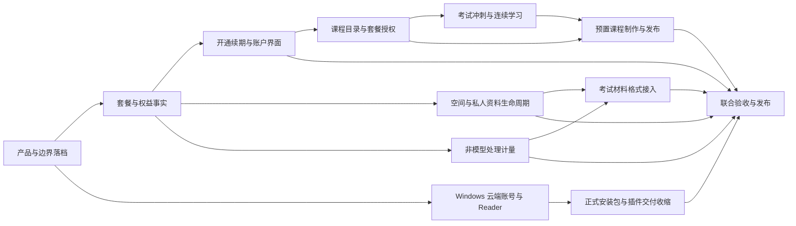

# 云端学习与考试冲刺：实施计划

日期：2026-10-20–21。状态：D0 与 C1–C11 的通用实现及本轮联合验证已完成；各切片的实际结果见第 5 节。2026-10-21 已上线配套云服务、Reader/Admin 和 Windows 0.3.0 下载。正式价格、配额和课程仍待定；生产准备宿主接入与用户实际安装升级尚待完成，详见[发布记录](performance/cloud-learning-20261020/release-20261021/README.md)。

行为合同见[产品方案](产品方案-云端学习与考试冲刺.md)，边界见[ADR-0173](adr/0173-cloud-learning-subscriptions-and-exam-sprints.md)。源码定位基于 HEAD `33c19c7` 的当前工作树，含既有未提交修改。引用用于定位实际接点；实施时保留其他工作的修改，并以各切片开始时的代码为准。

## 1. 实施前基础与复用接点

| 领域 | 已有实现与入口 | 本轮需要新增或调整 |
| --- | --- | --- |
| 网站身份 | [auth.rs](../crates/server/src/auth.rs)、[multi_user_host.rs](../crates/server/src/multi_user_host.rs) 的登录、Cookie、用户身份与授权 | Windows 授权返回、独立设备会话与完整资源请求接入 |
| 云端 Agent | [run_admission.rs](../crates/server/src/run_admission.rs)、[workspace_registry.rs](../crates/server/src/workspace_registry.rs) 的 NetworkRunPort | 复用现有运行，不再把本地执行作为商业桌面入口 |
| Windows | [main.rs](../apps/desktop/src-tauri/src/main.rs) 的 setup 启动 localhost server；[Cargo.toml](../apps/desktop/src-tauri/Cargo.toml) 依赖 server/runtime；[tauri.conf.json](../apps/desktop/src-tauri/tauri.conf.json) 携带四个 sidecar | 切换云端 Reader、移除正式包中的核心执行和运营工具、调整插件交付 |
| 网络前端 | [main.ts](../packages/web/src/main.ts) 用 VITE_MULTI_USER 选择 NetworkApp；[network-client.ts](../packages/web/src/network-client.ts) 使用 `/api` 与 same-origin Cookie | 保持完整同源请求链或明确改造；仅增加 API 地址不能完成桌面接入 |
| 额度期与收款 | [allowance_admin.rs](../crates/server/src/allowance_admin.rs)、[admin_schema.sql](../crates/server/src/admin_schema.sql) 支持时段、授额、人工收款和操作回执 | 商品、已售权益、首次购买与按期续用；保留同账号无重叠有效期 |
| 固定基准与补充方案 | [account_allowance.rs](../crates/server/src/account_allowance.rs)、[allowance_offers.rs](../crates/server/src/allowance_offers.rs) | 原 Offer 只有金额和增加比例，不能充当包含时长、档位、空间的完整套餐 |
| 个人准备 | [personal_preparations.rs](../crates/server/src/personal_preparations.rs) 已有分块上传、计划确认、任务上限和恢复 | 单文件/账号空间准入、取消/删除/释放；当前 32 KiB 只是单块限制 |
| 处理费用 | [model_spend_store.rs](../crates/server/src/model_spend_store.rs)、[external_build_costs.rs](../crates/server/src/external_build_costs.rs) | 非模型处理的用量、扣减及共享任务上限；当前 Whisper 路径模型扣减为零 |
| 课程发布与实例 | [workspace_publication.rs](../crates/server/src/workspace_publication.rs)、[workspace_release_instances.rs](../crates/server/src/workspace_release_instances.rs) | 从逐用户可见名单接入套餐课程权限；沿用确切版本与个人实例 |
| 冲刺学习 | [workspace_goal.rs](../crates/runtime/src/workspace_goal.rs)、[tutor.rs](../crates/runtime/src/tutor.rs)、[SharedWorkspaceCatalog.vue](../packages/web/src/components/SharedWorkspaceCatalog.vue) | 考试日期、范围、入口与跨天安排；已有自然语言目标不等于现成考试日程 UI |
| 资料与来源 | [video-import.ts](../packages/core/src/video-import.ts)、[cross_book.rs](../crates/server/src/cross_book.rs) 及来源跳转 | 考试材料格式接入与实际课程编排；B 站 URL、PPT 和精细题目映射均不能写成已支持 |

既有 W/Q/S/B/V/E1 状态和证据沿[原切片方案](切片方案-目标工作区与统一Agent额度.md)查询；E2 真实运行与发布工作接入 C11。已有能力不重复实现，也不重新宣布为本轮完成。

## 2. 依赖与里程碑

| 里程碑 | 范围 | 完成后的可观察结果 |
| --- | --- | --- |
| M1 商业权益底座 | C1–C4 | 可按期授予三档权益，上传占用受控，模型与非模型处理共享额度 |
| M2 网站冲刺候选 | C5–C6 | 用户选择课程、开始个人冲刺并按实际日期接续；可使用明确标记的测试材料验收 |
| M3 Windows 云端候选 | C7–C8 | 同账号接续网站学习，正式安装包不再携带本地核心执行链 |
| M4 首个正式场景 | C9–C11 | 已授权课程材料、所需格式、真实学习成本和迁入发布形成完整交付 |

C7 可以与权益线并行；业务切片不依赖先确定价格或具体课程。C10 的通用发布流程可先以原创测试材料验证，真实内容制作待课程选定。C11 的正式售卖、真实付费调用与部署分别按实际配置和执行授权推进。

## 3. 实施切片

每片使用现有相关测试和记录。下列验收项明确要检测的失败；出现失败就修正对应业务入口或数据归属，再继续后续里程碑。执行结果和发布环境尚待完成的工作分别记录在第 5 节。

### C1 套餐与账户权益事实

- **产出**：三档、月付与 1/3/7 天商品配置；购买记录、已售权益快照及其关联额度期。价格、授予量、空间、单文件上限等未完整配置时商品不可售。
- **接点**：[control_store.rs](../crates/server/src/control_store.rs) 的现有升级事务、[admin_schema.sql](../crates/server/src/admin_schema.sql)、[allowance_basis.sql](../crates/server/src/allowance_basis.sql)、[allowance_admin.rs](../crates/server/src/allowance_admin.rs)。
- **实现边界**：新增最小的商品与权益记录，引用现有用户、基准、额度期和收款事实。套餐权益表达档位/时段/空间/课程范围，额度账本仍表达授予和消耗；不再建立一份平行余额。数据库升级继续沿现有 schema、备份与恢复方式，实际版本号在实施时分配。
- **验收**：调整商品配置不改写已售权益；重复确认同一购买不重复建期或授额；同账号日包与月付不能同时建立重叠有效额度期；空价格和测试配置不会出现在正式可售目录。

### C2 开通、续期、补充与购买界面

- **依赖**：C1。**产出**：新用户与过期用户可购买；当前用户可续期、安排下一期换档、补充额度，查看确切期限和下一期安排。
- **接点**：[allowance_admin.rs](../crates/server/src/allowance_admin.rs)、[allowance_offers.rs](../crates/server/src/allowance_offers.rs)、[charge_admin.rs](../crates/server/src/charge_admin.rs)、[管理额度页](../apps/admin/src/pages/allowance.tsx)、[account-allowance.ts](../packages/web/src/account-allowance.ts)。
- **实现边界**：首版人工核款与权益开通在现有操作事务中完成；不将“选择套餐”当作已付款。短期按秒计算连续时长，月付每期创建新的授予；期内补充复用 Offer。换档按产品方案下一期生效，自动扣款和即时折抵另有明确需求后再接。
- **验收**：晚间购买一天得到完整 24 小时；月末开通后续期锚点正确；续费不结转旧余额；核款响应丢失重试仍只有一份收款和权益；无当前额度期的账号也能看到可购商品；换期不改变旧费用和历史百分比。

### C3 账号空间、上传与保留生命周期

- **依赖**：C1。**产出**：账号已用/上传中空间、单文件准入、资料占用明细、取消上传、删除、降档超额整理及到期保留。
- **接点**：[personal_preparations.rs](../crates/server/src/personal_preparations.rs)、[personal-preparations.ts](../packages/web/src/personal-preparations.ts)、[PersonalPreparations.vue](../packages/web/src/components/PersonalPreparations.vue)、[published_library.rs](../crates/server/src/published_library.rs)、[workspace_release_instances.rs](../crates/server/src/workspace_release_instances.rs)。
- **实现边界**：新增按账号归属的空间占用事实，在开始上传前按总长度预留；原上传身份和资料身份用于去重。只统计私人原件，演示页及交互状态等学习成果、内部副本和公共引用不计上传空间。保存学习成果不要求存储套餐，旧成果占用记录也不挤占上传配额。取消、失败收尾及到期清理释放原件占用；临时处理和缓存沿既有生命周期清理。
- **保留旧数据**：沿已存账号/资料归属建立现有私人材料占用；总量超限进入可整理状态，不追扣历史处理费，不据此删除材料。
- **验收**：两个工作区同时上传的合计不能突破账号上限；重复块和恢复上传不多占空间；取消/删除后释放；公共课程引用为零私人占用；一个工作区移除引用不误删另一个仍在用的材料；降档超额及到期期间可导出但不能新增原件上传；无套餐、套餐到期或空间满时演示版本与状态均可保存并重开；保留期结束的清理不删除公共资料、学习成果、有效引用或费用记录。

### C4 非模型处理纳入统一服务额度

- **依赖**：C1；界面与 C2 联通。**产出**：转写等处理有真实用量、可解释费率、预占/结算和同一账号余额。
- **接点**：[account_allowance.rs](../crates/server/src/account_allowance.rs) 的余额汇总、[external_build_costs.rs](../crates/server/src/external_build_costs.rs)、[personal_preparations.rs](../crates/server/src/personal_preparations.rs)、[video-transcript.ts](../packages/core/src/video-transcript.ts) 与既有宿主回执。
- **实现边界**：保留模型调用记录，为非模型处理新增明确类型的用量与扣减来源，并接入余额、父任务上限和成本报表。转写时长、服务扣减与平台实际/估计成本分别记录，未知成本保留未知。模型与处理合计约束同一任务，公共准备仍归平台。
- **验收**：实际个人视频处理进入额度和明细；回执重传不重复扣费；模型与转写合计不能越过个人确认扣减上限；中断恢复只处理未完成部分；公共预构建不扣学生额度；跨期回执仍归原期。相关失败应修计量/准入链，不通过改价格文案掩盖。

### C5 课程目录与套餐资料授权

- **依赖**：C2。**产出**：有有效权益的新账号能使用套餐允许的课程，无需逐个手工加入发布白名单；课程详情说明适用范围与实际能力。
- **接点**：[workspace_publication.rs](../crates/server/src/workspace_publication.rs) 的可见性、[workspace_release_instances.rs](../crates/server/src/workspace_release_instances.rs) 的 use/update、[learning_workspace.rs](../crates/server/src/learning_workspace.rs)、[authorization.rs](../crates/server/src/authorization.rs)、[SharedWorkspaceCatalog.vue](../packages/web/src/components/SharedWorkspaceCatalog.vue)、[运营发布页](../apps/admin/src/pages/workspace-releases.tsx)。
- **实现边界**：课程权益进入服务端目录、开始使用和资料读取链，继续检查每份材料授权及实际就绪状态。旧账号显式资料授权保留原语义，新增套餐授权有清晰来源与期限；到期按产品保留和内容授权规则处理。公共实例化不构建、不扣准备费。
- **验收**：刚购买的账号能创建允许课程的私人实例；不可见/未授权/未就绪课程不能通过直接请求使用；两名学生共用公共成果但目标与记录独立；套餐到期不会删除个人学习记录；受限公共材料不因记录保留而获得永久访问或导出权限。

### C6 考试日期、冲刺入口与连续学习

- **依赖**：C5。**产出**：选择课程后填写考试日期、已知范围与目标，可选可用时间；直接做题或短诊断均可开始，跨天展示当前安排。
- **接点**：[base-schema/lib.rs](../crates/base-schema/src/lib.rs) 的目标合同、[learning_workspace.rs](../crates/server/src/learning_workspace.rs)、[runtime/workspace_goal.rs](../crates/runtime/src/workspace_goal.rs)、[tutor.rs](../crates/runtime/src/tutor.rs)、[server/teaching.rs](../crates/server/src/teaching.rs)、[NetworkApp.vue](../packages/web/src/NetworkApp.vue) 和共享目录入口。
- **实现边界**：明确考试日期进入已有目标/约束及修订链，时间到来时按当前日期计算剩余时间。复用原教学阶段、作答证据和理解记录；当天安排引用这些事实，避免再造独立的掌握状态库。已有课程主题联系是资料级编排，精细来源锚点只在需要呈现时扩展原引用。
- **交付审阅**：匹配当前目标版本的考试工作区，其普通讲题复用已有教学审阅与教师工作记录，不要求先开启主动教学。修订在原任务中继续，费用归原账号和运行；通过前不发布草稿，预算终结、引用修复和失败降级也不能绕过审阅。
- **验收**：相同课程的三天冲刺与长期学习保留不同目标；“直接讲这题”可绕过诊断；隔天剩余时间改变且原作答保留；更改考纲/日期后旧安排按目标版本失效；视频看完不自动判为掌握；书籍和视频引用仍可回到确切来源；普通讲题可经拒绝、修订再交付，教师错误不写入学生理解记录。语义适配效果在 C11 用真实任务判断。

### C7 Windows 云端账号与完整 Reader 请求链

- **依赖**：D0；商业状态展示在 C2 后联通。**产出**：Windows 登录网站同一账号并接续云端工作区。
- **接点**：[desktop main.rs](../apps/desktop/src-tauri/src/main.rs)、[NetworkApp.vue](../packages/web/src/NetworkApp.vue)、[network-client.ts](../packages/web/src/network-client.ts)、[auth.rs](../crates/server/src/auth.rs)、[multi_user_host.rs](../crates/server/src/multi_user_host.rs)。
- **实现边界**：首版优先在 Tauri 承载现有同源托管 Reader，复用 `/api`、Cookie 与资源鉴权，避免先引入整套跨域客户端。系统浏览器完成账号授权，经原生客户端授权码与 PKCE 建立独立桌面会话；返回方式和会话落到 WebView 的接点在此片确定并实现。遵循 [RFC 8252](https://www.rfc-editor.org/rfc/rfc8252.html)，复用原账号，不复制浏览器 Cookie或加入共享客户端秘密。
- **本地交互**：保留可信产品页面所需的文件选择、上传、导出和窗口能力。云端任务断线后沿原运行标识恢复观察，不能因重连重复创建付费任务。
- **验收**：网站与 Windows 同账号读取同一聊天、额度和保存位置；重开应用恢复；切账号不展示上一账号数据；退出后受保护请求失效；PDF/图片、视频 Range、SSE、私人呈现均通过完整请求链；断线恢复不多发任务或扣费。

### C8 正式安装包与公开交付收缩

- **依赖**：C7。**产出**：普通用户安装后无需 Codex、Bun、Python 或自备模型即可使用云端学习。
- **接点**：[desktop Cargo.toml](../apps/desktop/src-tauri/Cargo.toml)、[tauri.conf.json](../apps/desktop/src-tauri/tauri.conf.json)、[build-sidecar.mjs](../apps/desktop/scripts/build-sidecar.mjs)、[installer-hooks.nsh](../apps/desktop/src-tauri/windows/installer-hooks.nsh)、[插件发布检查](../apps/desktop/scripts/assert-plugin-release.mjs)、[公开插件](../plugins/understand-book/.codex-plugin/plugin.json)及其技能/启动器、[桌面发行说明](../apps/desktop/README.md)。
- **实现边界**：移除正式包的 server/runtime 核心执行依赖和 build/publish/音视频处理等运营 sidecar，调整构建脚本和 Setup。同步处理公开构建技能与启动器的后续交付，不能留下指向缺失程序的入口。只读远程 Book MCP 延续独立资格与计次合同；维护环境的构建工具继续服务运营。
- **已有用户**：升级不删除本地书库、私人记录、模型配置或用户自行安装的插件；新增正式安装不再默认安装本地构建插件。历史发行已交付的实现无法由本次收缩收回。
- **验收**：检查实际安装内容与启动行为，确认不再分发或运行旧本地核心链；在无开发依赖的 Windows 环境完成登录、上传、学习和导出；升级保留原数据；公开插件说明和实际入口一致。

### C9 考试材料格式接入

- **依赖**：C3、C4。**产出**：支持首场景实际需要的个人考纲/课堂材料，并在界面准确标明格式能力。
- **接点**：[personal_preparations.rs](../crates/server/src/personal_preparations.rs)、[PersonalPreparations.vue](../packages/web/src/components/PersonalPreparations.vue)、[build-orchestrator.ts](../packages/core/src/build-orchestrator.ts) 及原工作台来源对齐入口。
- **实施顺序**：先将现有 PDF 来源对齐能力接到云端个人准备，保留页码与来源引用；PPT/PPTX 另作子片，以实际来源转换和页/幻灯片定位完成后开放。现有 EPUB/MD/TXT/MP4 保持可用。只用扩展名放行不算格式接入。
- **验收**：真实课件或考纲的公式、表格、页/幻灯片来源可回看；失败可恢复且已有成果不丢；处理进入空间与费用上限；不支持格式在开始前明确告知。若首批授权课程和个人输入使用现有格式即可完成，未使用的扩展子片不阻塞该范围首发。

### C10 预置课程制作与发布

- **依赖**：C5、C6；实际材料需要时依赖 C9。**产出**：一份经授权、可立即学习的正式课程工作区及其运营准备记录。课程和资料选定前只准备通用结构及原创测试材料。
- **接点**：[operator_builds.rs](../crates/server/src/operator_builds.rs)、[workspace_publication.rs](../crates/server/src/workspace_publication.rs)、[workspace_release_instances.rs](../crates/server/src/workspace_release_instances.rs)、[video-import.ts](../packages/core/src/video-import.ts) 与现有运营后台。
- **内容工作**：选定课程适用范围与材料版本，完成授权、来源准备、公共主题/路线和练习编排；声明能力与真实产物相符。已授权 MP4 可沿原视频引擎处理，外部课程链接与完整可检索视频分别展示。
- **验收**：两名学生使用同一发布不新增公共构建费，个人目标/作答隔离；从一个学习问题定位教材原文和视频时段；明确采用新版后私人材料与旧引用保留。没有正式课程材料时，不把测试工作区标为上线课程。

### C11 联合验收、成本与发布

- **依赖**：M1、M2、M3 与首场景必要的 C9/C10。**产出**：可审阅的真实场景证据、定价所需成本、配置和发布操作记录。
- **复用**：[原 E1 联合验收](联合验收-工作区与统一额度-20261018.md)、[原切片 E2](切片方案-目标工作区与统一Agent额度.md)、现有 Linux/Windows 发布与数据库恢复流程。
- **场景**：从新账号选择短期套餐到课程学习、补充私人材料、跨资料来源跳转、跨端接续、到期与续用；另走月付账期和降档整理。运行中断和重复回执只在会影响费用、空间或学习保存的接点验证。
- **成本**：分别取得公共准备、个人材料处理、普通答疑、持续教学、视频处理和保留存储的代表性记录；区分已确认、估计和未知。配置价格与额度前说明各档可承受的使用范围，不用一次短对话推算整月成本。
- **发布条件**：正式商品值、服务计量规则、保留期限与通知、内容使用范围、必要材料和支付核款流程已确定；先验证既有账号/费用/私人记录迁入与恢复，再按现有运行单发布。服务器、前端、Windows 和公开入口版本保持一致。
- **失败后的处理**：重复扣费、占用不释放、资料授权错误、来源回跳错误或私人记录丢失应回到对应切片修复；真实教学偏离目标回到 C6/C10 调整。

## 4. 复用验证入口

| 实施领域 | 已有可扩展覆盖 | 用于发现的具体失败 |
| --- | --- | --- |
| 权益与账本 | [admin_schema_tests.rs](../crates/server/src/admin_schema_tests.rs)、[q4_allowance_tests.rs](../crates/server/src/tests/q4_allowance_tests.rs) | 时段重叠、重复授额、历史事实被商品变动改写 |
| 私人准备 | [b2_preparation_tests.rs](../crates/server/src/tests/b2_preparation_tests.rs) | 上传重试、任务上限、恢复复用和跨期继续错误 |
| 公共课程与个人实例 | [s2_workspace_instance_tests.rs](../crates/server/src/tests/s2_workspace_instance_tests.rs)、[e1_workspace_integration_tests.rs](../crates/server/src/tests/e1_workspace_integration_tests.rs) | 两人实例串用、重复公共构建、更新丢私人材料或旧来源 |
| 网络与前端 | [network-client.test.ts](../packages/web/src/network-client.test.ts)、[multi-user-reader.spec.ts](../packages/web/playwright/multi-user-reader.spec.ts)、[reading-resumption.spec.ts](../packages/web/playwright/reading-resumption.spec.ts) | 会话/资料请求不完整、重连重复运行、接续归属错误 |
| 发行 | [desktop package.json](../apps/desktop/package.json) 与既有安装/发布工具 | 残留核心依赖、缺开发工具无法启动、升级损害用户数据 |

切片落地时更新对应测试和现有运行说明，新增占用、处理和授权行为补充相应失败覆盖。

### C12 Windows 本机导入与显式云端同步（2026-10-21 修正）

- **目标**：无套餐可导入、保存和打开本机资料；只有明确同步时调用云端存储准入。
- **实现**：Tauri 本机文件库与分段原文读取、随包离线书库；Reader 按桌面能力展示本地入口，云端副本与准备单独展开。复用云端上传、任务和额度合同，不改服务端准入。
- **验证**：本机持久化和范围读取；前端无套餐导入零网络请求；同步拒绝后仍可读；显式同步经过原云端接口；实际 WebView2 阅读及新版安装包。
- **发布**：0.3.1 与配套网页已发布，原生 6 项、前端 11 项、实际 WebView2 四格式与断网重载、三种公网 UI 入口通过，下载逐字节一致；见[发布记录](performance/windows-local-materials-20261021/README.md)。0.3.0 仅承载云端 Reader，需安装新版。本机资料不持久化占空间的云端 AI 处理尚未接通，未计入本片完成范围。

## 5. 配置依赖与当前完成状态

商业价格、各档实际配额、标准额度值与课程资料均按用户要求待定。保留期限、单文件上限、非模型处理费率及支付渠道在相应商品正式开放前确定；它们不阻塞通用实现与明确标记的测试配置。

D0 与 C1–C11 的通用实现及本轮联合验证已完成。实际配置、入口和数据行为见[运行说明](运行说明-云端学习与考试冲刺.md)，处理计量见[服务处理说明](服务处理计量-20261020.md)，材料格式见[考试资料准备](运行说明-考试资料准备.md)，完整结果见[联合验收记录](performance/cloud-learning-20261020/README.md)。

| 切片 | 实现状态 | 当前验证事实 |
| --- | --- | --- |
| C1 | 套餐配置、已售快照、原额度期关联已实现 | 8 项套餐与核款行为测试通过 |
| C2 | 读者与运营页面、续期换档、补充入口已接入 | 页面组件、核款重试、全局类型检查通过 |
| C3 | 原始材料上传预留、占用、导出与清理；学习成果独立保存 | 验证见[代码链路](代码链路.md#2026-10-21上传空间与学习成果保存分离) |
| C4 | 真实视频准备及原声复核、统一余额、未决核对、明确继续已实现 | 7 项 Rust 行为测试及 TS 执行恢复测试通过 |
| C5 | 分档课程资格、真实材料访问和恢复链已接通 | 到期保留目标、限制内容、独立授权恢复及新建课程资格测试通过 |
| C6 | 考试设置、目标修订、当日模型上下文、直接提问与交付审阅已实现 | 日期、范围、绕过诊断和来源场景通过；原题真实完成拒稿→修订→接纳，未审稿不显示，评分要求须有明确依据 |
| C7 | 同源 Reader、系统浏览器 PKCE、独立桌面会话已实现 | 授权与退出 HTTP 测试、真实 WebView2 跨进程会话验证通过 |
| C8 | 正式包本地核心移除，维护程序独立，公开默认插件入口收缩 | 源发行合同、桌面及维护测试通过；0.3.0 Release NSIS 构建完成，3,154,625 字节 |
| C9 | PDF 原页准备、真实课件转换与能力准入已接通 | 文档测试 5 项、原构建管线 21 项、实际 PPT/PPTX 转换及原页目视验收通过 |
| C10 | 通用发布模板、原创来源样例、外链展示已实现 | 3 项完整流程、公开标题、外链、双账号、版本来源与到期测试通过 |
| C11 | 本轮隔离浏览器、原数据升级、真实模型、成本归属及发行构建验证已完成 | 服务 69 项、Runtime 69 项去重通过，原 E1 四场景与浏览器通过；真实审阅修订交付及同任务结算通过 |

正式商品和真实课程没有在验收数据库之外预置。正式开售仍需确定商品值、费率、保留期限及授权课程，并完成生产准备宿主接入和实际安装升级验证；2026-10-21 已发布云端服务、Reader/Admin 与 Windows 0.3.0 下载，生产 schema 升级和旧数据保留通过；未操作用户现有安装。见[发布记录](performance/cloud-learning-20261020/release-20261021/README.md)。历史模型失败和第五轮后台调用最终结算未观测的测量缺口保留在成本报告，最终原题的 7 次前台调用均已结算；原创小样例不代表正式大学课程覆盖或整体学习效果。
