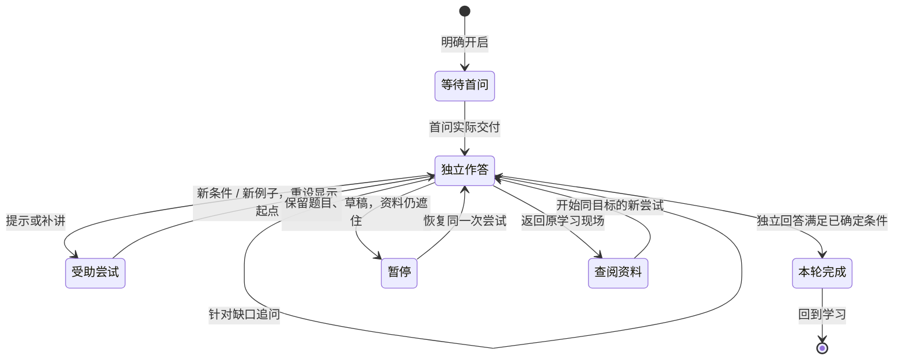

# 闭卷对话练到会：实施记录

日期：2026-11-15。对应 [ADR-0183](adr/0183-closed-book-dialogue-to-independent-performance.md) 与[切片方案](切片方案-闭卷对话练到会.md)。

## 已接入的行为

普通问答的学习操作与课程当前课头部提供「练到会」。也可以在对话中明确要求开启，Agent 沿本轮 `tutor.step` 保存原话和目标，交付首问。对象不明确时先澄清，确认对象后才冻结学习目标并出题；澄清不产生独立完成记录。开启后只显示当前尝试的问题、对话与作答区，首问交付前先显示准备状态。

Agent 根据实际回答追问。目标及完成条件在首问确定；实际交付的补讲与含有关键解法的引导均记为帮助，请求失败不会记为已获得帮助。本次获得帮助后，不能直接判为独立完成，必须先以同目标的新条件或新例子开始另一次尝试。新的尝试重新确定可见消息范围，上一尝试的提示继续保存在原聊天中。

「暂停」保存问题与草稿并继续遮住资料，恢复时接着同一次尝试。「返回看资料」关闭遮罩，保留未完成目标；返回时用新的独立尝试验证。Agent 也可以响应用户在对话中的暂停、结束、跳过或改向请求。

完成需要本次已经交付的问题、未受助的实际回答、确切用户原话及满足原条件的理由。界面显示具体反馈并结束本轮。原课程仍由自己的题目、活动和评估决定推进；不会因为闭卷对话结束就自动完成一课。

## 保存和交付边界

`memory::closed_book::ClosedBookPractice` 是现有 `teaching_trace` 的投影。`closed_book_changed` 保存状态，`closed_book_proposed` 保存拟交付文本、实际原话和教学决定；现有聊天仍是消息的保存位置。普通学习绑定 `TutorSession`，课程绑定原 `CourseRun`，同时保留工作区、来源版本、目标版本和确切聊天。

本次增加 `POST /tutor/closed-book`，本机路由与网络工作区路由使用同一实现。界面状态变更无需模型调用。每次教学回应复用 Resident：模型调用 `tutor.step operation=closed_book`，既有 prepared delivery 交付所接受的文本。只有持久化成功且未中断的答案才推进尝试状态。未交付草稿、失败答案，以及暂停或切换尝试前准备的迟到结果均不能打开新问题或完成当前目标。

完成判断的语义由本轮 Agent 负责。宿主核对所属尝试、已交付问题、帮助状态和原话引用；当前未受助且没有查阅待重试状态时，换题必须引用用户本轮要求换题的原话，防止答对后仍因旧帮助重复开题。没有增加另一个循环执行器或独立判分回合。理解记录继续使用原有教学事实与后台解释路径。

## 页面和恢复

`ClosedBookPractice.vue` 使用原生模态 `dialog`，置于页面顶层。Reader 与课程组件保留挂载，原位置、实验状态及输入草稿继续由原组件持有；闭卷期间整片原界面隐藏且不可聚焦。只渲染当前尝试记录的 `visible_turn_ids`，普通历史的展开入口无法进入闭卷页面。

显示仍沿用 Markdown 与公式渲染，链接转为文本，外部图片、音视频和嵌入页面不加载。资料阅读须通过离开流程。桌面与 390 px 窄屏使用同一个组件。

页面恢复先读取闭卷状态再显示原学习界面；恢复读取失败时继续遮住资料并提供重试，包括新设备上尚无本机记录的情况。草稿按用户、阅读现场、练习及尝试隔离；仅在对应回答交付后清除已提交草稿，求助和暂时失败保留未完成文字。

## 关键实现

| 文件 | 职责 |
|---|---|
| `crates/memory/src/closed_book.rs` | 教学事实投影、版本化状态及 TypeScript 类型导出 |
| `crates/server/src/teaching/closed_book.rs` | 模式控制、完成依据核对、交付后状态推进 |
| `crates/server/src/teaching.rs` | 冻结当前约定、绑定拥有者、接入实际交付 |
| `crates/runtime/src/tutor.rs`、`closed_book_prompt.md` | 工具合同和追问、帮助、重试、结束规则 |
| `crates/runtime/src/orchestrator.rs` | 沿既有 prepared delivery 交付问题与反馈 |
| `packages/web/src/components/ClosedBookPractice.vue` | 闭卷学习界面与焦点边界 |
| `packages/web/src/App.vue` | 普通问答、课程入口、草稿及历史恢复 |
| `crates/server/src/tests/closed_book_tests.rs` | Resident、保存、课程绑定和真实模型试验 |
| `packages/web/playwright/closed-book.spec.ts` | 桌面与窄屏真实页面操作 |

## 验证记录

服务端定向测试覆盖完整的交付、求助、换题、独立完成；口头开启与停止；目标澄清；禁止无依据重复换题；求助保留未发送草稿；准备中或中断交付；暂停和原题接续；返回资料后待重试；新聊天隔离；课程拥有者与进度不变。

页面验收覆盖首次进入、旧讲解不可见、刷新和草稿恢复、恢复请求失败、提示状态、独立重试的消息过滤、暂停后刷新、查阅后返回及完成退出。已直接检查桌面与手机截图。最终 7 项确定性服务端测试、1 条真实模型流程、2 个宽度的页面流程及前端类型检查通过，证据保存在 [closed-book-20261115](performance/closed-book-20261115/README.md)。

## 已知限制

- 当前闭卷题面支持文字、公式与 Markdown 表格，配图和交互实验继续在原学习现场使用。需要这些材料才能完整表达的任务应先在原现场学习，再选择可用文字和固定条件表达的闭卷目标。
- 应用外的查阅只能依据用户说明，不提供监考认证。
- 当前模型配置的闭卷回应实测约 27–78 秒；模型补讲仍观察到局部措辞与时间表不一致，具体原话及范围集中记录在验收证据的已知限制中。
- 工程测试和脚本化模型试验验证运行行为与代表性教学回应；真实学习者的长期保持和迁移效果仍需后续学习证据。
