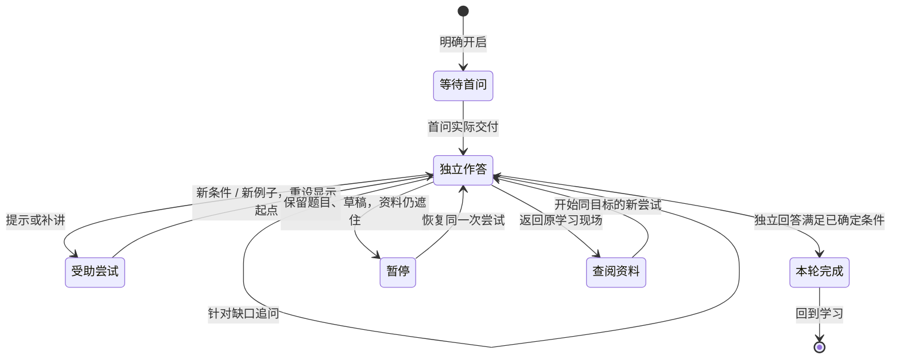

# 闭卷对话练到会：实施记录

日期：2026-11-15。对应 [ADR-0183](adr/0183-closed-book-dialogue-to-independent-performance.md) 与[切片方案](切片方案-闭卷对话练到会.md)。

## 已接入的行为

普通问答的学习操作与课程当前课头部提供「练到会」。也可以在对话中明确要求开启，Agent 沿本轮 `tutor.step` 保存原话和目标，交付首问。对象不明确时先澄清，确认对象后才冻结学习目标并出题；澄清不产生独立完成记录。开启后只显示当前尝试的问题、对话与作答区，首问交付前先显示准备状态。

Agent 根据实际回答追问。目标及完成条件在首问确定；实际交付的补讲与含有关键解法的引导均记为帮助，请求失败不会记为已获得帮助。本次获得帮助后，不能直接判为独立完成，必须先以同目标的新条件或新例子开始另一次尝试。新的尝试重新确定可见消息范围，上一尝试的提示继续保存在原聊天中。

「暂停」保存问题与草稿并继续遮住资料，恢复时接着同一次尝试。「返回看资料」关闭遮罩，保留未完成目标；返回时用新的独立尝试验证。Agent 也可以响应用户在对话中的暂停、结束、跳过或改向请求。

完成需要本次已经交付的问题、未受助的实际回答、确切用户原话及满足原条件的理由。界面显示具体反馈并结束本轮。原课程仍由自己的题目、活动和评估决定推进；不会因为闭卷对话结束就自动完成一课。

## 保存和交付边界

`memory::closed_book::ClosedBookPractice` 是现有 `teaching_trace` 的投影。`closed_book_changed` 保存状态，`closed_book_proposed` 保存拟交付文本、实际原话和教学决定；现有聊天仍是消息的保存位置。普通学习绑定 `TutorSession`，课程绑定原 `CourseRun`，同时保留工作区、来源版本、目标版本和确切聊天。

本次增加 `POST /tutor/closed-book`，本机路由与网络工作区路由使用同一实现。界面状态变更无需模型调用。每次教学回应复用 Resident：模型调用 `tutor.step operation=closed_book`，既有 prepared delivery 交付所接受的文本。只有持久化成功且未中断的答案才推进尝试状态。未交付草稿、失败答案，以及暂停或切换尝试前准备的迟到结果均不能打开新问题或完成当前目标。

完成判断的语义由本轮 Agent 负责。宿主核对所属尝试、已交付问题、帮助状态和原话引用；当前未受助且没有查阅待重试状态时，换题必须引用用户本轮要求换题的原话，防止答对后仍因旧帮助重复开题。没有增加另一个循环执行器或独立判分回合。理解记录继续使用原有教学事实与后台解释路径。

## 页面和恢复

`ClosedBookPractice.vue` 使用原生模态 `dialog`，置于页面顶层。Reader 与课程组件保留挂载，原位置、实验状态及输入草稿继续由原组件持有；闭卷期间整片原界面隐藏且不可聚焦。只渲染当前尝试记录的 `visible_turn_ids`，普通历史的展开入口无法进入闭卷页面。

显示仍沿用 Markdown 与公式渲染，链接转为文本，外部图片、音视频和嵌入页面不加载。资料阅读须通过离开流程。桌面与 390 px 窄屏使用同一个组件。

页面恢复先读取闭卷状态再显示原学习界面；恢复读取失败时继续遮住资料并提供重试，包括新设备上尚无本机记录的情况。草稿按用户、阅读现场、练习及尝试隔离；仅在对应回答交付后清除已提交草稿，求助和暂时失败保留未完成文字。

2026-11-16 修正普通提问和课程打开期间的标题闪现：`App.vue` 在会话切换后等待闭卷状态，原 `ClosedBookPractice.vue` 将这段未知状态直接显示成“练到会”。现在未知状态复用网站的翻页加载动画，读取失败显示通用学习恢复提示与重试；只有已确认的 active、paused、complete 练习显示标题和练习操作。未知状态下 Escape 不发出暂停操作，资料仍等待状态确认后显示。

## 关键实现

| 文件 | 职责 |
|---|---|
| `crates/memory/src/closed_book.rs` | 教学事实投影、版本化状态及 TypeScript 类型导出 |
| `crates/server/src/teaching/closed_book.rs` | 模式控制、完成依据核对、交付后状态推进 |
| `crates/server/src/teaching.rs` | 冻结当前约定、绑定拥有者、接入实际交付 |
| `crates/runtime/src/tutor.rs`、`closed_book_prompt.md` | 工具合同和追问、帮助、重试、结束规则 |
| `crates/runtime/src/orchestrator.rs` | 沿既有 prepared delivery 交付问题与反馈 |
| `packages/web/src/components/ClosedBookPractice.vue` | 闭卷学习界面与焦点边界 |
| `packages/web/src/App.vue` | 普通问答、课程入口、草稿及历史恢复 |
| `crates/server/src/tests/closed_book_tests.rs` | Resident、保存、课程绑定和真实模型试验 |
| `packages/web/playwright/closed-book.spec.ts` | 桌面与窄屏真实页面操作 |

## 验证记录

服务端定向测试覆盖完整的交付、求助、换题、独立完成；口头开启与停止；目标澄清；禁止无依据重复换题；求助保留未发送草稿；准备中或中断交付；暂停和原题接续；返回资料后待重试；新聊天隔离；课程拥有者与进度不变。

页面验收覆盖首次进入、旧讲解不可见、刷新和草稿恢复、恢复请求失败、提示状态、独立重试的消息过滤、暂停后刷新、查阅后返回及完成退出。已直接检查桌面与手机截图。最终 7 项确定性服务端测试、1 条真实模型流程、2 个宽度的页面流程及前端类型检查通过，证据保存在 closed-book-20261115。

2026-11-16 闪现修复：`LearningUi.i18n.test.ts` 与 `closed-book-recovery.test.ts` 共 17 项通过；`closed-book.spec.ts` 共 5 个浏览器场景通过，覆盖普通打开与首次提问时延迟状态响应，以及 1366、390、320 px 下的练习恢复、读取失败重试、暂停、草稿和完成退出。浏览器夹具加载正式 `index.html` 的动画样式，已查看桌面与手机加载画面。`pnpm --filter @understand-book/web build:multi` 通过。浏览器接口使用受控返回，本次模型调用为 0。

加载闪现修复已于 2026-11-16 19:12:42 HKT 上线，发布及公网验证见[记录](performance/closed-book-loading-20261116/README.md)。

### 2026-11-19 · 本机 ACP 教师

`cargo test -p reader-service --lib acp_teaching::tests` 的 3 项回归通过。真实 stdio 子进程先出题、给提示，再换另一个 Agent 继续。Reader 拒绝将刚受助的回答记为独立完成，保存新题的学习者原话，屏蔽闭卷期间的私有工具活动和判断字段。普通题覆盖帮助实际展示后的判分归属；正课覆盖求助后仍停在原步骤，直到学习者提交自己的回应。

真实样本用 OpenCode 1.19.6、项目配置的 DeepSeek 和演示书第 1.3.4 段检验“候选位置怎样支撑答案”。首题问两段候选与一条关系边能否构成证据。学习者求助后，教师解释了回读原句的作用，Reader 将这次尝试记为受助。第一版变式增加了“机制启用条件”的背景，仍重复原题的判断。实际回答指出关系边无法区分必要条件和充分条件，需从原文判断。重开同一私人库后，反馈引用了这段学习者原话，保存为第 2 次尝试完成。此前一次请求因试验上限停止，失败回合未改变状态。[原始题面和帮助](evidence/local-agent-acp-20261119/teaching-live-1) · [重开后的反馈与用量回执](evidence/local-agent-acp-20261119/teaching-resume-2)

随后在另一隔离库重放已交付的原题与帮助，使用修订后的教学指令请求新题。真实教师提出 A–B、B–C 两条相关边能否支持“A 导致 C”，并要求具体说明需要从 P1、P2 核对什么。作答指出相关关系不可传递，因果方向和适用条件需要原文支撑。教师追问边的正当用途；学习者澄清后，教师引用原话结束本轮。数据库保存第 2 次尝试、未受助、已完成。两次采样及恢复合计 22 次模型转发，21 次回执报告 203,164 token，另 1 次用量未知。[变式与第一次反馈](evidence/local-agent-acp-20261119/teaching-variant-2) · [澄清、最终反馈和累计回执](evidence/local-agent-acp-20261119/teaching-followup-2)

该试验也重现了 Windows 调试版独立 Reader 重开教学历史时的主线程栈溢出。正式桌面入口已用 16 MiB 栈。独立 Reader 和 CLI 的 Windows MSVC 构建同步了这一设置。新构建的 `reader --local-profile` 和 `understand-book serve` 分别重开同一真实私人库，均恢复同一聊天、学习者原话，以及第 2 次尝试未受助且已完成的记录。[重开失败记录](evidence/local-agent-acp-20261119/teaching-resume-1/reader.stderr) · [两个启动器的恢复回执](evidence/local-agent-acp-20261119/teaching-launchers.json) · [链接设置](../crates/reader-service/build.rs)

使用 `scripts/verify-local-agent-teaching.py --help` 查看复跑参数。脚本从课程试验环境读取原有模型配置，使用独立 Reader 目录和 OpenCode 配置。运行者根据实际变式将作答写入 `learner-answer.txt`。每次使用新的输出目录。重开或重放时携带之前的模型回执，累计上限为 24 次转发、已报告 300,000 token 后停止下一次转发。

## 已知限制

- 当前闭卷题面支持文字、公式与 Markdown 表格，配图和交互实验继续在原学习现场使用。需要这些材料才能完整表达的任务应先在原现场学习，再选择可用文字和固定条件表达的闭卷目标。
- 应用外的查阅只能依据用户说明，不提供监考认证。
- 当前模型配置的闭卷回应实测约 27–78 秒；模型补讲仍观察到局部措辞与时间表不一致，具体原话及范围集中记录在验收证据的已知限制中。
- 本机 ACP 的真实样本中，提示说关系边“没有出处”。教材能支持的是“关系边本身不是事实证据”。关系边也可以带回读线索。修订后的变式检验了两条线索之间的新关系，教师却将“即使两条边各自成立”的反事实假设误读为学习者把线索当作事实，给出了“对了一半”的评价。后续澄清得到了正确反馈。
- 工程测试和脚本化模型试验验证运行行为与代表性教学回应；真实学习者的长期保持和迁移效果仍需后续学习证据。
