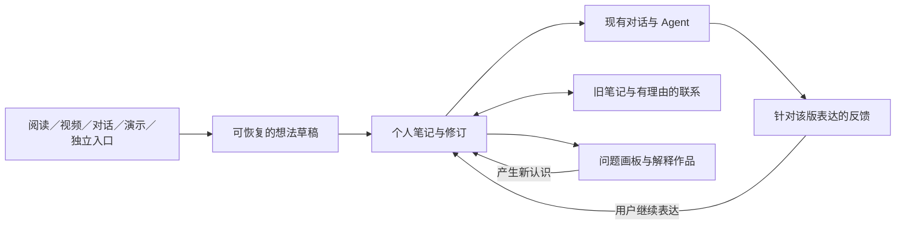

# 以个人想法为核心的笔记与学习：接入方案

日期：2026-10-29；2026-10-30 已落架构决策与详细切片。状态：**PN1–PN6、服务端 MiniLM 与首页入口调整已于 11:50 HKT 合并上线。** [ADR-0177](adr/0177-personal-notes-evolution-and-teaching-recall.md)记录架构取舍；[切片方案](切片方案-个人想法演进与教学召回.md)统一维护实施合同、顺序、状态与完成证据。本文保留产品解释、场景和设计前源码调查；当前代码、真实模型和界面验证见 [PN 实施报告](performance/personal-notes-20261030/README.md)。

产品依据：[以用户想法为核心、低成本表达与灵活使用](产品方案-云端学习与考试冲刺.md#11-以用户想法为核心)。现有能力分别沿用 [RN1 笔记合同](RN1-笔记存储合同.md)、[画板设计](设计方案-知识画板与持续讲解.md)、[教学与理解接续](设计提案-教学设计与理解接续.md)、[ADR-0170 工作区归属](adr/0170-goal-scoped-learning-workspaces-and-shared-releases.md)及 [ADR-0176 主 Agent 与教练](adr/0176-main-agent-planned-teaching-and-coach-guidance.md)。本文的对象名称与接口名称为拟定名称，实施时沿仓库实际命名收敛。

**实施重点（2026-10-29 用户进一步明确）**：笔记在需要时能被召回，并具体影响教学。第一份可用交付必须包含“当前问题触发相关个人想法召回 → 主 Agent 据此选择支持 → 用户新表达改变后续接续”；跨材料召回前移到 PN3，画板和高级整理在这条主线之后接入。

## 1. 用户应能走通的主线

用户看视频时记下“参数不变，为什么表示会变化？”，收起继续看；切换到书籍后仍能恢复原草稿和视频时刻。保存后，这句话成为一条个人笔记。用户选择讨论，Agent 读取这条笔记的确切版本，结合当前问题与相关资料回应。用户把自己的新理解补进同一条笔记，再把它与旧笔记连接，放到某个问题画板中。下次学习时，系统能找回这些表达并据此继续。

整条路径中的权威个人表达保持同一笔记身份；阅读位置、原视频、讨论、画板和历史反馈分别引用它。独立记录不要求先选资料、建立学习目标、填写标题或分类。



## 2. 现有系统怎样承担这条路径

| 部分 | 当前事实 | 本次接入 |
| --- | --- | --- |
| 用户私人存储 | 一个 `MemoryDocument` 持有该用户全部 `records`，非每本书一个数据库；网络按用户目录隔离 | 在原存储内建立个人笔记对象，材料成为可选关联 [S1][S2] |
| 笔记对象与编辑 | `Record.book_id`、`NoteData.material/association` 必填；编辑或重锚改变 `mem_id`，旧正文不留完整修订 | 稳定 `note_id`、保存版本、独立记录与展示位置分离 [S3] |
| 输入和草稿 | 已有统一笔记面板，当前一份草稿存在材料页面内；离开检查会要求处理草稿，刷新只有离开提醒 | 复用编辑能力，把可恢复草稿移至稳定的应用外层 [S4] |
| 日常表达与反馈 | 普通聊天可进入 `UsageObserved`，主 Agent 可据真实表达形成可修正解释；演示笔记有专门追问 | 增加普通笔记的确切版本引用，接入同一对话与事实链 [S5] |
| 个人检索 | 底层可跨材料，网络与 Agent 的常用入口强制当前材料；阅读标注依赖该范围 | 独立个人笔记检索，保留阅读标注原范围 [S6] |
| 画板 | 已有持久画板、解释、连线、来源和历史；缺少 Note 导入，画板读取仍核对当前材料 | 增加笔记引用，让学习工作区内的问题画板跨材料使用 [S7] |
| 学习接续 | 已有原话、帮助条件、理解解释、纠正与下一步指导 | 按当前问题读取相关笔记；历史个人表达与当前掌握分别处理 [S8] |
| 无材料讨论 | 当前聊天准备与运行范围直接持有 Book | 在现有运行器增加个人笔记讨论场景，不能只增加前端入口 [S9] |

## 3. 个人笔记成为共同引用的对象

### 3.1 最小对象边界

| 对象 | 拥有的内容 | 关键规则 |
| --- | --- | --- |
| `PersonalNote` | 稳定 `note_id`、创建时间、当前修订、保存过的修订 | 编辑正文、移动位置和换材料不改变身份；归现有本地用户或网络账号 |
| `NoteRevision` | 修订号、正文、可选标题、作者来源、保存时间、明确引用与保留摘录；可选修改说明、实际讨论来源、恢复来源修订 | 成功保存新的表达才追加不可覆盖的修订；自动保存草稿不制造正文版本 |
| 记录情境 | 当时可确定的资料、位置、聊天回合、视频时刻或演示回执 | 记录发生在哪里；不能由此推断笔记观点来自那里；无情境仍可记录 |
| `NoteRef` | `note_id` 与可选 `revision` | 未指定版本表示当前笔记；反馈、已交付作品及历史讨论冻结确切版本 |
| `NoteLink` | 两条笔记的身份、可选连接理由、建立联系时的相关修订 | 联系归个人，可从两端找到；理由可稍后补，用户修订笔记后仍可查看建立联系时的内容 |
| 草稿 | 草稿身份、正文、原情境、编辑对象及其基础修订 | 留在设备上用于恢复；正式保存或发送后再进入相应持久记录 |

`NoteRevision` 保留自己的文字、原文摘录和助手摘录的内容身份。既有纯摘录仍然可保存和阅读；界面明确哪些是素材、哪些是用户表达。未写正文且没有保留片段的空记录不创建。用户采纳的 AI 改写可以成为新的笔记版本，保留其来源；采纳本身不证明独立掌握。

一条笔记的多个使用位置无需一个统一布局引擎：阅读批注继续持有正文/PDF 放置数据；画板条目持有卡片位置；对话持有所讨论的 `NoteRef`。各宿主负责自己的位置，笔记负责自己的内容。移动位置不生成正文修订，从某处移除引用不删除笔记。

### 3.2 存储与命令

建议继续使用现有 `MemoryStore → MemoryDocument` 私人存储，在文档内新增专用 `notes` 与必要的笔记关系集合。笔记正文由此处唯一持有，阅读位置、高亮、画像及其他记录保留既有归属。沿用原子提交与文档修订，不另设思想数据库或通用事务框架。

本地笔记保存到既有本地 UserRuntime 的私人目录；网络笔记保存到已登录账号的用户目录。两者复用合同，保持现有本机/云端边界，不能因增加个人笔记自动上传本机内容。跨端同步与本地历史迁入按现有产品授权范围分别完成。

提供不依赖当前 Reader 材料的个人笔记操作：创建、读取当前/指定修订、保存修订、列表/查找、添加/移除联系、删除笔记。保存修订携带基础修订号，以便同一笔记在两个位置或设备编辑时保留双方文字并提示解决；网络创建/修订复用操作身份与回执，重试不重复新增。

现有 `memory/save / replace / reanchor` 的笔记分支改接同一权威操作；原调用者需要的记录形状只作为返回投影。标注读取仍按当前材料返回，不将私人笔记全库混入每页标注。移除展示位置与删除笔记分别执行。

### 3.3 旧笔记的必要接续

沿现有 schema 接续入口做一次有限升级：把现存笔记正文和关联转换为稳定笔记及初始修订，将当前 `mem_id` 与能够解析的 `note_replacements` 旧身份映射到同一笔记；原放置转为引用，非笔记记录保持原样。转换与保存沿原原子提交完成，后续修改仅写新的权威对象。

只保留实际存在的作者、时间和来源。作者不明的旧内容继续显示中性身份，不能全部改标为用户原话。已被旧 `replace` 覆盖的正文无法恢复；旧导航可找到现存笔记，不能承诺还原一个从未保存的历史版本。实际已有反馈中的原话快照继续保留。

### 3.4 保留想法演进（2026-10-30 用户确认）

**决策**：同一笔记保留历次表达及可追溯的变化过程。
日常打开显示当前版本；“思考过程”按时间展示首次保存、后续修订及明确相关的讨论。每个版本能读完整原文，可对照任意两版的增删改，并回到当时的资料或讨论。版本时间只表示先后，不自动表示理解进步或观点更正确。
版本历史以不可覆盖的正文修订为依据；演进视图直接组合修订、既有讨论和用户说明，不另建一份思想正文或要求 AI 划分成长阶段。
输入过程持续保存设备草稿；完成一次内容有变化的正式保存才追加修订。“与我推敲”沿既定流程先提交确切版本，再讨论；正文及内容来源均未变的重复保存不新增版本，移动展示位置不新增正文版本。
用户可选写一句“为什么改”，也可从确切讨论入口保存新认识并保留来源回合；这些都不成为保存前的必填项。仅同聊天、时间较晚或语义相似，不足以认定某次讨论促成了修订。
用户只在讨论中改变了说法而未更新笔记时，演进视图保留这段相关表达，显示为后续讨论；只有用户保存或采纳后，才成为新的正文版本。AI 可以应请求概括变化，概括需可回到对应原文，身份为系统解释。
恢复旧版本会追加一个新修订并记录恢复来源。例如 v5 恢复 v2 得到 v6，v3–v5 及其反馈仍保留。旧讨论和已交付作品继续引用当时版本，日常笔记引用解析当前版本。
当前教学默认读取当前笔记及明确相关的后续表达；回顾理解变化、重新遇到旧问题或用户主动问“我以前怎么想”时，再按需读取历史版本。旧猜测保留原时间和情境，不能作为用户现在仍持该观点的依据。
**完成证据**：首次保存→修改两次→重开→对照首版与当前版→打开中间版讨论→恢复首版形成新修订，所有已保存原话与反馈仍可回读；演进视图与基本版本能力纳入 PN1/PN2。
**已知边界**：旧系统曾覆盖且没有保存的正文无法补回，接续时以实际现存内容开始记录，不能生成虚构的早期想法。

## 4. 前端接入：一份编辑能力，多个就地入口

记录入口共用 `PersonalNotes` 便笺浮窗，保留 Markdown/公式、摘录预览与保存状态。顶部可拖动，边缘可缩放，收起后保留草稿，原阅读页面保持原有尺寸。按账号记住当前设备上的窗口位置和大小，同一时刻保留一个主要编辑区域。该方向替代先前的侧栏/底部停靠方案。[S4]

| 位置 | 用户操作 | 自动带入的确定信息 |
| --- | --- | --- |
| 正文/PDF | 选区“记想法”；未选择文字也能随手记 | 已选原文及确切范围，或仅当时阅读位置 |
| 对话 | 当前输入可选择留下；已发出的用户消息可“留下这个想法” | 原用户文字、聊天与回合；助手摘录另保留来源 |
| 视频 | 播放器旁“记想法” | 已确定的播放时刻与选择范围；仅记录文字无需额外截图或提问执行 |
| 演示 | 复用“记一下” | 已取得的确切演示版本及实际状态回执 |
| 画板 | 空白处新记想法，或把已有笔记引用进来 | 当前问题及实际选择的对象 |
| 个人入口 | 在书架/学习工作区导航旁进入“我的想法” | 不要求当前材料或学习工作区 |

编辑区提供“先记下来”和“与我推敲”两个直接动作。前者只保存，用户立即继续当前任务；后者先保存确切版本，再交给对话。保存成功但讨论启动失败时，保留笔记并允许重试讨论，不要求重写。已经保存的笔记使用同一详情页查看正文、相关讨论、来源、联系及修订。

草稿控制放在 keyed Reader App 外，由 `NetworkApp` 和本地外壳共享小型状态模块。按当前用户/本地身份与草稿 ID 在设备持久保存，材料和会话只是草稿情境；关闭编辑器或换材料挂起草稿，重开可恢复。未发送草稿不进入 AI 上下文。现有聊天、视频提问和正式活动草稿继续按各自语义保存；通过实际需要的“留下为笔记”动作接入，不强行合并所有输入类型。

右栏继续提供“当前相关”的快捷视图；个人入口提供“我的全部想法”。标题可由正文首句作为显示摘要，用户可随时修改，无需为每条输入先调用模型生成标题。创建、保存、移动、手工连接和找回已知笔记不等待模型调用。

### 4.1 产生现场与展示位置（2026-10-30 交互补充）

想法独立保存；产生现场说明用户当时在看什么，展示位置说明这条想法出现在哪里。同一想法可以有多个展示引用。后续挪动卡片、取消一处展示或把它带入另一个讨论，保留原产生现场及稳定身份。

默认记录能确认的产生现场，默认不自动往页面插入内容。浮窗底部用一条简短来源入口表示当前关联，用户不必先决定归类。续写草稿沿用原现场；从新的页面继续写不会悄悄改绑。用户从具体元素的“在这里记想法”入口新建时，以明确点选的对象为现场，并就地呈现引用。无法确认当前对象或没有打开材料时，使用独立想法。

| 场景 | 默认产生现场 | 用户可选择的展示方式 |
| --- | --- | --- |
| 全局浮窗 | 当前可确认的阅读位置；书架等无现场页面为独立想法 | 只保存到我的想法（默认），之后可放入其他位置 |
| 原文/PDF | 从选区入口保存确切范围；全局入口仅保存可确认的阅读位置 | 作为原文批注，或仅保留来源而不插入正文 |
| 画布 | 从对象入口记录画布与对象；从空白处记录画布 | 独立卡片、连接某个元素，或仅保存 |
| 对话 | 从消息入口记录会话、消息与实际选中的句子 | 挂在该句话下面，或仅保存；跨位置使用同一想法 |
| 演示 | 从记录入口保存演示版本与实际状态/所选对象 | 放在该演示页或对象旁，或仅保存 |
| 视频 | 已确认的材料与播放时刻 | 在对应时刻显示标记，或仅保存 |

浮窗的来源与“放到…”是两个动作。来源入口展示例如“学习与理解 · 第二章”或“独立想法”；“放到…”按当前可用宿主给出画布、对话和演示等具体选项。保存前可选“只保存想法”；保存后可以继续添加展示位置。后续若增加拖入宿主的操作，也只放置同一引用：高亮实际目标，在用户放下后确认绑定。默认不根据坐标接近、停留时间或语义相似猜测绑定对象。

阅读与召回应能展示“产生于哪里”和“在哪里使用过”，允许分别回到原现场和当前展示处。检索候选携带确切来源与引用；只有产生现场不能推断用户观点来自该元素，也不能推断掌握。原内容改变时保留当时摘录/版本，原对象删除后笔记仍存在，回到来源时明确原位置不可用。

**当前实现（本地，2026-10-30）**：可拖动/缩放浮窗已接通统一“放到…”入口；画布可放独立想法卡片或连接选中的卡片元素，对话可定位选中原句的具体出现处并显示在所属段落下，演示按 `visible_step` 或确切状态回执呈现。直接“在这里记”默认就地放置，全局入口默认只保存；来源和放置都在选择时冻结，续写及跨页面使用不改写来源。同一想法使用同一身份，正文修改同步到各处。详细页列出各处位置，支持返回与移除；放置失败保留已保存的正文及可重试草稿，不重复创建。存储与交互证据见[放置验收](performance/personal-notes-20261030/placements/README.md)。

**边界**：窗口拖动用于调整窗口位置，尚未提供把想法拖拽投放到宿主的手势。演示想法显示在对应页的宿主区域内，没有改写演示文件，也不支持指定演示内部任意像素或图形。没有可靠页标识的演示使用已记录的状态，并提供恢复入口。临时原文来源预览未暴露确切资料身份时，全局新记不猜测它后方的画布/消息来源。原内容已删除时显示不可返回，想法仍可阅读。此次本地修改未上线。

## 5. 接进主 Agent 与教学反馈

### 5.1 有材料的讨论先复用已有主线

```text
保存笔记版本
  → 用户选择“与我推敲”
  → 现有聊天入场冻结 NoteRef、当时正文、来源情境与当前请求
  → 主 Agent 读取个人表达，按需查材料、旧笔记或操作演示
  → 正常回答／TeachingMove 回应该次表达
  → 对话与反馈保留 NoteRef
  → 用户补充或修订原笔记
```

新增普通笔记讨论上下文，沿 `validate_agent_input / run_admission / FrozenTurn` 进入现有运行。现有 `note_mem_id` 是演示追问专用路径，不直接扩充成含义不清的通用字段。主 Agent 使用同一个 Resident 循环、Goal 工作计划、教学设计及已就绪教练指导；不另增加笔记教师、强制审核或每次保存的模型后台任务。[S5][S9]

反馈需要明确回应这段话的具体部分：哪些关系成立、哪个条件尚未区分、用什么例子可以检验、下一步怎样继续。系统可以提供改写建议，用户采纳后才修改笔记正文。普通讨论允许开放探索；正式练习仍沿原独立评分合同。

### 5.2 新表达、旧想法与系统解释分别记录

当用户刚写下当前理解并提交讨论时，将正文和对应修订作为一次明确的个人表达，接入既有 `UsageObserved` 事实链；扩展表达提取、输入时帮助冻结、事实回读和投影中涉及事件种类的路径。理解判断仍引用真实事件，不把 note_id 冒充 fact_ref。[S5][S8]

当用户拿一条旧笔记来讨论时，旧正文作为历史表达保留原时间、来源和可知帮助条件；当前补充是新的表达。查到或展示旧笔记不表示用户今天仍持相同看法。若当时帮助条件未知，记录为未知，不能把今天的讲解回填成当时帮助。纯摘录、未修改的 AI 提议和界面按钮不转换为用户独立理解。

反馈引用其实际回应的版本。用户修订后，日常笔记展示当前版本；旧讨论继续展示当时正文，并提供“查看现在的想法”。`UnderstandingSpace` 继续显示系统的理解解释和依据，增加前往原笔记及该版表达的入口；它不承担个人笔记正文的另一份编辑权威。

### 5.3 无材料讨论需要独立切片

当前 `prepare_agent_chat`、`RunScope`、`PrivateBookContext` 直接依赖 Book。独立笔记的记录和找回可以先完成；要兑现“没有打开书也能推敲想法”，必须增加以个人笔记为起点的运行场景。[S9]

该场景沿现有用户、聊天、Goal、模型调用和费用归属运行，输入包含用户请求、选定笔记版本及确切可用的资料引用。材料读取与正式 Tutor 能力仅在存在实际材料上下文时提供；无材料时正常讨论、比较笔记并保留反馈。来源受限的理解假设和正式活动继续检查真实目标，不伪造空白书籍、LID 或掌握记录。实现时分离共用运行职责与读取材料所必需的职责，复用同一个 Agent 执行循环。

## 6. 让旧想法参与当前学习

### 6.1 现有记忆入口与实际缺口

当前已有自动学习接续：`learner_context → continuity / learner_grounding → agent.learner_context` 为主 Agent 提供原始用户表达、解释、帮助条件与开放问题。普通笔记正文主要由按需 `memory.recall` 读取，该路径限定当前材料；`usage_facts` 读取最近阅读行为和聊天，未读取 note。因此“已经有学习记忆”不能代表“用户笔记已在需要时被想起”。[S5][S6][S8]

接入目标是让用户正在问的问题、教学当前关注的关系、已选择的笔记和待解决问题成为召回线索。私人笔记原话仍是权威；检索索引、短预览与本轮相关性判断都是可重建的辅助数据。

### 6.2 自动找回与按需深入

1. **入场时自动找回候选。** 用户开始或继续一轮学习时，宿主使用当前请求、已确定的教学焦点及明确笔记引用，执行有界个人笔记查询。明确选中的笔记直接读取，相关候选按既有上下文预算提供。无需用户先说“查我的笔记”，也不为每轮查询额外调用一个规划模型。
2. **主 Agent 按教学需要深入。** 确定要使用一个旧类比、解释前提、比较冲突或接回未解决问题时，主 Agent 按身份回读候选正文、修订和有关讨论。换了教学焦点或候选不能回答当前问题时，再发起针对性查询。检索预览仅供选择，精确引用和理解判断使用实际读到的表达。

界面提供“当前材料、当前学习空间使用过、全部个人笔记”视图。自动召回允许发现该用户其他材料中的相关想法；当前明确选择和与当前问题已有的联系优先。阅读标注仍由原材料范围的接口负责，不能把全库笔记混入每页标注。

个人检索同时利用文字、明确联系及语义接近程度。复用现有词法与多语言向量能力，覆盖“用另一种说法谈同一个关系”的真实场景；不另建推荐平台。派生索引归当前用户，以 `note_id + revision` 更新变化的内容；保存笔记不调用生成模型，旧版需要比较时显式读取。索引不可用时保留文字、引用和联系查询，并明确该运行的召回能力。[S10]

### 6.3 给 Agent 的是带情境的想法

有界候选至少携带：笔记身份和修订、用户原话片段、作者来源、表达时间、原记录情境、当前/历史版本关系、相关联系以及全文回读入口。短句笔记可直接提供全文；长笔记保留与查询有关的片段，不能只返回抽象标签或用户画像。

这些内容作为个人历史资料，与现有 `learner_grounding` 一起被主 Agent 读取，但检索命中不自动成为新的表达事实或掌握依据。当前请求、明确修订及用户纠正优先；查到旧疑问时应同时读取该笔记的最新修订，避免把已经解决的问题反复当成当前困难。旧笔记未更新时也只证明过去留下过该表达，按当前问题判断是否需要确认。

沿现有上下文片段机制交付本轮相关笔记；同一已读版本不反复追加全文，焦点改变后替换候选，历史原话保留在原记录。材料读取继续遵守原材料授权与当前运行范围，使用用户自己的笔记不会自动扩大书库访问范围。

### 6.4 召回必须改变具体教学选择

主 Agent 根据当前请求与实际笔记选择支持方式，沿现有 `TeachingDesign / TeachingMove` 落实。以下是可选择的具体变化，不是每轮固定执行的流程：

| 找回的个人表达 | 可能改变的教学动作 |
| --- | --- |
| 用户已经清楚表达过某个区别或关系 | 从该表达继续展开，在当前应用需要时确认适用条件 |
| 用户的猜测遗漏了一个关键条件 | 围绕该条件选择一个反例或单变量演示 |
| 用户自己提出过一个类比 | 从这个类比接入新概念，并指出迁移到新情境时的边界 |
| 两条笔记存在不同判断 | 把条件并置，让用户比较、修订或保留合理差异 |
| 上次留下了未解决的问题 | 用当前材料中的新线索接回那个问题 |
| 用户后来修订了原来的认识 | 采用较新的表达安排下一步，旧版只用于回顾变化 |

实际采用的笔记版本随教学设计或交付保留明确的个人笔记引用，和现有 `fact_refs / interpretation_refs` 分别表达；需要形成理解假设时仍按 §5 的真实表达事实链处理。用户可以从相关反馈回看那条笔记，不要求每轮展示召回清单或重新整理笔记。

一次回答仅提到“你以前写过……”不足以证明使用有效。至少能够解释这条笔记为什么影响了讲解起点、例子、需要澄清的条件、任务难度或下一步。没有适用笔记时正常完成当前请求，不为了展示记忆而牵强关联或插入测验。

### 6.5 反馈之后继续更新

用户在讨论中形成新的表达时，沿原事实链保存原话和当时帮助，系统可修订自己的理解解释。用户选择更新笔记时追加正文版本；未修改笔记也能从已保存的后续讨论看到更晚的表达。下一轮同时考虑当前笔记与明确相关的后续修订/纠正，不能只重复最早命中的内容。

由此形成“当前问题 → 相关想法 → 有依据的教学选择 → 新表达 → 下次接续”。用户看到的具体回报，是自己的话影响了后续支持，并能在以后的问题中再次发挥作用。

### 6.6 联系及理由

用户可以从一条笔记选择另一条，先连接，再按需要补一句“为什么有关”。AI 也可以在讨论中提出带理由的联系，用户采用或修改后保存。界面无需强制选择“支持/反驳/类比”等类型；连接理由可以直接表达这些关系，没有说明的联系只作导航。显示反向联系，允许查看当时建立联系所依据的版本。

联系保存在个人笔记域，离开画板仍然存在。画板里的线条可以引用该联系，也可以只说明当前问题中的局部关系。普通布局线条不自动进入个人笔记网络。

### 6.7 召回实现建议（2026-10-30）

**已接受的实施选择**：复用 BM25、向量检索与 RRF，按引用补齐个人表达；具体预算和操作合同以切片方案为准。
1. **保存与索引**：原文仍在私人笔记存储；派生索引覆盖当前修订及明确关联的后续用户表达，保留作者、来源和原话位置。用户正文与资料摘录分别标识；草稿不进入索引。正文保存不等待向量计算，变化内容在现有宿主任务中更新索引。
2. **检索单元**：短笔记整体索引；长笔记按段落和实际模型 token 上限切分，每段附简短标题/记录情境，保留段落位置并回到同一 `note_id + revision`。情境来自实际选区、章节或讨论，不用生成的解释替换用户原话。
3. **模型与存储**：沿现有 `Xenova/paraphrase-multilingual-MiniLM-L12-v2` 本地 CPU q8、384 维、128 token 输入能力；个人派生索引使用用户存储根，按记录修订增量更新，不能直接套用资料检索的共享缓存与整本版本失效方式。第一版沿现有余弦检索实现，不增加独立向量服务。
4. **自动查询**：提交问题时，用当前请求及必要的相邻对话、已选文本/已确定教学焦点组成短查询；原请求保留，旧教学焦点不能覆盖用户刚切换的话题。明确指定的笔记按 ID 直接读。主 Agent 确定了新教学需求后，可在同一运行中补查，不另开每轮查询规划模型。
5. **候选融合**：BM25 找术语与原话，向量找不同措辞的相关表达；各路先把片段归并到笔记/关联表达，使用现有 RRF（k=60）合并排名。候选按既有上下文预算截取，原始分数和名次只作相关性线索，不表示用户掌握或事实正确。
6. **补齐上下文**：对选中的候选，精确读取当前修订、所指历史修订与明确关联的后续讨论。已有 `NoteLink` 可做有界的一跳扩展，按连接理由判断用途；修订和纠正读取不受普通相似度排序挤出。默认不让同一笔记多个版本占满候选；主动回顾历史时另行读取。
7. **关系依据**：新笔记讨论将确切 `NoteRef` 随当前表达保存，后续确实围绕该笔记的表达保留关联。只有同一聊天、时间更晚或语义相似，不足以认定新表达修正了旧笔记；无法证实关联的历史内容只作为背景候选。
8. **交给教学**：提供用户原话、情境、修订/后续表达和回读引用；沿现有上下文片段去重交付。主 Agent 判断是否适用于当前教学，必要时补查，并记录实际使用的笔记版本及对应教学动作；允许没有合适笔记。
**何时回头**：真实中文/中英混写案例漏召回时，先定位查询、分段、分词或 embedding；候选已包含目标却排不到预算内时再评估独立重排。首版不预设额外 reranker、自动全图抽取或记忆平台。
**依据**：现有工作区检索实现见 [S10][S12]；RRF 算法见[原论文](https://cormack.uwaterloo.ca/cormacksigir09-rrf.pdf)，模型输入长度与维度见[原模型说明](https://huggingface.co/sentence-transformers/paraphrase-multilingual-MiniLM-L12-v2)。现有实现可复用不等于私人笔记索引已接入，也不代表当前运行实例已启用语义检索。

## 7. 画板与作品怎样接上

增加 `BoardImportSource::PersonalNote`（`kind: personal_note`） 与相应目标类型，以稳定 NoteRef 引用个人笔记。创建条目时保存当时展示的修订；当前编辑画板可解析最新正文并标明更新，历史画板/讨论继续读取冻结版本。`BoardContentRef.content_revision` 表示画板文档版本，笔记在别处修改不会改变该值；选中、交付和历史追问必须额外冻结实际笔记版本，不能只靠画板版本回读。现有回答、演示和 Drawing 的不可改写内容快照保持原合同，不通过放宽所有条目的校验实现可编辑笔记。[S7]

让已有学习工作区中的问题画板以工作区和问题归属，起始材料成为背景信息，条目各自保留真实来源。必须一并调整列表、搜索、打开、导入、追问上下文冻结和运行回读；仅修改列表会让切书后依然打不开或不能继续讨论。当前书架中的既有画板仍可按原入口打开，新跨材料能力先接入已有学习工作区，不要求记录想法前先建画板。

个人笔记可从详情选择“引用到画板”，也可从画板中搜索加入。卡片编辑进入同一笔记编辑器；移除卡片只移除引用。画板空白处的“记想法”创建个人笔记后放置引用，既有 AI 文本图形继续保留作者和交付身份。

围绕一个问题组织笔记、连接理由和补充说明后，可以整理为一份可编辑的综合笔记或说明，引用所用笔记版本，并保留 AI 草稿与用户修改的来源。先复用现有编辑与讲解能力完成“一页自己的解释”；专门文件导出按实际交付需求接入，当前没有已核实的完整画板作品导出路径。

## 8. 实施顺序与可用增量

详细依赖、接口合同、每片代码接点、失败处理和验收统一维护于[正式切片方案](切片方案-个人想法演进与教学召回.md#9-切片顺序与并行边界)，本节仅保留产品里程碑。

- PN1–PN3：稳定笔记与演进、低成本输入、跨材料主动召回、带材料的通用讨论及实际教学采用，构成第一份可用增量。
- PN4：完成真实无材料讨论及其保存、重开、取消与计量。
- PN5–PN6：在召回已工作的基础上完成自主联系、跨材料问题画板和综合表达。

PN1–PN6 现已接通独立记录、独立讨论、多处使用、教学召回及成果整理；真实验证与当前使用条件统一见正式切片方案和 PN 实施报告。

## 9. 验证与性能判断

每次检查围绕明确失败：草稿丢失、原情境被覆盖、旧笔记丢失、修改产生两份权威正文、旧反馈指向新正文、切书后画板打不开、纯摘录被当作用户理解、已保存内容因讨论失败丢失。失败时修正对应保存、引用或入场路径，而非重复增加泛化检查。

工程验证沿已有 memory/server 测试、真实磁盘重开与前端交互进行；UI 必须实际操作桌面和窄屏。教学语义使用真实模型走“提出猜测→得到针对性支持→修订表达→下一次继续”的完整案例，并人工判断回应是否利用了用户思路。保留实际失败，不以字段存在或测试替身证明学习效果。

PN3 重点检验三个阶段：其一，用户只提出当前问题，系统找回另一材料中相关但用词不同的笔记；其二，保持当前问题与资料一致，分别提供“正确区分”“缺失条件”“后续已修订”的真实表达样例，观察讲解是否作出相应改变；其三，保存新的表达并重开，后续支持是否采用新信息。无关笔记不应被牵强使用。检索命中与教学采用分别记录，实际采用沿原交付记录关联笔记版本，不建立一套额外评分系统。

性能重点是输入回显、保存完成、恢复草稿、热笔记查找及自动召回增加的首答等待。先记录现有代表性记录量下的基线，候选使用相同内容比较；模型等待单独计量。新修订会增加 `memory.json` 的全量写入成本，应在 PN1 用现有笔记加代表性修订测量一次保存与重开；若确实影响交互，再针对私人笔记存储优化。草稿持久化只保存当前变化，保存笔记不启动模型。检索复用现有运行时和派生索引，在实际需要计算时沿宿主锁外执行；分别记录冷启动与热召回，避免每轮重建索引、重新启动模型或另起一个分析 Agent。

## 10. 已知边界

- 以上为本地源码核对和接入设计，不表示线上已有相同能力，也没有验证真人学习收益。
- 旧版本未保存的正文无法补回；旧记录作者身份未知时保持未知。
- 持久草稿首先服务当前设备；跨设备未发送草稿同步及本机笔记批量迁云不隐含在本次方案中。
- 文本与粘贴、既有摘录/媒体情境优先接通；新语音输入、手写识别及新的附件制作流程未纳入本次切片。
- 无材料讨论与跨材料画板均需实际调整运行范围，不能以个人笔记保存接口完成代替。

## 11. 当前源码依据

行号为 2026-10-29 工作树观察位置，S12 补查于 2026-10-30；实施时按符号定位。只列本方案使用的实际接点。

| 编号 | 文件与观察位置 | 支持的判断 |
| --- | --- | --- |
| S1 | [MemoryDocument](../crates/memory/src/document.rs)：13、18、69；[MemoryStore](../crates/memory/src/lib.rs)：572、729、1084、1128、1162 | 单用户记录、旧身份导航、接续、原子提交、编辑及召回 |
| S2 | [用户存储路径](../crates/server/src/user_storage_paths.rs)：42；[UserRuntime](../crates/server/src/user_runtime.rs)：9、26、65 | 本地/网络用户私人存储归属 |
| S3 | [NoteData](../crates/memory/src/note.rs)：1、9、18、26；[笔记服务](../crates/server/src/note_api.rs)：185、264 | 作者身份、必填材料、演示专用追问 |
| S4 | [NoteEditorPanel](../packages/web/src/components/NoteEditorPanel.vue)：6、22、34；[App](../packages/web/src/App.vue)：1359、1383、1414、1596、3741、3747；[NetworkApp](../packages/web/src/NetworkApp.vue)：236、239、587；[聊天草稿](../packages/web/src/learning-workspace-state.ts)：12、22 | 编辑复用、页面草稿、离开检查、当前列表与稳定外壳 |
| S5 | [聊天入场](../crates/server/src/lib.rs)：12238、12307；[教学](../crates/server/src/teaching.rs)：792、850、905、2085；[事件表达](../crates/memory/src/teaching.rs)：185、213 | 当前表达记录、笔记追问边界与理解依据 |
| S6 | [工作区记忆接口](../crates/server/src/workspace_client.rs)：47、70；[工具分发](../crates/runtime/src/orchestrator.rs)：5009；[跨书读取](../crates/server/src/cross_book.rs)：12、19 | 当前材料过滤、个人检索与来源范围 |
| S7 | [画板服务](../crates/server/src/board_api.rs)：19、140、545、1288、1300；[画板对象](../crates/memory/src/boards.rs)：76、115、155、211、227、253、463；[来源解析](../crates/server/src/workspace_registry.rs)：695 | 导入缺口、当前材料约束、历史快照及局部关系 |
| S8 | [理解证据](../crates/memory/src/learning_evidence.rs)：18、49；[学习上下文](../crates/server/src/teaching.rs)：2274、2338、2407；[原始依据](../crates/server/src/teaching/grounding.rs)：19；[主 Agent 教学指导](../crates/runtime/src/tutor.rs)：711、771、801、807；[上下文注入](../crates/runtime/src/orchestrator.rs)：3505、7160、7173 | 原话、帮助、历史解释与当前请求的关系，以及实际进入模型的视图 |
| S9 | [PrivateBookContext](../crates/server/src/private_book_context.rs)：7；[聊天准备](../crates/server/src/lib.rs)：12307；[运行入场](../crates/server/src/run_admission.rs)：136；[Agent 执行](../crates/server/src/agent_run.rs)：52、292 | 当前运行对材料的真实依赖 |
| S10 | [工作区检索实施](实施计划-工作区检索与轻量搜索.md) | 既有词法与本地多语言检索能力及其边界 |
| S11 | [视频入口](../packages/web/src/components/VideoReaderPane.vue)：181；[演示入口](../packages/web/src/components/AgentPresentation.vue)：518、682；[RightRail](../packages/web/src/components/RightRail.vue)：1116、1421、1736；[NoteDetail](../packages/web/src/components/NoteDetail.vue)：15、21、23 | 现有情境捕获、用户消息与笔记操作入口 |
| S12 | [查询与融合](../crates/server/src/workspace_retrieval.rs)：32、62、87、100；[BM25](../crates/read-tools/src/ranked_search.rs)：151、162、391；[向量模型](../packages/core/src/local-embedding-provider.ts)：7、14、25、37；[语义搜索](../packages/core/src/workspace-semantic-search.ts)：59、97、102、150、180、192；[持久 worker](../crates/server/src/semantic_retrieval.rs)：148 | 已有关键词/向量/RRF、128 token 分段、384 维精确余弦与出版物级缓存；笔记需私有索引及按记录修订更新 |
