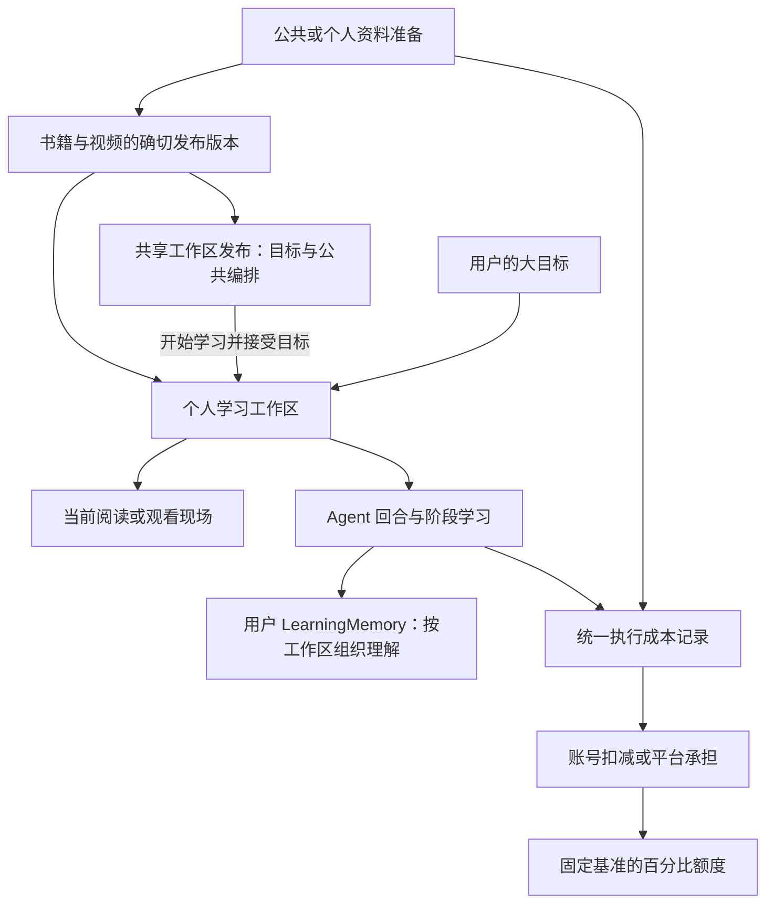

# 目标工作区与统一 Agent 额度

日期：2026-10-18。状态：W1–W6、Q1–Q5、S1–S2、B1–B2、V1、E1已完成并通过对应验收。工作区、共享实例、个人准备、视频与统一额度已通过A–D联合场景及真实后台/浏览器验证，上传入口和纯媒体私人理解保存已补齐；新计划默认关闭 Pass2 和额外 Tutor 材料。当前合同、执行能力与证据见切片方案§8–§18及[E1记录](联合验收-工作区与统一额度-20261018.md)；E2真实运行、成本对照和发布准备待做，未部署。

本方案统一学习工作区、大目标约束、共享预构建工作区、构建服务、全量 Agent 成本和百分比额度。实施顺序及验收见[切片方案](切片方案-目标工作区与统一Agent额度.md)；长期边界见 [ADR-0170](adr/0170-goal-scoped-learning-workspaces-and-shared-releases.md) 与 [ADR-0171](adr/0171-all-agent-cost-accounting-and-percentage-allowance.md)。

2026-10-18 视频接入：复用 video-understanding worktree 的现有 VI1–VI18 能力，将视频加入学习工作区与共享发布，版本更新遵守用户选择。B1 已接通原始视频自动调度、真实阶段进度、平台预算与逐笔外部费用回执；V1已接跨资料检索、取帧、原声复核和确切来源。源能力整合见[接入记录](视频工作区接入-20261018.md)，后台行为见[视频后台预构建](视频后台预构建-20261018.md)，最新个人准备及媒体验收见[B2/V1记录](个人资料准备与跨资料媒体-20261018.md)。Codex CLI 的部分用量继续待核算。

## 1. 产品约定

用户创建工作区时填写或接受一句话大目标，例如“学习深度学习，能够实现基本模型”或“机器学习期末考试冲刺”。工作区组织相关书籍和视频，Agent 在其范围内持续回答、安排学习和积累理解。当前打开的资料只表达阅读焦点。

平台提供资料准备能力。首批由运营者整理并发布已预构建的共享工作区，用户使用时建立自己的学习空间；后续开放个人资料构建。相同公共成果可被复用，个人目标、对话、理解与进度分别保存。

所有平台承担的 Agent 执行进入成本记录。用户学习、后台记忆和个人资料准备共同使用账号额度；公共工作区的准备成本归平台。用户以百分比查看、补充和消耗额度，支付时看到实际货币金额，运营后台保留成本与收款事实。

首个完整场景：两个用户使用同一个已预构建工作区，各自确认目标；Agent 跨两份材料回答并记住各自的困难；切换资料与重开后继续原问题；回答和后台整理完整计量；公共预构建只记录实际发生的成本。

首轮产品入口为现有托管多人 Reader，覆盖桌面、移动浏览器及其附属窗口。运营构建可以沿用现有外部 Harness，将任务和费用回执接回服务。

## 2. 领域与所有权

| 对象 | 拥有的内容 | 关联与边界 |
| --- | --- | --- |
| 用户 | 私人学习记忆、稳定偏好、账号额度 | 多个工作区共用账号额度；工作区消耗是其归集视图 |
| 学习工作区 `LearningWorkspace` | 大目标、资料成员、聊天归属、阶段学习上下文 | 有独立 `learning_workspace_id`；属于一个用户 |
| 阅读现场 `ReaderWorkspace` | 当前资料、读位或播放位置、选区、展示状态 | 关联学习工作区；保留现有现场 ID 的含义 |
| 资料及发布版本 | 原文或媒体、结构、索引、可用能力 | 使用确切发布身份；同一资料可加入多个工作区 |
| 工作区大目标 `WorkspaceGoal` | 用户接受的目标原话、已明确约束、修订记录 | 由用户修改；阶段焦点和单次交付任务引用它 |
| `TutorSession` | 当前阶段的学习意图、焦点、教法及进度 | 归属工作区并关联大目标版本；现有用户级教学开关继续决定主动带学是否开启 |
| 工作区理解视图 | 当前困难、理解假设、真实反馈、适用的能力证据 | 从用户 `LearningMemory` 按工作区与来源投影 |
| 共享工作区发布 `WorkspaceRelease` | 发布者编排的目标、资料版本清单、主题联系、建议路线 | 公共版本可被多个个人工作区引用 |
| Agent 费用记录 | 实际调用、用量、成本、承担方、任务及结算状态 | 用户扣减与平台成本分别保存；与付款记录关联但单位独立 |



构建目录仍称“构建工作区”；它保存资料加工状态。产品中的“工作区”指学习工作区。现有 `RunScope.workspace_id` 继续指阅读现场，新增的学习归属使用独立字段。

## 3. 大目标与 Agent 行为

### 3.1 创建与修改

新工作区必须有用户填写或接受的非空目标。创建只要求一句话；考试时间、考纲、背景和期望深度在影响学习选择时补充。共享工作区预填发布目标，用户可直接接受或修改。创建可以先没有资料，随后加入材料。

工作区保存目标原话、用户明确的约束和目标修订号。用户通过界面修改或在对话中明确要求改变目标，形成可见的目标变更记录。Agent 的总结、推测和局部规划不写入用户目标。修改保留旧版本及其已发生的学习记录。

W4/W5已将目标栏修改与Agent的`workspace.goal.update`接入同一版本存储。对话改向保留完整当前用户原话，校验新目标和新增约束的文字来源、原工作区归属及期望版本；是否明确改向由Agent结合完整请求判断。修改成功后目标栏显示新版本，同一回合接受的新目标另有持久回执。

### 3.2 三层职责

| 层级 | 示例 | 修改者 |
| --- | --- | --- |
| 工作区大目标 | 三周内完成某课程期末复习 | 用户 |
| 阶段焦点 | 先处理梯度与反向传播的薄弱点 | Agent 在大目标和用户约束内调整 |
| 当前交付任务 | 解释这段代码为什么需要保留计算图 | 本次用户请求及 Agent 执行计划 |

补链式法则可以服务深度学习目标；考试冲刺应以已知考纲、时间和实际困难选择深度。临时插问按当次请求回答，结束后保留工作区目标。用户要求扩大、缩小或改变最终方向时更新目标；Agent 主动提出的改向由用户接受后生效。

主动教学开关控制是否自主安排后续教学。普通问答仍携带工作区目标，以调整解释的侧重和深度；目标存在本身不会开启主动教学。

### 3.3 运行中的约束

工作区内的回合及后台任务绑定用户、学习工作区、目标版本、原任务和提问现场；账号级整理保留相关工作区来源，不指定单一工作区目标。前台切换页面或资料不改变已经开始的任务归属。每次自主选择下一步时读取有效目标和已知约束；目标已改变时，旧阶段安排停止自主推进，后续任务使用新版目标。

来源定位、目标变更权限和任务归属由代码保证；“这次补充是否服务目标”由 Agent 结合具体问题判断，并在提出阶段安排时说明与目标的联系。验收使用真实目标、临时插问和目标修改场景观察行为。

W4通过独立目标投影把原话、约束、版本及阶段焦点送入规划和最终化。TutorSession关联创建阶段时的目标版本；目标修改暂停旧阶段并清除其主动推进资格，下一次用户问题使用新目标开始阶段。阶段可以聚焦一份资料或章节，切到其他成员资料不会把原阶段扩大，普通问答仍携带工作区大目标。

## 4. 工作区内的访问与理解

### 4.1 材料范围

用户从可访问资料库加入确切资料版本。运行中的目录、检索、原文和媒体读取，只能使用本工作区的材料成员与已有访问授权的交集。当前 `book.*` 保留当前资料语义，`library.*` 在学习工作区范围内完成跨资料读取。Agent 可提出添加资料的建议，用户添加或接受建议后纳入范围。

新运行取得当前资料成员集合；已启动运行保留原集合，成员变动从后续运行生效。既有账号和材料权限撤销仍按原授权路径生效。移出资料不会删除历史引用；历史回看按原来源身份和当前授权读取，历史出处不会自动重新成为后续 Agent 的可用参考材料。

书籍引用保存资料与版本及原文范围，视频引用保存确定媒体及时间范围。跨资料联系保存两端来源及成立依据；同名概念的匹配需要语义依据。查看引用预览保留原聊天和阅读现场。

### 4.2 聊天和学习状态

聊天归属学习工作区，回合保留提问材料、选区或视频现场。切换资料继续当前聊天，切换工作区恢复该工作区的聊天与阶段学习状态。每个工作区可保留自己的 Tutor 会话；全局教学开关沿用用户控制，只有用户当前继续的工作区参与主动推进。

W5在托管Reader接入一句话创建、工作区选择、大目标栏、成员资料及理解入口。阅读检查点按工作区和确切资料版本保存，返回工作区恢复最近资料、原读位和选中聊天；普通输入草稿随工作区聊天保存，选区草稿保留原资料身份。桌面、窄屏和附属窗口使用同一学习归属。

`LearningMemory` 继续由用户唯一持有。新增使用事实、理解假设、评估和阶段会话记录工作区归属；查询、投影重建、分页、修订及 `supersedes` 都使用同一归属边界。只给资料检索增加过滤不足以完成工作区理解。

同一本书同时在 A、B 两个工作区时，两边复用公共内容，局部聊天、理解假设和进度各自延续。用户明确选择“带入已有学习记录”时，以原事实引用纳入目标工作区，保留原归属和上下文；理解沿新上下文重新判断，不自动继承掌握状态。对共享原记录的纠正可被回看，本工作区的新解释不覆写另一个工作区的解释。

稳定背景与通用讲解偏好继续归用户。跨工作区的画像整理记录为账号级记忆任务；它保留来源关联，局部知识判断仍留在各工作区理解视图。

### 4.3 旧记录承接

现有单书聊天和学习证据保留原记录、来源与历史读取入口，标记为尚未归入学习工作区。用户创建并确认大目标后，选择纳入哪些资料和已有记录。关联通过原记录引用完成；仅凭书名或 `book_id` 不生成大目标，也不把同书的全部私人记录自动并入新空间。

新增记录使用工作区归属；原来的正式对象证据与来源版本保持原身份。已有记录缺少工作区时，不参与新空间默认理解查询。迁入按现有数据库升级和备份流程实施，建立必要的归属与关联字段。

## 5. 共享预构建工作区

### 5.1 发布内容

一个共享发布包含：名称、发布者、目标说明、适用范围、建议基础、确切资料版本清单、公共主题联系与建议起步路线，以及该版本实际可用的能力。考试类工作区写明适用课程、考纲或资料范围。

发布者编排的公开目标和路线属于工作区发布；基础资料抽取仍表达材料自身。私人 `BuildIntent`、聊天、理解假设和用户画像留在个人存储，发布内容从明确选择的公共编排和资料版本组成。

发布沿用现有材料授权。运营者发布时配置目标用户及相应资料访问，使用入口检查全部必要材料的可访问性和声明的就绪能力；缺失的发布不展示为“已准备好”。工作区可见性本身不授予额外材料权限。

S1已接入运营发布页面、`/admin/workspace-releases`管理接口与`/workspace-releases`读者查询。管理员明确选择可见用户、确切资料发布及各自必要能力，填写公共目标、适用范围、基础、主题联系和路线；公共编排只能引用本清单内的资料。发布沿现有操作回执追加不可变版本，重复提交返回原回执；ControlStore schema17保存公共清单、版本可见范围和发布时的就绪快照。

发布后的当前可用性随每次读取重新检查，分别反映资料、必要能力和该用户的访问授权。缺项的版本保留为“准备未完成”，运营者可查看原因；资料文件或用户授权恢复后反映当前状态，新增资料能力通过选择相应资料发布形成工作区新版本。管理员看到指定读者的整体情况，读者只看到自己的授权状态。导出内容为明确发布的公共清单及版本身份；发布、读取和导出本身不启动构建，也不生成模型费用。

### 5.2 开始学习

S2已接入共享目录、版本详情、目标确认与开始学习入口。确认前可修改公开目标并填写个人约束；提交后创建独立的个人工作区，重复提交返回同一实例。

用户选择发布版本，接受或修改目标，建立新的个人工作区。实例保存 `release_id` 与版本引用，并引用公共资料成果。个人学习状态从该用户自身开始，后续私人资料和目标调整只影响自己的实例。

两个用户实例化同一发布时复用原成果，不重新启动资料构建。不同用户的来源、回答、后台记忆和理解记录沿各自用户与工作区保存。

### 5.3 更新与归档

S1已支持基于最新版本追加发布新版本，公开目标、适用范围、主题联系和路线可以独立修订，既有资料版本可继续引用；原版本仍可按确切发布身份读取和导出。

S2的个人实例保持选定版本；用户预览材料、必要能力、公开目标及编排变化后，可保留原版或明确接入新版。个人目标、目标历史与私人追加资料保留；显式添加过的私人资料即使后来与公共版本重叠，也继续保留个人添加的身份。旧对话、笔记和理解证据继续指向当时版本；新资料是否支持旧理解按内容重新判断。当前阅读资料被新版替换时，Reader接续同书新版本或当前工作区内的可读资料。

归档个人工作区暂停它的主动教学和新增后台工作，保留历史、费用与出处。S2已接共享归档/恢复及个人归档/恢复入口；共享归档停止新的使用入口，已建立的个人实例沿现有材料授权和版本保留策略继续访问。共享版本可见性和资料授权分别检查，不能通过实例化或更新读取无权资料。

## 6. 构建服务与成果复用

| 成果层 | 内容 | 复用方式 |
| --- | --- | --- |
| 资料公共成果 | 正文或转写、来源定位、结构、语义及媒体索引 | 同一有效版本供多个工作区引用 |
| 发布者公共编排 | 公开目标、主题联系、建议路线 | 随共享工作区版本发布 |
| 个人适配成果 | 针对目标的整理、解释、学习安排与理解记录 | 属于用户及工作区，保留来源 |

先提供运营构建与发布，再开放个人上传。B1已接运营后台的准备任务、计划与预算确认、执行状态、暂停/继续及选择成果发布。一个任务可混合复用已有成果与准备缺失资料；原DSH宿主通过现有Build Engine、BuildIntent/BuildPlan、阶段发布和恢复能力执行，完成后沿PublishedLibrary导入并发布S1公共清单。大目标不是无限构建授权，涉及付费准备时展示范围、预计额度及任务使用上限，用户确认后执行。

运营任务绑定一个平台父任务预算，各材料执行共用原Q3准入与费用回执。准备计划不调用模型；实际执行发生的部分或未知费用保留待核算。首次构建确认身份与原构建引用保持稳定，继续时可提高任务预算；构建创建成功但进度回执丢失后，仍找回原构建。需要中途人工选择时沿原构建宿主问答继续。任务持久化、资料导入与公共发布各自沿既有恢复和操作回执处理。

任务预算以精确内部额度冻结，界面按对应基准显示百分比。父任务预算限制后续调用准入；实际发送仍逐次预占和结算，父任务预算本身不再扣一次。并行子任务共同使用父任务剩余预算。

个人构建对用户承诺的上限约束该父任务最终累计扣减。预占是估算，实际费用可能超出：完整供应商成本照实记录，结算时只将剩余任务上限内的部分扣给用户，超出部分归平台并停止后续发送。并行结束或迟到费用按同一父任务累计上限结算；继续构建需用户增加上限。普通问答沿用原账号额度结算合同。

修改目标复用仍有效的资料成果，只重做变化的编排或个人适配。

材料按真实能力逐步开放。文本阅读、语义问答与主动教学沿已有就绪合同；视频按既有方案在全片忠实转写就绪后开放伴读，视觉索引等成果继续补齐。未完成的能力在资料状态中表达。完成单元在重启或继续构建时复用，失败单元按现有恢复路径处理。

## 7. 全量 Agent 成本

### 7.1 覆盖与承担方

| 执行 | 记录归属 | 用户额度 |
| --- | --- | --- |
| 回答、检索综合、来源修复、压缩、教学判断、翻译、演示生成和预览模型观察 | 用户、适用的工作区、回合及父任务 | 按实际结算扣减 |
| 私人理解整理、后台记忆复核与画像整理 | 原用户及原任务；账号级整理保留相关工作区引用 | 同一账号额度，扣一次 |
| 用户发起的资料预构建、转写、视觉分析和目标整理 | 发起用户、工作区和构建任务 | 用户累计扣减不超过已确认任务上限，实际超出成本归平台 |
| 官方共享资料预构建、公共编排和维护 | 平台运营任务及目标发布 | 平台承担，进入经营成本 |
| 重试、失败、取消前已发生的付费执行 | 对应实际发送与原任务 | 按现有结算事实入账；减免独立记录 |

采用同一成本口径覆盖全部付费执行，并按承担方归集。用户自己付费的外部 Agent 调用记录执行者和可取得的用量，其付款不记成平台支出。纯读取或复用已有成果不产生新的模型调用费。需要付费的转写、视觉或其他服务按其真实计量单位接入。

### 7.2 账本与接入

复用现有 `ModelSpendPort`、费用记录、费率快照、预占、结算和人工核算。扩展平台/账号承担方、学习工作区、父任务与构建任务关联。平台任务不绑定读者额度期；用户任务的每次发送绑定准入时的有效额度期。

原始用量、计量来源、实际成本、用户扣减分别保留。一个业务回合可包含多次模型请求，每次实际传输重试独立计量；重复收到同一发送回执只结算一次。汇总从费用事实产生，外部观测与导出用于诊断。

TS 构建和外部 Harness 接入必须贯通发送前预算准入与执行后回执。现有构建任务/尝试身份用于关联；最终成果与统计文件不能替代逐次费用事实。具有多次模型请求的外部执行，需要完整的调用明细或供应商可核对的整次执行费用；同一次执行选择一种结算粒度，汇总不能再叠加其明细。

按时长或请求计价的服务保存原始时长、请求量及费率依据。采用套餐付费的外部 Harness 以真实套餐账单记平台支出，任务用量及成本分摊另外标明估算。尚无可核算回执或可约束预算的执行路径先用于运营准备；个人付费构建选择具备相应能力的执行路径。

### 7.3 未知、停止与补偿

明确未发送的调用释放预占；已发送且有完整用量的调用即使业务失败也结算；发送或费用不明时记待核算并保留适用预占。未知成本与已确认成本分列，运营免扣不将供应商未知成本改成零。

账号额度与父任务预算都参与后续发送准入。额度不足时保存已完成结果、未完成任务和停止原因，等待用户补充并显式继续。已发送请求按原额度期结算；新额度期下的继续任务使用新的准入事实。恢复服务和补充额度不会重发已经完成的调用。

平台故障补偿沿现有追加更正/免扣记录处理，保留实际成本与依据。归档工作区、删除聊天不删除已发生费用。

## 8. 固定百分比额度

### 8.1 基准与公式

一份标准额度对应固定内部额度 `B > 0`，显示为 100%。首版复用整数 `micro_cny` 额度单位；付款金额独立以分记录。额度期绑定基准版本及数值，追加充值不改变该期基准，历史明细使用所属期基准。未来调整基准只作用于新额度期。

设授予总额为 G、已扣减为 D、正在使用的预占为 R、待核算占用为 P：

```text
可用内部额度 A = G - D - R - P
可用百分比 = max(A, 0) / B × 100%
已用百分比 = D / B × 100%
预占百分比 = R / B × 100%
待核算百分比 = P / B × 100%
补充 x% 的内部授额 = B × x / 100
```

账户可用值允许超过 100%。账本保留实际超出量；可用主卡最低显示 0%，耗尽后停止后续发送，明细仍反映已发生的扣减。补充额度沿原规则先覆盖已有扣减与占用。

费用累计采用精确整数，只在显示时舍入。小额非零消耗可显示“低于 0.1%”；它在合计中完整累加。按后台支持的百分比销售步长换算授额，避免每笔费用先舍入成百分比。

示例：73% − 本次学习 2.3% + 补充 50% = 120.7%。补充前后，本次学习仍显示消耗 2.3%。示例不规定销售价格或基准的具体成本值。

### 8.2 有效期与充值

沿用当前每账号同一时刻一个有效额度期的合同。补充额度进入明确的有效期；到期时间在充值和使用入口可见。续期开立或更新期限沿现有操作表达，充值不隐含自动续期或把旧期剩余量转移到新期。

购买入口显示实际支付金额、增加的额度百分比和有效期。人工收款与授额继续原子登记，赠送和更正独立留据。新销售配置包含价格、百分比及适用的基准版本；本方案复用现有人工收款入口。

### 8.3 用户与后台界面

用户主界面显示“可用额度”、有效期与补充入口。明细按学习对话、资料准备、记忆整理等用途显示百分比；可归属同一学习任务的后台工作在同一任务下继续更新。正在使用和待核算的额度分别展示，避免把占用误认为最终消耗。

个人 API 返回余额和每条历史费用适用的基准，不能让前端用当前除数重算全部历史。平台公共构建费用只进入运营报表。账号级记忆任务独立列示，工作区视图只归集属于它的记录，账号合计只计一次。

跨额度期的任务和工作区明细按所属期及基准分组显示百分比小计，不合计不同基准的百分比。后台可用内部精确单位汇总真实费用。构建跨期继续时，原任务精确扣减上限保留，继续页面按当前期基准显示剩余可扣额度；增加总上限仍由用户确认，历史消耗仍按原期显示。

后台保留供应商用量、成本、用户扣减、收款与经营汇总。切换前给既有额度期明确绑定固定基准，原授予、扣减、收款、有效期与发送状态保持原事实。基准数值由运营者在上线前配置。

### 8.4 任务、工作区与平台汇总

Q5已接入Reader的任务、工作区和账号级整理视图，以及后台费用汇总。`/account/cost-summary`只读取当前账号，`/admin/cost-summary`提供账号与平台报表；逐次明细沿相同父任务、主工作区或账号级范围筛选。汇总直接从既有调用账本生成，分页只改变任务列表，不改变账号和工作区合计。

同一父任务的前台与后台子调用归并计算；持久画像复核保留自己的账号级父任务，其相关工作区仅作为来源引用。工作区小计只包含明确归属该工作区的调用，账号总计每次发送只计一次。按日期筛选使用原发送日期，迟到结算继续更新原任务和原额度期；归档工作区仍可核对已经发生的费用。

任务、工作区及账号的百分比均按原额度期及其固定基准分组，附该期有效时间供界面显示，没有跨期百分比总数。后台精确金额可以跨期求和；已确认成本、未知费用数量、待核算占用和争议数量分别列示。存在未知或争议时，完整供应商成本返回未确认状态，已确认部分仍可查看。平台准备调用的确认成本与账号任务由平台承担的差额分别展示，共享成果的再次引用不会增加费用记录。

## 9. 接到现有实现

以下以设计落档时 HEAD `402d9be` 工作树为基线，包含当时未提交修改，并补充已落地的实现接点。W1/Q1/Q2新增接点与验收结果见切片方案§8，W2/W3见§9，W4/W5见§10，W6见§11，Q3/Q4见§12，Q5/S1见§13，S2/B1见§14；实施状态以这些记录和实际代码为准。

| 接点 | 落档基线行为 | 本方案变化 |
| --- | --- | --- |
| [reader_workspace.rs](../crates/server/src/reader_workspace.rs)、[run_scope.rs](../crates/server/src/run_scope.rs) | 单资料阅读现场及运行归属 | 新增学习工作区关联，现场身份保留 |
| [server/lib.rs](../crates/server/src/lib.rs) 的 `AgentChatSession`、[session_runtime.rs](../crates/server/src/session_runtime.rs) | 按 `book_id` 组织聊天 | 工作区聊天；回合保留原资料与版本 |
| [runtime/library.rs](../crates/runtime/src/library.rs)、[cross_book.rs](../crates/server/src/cross_book.rs) | 从账号授权书库读取与补讲 | 增加工作区资料范围，贯通理解读取与来源回看 |
| [learning.rs](../crates/memory/src/learning.rs)、[learning_evidence.rs](../crates/memory/src/learning_evidence.rs) | 理解查询按来源，投影以来源聚合 | 事实、解释、修订与投影具有工作区归属 |
| [published_library.rs](../crates/server/src/published_library.rs)、[online_publication.rs](../crates/server/src/online_publication.rs)、[workspace_publication.rs](../crates/server/src/workspace_publication.rs)、[workspace_release_instances.rs](../crates/server/src/workspace_release_instances.rs) | 共享确切材料发布与在线导入 | S1/S2已接公共清单、不可变版本、可见范围、动态就绪、导出、目标确认、私人实例、选择更新与归档 |
| [build-intent.ts](../packages/core/src/build-intent.ts)、[build-intent-v2.ts](../packages/core/src/build-intent-v2.ts) | 单材料目标、计划与构建 | 工作区组织多个材料任务，复用原阶段执行与发布 |
| [operator_builds.rs](../crates/server/src/operator_builds.rs)、[operator-build-host.ts](../packages/dsh-plugin/src/operator-build-host.ts) | 运营准备复用既有Engine与DSH执行 | B1持久任务、实际计划确认、共享父预算、暂停恢复、成果导入与选择发布 |
| [model_spend.rs](../crates/runtime/src/model_spend.rs)、[model_spend_store.rs](../crates/server/src/model_spend_store.rs) | 逐次发送结算，账本拒收 `OperatorTask` | 补平台承担与外部构建费用归集 |
| [multi_user_review.rs](../crates/server/src/multi_user_review.rs) | 后台记忆已通过 `ReaderTask` 计费 | 保留费用路径，补工作区或账号级任务归属 |
| [automatic-build-metrics.ts](../packages/core/src/automatic-build-metrics.ts) | 外部执行器用量可为部分或不可用 | 增加预算准入与可结算回执；统计状态不能冒充确认成本 |
| [account_allowance.rs](../crates/server/src/account_allowance.rs)、[AccountAllowance.vue](../packages/web/src/components/AccountAllowance.vue) | 整数成本额度，用户界面展示金额 | 固定基准投影、百分比历史与充值呈现 |
| [cost_summary.rs](../crates/server/src/cost_summary.rs)、[charge_admin.rs](../crates/server/src/charge_admin.rs)、[admin_usage.rs](../crates/server/src/admin_usage.rs) | 调用明细与运营收款、活跃报表 | Q5已接父任务、主工作区、账号级整理及平台归集；原期比例、未知状态和明细使用同一口径，原运营报表保留 |

### 9.1 与已有决策的关系

| 既有决策 | 本方案承接或调整 |
| --- | --- |
| [ADR-0118](adr/0118-learning-memory-owned-replayable-tutor-session.md)、[ADR-0141](adr/0141-global-tutor-control-and-session-ownership.md)、[ADR-0161](adr/0161-conversation-first-learning-and-multi-user-memory.md) | 新工作区先确立大目标；首问仍可建立阶段学习意图；私人记忆与全局教学开关保留原所有权 |
| [ADR-0169](adr/0169-cross-book-reading-and-private-understanding.md) | 多书证据与内部读取继续复用；新工作区的默认资料和理解查询范围收敛到本工作区 |
| [ADR-0093](adr/0093-intent-confirmed-progressive-prebuild-and-reader-private-goal-artifacts.md)、[ADR-0158](adr/0158-book-structure-ready-tutor-and-optional-teaching-assets.md) | 公共资料与个人目标产物分离、构建授权和分级就绪继续适用；增加明确发布的公共工作区编排 |
| [ADR-0145](adr/0145-video-media-locations-and-revisable-visual-units.md)、[ADR-0146](adr/0146-portable-build-workspaces-and-incremental-book-updates.md) | 视频原始位置、内容版本与历史引用保留；工作区引用其成果 |
| [ADR-0156](adr/0156-reader-admin-and-account-allowance.md) | 收款、额度、成本分账与原预占结算保留；扩展承担方并将用户额度表达改为固定百分比 |

## 10. 实施边界与待配置项

- W1–W6已接通工作区数据、聊天与运行范围、私人理解、目标规划、阶段版本、托管Reader入口及旧学习记录的明确选择带入。Q1–Q5已接通固定基准、费用归属、外部任务预算/回执、百分比额度界面及任务、工作区、账号和平台汇总；S1/S2已接共享公共清单、目标确认、私人实例、选择更新、当前能力与归档生命周期。具体合同及验收见切片方案§13–§14。
- B1已接运营任务、计划与平台预算确认、原Engine执行和恢复、真实导入及公共发布；B2已接个人资料上传、准备范围、额度确认和原学习任务接续。个人上传支持EPUB/MD/TXT/MP4，原始PDF需先完成既有工作台来源对齐。运行需要已连接的原DSH根会话及可共同访问的成果路径，配置见插件README。
- 首轮接入托管多人 Reader；独立离线单书入口沿现有行为使用，离线多资料学习工作区的存储与资料库接入后续单独实施。
- [视频实施方案](切片方案-视频理解与渐进伴读.md)的现有VI1–VI18能力已接入同一工作区及计费归属。个人视频准备提供本地转写、播放和原文学习，完整翻译、视觉索引、图谱及原讲解结构由运营预构建和共享成果提供。
- 外部 Harness 缺完整费用依据时保留待核算。DSH新增 `provider_calls_v1`：逐次实际模型发送前准入，按完整用量与冻结费率结算，已开放个人书籍准备；缓存细分或用量缺失仍待核算。原DSH粗粒度模式和 `codex_cli_video` 继续沿平台预算记录部分回执，不能向个人收取精确构建费用；Codex原书籍profile缺计量回调时仍拒绝绑定创建。费用合同见切片§16–§17和ADR-0171。
- 内测远程 Book MCP 的调用次数与用户自备模型费用沿 [ADR-0162](adr/0162-beta-remote-mcp-and-prepaid-call-credits.md) 单独管理；本方案的百分比额度用于平台托管 Agent 服务。将远程次数产品合并销售需要单独明确换算和旧权益处理。
- 运营上线前确定：100% 对应的内部额度 B、售卖价格与百分比档位、有效期、共享发布的目标用户、首批内容及公共准备预算。个人构建的预算由具体计划和用户确认提供。这些数值不阻塞数据与行为合同实现。
- 首版采用共享内容发布与独立的个人使用实例。多人共同编辑一个私人学习空间、自动支付和订阅另有产品需求时设计。

## 11. 验证依据

设计验收与实施验收分别记录。本次核对已有代码边界、文档引用、切片依赖和百分比算例；实施时按切片验证具体行为。每项检查先说明它会发现什么失败，失败后修改对应路径。

完整验收应覆盖：同资料多工作区的理解隔离、切资料接续、大目标修改与临时插问、两用户复用公共成果、共享版本更新、回答与后台工作合账、外部构建恢复和取消、平台承担、旧记录承接，以及充值前后历史百分比稳定。

仅有模型替身的自动测试可证明调用、归属和结算路径；目标相关性、补讲选择及模型自由行为另需已明确预算的真实任务验收。完成前不将替身结果写成真实教学质量结论。

## 12. 外部参考

2026-10-18 查阅的 [Codex 官方额度说明](https://learn.chatgpt.com/docs/pricing#what-are-the-usage-limits-for-my-plan)描述多类 Agent 活动共享额度，消耗受模型及任务影响，并可通过额外 credits 继续使用。本方案借鉴统一额度体验；固定 100% 基准、允许余额超过 100% 和本项目的成本承担规则由本方案定义。
