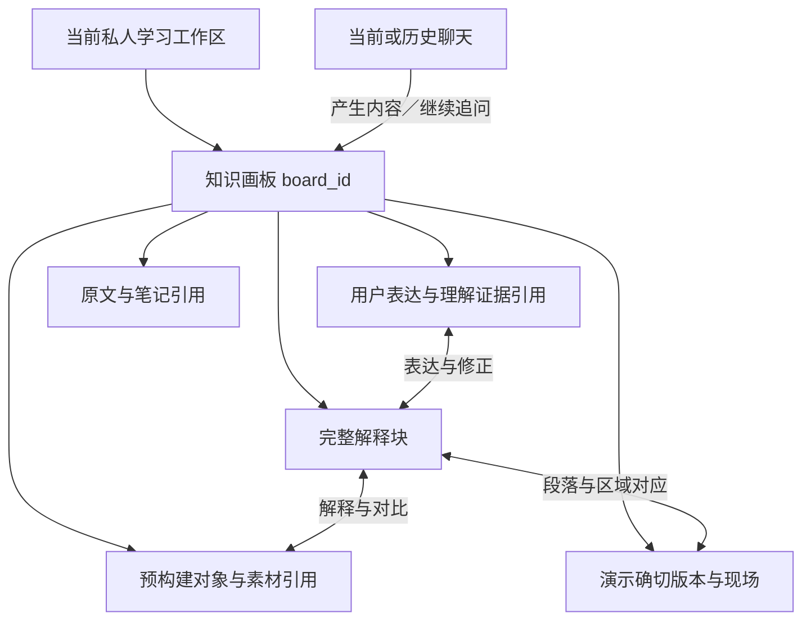
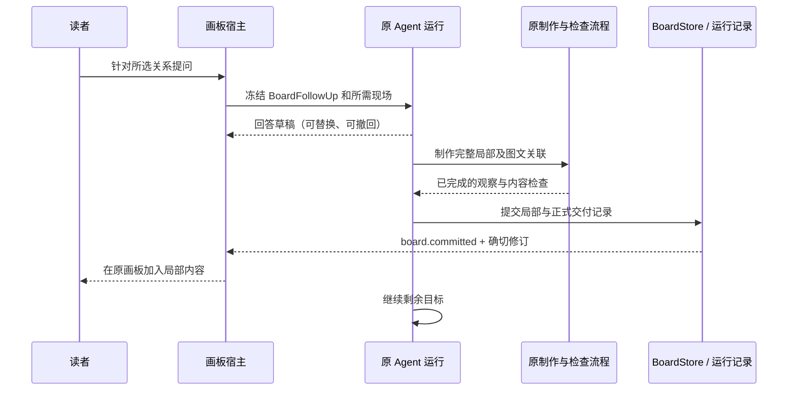

# 知识画板与持续讲解：完整设计方案

日期：2026-10-25。状态：WB1–WB4 已实现并验收，2026-10-26 已随 `combined-20261026` 上线，见[发布记录](https://github.com/adaelon/understand-book/blob/625b4405af3b011e87d4eb256f819c8075f88613/docs/performance/combined-release-20261026/README.md)。实际范围与证据分别见[WB1 实施记录](实施记录-WB1知识画板.md)、[WB2 实施记录](实施记录-WB2画板追问.md)、[WB3 实施记录](实施记录-WB3图文联动与板书讲解.md)和[WB4 实施记录](实施记录-WB4正式局部交付.md)。

2026-10-26 补充：用户验收发现整板提问、板内讨论、相关历史检索和既有图元操作尚未形成完整流程。WB6 已于 2026-10-26 18:44:57 HKT 补齐并上线这些行为，真实两轮改图与浏览器验收见[WB6 实施记录](实施记录-WB6画板式学习.md)；原阶段验收不能替代整套产品流程验收。

适用项目：Understand Book 当前工作树。源码基准为 df019a38 及工作树中的相关未提交修改；本文依据实际文件中的现有接口，不把历史 ADR 的计划直接视为已实现能力。源码依据集中在附录 A。

## 1. 产品目标与核心决定

知识画板是围绕一个知识点、问题或局部主题持续存在的学习空间。它连接预构建知识、原文、Agent 回答、可操作演示、用户表达和理解变化。读者从书或知识点进入画板，即可回顾完整解释并继续追问，无须先找到产生它的旧聊天。

画板保存内容之间的组织关系，阅读视图呈现完整文字，讲解播放按理解顺序展开相关内容。三种使用方式共享同一份已保存内容和出处。聊天继续承担提问、讨论和任务运行；其历史保留当时的过程，画板承载可再次使用的学习成果。

本方案采用以下决定：

| 决定 | 具体结果 |
| --- | --- |
| 为画板建立独立 board_id | 编辑布局、换聊天、增加回答、替换演示版本都不改变画板身份 |
| 以当前学习工作区为私人归属 | 同一知识点在不同学习目标下可有不同画板；公共预构建继续共享，私人理解分别保存 |
| 直接引用已有权威内容 | 正式对象、原文、笔记、演示和学习证据沿原身份读取；画板负责组织和导航 |
| 将完整解释正式保留到画板 | 解释正文可独立于原聊天阅读，图元与段落有明确对应 |
| 用户表达与系统判断分别呈现 | 用户原话、Agent 整理、理解假设和练习表现保留各自依据 |
| 沿用演示制作、现场和交付合同 | 新内容经过原制作与检查路径；已有内容通过现有动作接口操作 |
| 先完成持久内容闭环，再接实时局部交付 | 各阶段都交付可使用的能力，最终实现边讲边补充原画板 |

产品完成场景是：读者从一段原文打开画板，看到预构建结构；Agent 的回答和演示留在其中；读者指出自己的理解，Agent 在原处补充和比较；隔日从原文或搜索重开，全部解释、出处、用户表达及未解决问题仍然可读，并能从原位置继续。

## 2. 现状、复用基础与实际缺口

### 2.1 已有能力

本节保留设计立项时的基础能力与缺口。WB1 已增加的持久画板、四类内容留存和 Reader 入口见第 13 节及实施记录；其余章节描述完整目标，不表示已经全部交付。

| 现有部分 | 当前能力 | 本方案的复用方式 |
| --- | --- | --- |
| TeachingMap / LearningObject | 正式对象身份、对象修订、关系参与者、条件、来源及拆并对应 | 作为画板知识对象的权威引用 |
| CognitiveMaterials 与成果记录 | 重点认知素材、步骤、连接，及带来源的成果记录 | 生成初始局部板书，挂载现有图解与推导素材 |
| AgentAnswerPart | 回答中混排 Markdown、来源与演示引用 | 接入正式解释块及“在画板中查看”入口 |
| 演示共享工作区 | 同屏原对话、同一输入和运行、同一演示实例，窄屏可切换讨论 | 延续其双区布局及现场连续性 |
| AgentPresentation | 自包含内容、确切版本、可读说明、来源、状态读写、区域定位 | 作为画板中可操作的演示条目 |
| presentation.interact | 操作已打开版本的声明动作、参数、揭示和高亮，并回读实际结果 | 驱动板书播放和同一教具上的讲解 |
| 长期笔记与原文放置 | 保存回答摘录、演示现场，放到正文或 PDF 附近 | 作为画板内容及回到阅读现场的入口 |
| TeachingEvent / LearningEvidence | 用户表达、帮助、活动事实，及带依据、可修正的理解解释 | 显示“我怎样理解过”及后续变化 |
| UnderstandingSpace | 原话、解释、能力维度、帮助条件和理解时间线 | 增加直接进入相关画板的入口 |

现有演示工作区已经能够与原对话同屏，且能继续追问。当前问题在于内容仍以消息和单个演示对象组织，缺少知识点级的持久归属、完整回答的独立阅读组织，以及段落与图元之间的稳定联系。参见 ADR-0144 与 [S03]、[S04]。

### 2.2 必须新增的能力

1. 独立画板身份、私人归属、保存与直接打开入口。
2. 完整解释正文与画板对象、步骤的双向关联。
3. 预构建对象、用户表达、理解证据在同一局部空间中的呈现。
4. 带画板选择的提问上下文，以及同板补充的正式交付结果。
5. 按知识点、原文位置和解释内容找回画板的索引。
6. 在现有最终交付之外增加正式的局部交付，支持生成过程中逐段加入。

有三处实现边界直接影响设计：

- 笔记 mem_id 会随编辑、重锚改变，不能作为稳定 board_id；新笔记的 Record.content 专指用户填写的文字，也不能用它无署名保存 Agent 正文。[S07]
- 当前 authoring 的 global/local/review 是制作职责，不能直接等同于向读者逐段发布。[S11]
- 普通演示追问受原聊天所有权约束；现有笔记留存路径允许在别的聊天解释旧演示，但新内容需在当前聊天创建新演示对象。[S10]

## 3. 信息归属与画板范围

### 3.1 以知识点或问题聚焦

默认画板围绕一个正式学习对象、一个原文范围或一个具体问题创建。对象可包含必要的前置概念、条件、例子和后续关系。章节入口列出相关画板；画板之间通过现有对象与来源建立导航。

打开时展示当前问题、核心结构、相关解释和未解决的分支。长文、较远关系、历史理解及旧版本按需展开。用户可以手动摆放、分组、折叠内容，Agent 的新补充优先放在所选对象附近，保留已有空间位置。

没有完成语义预构建的材料，也可以从确切原文范围开始画板。取得正式学习对象以后，再增加对象关联；已有来源和用户表达保持原身份。

### 3.2 公共内容与私人内容

公共层继续保存正式对象、认知素材和发布成果。私人画板归当前账号及 learning_workspace_id；运行中的 Reader workspace_id 仍表示阅读现场，两者分别使用。

画板引用确切资料发布、对象版本和成果记录。用户的问题、回答、布局、练习与理解留在私人空间。跨资料关联遵循当前学习工作区的资料成员与账号授权。来自其他学习工作区的私人记录沿现有“带入学习记录”流程选择进入，保留原归属。[S01][S13]

### 3.3 内容来源在界面上可辨认

画板可显示“原文”“预构建整理”“Agent 解释”“你的原话”“系统对理解的判断”“练习表现”等简短来源标识。它们表达作者和依据，不表示自动正确性。

引用原文的节点可以展开原片段；预构建关系可以展开条件和依据；用户表达可以查看原话与时间；理解判断可以查看所依据的表达、帮助条件和修正。普通移动、播放和查看记录不改变理解状态。

## 4. 用户体验与主要流程

### 4.1 从原文进入

读者选择原文或打开知识对象，使用“在画板中理解”。若当前学习工作区已有以相同确切对象或来源范围为焦点的画板，优先继续最近使用的一份；有多个不同问题时显示问题标题供选择。用户也可明确新建另一份。

首次进入时，从当前对象、必要前置关系、认知素材或已有成果形成初始局部结构。规则性结构投影不需要额外模型调用；需要重新组织讲解时，由 Agent 阅读原文后设计。创建结果立即拥有稳定地址。

### 4.2 回答进入画板

从画板发起的内容性提问默认归入当前画板。从原文发起并进入讲解的提问归入对应知识点画板。解释、例子和结论正式保留；运行进度和操作通知继续保留在聊天。

完整回答出现在画板旁的“讲解”区。画面上使用短标题、关键句、公式与关系；长文采用正常文字排版，支持选择、复制和来源点击。聊天显示当时回答及“已加入某画板”的定位入口。

单个解释可以先只有文字；需要图示时，再建立图文关联。普通简短问答仍可直接完成，不要求每次制作演示。

### 4.3 指着对象追问

用户选中节点、关系、回答段落或演示区域后，输入框显示明确的对象提示，例如“针对：A 在条件 C 下影响 B”。发送时冻结所指对象及确切内容版本；发送后继续操作画板，不改变已经发出的问题。

回答完成后，新解释归入当前问题或成为相关补充分支。读者点击文字时，画板突出对应对象；点击对象时，讲解区定位相应段落。存在多条解释时按问题标题与当前讲解关系列出，不随意选取一条覆盖其他内容。

### 4.4 将用户理解画出来

用户表达“我理解成 A 直接导致 B”，系统保存原始表达，并允许 Agent 将它组织成一条带“你的理解”标识的关系。若书中关系包含条件 C，画板可同时呈现该条件及其依据。

Agent 对差别的解释单独显示。用户之后说“这里需要 C”，新表达与之前表达建立修正联系；当前画面可突出新的表达，旧内容在历史中可查。Agent 的整理文字保留整理身份，用户未表达的内容不能写成用户原话。

练习回答及反馈引用已有活动和证据。判题、帮助曝光、修正和理解汇总继续由现有教学链路产生；画板只呈现和操作这些内容。[S08][S09]

### 4.5 演示作为画板内容

演示条目使用现有 AgentPresentation，保留其来源、确切版本和现场。选中条目可以在画板区域内放大操作；收起后保留参数和输入。完整解释在相邻讲解区可见，演示的 readable_content 作为该演示自己的说明保留。

图文联动可以定位演示整体，也可以定位声明过的内部区域。旧演示没有区域声明时，先支持整体定位；新制作的板书演示提供区域与步骤映射。

### 4.6 回顾与找回

**决策（2026-11-02）**：学习画板与学习资料并列为一级入口。

产品首页、登录后的资料页和阅读／画板现场均直接显示“学习画板”，手机同样保留。`/index.html?view=boards` 可以独立进入自己的画板首页，无需先打开书籍。首次进入展示梳理关系、比较概念和检查理解三种用途；已有画板时优先展示按最近修改排列的列表，用途说明可以展开。画板卡片显示原资料和所属学习工作区，支持按标题、资料或工作区搜索；打开时恢复保存的资料版本和工作区。资料不可用或工作区归档时保留卡片并说明原因。

账号画板首页读取私有画板摘要，具体内容仍在原来的书籍／学习工作区范围内打开。后续仍保留四种上下文入口：原文附近的“已有画板”、本书或章节的画板列表、“我的理解”中的相关画板、画板标题与正文搜索；本次首页搜索覆盖摘要，不读取全部正文。实现与验证。

命中回答段落时直接打开该段及对应图元；命中用户表达时显示原话和相邻解释。旧聊天作为追溯入口保留，读取已沉淀内容不依赖聊天仍然存在。

## 5. 页面结构与交互规则

桌面延续现有演示共享工作区的可调整双区：主区为画板，右区为“讲解／讨论”，底部沿用同一提问输入和运行状态。右栏可以收起；“显示全部内容”调整缩放，“全屏画板”扩大画布并收起周围面板，全屏中仍可打开讲解、讨论和提问，退出恢复原布局。原文引用入口放在讲解标题下，点击后打开大幅临时阅读窗口，定位并高亮引用，可上下连续滚动、通过目录换章节或回到引用处；窗口独立保存临时位置，关闭恢复画板现场。明确选择“在阅读器中打开”才将主阅读器定位到临时窗口当前读到的段落。来源始终绑定引用保存的书籍与出版版本，失效来源继续显示保留摘录。实现与验证见[画板全屏与原文阅读](https://github.com/adaelon/understand-book/blob/625b4405af3b011e87d4eb256f819c8075f88613/docs/performance/board-fullscreen-sources-20261028/README.md)及[来源临时阅读窗口](https://github.com/adaelon/understand-book/blob/625b4405af3b011e87d4eb256f819c8075f88613/docs/performance/board-source-window-20261028/README.md)（本地实现，未部署）。

```text
返回阅读   画板标题                         当前重点 · 全图 · 播放
┌──────────────────────────────┬─────────────────────┐
│                              │ 讲解 / 讨论         │
│  概念 → 条件 → 关系           │ 当前问题            │
│    │         │               │ 完整回答与来源      │
│  原文依据   可操作演示        │ 例子与后续补充      │
│    │                         │ 用户原话 / 理解变化 │
│  我的理解 → 待澄清分支        │                     │
├──────────────────────────────┴─────────────────────┤
│ 针对：已选对象                继续提问…             │
└────────────────────────────────────────────────────┘
```

“讲解”按知识点和问题组织，能够连续阅读。“讨论”显示当前真实聊天及运行过程。两者使用相同已交付内容引用和提问通道，不另建一份聊天。

窄屏使用“画板／讲解”切换，保留所选对象和继续提问入口；展开输入时优先保证文字与输入空间。切换视图保持画板视角、演示实例和未提交输入。

定位默认只突出相关对象。跟随讲解时，镜头可移动到当前区域；读者手动探索后暂停自动跟随，并提供“继续跟随”。“回到提问时”才恢复实验参数和冻结现场。显示新版入口时不自动替换正在操作的演示。

画板外层采用 Vue 的文字／内容节点与 SVG 连线，统一世界坐标和视口变换；长文留在普通 DOM 阅读区。现有 Konva、SVG 或其他演示表达继续运行在 AgentPresentation 内部。初版使用这一组合，直接复用来源、文字、选择和演示能力；逐笔线条由路径进度实现，普通文字按短句或字符揭示。

## 6. 内容模型与最小新增合同

本节定义 WB1–WB4 的目标模型。WB1 已以 Rust 权威类型生成 Web 类型，实现 BoardDocument、四类 BoardTarget、BoardItem 与独立 BoardView；WB3 已增加原生图元、links、稳定解释块、双向映射和讲解路径；WB4 已增加独立局部提交身份、持久会话记录与运行恢复投影。已实现字段以 [boards.rs](../crates/memory/src/boards.rs) 和实施记录为准。

### 6.1 BoardDocument

| 字段 | 语义 |
| --- | --- |
| board_id | 独立稳定身份，移动、换聊天和换演示版本均保留 |
| owner_scope | 现有账号私有存储归属及 learning_workspace_id |
| title / focus | 问题标题，关联的正式对象和／或确切来源范围 |
| revision | 已正式保存的画板内容修订号 |
| items / links | 内容条目、布局、分组和具有语义的连接 |
| explanation_order | 阅读视图中解释块的顺序与分组 |
| routes | 可选讲解路径，引用条目、区域和解释块 |
| created_at / updated_at | 创建与实际内容更新时间 |

BoardView 单独保存视口、当前选择、展开项、当前讲解路径和步骤。每帧镜头变化不形成内容修订。条目的手动位置在拖动结束时保存；播放过程只改变显示状态。

### 6.2 BoardItem 与引用

每个条目有稳定 item_id、内容种类、位置尺寸、分组、来源身份及目标引用。以下引用使用现有对象体系：

| 条目类型 | 保存的目标 |
| --- | --- |
| 原文 | 现有确切资料发布及 SourceBinding／媒体位置 |
| 正式学习对象 | LearningObjectRef、object_revision、所在教学发布版本 |
| 认知素材／成果 | 所在发布、target_id 与 step.id，或已有 artifact_ref / record_ref |
| 演示 | 原 owner、确切 PresentationRef、可选保存现场回执 |
| 用户表达 | 工作区范围内的 TeachingEvent 引用及原始表达定位 |
| 理解解释／练习反馈 | LearningEvidence 或既有活动／评价引用，保留原对象版本 |
| 笔记 | 原 mem_id，通过 current_note_record 解析现行记录 |
| 画板解释／批注 | 画板拥有的正文块或用户明确编辑的批注 |

正式知识关系引用现有 relation object。为本次解释增加的“例子”“对比”“针对这个问题”“修正了这段理解”等连接属于画板组织，不自动写回公共图谱。

### 6.3 完整回答与稳定段落

解释条目保留原问题、正式回答正文、来源绑定和 origin_session_id / origin_turn_id。正文被组织为带稳定 block_id 的块；首版可以把一段完整回答作为一个块，后续制作在有真实图文联动时提供较细的块。

正文直接取正式回答编译结果，不用摘要替代原答案。聊天保留当时版本，画板保留可独立阅读的内容。后续补充成为新块；实质修正产生明确后继版本，旧消息仍能查看当时的正文与图示。

正式提交之后，两处界面通过同一块引用呈现正文；原消息中的历史文本保持原交付记录。历史回答导入时建立一次明确的保留记录，并保存原出处。

### 6.4 图文对应关系

对应关系保存以下两端：

```text
文字端：board_id + item_id + block_id + 内容修订
视觉端：board_id + item_id + 可选 anchor_id / step_id
        + 涉及演示时的确切 PresentationRef
```

原生画板对象直接用 item_id / link_id 定位。演示内部提供声明过的 anchor_id 及其作用说明；由现有 bridge 加入区域定位约定，复用可用的 teaching regions。对应关系由内容生成或明确编辑时提供，不能依赖标题相似、Markdown 字符位置或 DOM 数组下标猜测。

### 6.5 引用结构



### 6.6 持久化与保留

新增 BoardStore，使用现有账号私有存储根和原子文件写入设施。初版按工作区保存 boards 下的画板文档；正式内容修订使用不可变快照与当前修订指针，先保存完整快照再更新指针。视口和临时选择单独保存。

布局或内容写入带 expected_revision。实际支持的多窗口同时编辑发生冲突时，保留本地未提交内容并重新取得当前版本，不静默覆盖另一个窗口的修改。交付记录使用既有运行／交付身份去重。

画板保留解释正文和真实来源绑定；原聊天引用用于追溯。演示挂入时建立属于画板的真实留存关系，扩展现有 retained 解析路径，使原聊天删除后仍可按原版本读取。读取仍经过现有资料授权。

留存关系还必须接入演示交互。现有 PresentationCommands::prepare 从当前运行会话查找演示交付，因此“可以读取旧演示”并不意味着另一聊天的 Agent 已能操作它。[S17] 拟为原 presentation.interact 目标增加画板引用路径：服务端从已保存的 board_id / item_id 解析原内容 owner、确切交付版本和留存关系，分别携带当前运行身份与原内容身份。浏览器仍按原内容版本找到当前实例，动作与状态回执仍属于实际被操作的版本，教师操作和帮助事实关联当前运行。无画板引用的普通调用保留原会话规则。

此存储选择避免将画板写入用户笔记正文，也避免改动学习证据数据库的表门禁。学习事实与理解解释继续由 LearningStore 保存；画板内容不参加 learner projection 的计算。

## 7. 四类内容如何接入同一画板

### 7.1 预构建结果

正式学习对象负责“讨论的是什么”；认知素材和已有成果提供“可怎样展开”；原文提供依据。初始板书从焦点对象及必要关系构成，不按名称合并不同资料的对象。

有正式对象时沿 LearningObjectRef 建立画板索引。有认知素材时引用确切 target_id、步骤与来源。有通用成果时引用 artifact_ref / record_ref。有图谱候选关系时，将它用作选材和检索线索，正式解释仍读取原文确认含义与条件。

预构建修订完成后，画板提示相关对象有新版。用户选择更新时沿现有 correspondences 处理拆分和合并；保留旧解释、用户表达和证据的原版本，不将旧掌握状态套到新对象。

### 7.2 Agent 回答

回答生成沿原运行与编译链路。正文草稿在当前讲解区显示，能够随重试撤回。正式交付时一次性保留完整解释、来源、图文对应及演示引用，生成 BoardDelivery。

“这条回答属于哪里”由入口携带的画板与选择明确指定。用户转问另一个知识点时，可以创建新的问题分支或打开另一画板；已有解释不被强行混入。普通消息的归档入口允许读者选择“加入现有画板”。

### 7.3 演示

演示作为条目进入画板，内容仍由原 presentation 存储持有。原版本内的调参、揭示和高亮调用 presentation.interact；跨聊天或原聊天已删除时，经过 §6.6 的画板留存目标解析，再进入原动作执行链。收到执行与保存回执后才陈述实际操作结果。

需要新内容时继续 write/patch → preview → 后续采样观察 → deliver → 正式提交。跨聊天修订按现有规则在当前聊天创建新的演示对象；画板同一条目可以连接该后继内容，原对象和原聊天出处保留。用户选择采用后继版本，不自动替换当前实验现场。

### 7.4 用户理解

“你的原话”引用真实 TeachingEvent；“Agent 对理解的判断”引用 LearningEvidence；练习反馈引用原活动标准、回答与帮助条件。画板按对象和当前问题加载相关记录，允许展开历史与纠正关系。

用户明确编辑自己的一条表达时，沿原记录体系保存新的表达或修订，不覆盖既有事件。系统解释被替代时，当前视图可显示新解释，并保留依据与旧解释入口。当前明确请求仍优先于历史理解推断。

## 8. Agent 上下文与双向操作

### 8.1 输入：冻结所指对象

在现有统一发送链路加入 BoardFollowUp，与 PresentationFollowUp 并列：

```text
BoardFollowUp
  board_id / board_revision
  selected_item_ids / selected_link_ids / selected_block_ids
  当前正式对象和确切来源引用
  当前讲解路径与步骤
  涉及的演示现场回执（沿用 PresentationFollowUp）
```

宿主在发送时解析并冻结这些引用。模型初始上下文只包含所选内容、必要相邻关系、当前问题和相关理解依据；完整正文、其他分支、原文与演示内容通过现有读取能力按需获取。

### 8.2 输出：正式内容与定位动作

新增画板能力按当前任务发现，技术说明按需加载：

| 拟新增操作 | 用途 | 处理原则 |
| --- | --- | --- |
| board.read | 读取当前或确切修订及所选条目 | 返回明确来源，保留现有资料和工作区边界 |
| board.prepare_update | 准备新增解释、引用、连接或布局变化 | 形成待提交更新，继承本轮目标与所选上下文 |
| board.preview | 观察 Agent 新制作的板书或实质重排 | 用正式 BoardCanvas 渲染确切候选，复用现有浏览器观察设施 |
| board.commit | 提交完整且合格的局部内容 | 正文沿回答合同，演示沿 author 交付合同；检查目标引用和段落映射 |
| board.focus / board.play | 操作当前可见条目、步骤与镜头 | 对已保存内容操作，取得宿主回执；演示内部动作复用 interact |

上述名称是接口设计，正式工具注册时可并入现有能力分组。短答和简单布局修改不强制走复杂演示制作；新增可执行演示继续遵守原有制作和预览要求。

原生画板的预览需要明确接入。现有 presentation.author 只观察演示候选，不能代替对外层 Vue／SVG 画板的观察。board.prepare_update 因此保存基于确切 board_revision 的候选更新及其完整画板投影；board.preview 使用与 Reader 相同的 BoardCanvas 渲染它，观察新增图元、连线、文字和关键操作，发现遮挡、错连或裁切后修订同一候选。board.commit 只接纳实际观察过的对应候选；候选内容变化后，重新观察受影响部分。纯文字回答、已交付内容引用和用户普通拖动沿各自现有合同，不额外要求制作演示。

正式结果返回 BoardDelivery，包含 board_id、前后修订、实际加入或修改的条目、解释块及原运行／回合来源。聊天显示定位入口，画板按正式结果更新。Goal 只在用户请求的实际范围完成时结束，局部提交不代替整体完成。

画板内的演示动作继续使用既有参数、声明动作、观察回执和参数冲突处理。新增的是目标解析与运行归属的接线：当前聊天负责本次运行，原演示保留内容与状态所有权。新内容仍按原规则形成当前聊天中的后继演示对象，留存目标解析不授予跨聊天改写旧内容的权限。

### 8.3 布局与内容的控制

Agent 默认在所选对象附近添加补充分支，避免重排整张画板。用户请求“重新组织这部分”时，对所选范围给出实际布局变更。用户的批注和手动位置作为当前布局输入保留。

回到原文沿现有 reading return point 增加 board/item/block 和视口信息。返回画板时恢复阅读位置与当前内容实例。图元定位、实验现场恢复和内容换版是三种不同操作，界面分别表达。

## 9. 实时板书与正式分段交付

### 9.1 已交付内容的逐步讲解

完整内容先保存，讲解路径引用要显示的条目、文字块、区域和当前焦点。播放只改变可见集合、路径进度、重点标记和视口。支持暂停、上一步、下一步和全图，重开恢复步骤。

线条与自由笔迹沿路径逐步显示；普通文字按字或短句揭示。长段正文直接保持可读。减少动态效果时直接展示对应步骤的完成态。每一笔和每一帧都在本地执行，不触发模型调用。

### 9.2 生成过程中继续补充

真正的实时生成以“一个教学上完整的局部”为提交单位，例如一段推导及其解释、一个对照例子、一个可操作场景。正文草稿可先显示；尚未正式提交的图示与解释不进入长期讲解记录。



现有 RunStream 负责事件顺序与快照；新增 board.committed 事件携带正式修订。服务端先写入持久内容，再发布事件。前端重连后按运行快照与画板修订恢复，使用既有运行／交付身份去重。

原 presentation.deliver 当前只说明版本已保存，历史提交仍可能待完成。局部交付需要补齐正式交付记录，并接入原实际呈现与帮助事实链，之后才能在读者画板中挂载。制作阶段字段不授予这一资格。[S11][S12]

WB1–WB3 沿最终回答提交边界保存整次解释；WB4 已独立接入上述局部提交。整次与分段交付保留各自身份，已提交局部的回合最终引用这些内容，不再重复保存整答。

## 10. 查找、重开与检索

新增画板索引覆盖当前学习工作区内的资料、正式对象、原文范围、问题标题和最近使用位置。入口分别加入原文、预构建成果、理解空间、笔记和聊天的相关对象菜单。

首版画板搜索覆盖标题、正式解释正文、用户批注和可读的用户表达，并返回内容类别、摘要、board_id、item_id 与 block_id。点击结果直接进入命中位置。

现有目录搜索仍负责目录过滤，原文搜索仍返回原文位置，成果检索继续使用 artifact_ref / record_ref。统一入口可以聚合这些结果，但保留明确类型。画板搜索沿当前书籍或学习工作区范围进行，原话与系统解释分开标注。

画板索引由正式内容修订更新；初版可按当前资料范围加载文档并建立进程内文本索引，用 revision 更新失效项。持久文档是权威，索引可以重建。搜索不需要新的模型或向量服务。

## 11. 内容修订、取消与生命周期

| 事件 | 明确行为 |
| --- | --- |
| 回答草稿被替换、工具重试或取消 | 撤回未提交草稿；已有正式板书保持不变 |
| 已提交部分内容后取消 | 保留实际交付部分，显示本次讲解未完成；其余工作继续由原 Goal 表达 |
| 教师动作已执行或帮助已经显示后取消 | 保留实际操作和已展示帮助的原事实；撤回未提交草稿不撤回这些事实 |
| 演示预览或内容检查失败 | 修订候选，当前正式画板保持原版本 |
| 当前演示产生后继版本 | 显示更新入口，由用户选择；不自动恢复旧参数到新版本 |
| 旧回合中的段落或图元后来修改 | 旧回合指向原修订；当前画板提供后继内容入口 |
| 原聊天删除 | 已保留的画板解释直接可读；演示沿画板留存关系读取；聊天追溯入口显示原记录不可用 |
| 笔记编辑或重锚 | 读取经 current_note_record 解析，写入使用当前 mem_id；保留原来源语义 |
| 笔记被删除 | 画板标明目标已删除；不从旧布局快照恢复被删除的笔记正文 |
| 源资料或正式对象重建 | 原引用保持确切版本；选择更新时沿现有对应关系处理，历史理解继续标为历史 |
| 理解判断被修正 | 沿 supersedes 展示当前解释，原用户表达与原依据保持可查 |
| 从画板移除条目 | 只移除组织关系；删除原笔记或其他内容使用对应系统的明确删除操作 |
| 删除画板 | 删除其私人布局和自有解释，释放画板留存关系；原文、笔记、演示及学习证据按各自既有保留规则处理 |
| 跨工作区带入内容 | 使用现有选择承接机制，保存原归属，不自动转移用户能力结论 |
| 资料当前不可访问 | 复用现有授权与保留内容显示规则；不通过画板引用取得额外访问权 |

画板公开分享不自动包含私人理解。后续若接公开分享，使用明确的选定内容投影及现有来源访问规则；私人画板的保存与回顾可以先完整交付。

## 12. 与现有模块的接入位置

| 模块 | 复用／新增内容 |
| --- | --- |
| packages/core/src/teaching-map.ts、cognitive-materials.ts、teaching-build.ts | 读取正式对象与版本化素材；首版不改变预构建产物格式 |
| crates/memory/src/boards.rs（新增） | BoardDocument、BoardStore、修订、内容保留、读取与搜索投影；不写理解判定 |
| crates/memory/src/teaching.rs、learning_evidence.rs | 解析既有事件、原话、解释和修正；按需加入画板实际交付的来源引用 |
| crates/server/src/board_api.rs（新增） | 当前私人工作区中的创建、读取、更新、搜索、留存解析及打开上下文 |
| 画板候选预览入口（新增，复用原浏览器观察设施） | 用正式 BoardCanvas 装配确切候选投影，返回局部画面与操作结果，关联同一待提交更新 |
| crates/server/src/note_api.rs、presentation_interact.rs、演示读取相关模块 | 为读取与交互增加画板留存目标解析，分开当前运行与原内容身份，保留原资料与版本 |
| crates/runtime/src/answer_stream.rs、orchestrator.rs | 草稿投影、正式解释块提交、画板工具和最终／局部交付关系 |
| crates/runtime/src/presentation_author.rs、presentation_interact.rs | 沿用制作与操作分工，增加可选板内区域与正文块关联 |
| crates/server/src/agent_stream.rs、运行快照相关模块 | 正式画板局部提交事件、重连快照与交付去重 |
| packages/web/src/board-workspace.ts（新增） | board/item/block/viewport 状态，与原 presentation workspace 分别建模 |
| BoardWorkspace.vue、BoardCanvas.vue、BoardReadingPane.vue（新增） | 画板容器、局部空间与完整解释阅读，双向定位及窄屏切换 |
| AgentPresentation.vue、presentation-bridge.js | 保留单实例宿主；区域定位、声明动作、现场回执与板内映射 |
| RightRail.vue、App.vue | 共享回答渲染、输入与运行；发送画板上下文、打开和返回画板、响应正式更新 |
| UnderstandingSpace.vue、IntentArtifactPanel.vue、原文／笔记入口 | 根据既有对象打开或定位画板 |
| BoardIndex.vue（新增）、搜索入口 | 本书／章节索引，全文命中与稳定定位 |
| skills/presentation/methods/process-reveal、Konva 说明 | 复用逐步展开语法，补板内对象与解释块的关联示例；不强制所有回答套用 |

工具说明沿现有能力发现与分阶段加载方式接入。新增类型通过现有 Rust → TypeScript 生成流程进入 generated 目录，实施时不直接维护两份协议。

## 13. 分阶段实现与交付

### WB1：稳定画板与四类内容接入

状态：已实现。真实完整 App 与隔离持久后端的主流程验收通过，跨媒体来源的 UI 合同集成验证通过；桌面与 390px 截图已检查。分层结果与生产构建统一记录在[WB1 实施记录](实施记录-WB1知识画板.md)。

产出独立画板存储、当前工作区归属、本书入口与直接地址；能把一个真实知识点的预构建对象、已有完整回答、已有演示及用户理解记录放到同一画板。接入原文返回、基本布局、解释阅读、留存关系和重开。

完成判据：关闭再打开后四类内容均可阅读；删除原聊天后已保留解释与演示仍可打开；原文和用户原话的身份明确；笔记修改不导致画板失去身份。

本轮落地为可摆放、平移和缩放的卡片画板与相邻全文阅读区。完整回答连同内嵌演示一并留存；演示保存加入时回执与当前操作现场。布局和标题使用内容版本冲突检查，失败时保留未保存修改，提供重试和明确放弃后重载。移动端切换画板与全文，保留已打开的演示实例。WB1 尚未引入语义连线、逐笔播放或从画板发起的 Agent 续讲。

### WB2：同板追问与可找回的回答

状态：已实现并验收。BoardFollowUp、BoardDelivery、完整回答稳定块、父子条目、全文检索、理解与聊天定位、提交恢复、保存重试和条目/块深链均已实现。真实网络 Reader 流程 1/1 通过，7 张桌面与手机截图已检查；分层结果、最终生产构建及本地证据统一见[实施记录](实施记录-WB2画板追问.md)。

新增 BoardFollowUp、稳定解释块和最终提交时的 BoardDelivery；画板与聊天共享回答引用。预构建和理解入口定位当前画板，标题与全文搜索直达段落。Agent 从所选内容继续解释，结果归入原问题或明确的新分支。

完成判据：从一个对象追问，在发送后移动视角，回答仍针对发送时对象；完整回答与来源保存在画板；从搜索和“我的理解”可以直接找回，不需要先打开旧聊天。

### WB3：图文联动与板书讲解

状态：已实现并验收。真实完整流程覆盖原生候选观察与正式交付、双向图文和演示区域定位、持久讲解路线、删除原聊天后的留存演示操作，以及新理解与预构建条件的对照。桌面与 390px 窄屏截图已检查；分层测试和实际证据见 [WB3 实施记录](实施记录-WB3图文联动与板书讲解.md)。

增加段落—图元／区域映射、讲解路径、逐步绘制、暂停回退与全图。复用 presentation.interact 和真实现场回读；为 Agent 新制作的原生板书接入与 Reader 同渲染器的候选预览。新用户表达及理解修正进入相关对象附近，保持原话与解释分开。

完成判据：文字和图形双向定位；回退重播与重开保持一致；暂停探索后可继续跟随；演示放大收起不丢输入；另一聊天或原聊天删除后，Agent 仍能通过画板留存目标操作原版本并取得正确回执；新的用户理解能够和预构建条件进行有依据的比较。

### WB4：正式局部提交与实时补充

状态：已实现并验收。真实页面覆盖首段可用时继续生成、刷新恢复、取消保留、两部分连续提交与重试去重、最终不重复写入，以及新版本不抢占旧 iframe 与输入；桌面与 390px 窄屏已直接看图。实现、分层回归与测试环境边界见 [WB4 实施记录](实施记录-WB4正式局部交付.md)。

扩展原交付边界，使一个完整局部通过实际制作、观察和内容检查后就可正式加入画板；运行继续完成后续范围。接入运行事件、局部交付记录和相应帮助事实。

完成判据：第一段已经可读可操作时，后续段落仍可继续制作；取消与断线不会丢失已正式交付内容，也不会留下被撤回草稿；最终回答引用已提交内容，避免重复写入；旧实验现场不会被新版本抢占。

WB1–WB3 形成可实际使用的持久板书闭环；WB4 完成实时创作体验。两者都属于目标范围，分阶段用于隔离交付与版本变化。

## 14. 验证方案与性能判断

WB1–WB4 已执行的分层测试、真实 Reader 验收与截图见各自实施记录。WB2 的冻结对象、回答正式归板、检索定位及运行恢复，WB3 的图文联动、讲解重开、跨聊天操作和新理解对照，以及 WB4 的运行中正式分段交付、取消恢复与旧现场保持，均已通过相应分层回归与真实浏览器验收。下列场景覆盖完整方案，证据范围与环境限制以各阶段记录为准。

| 场景 | 要检测的具体失败 | 失败后的调整 |
| --- | --- | --- |
| 一个真实对象接入预构建、完整回答、演示与理解 | 来源混淆、内容只能从原聊天读取、引用错版 | 修正保存模型、来源解析或留存路径 |
| 同板连续追问，期间改选对象与调参数 | 回答绑定最新画面而非发送现场 | 修正冻结上下文与回执使用 |
| 点击回答／图元，切换历史版本 | 段落错位、定位改变实验参数、旧链接指向新内容 | 修正稳定块／区域映射与版本定位 |
| 原生 BoardCanvas 候选与实际 Reader 对照 | 只预览了嵌入演示，外层板书仍有遮挡、错连或文字裁切 | 修正画板候选投影和同渲染器观察入口 |
| 笔记编辑、聊天删除、源资料重建 | 画板身份丢失、已保留内容失效、历史证据被改绑 | 修正引用解析与生命周期实现 |
| 从另一聊天或删除原聊天后继续旧画板 | 旧演示可读却无法操作、旧 owner 被改写或回执串到新聊天的内容 | 修正留存交互目标与运行身份分离，保持后继版本和画板上下文 |
| 用户原话、Agent 整理、理解假设与修正同屏 | 模型判断冒充用户表达、浏览行为变成掌握证据 | 修正内容身份与原教学事实接入 |
| 分段完成后取消、重试、断线重连 | 草稿残留、重复提交、已交付内容丢失 | 修正提交顺序、快照与运行身份去重 |
| 桌面窄分栏、320/390px 文字与键盘场景 | 文字难读、控件遮挡、切视图重建 iframe | 调整布局与实例生命周期 |
| 实际 Reader 保存、关闭、重开 | 预览通过但用户状态无法恢复 | 修正真实宿主保存／恢复；不以制作预览替代 |

性能工作围绕实际画板内容展开：首次进入读取了多少数据，平移缩放是否重复渲染长文或重建演示，正文搜索是否反复读取整本书，以及补充一个分支是否重做整个演示。

默认只加载当前局部及必要引用，缓存按已有版本号失效；长文按阅读区域显示；离屏大型演示可先显示可读预览，首次激活后保留实例及现场。平移、缩放和播放在本地完成，保存发生在有意义的操作结束或正式交付时。

实施前选取项目中的真实小型知识点和内容较多的章节板书，记录首屏可用时间、交互期间是否掉帧、保存／重开时间、请求与模型调用次数。若出现明显阻塞，定位具体读取、布局或宿主重建再优化；本方案不预先承诺未测量的速度或容量。

## 15. 已知限制与取舍

- WB1 持久内容闭环、WB2 同板追问与检索、WB3 图文双向定位和本地逐步讲解、WB4 生成过程中的正式局部提交均已完成相应验收。受控模型与实际执行环境的证据边界见各阶段实施记录。
- 画板共享的是内容引用与组织关系。既有任意 HTML 演示只有声明过的区域和动作能够参加细粒度联动；旧演示先提供整体定位和保留现场。
- 自动初始布局和讲解路径需要真实内容验证。正式图谱关系不直接等于教学顺序，预构建产物也不自动证明解释正确。
- 完整自由手绘编辑、Excalidraw 文件往返、多人同时编辑、公共画板发布属于后续独立能力；当前目标先覆盖私人知识画板、同板讲解与理解积累。
- 引入全套 Obsidian 插件会带来宿主、文件库和定制画布依赖。本方案借鉴其图元、步骤与镜头思想，使用项目现有 Web 演示能力；若后续需要完整画图编辑，再单独比较 Excalidraw 组件接入。
- 真实学习收益需要实际使用依据。来源正确、交互可用与记录完整是工程完成标准，不能据此宣布读者已经理解或学习效率提高。

## 16. 可编辑思维导图的后续实施

2026-10-28 已确认补齐成熟导图编辑能力的产品方向，具体方案尚未实现。

**决策**：在现有画板内增加正式主题树。

主题沿用条目身份，人工与 AI 使用同一套结构编辑操作；布局、Reader、候选预览和导出保持一致。原文、回答、笔记和演示仍按既有来源与归属解析。树的父子线与条件、因果、对比等说明关系分别处理。

第一版将直接编辑、分支操作、自动布局、大纲与折叠、事务撤销、AI 局部修改、手机核心操作及基础导入导出连成完整交付。生成期间的非冲突改动通过新候选与新预览承接，原回执和教学事实不随撤销回退。旧图不按箭头自动迁移。

交互、数据合同、实施切片与 Rust 验收场景见[可编辑思维导图实施方案](实施方案-可编辑思维导图.md)。

## 附录 A：现有项目依据

以下链接与行号用于实施定位，相关源文件继续变化时以符号和合同为准。

| 编号 | 依据 | 支持的事实 |
| --- | --- | --- |
| S01 | [teaching-map.ts，第 9、66、106 行](../packages/core/src/teaching-map.ts)；[cognitive-materials.ts，第 8 行](../packages/core/src/cognitive-materials.ts)；[teaching-build.ts，第 608 行](../packages/core/src/teaching-build.ts) | 正式对象、素材、稳定身份和版本化教学发布 |
| S02 | [AgentAnswerPart.ts，第 3 行](../packages/web/src/generated/AgentAnswerPart.ts)；[RightRail.vue，第 1422 行](../packages/web/src/components/RightRail.vue) | 回答内容类型、草稿与正式演示挂载 |
| S03 | [ADR-0144](adr/0144-shared-presentation-conversation-workspace.md)；[presentation-workspace.ts，第 3 行](../packages/web/src/presentation-workspace.ts) | 同屏原对话、现场连续性及当前工作区身份 |
| S04 | [AgentPresentation.vue，第 418、458、674 行](../packages/web/src/components/AgentPresentation.vue)；[presentation-bridge.js，第 24、109 行](../packages/web/src/presentation-bridge.js) | 区域定位、追问现场、说明正文及当前页面缩放 |
| S05 | [presentation.rs，第 163、232 行](../crates/runtime/src/presentation.rs) | 演示所有权、内容文件、来源、状态及版本 |
| S06 | [App.vue，第 4487、4696、4733、4778 行](../packages/web/src/App.vue)；[NoteAssociation.ts，第 5 行](../packages/web/src/generated/NoteAssociation.ts) | 统一发送、笔记保存放置、原文往返和单一主要关联 |
| S07 | [RN1 笔记存储合同](RN1-笔记存储合同.md)；[memory/lib.rs，第 563 行](../crates/memory/src/lib.rs) | mem_id 更新、用户文字归属及 current_note_record |
| S08 | [teaching.rs，第 183、418 行](../crates/memory/src/teaching.rs)；[learning_evidence.rs，第 40、123、264 行](../crates/memory/src/learning_evidence.rs) | 用户表达、证据解释及追加修正 |
| S09 | [assessment.rs，第 1、105 行](../crates/memory/src/assessment.rs)；[ADR-0143](adr/0143-teaching-trace-assessment-and-learning-evidence.md)；[ADR-0172](adr/0172-interactive-teaching-state-and-learning-continuity.md) | 表现与掌握的区分、实际帮助和教学接续 |
| S10 | [note_api.rs，第 254、287 行](../crates/server/src/note_api.rs)；[run_admission.rs，第 1577 行](../crates/server/src/run_admission.rs) | 删除聊天后的演示留存、跨聊天追问的所有权 |
| S11 | [presentation_author.rs，第 147 行](../crates/runtime/src/presentation_author.rs)；[orchestrator.rs，第 8438 行](../crates/runtime/src/orchestrator.rs)；[server/presentation_author.rs，第 501 行](../crates/server/src/presentation_author.rs) | 制作阶段、后续采样观察及 version_saved 与正式提交的区别 |
| S12 | [presentation_interact.rs，第 78 行](../crates/runtime/src/presentation_interact.rs)；[answer_stream.rs，第 102 行](../crates/runtime/src/answer_stream.rs)；[agent_stream.rs，第 19 行](../crates/server/src/agent_stream.rs) | 已交付动作、回答草稿撤回及运行事件快照 |
| S13 | [learning.rs，第 339、394 行](../crates/memory/src/learning.rs)；[server/teaching.rs，第 2354 行](../crates/server/src/teaching.rs)；[ADR-0170](adr/0170-goal-scoped-learning-workspaces-and-shared-releases.md) | 私人工作区边界、历史对象投影和记录带入 |
| S14 | [UnderstandingSpace.vue，第 302 行](../packages/web/src/components/UnderstandingSpace.vue)；[IntentArtifactPanel.vue，第 163、411 行](../packages/web/src/components/IntentArtifactPanel.vue) | 用户理解和预构建成果的现有界面入口 |
| S15 | [LeftRail.vue，第 49 行](../packages/web/src/components/LeftRail.vue)；[artifact-tools/search.rs，第 47 行](../crates/artifact-tools/src/search.rs) | 目录搜索与带成果身份的检索结果 |
| S16 | [process-reveal 方法](../skills/presentation/methods/process-reveal/v2/card.md)；[Konva 指导](../skills/presentation/references/konva.md)；[ADR-0154](adr/0154-presentation-global-framework-and-staged-authoring.md)；[ADR-0155](adr/0155-goal-work-plan-and-version-centered-presentation-context.md) | 逐步展开语法、图形能力、全局框架与 Goal 职责 |
| S17 | [server/presentation_interact.rs，第 25 行](../crates/server/src/presentation_interact.rs) | 当前运行会话中的交付查找；画板留存读取不能直接代替交互目标解析 |

## 附录 B：外部参照

- [Excalidraw-ymjr 的源码分层](https://github.com/Bowen-0x00/obsidian-excalidraw-plugin-ymjr#source-code-and-builds)：画布组件、Obsidian 宿主与脚本能力分工。
- [逐笔绘制脚本](https://github.com/Bowen-0x00/obsidian-excalidraw-scripts/blob/main/Scripts/animation/Action-Progressive-Drawing-Animator.md)：路径、文字和视口的播放组织。
- [逐步显示脚本](https://github.com/Bowen-0x00/obsidian-excalidraw-scripts/blob/main/Scripts/step-appear/Feature-Step-Appear-Engine.md)：按序显示与回退。
- [Notion 内容块说明](https://www.notion.com/help/guides/types-of-content-blocks)：连续页面中的多种内容组织。此处借鉴组织方式，画板与学习证据合同仍由本项目定义。
