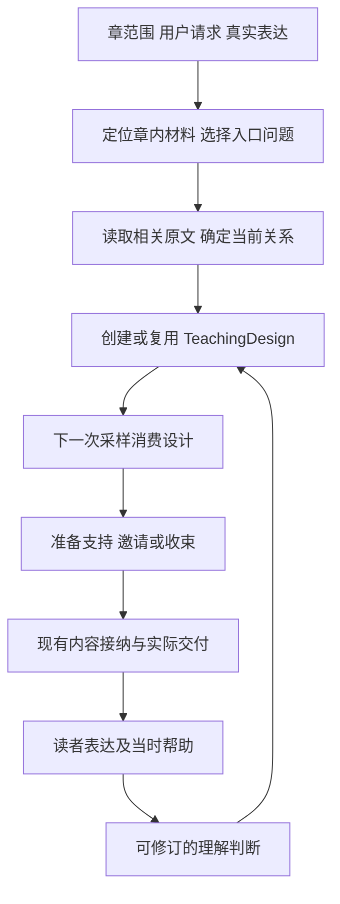

# 章节导读的问题选择与理解进展设计方案

日期：2026-10-17。状态：切片 A、B 已实现并完成对应回归与真实章节验证；切片 C 待真人形成性观察。具体结果见[切片 A 实现与验证](performance/chapter-reading-a-20261017/implementation.md)和[切片 B 实现与验证](performance/chapter-reading-b-20261017/implementation.md)。依据当前工作树，包括尚未提交的教学设计与交付接纳实现。

切片 A、B 已于当日发布至 understandbook.top，见[上线与恢复记录](performance/chapter-reading-b-20261017/deployment/README.md)。

“带我读这一章”的交付目标是：围绕读者此刻值得弄明白的问题，提供有来源、能够使用的支持，再依据读者的实际表达决定如何继续。读者应能知道为什么从这里开始、当前解决了什么，以及还有什么可以接着理解。

本切片复用现有 Resident、TutorSession、TeachingDesign、教学交付和 LearningEvidence。新增的工程连接是明确章节入口、持续传递章节范围，以及让问题选择影响实际交付。理解进展通过真实表达和帮助条件判断；真人效果验证与工程验收分别进行。

## 1 入口与用户可见行为

### 1.1 完整入口

在 Reader 当前章节提供“带我读这一章”操作，显示实际章名。章引用取自规范目录节点；服务端核对来源及节点。Tutor 关闭时，操作明确显示为“开启学习并带我读这一章”，沿现有 SetEnabled、Start 和教学启动链执行。用户完成这一个操作即可开始。

已有同书同章的活动学习会话时沿用它；用户明确恢复同章会话时沿现有 Resume。开始另一章时使用 Start，原会话按现有行为暂停，原设计和记录保留。默认教学意图保持 neutral，由当前请求和可用支持决定是否邀请读者尝试。

`App.vue::startTutorRequest` 共用“启动、刷新状态、提交一次请求”的逻辑：Start/Resume 成功后调用，同章 active 复用分支也直接调用。生命周期操作失败时显示现有失败结果，成功受理后才提交学习请求。

当前 `start_request` 固定返回“请继续本次学习……”，这段文字不会激活现有显式导读识别。章节入口的唯一提交需要使用明确的“带我读《实际章名》这一章”，而非只把章名塞进私有上下文。

为保留操作来源，在现有 `EntryAction` 增加 `GuideChapter`，请求携带 `chapter_lid`；`InteractionInput` 从该节点解析服务端的 `ResolvedInteraction`。其 `accepted_request` 使用实际章名生成上述公开请求，规范化后的模型输入沿现有 `ExplicitGuidedRead` 激活导读工具。`source_bindings` 表示定位范围，`source_excerpt` 与 `target` 留空，实际证据仍由后续原文读取建立。章入口的预设文字记为 UI 请求；用户另写的补充才属于用户原话。Rust 合同与生成的前端类型沿现有流程同步。

自然语言入口按以下语义承接：

| 请求现场 | 行为 |
| --- | --- |
| Tutor 活动，用户明确说“带我读这一章” | 从本次输入冻结的阅读位置解析章范围；同章沿用，无章范围或明确换章时在绑定本轮教学前 Start 章会话 |
| 已有章会话，用户说“继续” | 沿用原章、当前问题与邀请，即使视口已滚动到别章 |
| Tutor 关闭或会话暂停，普通聊天输入“带我读这一章” | 保留现有普通导读行为，并提供同一个显式章节学习入口；完整的设计与理解接续从该入口启动 |
| 用户要求“完整讲解这一章，不要让我作答” | 覆盖其要求的内容，采用直接讲解；问题选择用于组织解释 |
| 来源没有可确定的章边界，或指代同时涉及不同章节 | 先确定具体章；不凭显示章号猜内部 LID |

自然语言章入口复用已有 `ExplicitGuidedRead` 识别，结合实际章节指代和冻结输入解析：优先使用本次请求已有的 `question_anchor_lid`，缺失时回退到 Reader 视口。浏览器实际阅读位置可能不同于服务端窗口中心。普通导读、整书路线和“继续”不会因此统一重建章会话。首版的完整入口覆盖当前章与目录中明确选择的章。

### 1.2 章节范围与局部证据

`TutorSession.material_scope` 已有 `source_id / scope_refs / role`。章入口将规范章容器 LID 放入 primary material 的 `scope_refs`，由该次 Start 持久保存。它表示用户选择的材料范围。已有选区来源范围保持原含义，空范围表示尚未限定章节；章入口保存的规范节点按目录拓扑解析。

`freeze_prepare` 将会话材料范围投影到现有冻结 Tutor 上下文，附上从规范目录取得的章名与边界，供模型解释。范围是定位信息；当前 `TeachingTarget.source_bindings` 和关系块的来源仍只指向本轮真实读过的原文。当前目标可以是一小段，本次阅读的总范围仍是一章。

章节身份使用规范 LID 树。`book.guide_path(at)` 目前仍返回全书路线，`at` 只标记当前位置，不能用它代替章节过滤。首版在章范围内定位问题；必要的章外前提作为明确的补充展开，并保留原问题的返回位置。

章节范围在 Start 前或普通章请求的受理阶段确定，早于本轮 `TurnBound` 与教学快照冻结。开始生成后，日常焦点变化只修订 TeachingDesign，保持 TutorSession 的生命周期版本稳定。

## 2 实施前基础与切片 A 增量

| 实施前基础 | 切片 A 的具体变化 |
| --- | --- |
| 普通导读已有 `reader.state → book.structure → book.guide_path`，随后读原文、跳转、讲一个 stop | 保留定位与取证顺序，在章范围内选择有理解用途的问题；后续可以留在当前关系补帮助或收束 |
| TutorSession 已持久保存材料范围，但普通自动 Start 常为空；冻结上下文未传材料范围 | 章入口填范围，冻结与恢复时将其传给同一 Resident |
| TeachingDesign 已有组织关系、关系用途、焦点、表示、修订与返回引用 | 用这些字段保存已选择的问题、选择理由和当前可行动关系，继续消费同一设计 |
| 教学动作已有准备正文、独立内容接纳和实际交付约束 | 同一次接纳检查交付是否服务于所选问题；继续使用接纳后的正文 |
| LearningEvidence 已关联原话、帮助、设计、关系和下一步影响 | 以同一关系的实际前后表达描述局部进展，保留未知和帮助依赖 |
| 真实多轮 harness 已运行生产教学链，但材料固定为 BookStructure 示例 | 参数化章节材料，加入章节入口及不同读者起点场景 |

导读提示已与活动 Tutor 对齐：其一，进入新的阅读位置才执行读源与 goto，修补当前问题不必每轮换 stop；其二，“没理解”先结合当前表达、已经提供的帮助和有效理解记录决定下一步。只有确实需要前置关系时才使用前置路线，阅读状态本身不证明能力缺口。

源码依据：`crates/runtime/src/agent_prompt.rs:48`、`crates/runtime/src/tool_exposure.rs:435`；`crates/server/src/teaching.rs:395,479`；`crates/memory/src/learning.rs:44,60,165`；`crates/read-tools/src/lib.rs:4992,5052`。

## 3 如何选择值得理解的问题

### 3.1 从章节线索形成候选

Resident 先取得当前章范围、用户请求、明确约束、已有理解和未接完的问题。当前困惑明确时，从这个困惑出发；开放请求则从章节中能解释现象、区分适用条件或改变判断的关系出发。

BookStructure 的章节概述、key stop 的学习理由和相关主题提供候选线索。已有 CognitiveMaterials 可以补充关系步骤、条件和缺口，TeachingMap 可以帮助定位对象。初始 Tutor 对象列表只是有界视图；按需继续读取相关对象。没有这些语义材料时，从规范目录和章内原文建立一个局部入口。

候选以自然问题表达。例如项目书第 6 章可以引出：

- 怎样让导览足够简短，同时保留具体问题可能需要的细节？
- 搜索已经找到了相关材料，为什么还需要查看完整内容和原文？
- 两章讨论同一个主题，为什么不一定构成先后学习依赖？

这三个问题分别服务于信息保留、证据使用和学习路线判断。它们有各自的材料依据，不能合成首轮必须讲完的一份清单。

### 3.2 依据读者的用途作出选择

选题由同一 Resident 判断，候选只在本轮工作上下文中暂存。选择依据要能说明：解决这个问题后，读者能多作出什么有意义的区分，以及为什么现在值得作出这个区分。

用户说“导览没有提到缓存失效，我担心细节被删了”，首先选择信息保留问题。用户说“我知道候选还在，但检索到它以后凭什么采用”，首先选择证据使用问题。用户没有具体目标时，可以从本章最能解释其结构用途、且起步支撑可提供的关系开始，并将其表达为一个可调整的入口。

好奇心也是正当用途。选题可以解释一个令人困惑的现象；系统无需把每个问题都包装成工作收益。用户明确觉得无关、已有基础或更关心别处时，下一次选择随之改变。“已经会了”足以支持换入口，但不自动成为已经掌握的学习证据。

这一选择依赖语义判断。首版将短理由保存在设计的组织关系与块用途里，使后续交付能够消费它；不把相关性、趣味性和重要性换算成统一分数。

### 3.3 读原文后确定可兑现的承诺

结构摘要和学习理由负责找材料。选定的问题及将要解释的关键关系，必须回到章内原文读取。来源中只有条件性结论时，问题和解释保留这些条件；如果原文支持不了预想问题，就缩小承诺或选择另一个有依据的问题。

例如“为什么这个方案永远更好”包含了来源未必支持的前提，可以改成“在本章讨论的条件下，这个方案解决了原方法的什么问题”。这样的调整应发生在交付前。

当章范围已明确、问题与当前读者有关、所需关系有来源且能提供起步支撑时，即可开始第一步。只有会改变选题或支撑方式的疑问才继续检索。已选入口无需先证明是全章唯一最优的问题。

### 3.4 先让读者看见投入的理由

首个交付自然地连接问题、用途和第一份帮助。例如：

> 这一章要处理一个实际矛盾：导览必须简短，后来的具体问题又可能需要被省略的细节。我们先看清“没有放进导览”和“材料已经消失”之间的区别，这会决定你找不到一个条件时应该去哪找。

随后提供能让读者开始理解的具体材料。只有前提已经可用、且确有必要让读者贡献一步判断时，才创建表达邀请。选题问题属于整个解释的方向；它本身不自动成为一道要求读者回答的题。

## 4 如何复用教学设计与交付链

### 4.1 使用现有字段

| 需要保留的内容 | 现有承载 | 后续如何使用 |
| --- | --- | --- |
| 读者希望完成本章阅读的目的与章范围 | `TutorSession.user_intent / material_scope` | 恢复总方向，避免视口变化把阅读目标带走 |
| 这次从什么问题理解本章、为什么有意义 | `TeachingDesign.organizing_model` | 组织解释，判断局部关系是否服务于该问题 |
| 当前希望读者能够作出的判断 | `target.learning_focus / expected_performance` | 确定本轮帮助与观察范围；公开目标不提前泄露邀请答案 |
| 关系及它解决的困难 | `blocks[].relation / purpose / source_bindings` | 选择具体支撑，保留来源与适用条件 |
| 本轮正在处理哪一块 | `focus_block_refs` | 约束动作和演示范围；相邻内容留待后续选择 |
| 选择依据与修订原因 | `basis_refs / revision_reason / previous_ref` | 回指实际请求、有效理解和使用事实，解释为何改变入口 |
| 真实追问和支线返回点 | `open_question_refs / return_to` | 接住读者问题后回到原关系或确切现场 |
| 文字或演示为何有帮助 | `representation` | 决定支持形式，演示还需明确可观察关系 |

`open_question_refs` 只引用真实读者问题的事实，不能装入模型自己生成的候选。未被选择的问题不成为用户的学习欠账。关系含义不变时保留 block ID，换一种表述或表示无需另造关系身份。

设计保留当前可行动和有接续价值的关系。每个声明的来源范围仍按现有接纳规则完整读过；不为表示全章覆盖而提前塞入整章关系和来源。

### 4.2 依赖关系

这是依赖关系。已经适用的设计直接复用；有了新的相关事实才修订。新设计接纳后先进入后续采样，再选择动作或制作内容。模型完成本轮回答时可以结束当前请求，TutorSession 继续保留章学习关系。

`TeachingMove.participation` 决定本轮实际工作：support 补足一个需要的连接；invite 留下前提充分、尚未代答的一步；conclude 回应已经足够的表达或完成当前请求。用户要求完整讲解时，交付其要求的内容。单个问题解决后，只记录该问题的进展，不能据此宣布整章已经读完或掌握。

### 4.3 复用现有内容接纳

当前 `review_delivery` 已经独立读取原请求、冻结输入、理解工作视图、完整 current_design、准备交付的正文与邀请，以及确切页面内容。在同一次调用中补充一个具体判断：这份支持是否兑现了设计中选择的问题和用途。

应退回的情况包括：设计选择了一个关系，正文却变成相邻术语清单；承诺解释一个现象，却缺少必要连接；用户明确改变用途后，正文仍继续旧问题。接纳理由需要指出实际不匹配。存在其他同样合理的选题，不构成退回当前选题的理由。

现有 `delivery_text → 内容接纳 → 持久化选择 → 实际交付` 链继续负责交付一致性。内容接纳中的来源字段只是已呈现来源绑定及预览，完整原文准确性由真实取证和内容核对承担。

源码依据：`crates/memory/src/teaching_design.rs:47`；`crates/server/src/teaching/design.rs:31,81`；`crates/runtime/src/tutor.rs:118,446,453,564`；`crates/runtime/src/orchestrator.rs:6908`。

## 5 用项目书第六章走通一次

材料为[全书结构与语义候选召回](project-book/chapters/06-全书结构与语义候选召回.md)。书籍导入后的章 LID 由规范目录解析，示例不把显示章号当作 LID。

### 5.1 首次进入

读者说：“带我读这一章。我知道系统会做摘要，但不明白为什么还要留那么多候选。”

选择的问题是“怎样让导览简短，同时保留以后可能需要的细节”。当前目标收窄为：能区分缩短导览与删除底层材料，并据此判断一次新的细节查找应该从哪里开始。

`organizing_model` 保存这个问题及用途；第一块关系保存“保存的材料与为某个用途挑选的材料属于不同集合”。首轮用章中缓存材料的一个具体对照提供支撑，只解释当前需要的连接。表示可以是一张并列表；当读者仍无法追踪同一材料在不同视图中的位置时，再选择保持对象身份的演示。

### 5.2 三种回应带来三种后续

| 真实回应 | 如何承接 |
| --- | --- |
| “我还是觉得，没进导览就说明后面没有它了。” | 回到同一份材料，指出保存位置与导览选择的区别；理解判断只记录这一个混淆 |
| “我明白材料还在。我想知道搜到它以后怎么判断能不能用于主题。” | 将问题转为证据使用，读相关原文并修订焦点；保留旧关系身份和返回位置 |
| “所以换一个用途，要重新看保留下来的材料，不能只沿用之前的短名单。” | 肯定这次对用途与选择关系的表达，视当前请求进入下一关系或收束；能否用于新的判断，另看实际表现 |

若要安排一个新的应用，应先明确改变的是哪个条件、哪些前提保持不变。例如提供一个新的使用目标，让读者从仍保留的几份材料中选出需要重新查看的对象，并说明原导览为什么不足以决定这次选择。具体材料必须让答案可由已提供的关系推得，不能只把刚展示的答案换一个对象名字。

“被章节选择”“进入宏观路线”“被主题使用”各自有独立条件。当前只建立其中一个区别时，不能突然用另一个区别来判定读者是否理解。下一关系进入支持前，需要自己的材料和支撑。

### 5.3 保留可用的进展

普通表达继续通过 `tutor.step evidence` 写入 `nature=hypothesis`。解释引用原话、design/block 和当时帮助，并说明下一步因此怎样改变。例如：

> 在已经提供保存集合与导览选择的对照后，读者提出新用途应重新查看保留材料，理由是旧短名单不能代表新用途。可以据此继续讨论选用依据；尚未观察他如何判断某段材料是否足以支持主题。

如果之前有明确的相反表达，才能描述这两次表现之间的变化。没有前面的表现时，记录这次观察到的能力范围。反馈可以把这个具体变化告诉读者，帮助他知道自己究竟多理解了什么。

## 6 如何验证理解进展

### 6.1 工程回归

每项检查检测一个会改变实际行为的失败。已有测试可以覆盖的部分直接复用。

| 检测的失败 | 验证输入与观察 | 失败后修改哪里 |
| --- | --- | --- |
| 入口显示已开始，实际却仍处于 observing 或重复发送首问 | Tutor off 点击明确章入口；检查 enabled、active、唯一首问及 design/select 可见性 | 入口与既有生命周期、自动提交链 |
| 视口变化把“继续”带到别章 | 从 A 章开始，滚动 B 章后继续并重开聊天；章范围仍为 A，局部焦点可恢复 | 材料范围写入、冻结和恢复投影 |
| 将整章范围当成已读来源 | 只读选题所需段落；设计使用这些原文，章定位仍独立保留 | scope 与 Target 的职责边界 |
| 导读路线强迫已经卡住的读者换 stop | 保持同一困惑后继续；支持留在该关系，新位置才按读源与 goto 链执行 | NAVIGATION 与 Tutor 的选择规则 |
| 设计没有进入生成，退回稿或自由终答又代答 | 复用设计先消费、接纳后交付及修订回归 | 设计消费或交付链 |
| 后来的帮助污染早先表达，或点击变成理解事实 | 复用普通表达冻结帮助、页面帮助及纠正回归 | LearningEvidence 与真实事实的绑定 |

主要复用 `crates/runtime/src/teaching_design_loop_tests.rs`、`crates/server/src/tests/teaching_design_tests.rs` 和 `orchestrator.rs` 中已有的 guided_read 场景。界面入口测试检查章名、生命周期结果及唯一提交；不通过界面测试推断教学质量。

### 6.2 真实模型行为验证

参数化现有 `teaching_design_live_subagent_conversation` 的章节 fixture，沿真实 prepare、execute_prepared、持久化与交付记录运行。教师使用实际生产模型配置；隔离的模拟读者只取得实际显示的内容。实验保留来源、章范围、实际设计、交付正文、邀请、帮助条件、读者原话和完整用量。

同一真实章节覆盖三个起点：第一次接触；已有基础但用途尚不明确；带着一个具体困惑。继续观察换问题、暂时卡住、要求完整讲解和自然结束等分支。场景预先确定输入与关注的失败，读者后续如何回应由实际交付决定。

内容审阅依据原文、读者起点与可见对话，分别给出具体判断：选题是否与这个读者有关，解释是否有来源，必要前提是否已提供，用户需要完成的判断是否已经被讲解或页面代答，以及用户表达是否改变了下一步。原来已经成立的替代选题同样可以通过。

运行出现内容错误或不可用支撑时，保留失败记录，修改对应机制，然后重跑该失败与受影响场景。首轮验证选择一个具备完整来源的真实章；另外保留缺少 BookStructure 的局部导读路径，确认可选素材缺失不造成虚假的“无法学习”。

通过此阶段说明生产链能够实施这种教学选择。模拟读者的正确回答是行为材料；真人学习效果由下一阶段观察。

### 6.3 真人形成性验证

首批招募 6–8 名目标读者，包含上述不同起点。这是发现体验与教学问题的首批规模。参与者读同一真实章节，保留自然表达，并允许换方向、求助或结束。

开始前用一个简短情境了解其原有判断及理由，或采用其已经自发表达的困惑。结束后使用一个讲解没有完成过的同关系变式，观察他能否解释决定性条件。前后任务有相同的关系要求和相近难度，但后任务不能由抄写刚交付的结论完成。是否提供提示、是否查看原文和是否已经看到结果均按实际记录。

预先准备多个关系的可比任务对；真正评估哪一个，取决于本次实际学习的关系。若中途换题而没有相应的前表现，报告后表现，不据此声称发生了前后提升。读者原先已经会的关系也不能算作新增理解。

“保存与选择”关系可先试用下面的任务对。字母及变更情境为教学构造，关系依据来自第六章。

| 时点 | 任务 | 需要观察的理由 |
| --- | --- | --- |
| 阅读前 | 昨天的宏观路线有甲、乙、丙，今天只有甲、丙。变更记录只写“缩短路线”。有人据此说乙对应的候选和正文也被删除。仅凭路线能作这个判断吗？需要查看什么？ | 能否区分路线缺席与底层材料存在，提出查看候选目录及原文 |
| 阅读后 | 旧路线有丁、己，新路线有丁、戊、己。有人说戊肯定是本次重新读取原文才发现的。仅凭新增路线项能支持这个说法吗？怎样区分重新选用旧材料与新增候选？ | 能否把保存与选择的关系用于相反方向，提出比较旧候选目录与本次材料记录 |

后任务从“少了是否等于删除”换成“多了是否等于新发现”，用于观察同关系的近距离应用。任务难度及额外背景负担由形成性试用检查；正式对照的两组使用相同安排。后任务保留在实验侧，教师看不到题目及判断要点；若实际讲解已完整回答相同判断，该题就不能提供未代答应用的证据，应如实记录并使用预先准备的另一项。

每位读者保留一条可复核的证据链：原先怎样解释，收到什么帮助，后来如何处理新的条件。内容判断采用自然语言说明：出现了此前没有的正确连接；某个连接仍未建立；原先已经会；或表达不足以判断。普通产品对话保持现有 hypothesis 记录，研究记录单独保存材料与判断，不写成总掌握分。

例如前面把“未进入导览”解释成“材料不存在”，后面能在新用途下找到应重新查看的保留材料，并说明选择条件变化，支持观察到该关系的局部进展。只有“挺有意思”“懂了”或选择继续，支持的是体验与意愿方面的反馈。

首批结束后，根据逐例材料决定下一步。若主要问题是入口不相关或读者无法开始，就先修选题和支撑；若不同起点都能进入有来源的解释并出现可解释的局部表现，再冻结候选，决定是否投入对照研究。人数达到预设数量本身不构成通过。

### 6.4 如何判断新切片带来的净收益

前后出现进展，仍可能包含材料本身、重复尝试和其他帮助的作用。需要声称本切片比原导读更有效时，使用同章、不同读者的随机对照。

保留同一当前实现的基线和完成本切片的候选。两组使用相同来源、生产模型与可用学习时间，并记录实际帮助、模型用量和等待；按起点分层分配。独立审阅者在不知道组别的条件下判断未被代答的新情境解释。预先固定共同的章级判断任务及可接受理由，避免新方案自行选择容易目标后只按自己选出的目标报成功；实际所学关系的局部表现另行报告。

形成性结果用于估计任务难度、合理时间及值得投入的改善幅度，随后确定样本需求。结果用于决定是否推广切片；不能区分两种方案时，报告尚未证明改善。需要判断保持效果时，再安排延迟应用。

### 6.5 沿用已有验证资产

- `crates/server/src/tests/teaching_design_live_tests.rs`：真实教学入口，已支持 `TEACHING_LIVE_BOOK_DIR` 读取规范章节材料，未设置时继续使用原 fixture。
- `crates/runtime/src/teaching_design_loop_tests.rs:146,272,387`：设计消费、已接纳正文交付和退回修订。
- `crates/server/src/tests/teaching_design_tests.rs:261,352,451,491,519`：局部目标、返回上下文、输入时帮助冻结、理解纠正与页面帮助。
- `crates/runtime/src/orchestrator.rs:14455` 附近：现有“带我读这一章”、导读继续、无结构与普通总结的路径回归。
- [教学交付闭环记录](performance/teaching-handoff-20261017/implementation.md)：保留过早引入相邻条件的失败与之后的实际修订，作为内容回归材料。

真实多轮测试沿用已有入口：`cargo test -p server --lib teaching_design_live_subagent_conversation -- --ignored --nocapture`。实际执行前指定新的 `TEACHING_LIVE_OUTPUT` 和本切片章节输入，使用已授权的模型预算。

## 7 实施顺序与完成条件

### 切片 A 章节范围与第一个问题

已完成。章节入口、范围持久化、问题设计与实际交付经过工程回归及三个 gpt-6.1-sol 真实首轮验证。回归还补齐了首问结束后的“继续”、暂停状态和浏览器入场位置语义，详见[实现与验证记录](performance/chapter-reading-a-20261017/implementation.md)。

接通 Reader 章入口、既有 Tutor 生命周期、章节范围持久化和冻结投影；协调 NAVIGATION 与 Tutor DESIGN/SELECT；使用现有字段组织选题并交付第一份支持。文字和已有简单对照足以表达时直接使用。

主要接点：`packages/web/src/App.vue::tutorAction` 与现有章导航 UI；`crates/runtime/src/tutor_continuation.rs::EntryAction`、`crates/server/src/interaction_input.rs` 及其规范化输入；`crates/server/src/teaching.rs::freeze_prepare / start_request`；`crates/runtime/src/agent_prompt.rs::NAVIGATION`；`crates/runtime/src/tutor.rs::design_input_schema / DESIGN / SELECT / review_delivery`。memory 继续使用现有 TutorSession 与 TeachingDesign 格式。

完成条件：实际章入口只启动一次，章范围在继续和重开后保持；第一份交付能说明所选问题的用途、提供有来源的起步关系；不同读者起点能够导致有理由的不同入口。工程回归与真实章节首轮内容一起验收。

### 切片 B 根据实际表达推进

已完成。现有工作视图补上每份实际帮助所回应的先前表达，与得到帮助后的表达并列保存原话引用和各自冻结的帮助条件；新的局部表现追加理解假设，纠正原解释才使用替代。38 项相关工程回归通过，五轮真实章节对话验证了卡点变化、未代答变式、换问题、完整直讲及保留未知的结束。详见[切片 B 实现与验证](performance/chapter-reading-b-20261017/implementation.md)。

沿现有真实表达、帮助关联和理解更新完成多轮章阅读。补齐发生在本切片场景中的具体接续缺口，验证卡住时换支撑、换问题时修订焦点、充分时结束局部工作。已有演示能够帮助追踪对象时复用其现场。

主要接点：`crates/server/src/teaching/design.rs` 的工作视图与返回上下文、现有 LearningEvidence、TeachingMove 和最终交付链。真实模型实验参数化沿用已有 live harness。

完成条件：读者的不同表达导致内容上不同的下一步；证据保留原话和当时帮助；问题推进没有被固定轮数、路线位置或术语覆盖驱动；已知来源错误和代答失败得到解决。

### 切片 C 观察真人理解并决定推广

完成首批真人形成性验证，逐例交付前表现、帮助与后表现。根据实际失败修订问题选择或支撑。需要比较原导读与新切片时，再执行预先约定的对照研究。

完成条件：能够说明哪些读者在哪些关系上出现了什么变化、哪些没有，以及下一步应该改什么。推广判断依据实际结果和成本，不由模型自评或一次接纳成功代替。

## 8 已知限制与代价

当前真实教学记录主要来自模型模拟，支持即时区分和紧贴讲解的应用；尚没有这个章节切片的真人学习与保持结果。正式效果结论以第 6 节实际执行所得为准。

现有每次新 select 已有一次独立内容接纳调用，修订会增加调用和等待。本切片复用该调用；选择新的原文、修订设计和更换表示仍可能增加成本，实验同时记录首次可用支持耗时、完整用量与失败调用。

公共结构与学习材料提供候选，不保证覆盖了所有值得理解的问题。缺少可选语义材料可以从原文建立局部入口；来源本身不完整或章边界无法确定时，需要先解决该具体输入问题。

关闭 Tutor 的普通导读仍有独立行为。首版通过明确章学习入口进入完整 TeachingDesign 链；是否进一步让任意自然语言章请求直接改变 Tutor 开关，属于后续单独的产品行为决定。
