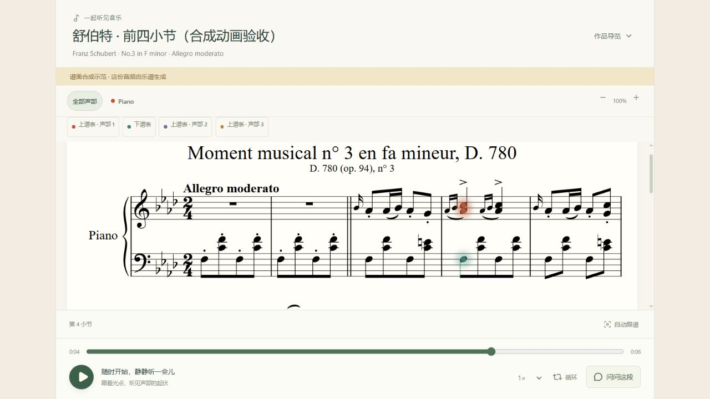

# 音乐预构建与交互伴听：实施验收

日期：2026-10-22。关联：[ADR-0175](adr/0175-curated-music-prebuild-and-guided-listening.md)、[实施切片](切片方案-音乐预构建与交互伴听.md)。

## 当前结论

2026-11-03：贝九当前构建改用 Tennstedt 1992 四乐章存档与用户视频音轨，Coates 选段及其成果弃用。本机预构建、327 页完整总谱、104 个导航节点、352 个精选材料区域及 547 次唱词出现已落地；逐音候选保持待核。入口、验证与限制见[本轮贝九记录](performance/beethoven9-tennstedt-20261103/README.md)。本文后续保留早期实验过程。

音乐资料合同、真实录音与 MusicXML 导入、Verovio 谱面、图形校准、来源化音乐事件、播放器、Agent 工具及运营构建已实现。实际媒体、校准保存、共享发布和示范/原声切换已验证；真实模型完成过首轮教学交付，完整四轮仍未通过。首批内容与教学体验的验收不能标记完成，具体缺口集中在本文最后一节。

## 实际输入与产物

### 2026-10-23 谱面事实补全与舒伯特重新发布

针对“只有音高、时值与休止，调性和速度先待核”的实际回答，补齐 `parseMusicScore → music_source_manifest → music.read → source.present → 来源回看`。新增 5 条原谱声明（调号、2/4 拍号、Allegro moderato 及两处 dim.），中间小节读取保留适用的先前声明，引用携带声明原位置及出处。作品调性有独立的 `work.tonality` 核对结论，原 MusicXML `mode=major` 和源文件不改写；[核对记录](../evals/music/schubert-tonality.json)确认 F 小调。`sound tempo=80` 明确为文件播放参数。

以最新已发布校准 `01a1646d-2408-7e21-acd7-9d3853666c29` 为输入，经原构建／发布器生成 `01a166d8-fabf-73d2-9502-4bf3d55da1b7`，位于本地 `music-acceptance-service` 资料库。[重建比对](../evals/music/results/score-facts-20261023/rebuild.json)确认 1066 个谱对象、1059 条对齐、78 个演奏出现、19 个 unobserved 标记、既有覆盖／事件／示范保持一致；原谱、录音、导读和示范字节相同。

Core 18 项、read-tools 5 项、Runtime 3 项、Server 19 项通过；Core/Web 类型检查、Rust 音乐绑定导出及服务端／发布器构建通过。另一受支持的贝九选段提取 58 个声明、1249 个谱对象，并通过合同校验。

工具契约文档已同步实际注册定义。首次生成的重复编译遇到 LLVM 内存不足，随后使用本轮已成功编译的 Server/Runtime 测试二进制执行原导出入口，两项导出测试通过，沿原生成器产出文档；见[生成记录](../evals/music/results/score-facts-20261023/tool-docs-prebuilt.log)。

一次真实 `deepseek-v4-flash` Reader 联测通过：4 次模型请求、130875 tokens、约 28.1 秒。模型实际调用概览、谱面读取、标记文字搜索及 `source.present`，明确回答 F 小调、2/4、Allegro moderato，并解释原编码与作品调性的区别。生成的一个引用固定新发布，包含三条开头声明、调性核对 provenance 和原谱页。重启后来源解析仍成功，原 SVG 请求为 200、`image/svg+xml`。

证据：[真实回答](../evals/music/results/score-facts-20261023/live-01/answer.md)、[联测报告](../evals/music/results/score-facts-20261023/live-01/report.json)、[来源快照](../evals/music/results/score-facts-20261023/live-01/sources.json)、[重启回看](../evals/music/results/score-facts-20261023/preview.json)、[发布记录](../evals/music/results/score-facts-20261023/publication.json)。联测入口为 `evals/music/score-facts-live.mjs`，重建入口为 `evals/music/rebuild-score-facts.mjs`。

以下保留首轮音乐伴听验收及历史输入记录。

| 样本 | 实际材料 | 构建结果 | 可声明的范围 |
| --- | --- | --- | --- |
| 舒伯特《音乐瞬间》第 3 首 | Harald Vetter 真人钢琴录音，101.041633 秒；Noctave MusicXML，78 小节 | 1,066 个谱对象、3 页 SVG、3 个谱面依据事件及合成示范 | 可播放、查谱、选择钢琴上下谱表声部、查看事件和比较材料；真实录音对齐待校准 |
| 贝九第四乐章选段 | Coates 1923 演奏的现代转录，完整乐章 1,448.85551 秒；OpenScore/Hauptstimme 总谱派生第 93–164 小节 | 72 小节、6 个实际参与声部、1,249 个谱对象、17 页 SVG；保留完整录音时间轴和选段外导航 | 本机实验材料；选段三次主题呈现有谱面依据，录音候选约 171.572–289.469 秒 |
| 动画验收夹具 | 同一舒伯特 MusicXML 前 4 小节的谱面合成 WAV | 38 音，6,150.0227 ms，使用生成器实际时轴 | 验证同时音、尾迹、缩放及跟随；界面明确显示“谱面合成示范” |

真实文件、来源与许可依据见 [样本说明](../evals/music/README.md)、[舒伯特 curation](../evals/music/schubert-curation.json)、[贝九 curation](../evals/music/beethoven-curation.json)。作品、录音、谱本、现代转录和分析标注分别记录。用户提供的参考视频用于观察视觉形式。

## 已落实现

### 预构建与来源

- `music_source_manifest.v1` 分别记录作品、谱本、具体录音、乐器/乐器组、内部声部、演奏出现、音符对应、精度覆盖、事件及依据。同一谱位的多次演奏有不同 occurrence。
- 原音频与 MusicXML 保存为资料来源；SVG 位置通过稳定谱对象 ID 关联。原录音或原谱字节改变时建立新资料；重新校准和重排可产生同源新发布，旧引用保留原发布。
- 构建实际执行媒体探测及完整解码、MusicXML 解析、Verovio 排谱、谱面合成示范。固定作品导读作为现有 Book 基座，音乐语义与位置存入音乐合同。
- 校准修订保存前后范围及依据，保留未受影响的成果，重建时重放已接纳修订。谱面事件的播放窗口绑定演奏出现，相关校准更新事件与对应段落；真实音频证据仍保留原区间。
- 本地未发布音乐工作区提供图形校准入口：对照原录音和谱面，选择演奏出现与音符、调整时间点、记录理由和依据，再通过现有 Engine 保存修订。已发布目录保持只读；本机材料的校准不改变其分发许可。
- Verovio 6.3.0 由服务端预渲染。编译 Engine 使用相邻、可替换的库资源，并提供许可、对应源码及替换说明；谱面字体 Leipzig 的 OFL 及署名随产物保存。

### 伴听与学习

- MusicReaderPane 从实际播放器时间计算音符高亮、彩色光点与短尾迹；支持暂停、拖动、倍速、循环、缩放、手动查谱和返回播放位置。未接纳对齐区间显示校准状态。
- 同一钢琴的上下谱表可分别关注；整件乐器选择与具体声部选择取并集。当前问题冻结录音区间、谱面与声部，后续播放位置改变时仍可回到原问题。
- `music.read` 提供可分页的概览、事件及谱对象；`music.interact` 使用 observe → act 和浏览器 claim → complete 回执。读取预构建数据返回 `heard_audio=false`，浏览器认领也不会被算作播放完成。
- 来源弹窗保存并回看原发布的音频与谱页；教学目标、笔记、私人理解、历史上下文及系统教练接收同一音乐来源定位。沿用现有逐轮教练与费用归属。
- 当前音乐场景直接提供读取和播放工具；实际操作请求与浏览器回执进入交付审阅。引用的证据区间与实际播放区间分别表达，读取来源不能充当播放证据。来源对象列表按集合比较，版本、范围和成员仍必须来自本轮实际读取。
- 原录音与谱面合成示范保留各自的播放时钟。原声的 `current_ms/paused` 不随示范切换含义，示范状态由 `demonstration_state` 返回；恢复原声会结束示范，暂停会停止双方。
- 播放动作可选择本轮已读事件的 `cue_event_id`。界面在声音开始前显示该事件的 `listen_for`，回执确认实际显示的原文；服务端验证提示与发布材料一致。完整动态讲解仍沿现有教学准备和审阅流程。

### 运营与发布

后台运营入口选择音乐资料与 curation 路径，沿现有 Build Engine 计划、预算、进度、恢复及发布。发布能力区分 `music`、`music_score`、`music_events` 与 `music_note_alignment`。缺逐音符能力的样本不会因导入成功获得该能力。

公开发布检查所分发录音、谱本及其他素材的使用依据；共享音频、SVG 和示范沿资料授权读取。多用户复用公共资料，私人目标、聊天与理解继续归各自工作区。

## 验证证据

| 层次 | 已执行的验证 | 证据 |
| --- | --- | --- |
| 合同 | Rust 36 项类型导出、10 项行为和 TypeScript 10 项行为通过；覆盖稳定来源、重复出现、和弦、覆盖缺口、声部/主题归属和旧 JSON | `crates/base-schema/tests/music_contract.rs`；`packages/core/src/music-contract.test.ts` |
| 核心构建 | 10 项通过：真实 FFmpeg 解码与 Verovio、谱对象到 SVG 映射、移调/装饰/延音、重建/校准保留、事件随校准更新及原源修改拒绝；类型检查通过 | `packages/core/src/music-*.test.ts` |
| 读时 | memory 3、read-tools 4 项通过；最新 runtime 11 项通过，覆盖已读来源约束、实际动作、重复出现、取证进展、双播放器时钟及本轮已读提示 | 各 crate 的 music 测试 |
| 服务端 | 最新 16 项通过：资料授权与旧版本、媒体 Range/HEAD、动作回执、冻结问题、私人学习及费用归属，以及校准和独立示范时钟/提示校验 | `crates/server/src/tests/music_*` 及现有运营/教学测试 |
| 播放界面 | 真实录音桌面 1280×720 与手机 390×844；播放、0.75 倍速、循环、提问暂停与冻结 | [界面操作记录](../evals/music/results/ui-verification.md) |
| 动画 | 合成时轴 4.7 秒同时标记上方两音和弦与低音；125% 缩放、手动跟随恢复、手机横向定位和短尾迹 | 同上及下方截图 |
| 播放前提示与示范 | 真实发布素材与 Reader 组件在 Chromium 中完成 9 个动作；提示实际先显示后播放、两路时钟独立、示范中提问暂停双方、原声播放退出示范、手动调速清提示。命令传输使用浏览器测试适配器，完整模型/服务端链路另验 | [浏览器证据](../evals/music/results/music-playback-cue-ui.json) |
| 安装态 Engine | 在源码外运行，替换 Verovio 库触发实际失败，恢复后继续构建；要求未就绪逐音符能力时保留已完成清单 | [安装态证据](performance/music-operator-20261022/installed-engine-verification.json) |
| 校准命令 | 源码与独立安装 Engine 均保存真实舒伯特副本的候选、追加历史并保留音频；pending 保持原状态，已发布目录拒绝保存且原成果不变 | [校准 Engine 证据](performance/music-operator-20261022/calibration-engine-verification.json) |
| 校准服务 | 两份真实素材完成音频 Range、谱页、保存及刷新；缺音符的接纳与错源写入被拒绝，失败不丢已有成果，已发布目录不可写。另有 2 项 Rust 回归覆盖相对工作区路径及真实 Core 保存 | [舒伯特 HTTP](performance/music-calibration-20261022/schubert-http.json)、[贝九 HTTP](performance/music-calibration-20261022/beethoven-http.json) |
| 校准界面 | 舒伯特与贝九真实资料在桌面和 390 像素宽度下完成原声 0.75× 播放、谱面选择、共享边界编辑与放弃、pending 保存、刷新历史，以及 LocalApp 关闭后重开；无页面错误或水平溢出 | [舒伯特 UI](../evals/music/results/music-calibration-schubert-ui.json)、[贝九 UI](../evals/music/results/music-calibration-beethoven-ui.json) |
| 校准重建 | 两份经浏览器保存的工作区从原 curation 重建，历史、演奏出现、音符对应、覆盖、事件、结构及原音频保持一致；耗时 7.268 秒／8.907 秒，候选仍为 pending | [重建重放证据](performance/music-calibration-20261022/rebuild-replay.json) |
| 切换校准材料 | 经真实 App 关闭、切材料和重开，舒伯特约 101 秒变为贝九约 1,449 秒，再切回；标题、谱本与录音一致，旧资源 URL 拒绝读取，普通资料切到音乐后出现校准入口 | [工作区切换证据](../evals/music/results/music-calibration-workspace-switch.json) |
| 后台界面 | 1440 和 390 宽度下实际创建音乐任务、直接启动与进度；Admin 18 项测试、类型及生产构建通过 | [后台证据](performance/music-operator-20261022/README.md) |
| 真实共享链路 | 创建 → 谱面完成后暂停 → 销毁/重建宿主 → 同一 invocation 继续 → 在线导入 → 共享发布 ready；A/B 各自创建私人工作区，A 改目标不影响 B，音频 Range 均为 206/32 字节且 SVG 可读 | [实际 HTTP 验收](performance/music-operator-20261022/http-acceptance-result.json) |

实际音频实验使用 STFT 色度/低音特征和 DTW。舒伯特全曲耗时 10.862 秒；错谱六半音的平均匹配代价从 0.4576 增至 0.5677。贝九选段子序列匹配耗时 2.597 秒。两者证明算法使用了本录音的音高内容；起音误差仍需独立参考标签。完整分析及图示观察见样本说明。

真实运营测试的模型调用、供应商成本、用户扣费和调用账本均为 0；第二位用户进入时没有新增公共构建任务。恢复保留原媒体、成果清单和已保存校准，本地解码与排谱会重新执行。当前发布能力为 `music/music_score/music_events`，逐音符能力为 false。

早期统一 Rust 检查 `cargo test -p memory -p read-tools -p runtime -p server --lib music` 共 25 项通过；此后根据新发现的失败补充定向测试，最新结果如下。同源新发布沿用既有授权继承规则，已经打开的工作区和来源仍绑定各自明确的 publication。

针对真实联测发现的问题，Runtime 的音乐定向测试增至 11 项并通过；内部审阅判定相关 13 项通过，另 1 项要求外部探针目录的已有测试保持忽略。Server 音乐定向 16 项通过。前端最后播放器及动作分派 18 项测试、类型检查和生产构建通过；此前校准相关测试、音乐文案适配相关 85 项组件测试通过。最终前端为 2,228 个模块，Engine 为 608 个模块；实际校准全过程见[校准验收记录](performance/music-calibration-20261022/README.md)。

第五次联测后，新增“退回修订不能同时提示已接纳”的单项 Runtime 回归通过。完整 move 修稿所需字段、`direct_explanation` 对应 `kind=explain`，以及示范与原声保持同一聆听目标的工具说明已修正。工具契约文档已重新生成：51 个 Resident 工具、17 个本地 MCP、12 个远程 MCP、4 个 Executor 工具及 17 个 Tutor 状态。说明修订没有新增工具字段，不以编译或单元测试冒充模型行为验证。

最后 `cargo build -p server --bin server --bin publish_book` 通过，包含上述最后指导修订。本机预览 `http://127.0.0.1:6677/` 使用最终二进制、第二版生产前端 `reader-DDJl87jm.js` 和新发布 `01a1625b-808a-77d2-9cfb-1ecc62bd219f`；独立预览学习空间避免已有工作区继续固定旧发布。API 已确认新提示、3 页谱面及 101041.633 ms 原声，实际 App 无页面错误。

校准预听原先依赖原生 `timeupdate`，实际 1.820 秒边界约在 2.021 秒才触发回跳；改用播放器逐帧时钟后，同一边界实测在 1.822831 秒触发，回到 0.580 秒。这是该浏览器运行的一次实际边界测量，未将它写成跨设备精度保证。暂停及卸载会停止调度；该变化只改善复听边界，不把候选时间升级为已听核时间。



[连续动画录屏](../evals/music/results/music-synthesis-animation-screenrecord.mp4) 长 10.08 秒，来自真实浏览器连续帧。画面采用前 4 小节的谱面合成时轴，录屏无声。它用于观察多音高亮、尾迹和跟随，不作为原演奏同步精度的证据。

### 乐谱空间与界面第二版（2026-10-22）

页面以暖白谱纸为主体，收紧标题和工具栏；声部、音乐作用与作品导览按需展开，墨绿播放条集中承载播放、进度、速度、循环和提问。全屏看谱后提问会暂停音乐并退出全屏，显示工作区提问区；手机保留手动浏览后的跟谱恢复按钮。

同一 Reader 预览、同一资料、无活动提示或展开面板时，乐谱可见区域占 Reader 高度的实测对比如下。这是界面空间测量，不是同步精度或学习效果指标。

| 视口 | 调整前 | 调整后 |
| --- | --- | --- |
| 1500×1000 | 581.6 px / 58.2% | 810.3 px / 81.0% |
| 1280×720 | 301.6 px / 41.9% | 530.3 px / 73.7% |
| 390×844 | 380.2 px / 45.0% | 643.0 px / 76.2% |

真实 Chromium 已检查舒伯特合成动画、原录音与示范、贝九 17 页 / 6 声部；操作覆盖实际播放、调速、缩放、声部聚焦、手机跟谱恢复、全屏、提问和返回。播放器 / 动作分派 / 角色相关 20 项测试、类型检查和生产构建通过；播放前提示与双时钟的 9 个浏览器动作继续通过。全屏提问回归先在实际 App 复现“退出全屏超时”，修复后由同一脚本验证。

复现入口：`node evals/music/score-space-ui.mjs --phase after --interactions`（本地 Vite 4193）；生产 App 使用 `--published`（6677）。[前后测量与截图](../evals/music/results/score-space-v2/)、[交互记录](../evals/music/results/score-space-v2/after.json)、[完整 App 记录](../evals/music/results/score-space-v2/published.json)、[提示与示范记录](../evals/music/results/score-space-v2/cue-music-playback-cue-ui.json)。

### 真实模型验证

使用现有配置的 `deepseek-v4-flash`、真实 Provider、生产 Reader 和实际发布。学习者表达由脚本模拟，播放器回执、来源和教练为真实调用；不据此推断真人听觉或学习成效。各次记录分别保存，失败不覆盖。

| 运行 | 完整最终交付 | 实际调用 / tokens | 结果及原始记录 |
| --- | --- | --- | --- |
| 01 | 0 轮 | 19 / 1,450,564 | 交互工具未直接暴露、来源数组顺序误拒、审阅混淆引用和播放；[复盘](../evals/semantic/quality-results/music-listening-20261022-schubert-01/semantic-review.md) |
| 02 | 0 轮 | 10 / 408,916 | 原声播放成功，播放器状态未计入进展而提前收尾；收尾遗漏音乐证据；[复盘](../evals/semantic/quality-results/music-listening-20261022-schubert-02/semantic-review.md) |
| 03 | 0 轮 | 17 / 977,332 | 实际播放和交付审阅均成功；内部额外字段触发重审，接纳后继续非阻塞润色，最终超过 480 秒时限；[复盘](../evals/semantic/quality-results/music-listening-20261022-schubert-03/semantic-review.md) |
| 04 | 1 轮 | 17 / 930,660 | 首轮 169.5 秒完成；第二轮示范回执混用了原声与示范时钟，出现 409 后主动取消；[复盘](../evals/semantic/quality-results/music-listening-20261022-schubert-04/semantic-review.md) |
| 05 | 1 轮 | 29 / 1,806,215 | 首轮 208.4 秒完成；第二轮真实示范与返回原声成功，但讲解顺序仍被退回，422.1 秒后交付 incomplete 材料摘录；第 3、4 轮未启动；[复盘](../evals/semantic/quality-results/music-listening-20261022-schubert-05/semantic-review.md) |

前三次具体故障已形成通过的回归测试。内部审阅保留必需字段、枚举与精确引文验证，忽略未使用的额外字段；接纳后优先交付已通过的正文。工具明确单次试听与循环恢复的不同语义。第四次暴露的双播放器时钟问题已通过定向回归，并在第五次真实模型路径完成示范播放、观察和返回原声，未重现 409。

第四次首轮在 68.9 秒开始试听，最终解释比播放晚约 100.6 秒，先前的进度说明没有提供听觉关注。新增的播放前事件提示专门补足这一顺序；它复用已发布编选内容，不将未审阅的模型正文塞入进度消息。该次运行的两次自动教练均完成，第二轮实际消费了首轮教练指导；仍不代表完整四轮或真实学习验收通过。

第五次首轮在提交后 158.5 秒开始带提示播放 580–5420 ms 原声，实际来源解析返回原 publication、recording 与谱对象。第二轮原声停在 5420 ms 时，示范以自己的时钟播放；返回原声后示范状态清除。两次必要审阅发现：旧 `two-staves` 提示要求下一遍换听下方，与本次听上方的目标不一致；示范和原声关系的说明只出现在尚未交付的正文中，顺序太晚。因此不能把播放成功算作完整教学成功。

第五次沿用 1,800,000 tokens 的启动门槛；最后一个已启动请求完成后实测累计 1,806,215，未抬高门槛或继续发起模型请求。原声回放成功后仍有 6 次主请求和 2 次审阅，合计 657,711 tokens，占第二轮的 56.1%；其中 3 次选择参数错误对应 273,834 tokens，开头重复空参数读取另占 54,396。两次审阅分别用时 124.4 秒和 103.1 秒，指出的顺序问题成立。详细请求归因见[性能记录](../evals/semantic/quality-results/music-listening-20261022-schubert-05/performance-review.json)和[输入分析](../evals/semantic/quality-results/music-listening-20261022-schubert-05/request-cost-analysis.json)。

依据这次真实失败，精选提示已修订为：“谱面示范按谱另行合成，并非原录音分轨；谱上上下两层原本同时进行。这一遍只跟上方旋律的走向。”实际第 3–4 小节的上下声部支持这项谱面事实。该修订通过同源新发布 `01a1625b-808a-77d2-9cfb-1ecc62bd219f` 交付；第五次运行的旧发布与原始记录保留。录音、谱本、示范音频与全部 pending 对齐保持原样，见[内容修订证据](performance/music-calibration-20261022/schubert-demo-relation-cue-verification.json)。修订后的完整四轮模型流程没有再执行，不能从局部修正推断已经通过。

新发布提示的实际 Reader 验证在 1440×1000 和 390×844 下完成：全文、来源与播放控件可见，实际调用示范 `play()` 前提示已绘制，5 个命令无浏览器错误。该次浏览器使用测试命令传输，不是新的模型联测，见[新提示界面验证](../evals/music/results/final-cue-verification.md)。

基线的末次主请求累积了 15 份完整动态状态。修正复用已有状态退休流程，保留最新完整状态、真实对话和工具历史；后续实际请求均只有一份动态状态。离线重投影由 528,382 降至 284,930 字节，具体归因见[输入规模记录](../evals/semantic/quality-results/music-listening-20261022-schubert-01/context-size-review.json)。这些运行的调用序列与结果不同，不能用总 tokens 直接推断性能收益或货币费用；当前仅有供应商返回的真实 usage（包含缓存），没有核验供应商价格或网络账户扣费。

## 谱面截图提问（2026-10-23）

音乐提问沿用视频的一张图片附件交互：发送框的“＋”上传 PNG、JPEG、WebP，输入框支持粘贴截图，缩略图可放大、复制、替换和移除。乐谱工具栏的“框选谱面”可圈住任意谱线、音符、谱号、休止符或其他标记；截图保留当前谱面图形及声部颜色，不要求该位置已进入谱对象索引或逐音对齐。框选暂停声音，Escape 可取消。

只附图片时允许直接发送，默认问题是“我是初学者，请从零解释这张谱面截图里的线条、音符和符号。”回答指导要求定位可见元素、先解释必要术语；看图不以录音加载、播放或工具读取为前提。原播放片段仍作为独立冻结背景保留。

`MusicQuestionContext.image` 沿准入、Run 和历史保存；模型请求沿既有图片输入传输像素，文字上下文只留尺寸和来源。首轮、后续与最终收尾请求携带同一图片。提交失败保留图片和文字，确认接收后清空；响应丢失时，历史中的相同 draft_id 可确认已接收，避免把原附件留作新提问。

- 前端四组 191 项测试、Core 音乐合同 12 项、Rust 音乐合同 12 项、Runtime 音乐 13 项、Server 音乐 18 项、视频图片 Runtime 回归 2 项通过；前端类型检查及生产构建通过。
- [浏览器脚本](../evals/music/question-images.mjs) 使用真实舒伯特谱面和实际 App 组件，在 1500×1000、390×844 下验证框选像素、暂停、Escape、仅图发送、预览、剪贴板复制再粘贴、上传替换、删除、失败保留、Ctrl+Enter 和冻结范围。桌面截图 1160×228，手机截图 621×156；界面无横向溢出。已直接查看实际页面截图和裁剪 PNG。
- [验收数据与截图](../evals/music/results/question-images-20261023/verification.json)；[桌面附件](../evals/music/results/question-images-20261023/attached-1500.png)、[手机预览](../evals/music/results/question-images-20261023/preview-390.png)。浏览器准入使用明确拒绝的测试响应，不发起模型调用；真实模型的初学者讲解质量没有在本次重跑。图片上限沿用 2048 像素、编码后 4 MiB；内置框选针对单页，跨页内容可用系统截图上传。

复现界面验证：先执行 `pnpm --filter @understand-book/web dev --host 127.0.0.1 --port 4195 --strictPort`，再执行 `node evals/music/question-images.mjs`。该脚本默认复用本机已有的 `evals/music/results/music-review-context.json`，可用 `--fixture <context.json>` 指定其他真实资料。

## 复现入口

在仓库根目录使用现有构建入口：

```powershell
node --import tsx scripts/music-build.mjs --input evals/music/schubert-curation.json --output .understand-book/music-schubert
node --import tsx scripts/music-build.mjs --input evals/music/beethoven-curation.json --output .understand-book/music-beethoven
node --import tsx scripts/music-build.mjs --calibration revision.json --output .understand-book/music-schubert
```

`revision.json` 使用 `MusicAlignmentRevision`：确切录音及谱本版本、完整演奏出现的替换范围、起音/覆盖、修改原因及依据。发布使用现有 `publish_book` 或运营发布入口。发布器要求录音和谱本各有来源与许可记录，并将包括 `local_only` 在内的原始分发标记一并保存。

本地 Reader 打开未发布且已有候选的音乐工作区后，自动进入“检查音乐对齐”；关闭后可从本地校准入口再次打开。界面保存沿 `POST /api/build_workbench/music/calibrate` 调用 Engine。安装态也可执行 `music-calibrate --book-dir <workspace> --revision-file <revision.json>`。校准使用独立的本地材料上下文，不生成临时 publication。

## 已知问题与未完成验收

1. **真实录音的全曲逐音符同步尚未通过。** 舒伯特有候选小节/音符对应；对 47 个装饰音追加分析后，44 个出现非零间隔候选，3 个仍重合。m38/46 有粗锚点漂移，m65/69/73 起音未分开，另有前音衰减与装饰音归因歧义。没有独立人工起音真值和连续听核，因此候选保持 pending，无法给出真实同步误差或标记完整舒伯特小样完成。
2. **贝九当前材料不具备清晰的共享分发依据。** 现代修复转录与所带分析标注仍有许可不明处，保留 local_only。实际逐音符对齐和教学听核也未通过。
3. **教学效果验收需要区分模型流程与真实学习。** 本轮真实模型/浏览器联测使用脚本模拟的学习者输入，不能替代真实初学者的学习效果反馈。真实乐曲听核和初学者测试没有完成。
4. **早期选段的深度范围有限。** Coates 选段已由 2026-11-03 Tennstedt 四乐章资料替代，完整总谱和无固定音高打击乐已接入；主题材料仍按实际精选范围提供。通用 OMR、原声乐器分离和外部实时演奏跟随仍在后续范围。
5. **真实模型的连续教学与响应速度仍未达成品验收。** 第五次只有首轮完整交付，首轮用时 208.4 秒，第二轮在预算门槛后仅返回 incomplete 材料摘录；未执行后两轮。已修订播放前关系说明与有具体失败依据的工具指导，仍缺修订后的完整四轮成功证据。当前不能宣称流畅的实时伴听体验。

完成状态按真实证据更新；首批内容的上述必要缺口保留在对应切片。
